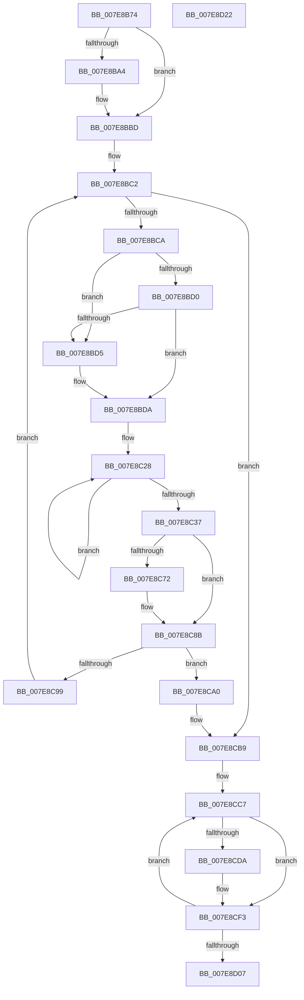

# CmpBuildMachineHiveCache

- RVA: `0x007E8B74`–`0x007E8D23` (길이 `431` bytes)
- VA: `0x00000001407E8B74`
- 실행 섹션: `PAGE`
- PDB 이름 있음: `예`; PDB Function 태그: `아니요`
- unwind 정보 RVA: `0x00091ECC`
- 디코드: `106`개 명령, `431/431` bytes 표시
- 미해석 바이트: `0` (있으면 어셈블리에 `.byte`로 보존)

> 이 문서는 커널 이미지의 기계어와 PDB 기호를 분석해 생성했습니다. 4번과 5번은 함수 원형과 자료형을 바이너리 사용 방식에서 추정한 C 해석이며 원본 소스 복구 결과는 아닙니다.

## 1. Dependencies

- 직접 호출 지점: **12**; 고유 호출 대상: **9**
- 직접 호출자로 확인된 함수: **1**
- RIP 상대 이미지 참조: **5**

### Outgoing calls
- `0x007E8B9B` → [IoCreateDriver](../AC/IoCreateDriver_function_00AC9D70.md) (function, `0x00AC9D70`)
- `0x007E8BB7` → [KeBugCheckEx](../../text/4F/KeBugCheckEx_function_004FD660.md) (function, `0x004FD660`)
- `0x007E8BFD` → [memset](../../text/6C/memset_function_006C6C40.md) (function, `0x006C6C40`)
- `0x007E8C0D` → [memset](../../text/6C/memset_function_006C6C40.md) (function, `0x006C6C40`)
- `0x007E8C28` → [CmSiEventTupleInitialize](../../text/49/CmSiEventTupleInitialize_function_00495EE0.md) (function, `0x00495EE0`)
- `0x007E8C55` → [CmpInitializeThreadInfo](../../text/3F/CmpInitializeThreadInfo_function_003FBE70.md) (function, `0x003FBE70`)
- `0x007E8C67` → [CmpHiveCacheCreateHiveEntry](../7F/CmpHiveCacheCreateHiveEntry_function_007F5A68.md) (function, `0x007F5A68`)
- `0x007E8C86` → [SetFailureLocation](../../text/46/SetFailureLocation_function_0046EF54.md) (function, `0x0046EF54`)
- `0x007E8C90` → [CmCleanupThreadInfo](../../text/41/CmCleanupThreadInfo_function_0041FD50.md) (function, `0x0041FD50`)
- `0x007E8CB3` → [KeBugCheckEx](../../text/4F/KeBugCheckEx_function_004FD660.md) (function, `0x004FD660`)
- `0x007E8CD1` → [CmpMachineHiveCachePopulateEntry](CmpMachineHiveCachePopulateEntry_function_007E8E88.md) (function, `0x007E8E88`)
- `0x007E8CEE` → [SetFailureLocation](../../text/46/SetFailureLocation_function_0046EF54.md) (function, `0x0046EF54`)

### Direct callers
- [CmInitSystem2](../../init/C6/CmInitSystem2_function_00C6FDD8.md) at `0x00C6FE4B`

### Static image references
- `0x007E8B8D` → RVA `0x007E8B60` (`CmHiveCacheDriverSetup`; read)
- `0x007E8B94` → RVA `0x00E09FF0` (`.data`; read)
- `0x007E8BDA` → RVA `0x00EF59C0` (`.data`; read)
- `0x007E8CB9` → RVA `0x00EF5B48` (`.data`; read)
- `0x007E8CC0` → RVA `0x00E098A0` (`.data`; read)

## 2. Other-region calls and transfers

- 다른 실행 섹션으로 향하는 call: **9**
  - `0x007E8BB7` → [KeBugCheckEx](../../text/4F/KeBugCheckEx_function_004FD660.md) (`PAGE` → `.text`)
  - `0x007E8BFD` → [memset](../../text/6C/memset_function_006C6C40.md) (`PAGE` → `.text`)
  - `0x007E8C0D` → [memset](../../text/6C/memset_function_006C6C40.md) (`PAGE` → `.text`)
  - `0x007E8C28` → [CmSiEventTupleInitialize](../../text/49/CmSiEventTupleInitialize_function_00495EE0.md) (`PAGE` → `.text`)
  - `0x007E8C55` → [CmpInitializeThreadInfo](../../text/3F/CmpInitializeThreadInfo_function_003FBE70.md) (`PAGE` → `.text`)
  - `0x007E8C86` → [SetFailureLocation](../../text/46/SetFailureLocation_function_0046EF54.md) (`PAGE` → `.text`)
  - `0x007E8C90` → [CmCleanupThreadInfo](../../text/41/CmCleanupThreadInfo_function_0041FD50.md) (`PAGE` → `.text`)
  - `0x007E8CB3` → [KeBugCheckEx](../../text/4F/KeBugCheckEx_function_004FD660.md) (`PAGE` → `.text`)
  - `0x007E8CEE` → [SetFailureLocation](../../text/46/SetFailureLocation_function_0046EF54.md) (`PAGE` → `.text`)
- 별도 외부 분기/꼬리 이동을 확인하지 못했습니다.

## 3. Assembly (complete function range)

```asm
007E8B74  48 8B C4                        mov rax, rsp
007E8B77  48 89 58 08                     mov qword ptr [rax + 8], rbx
007E8B7B  48 89 68 10                     mov qword ptr [rax + 0x10], rbp
007E8B7F  48 89 70 18                     mov qword ptr [rax + 0x18], rsi
007E8B83  48 89 78 20                     mov qword ptr [rax + 0x20], rdi
007E8B87  41 56                           push r14
007E8B89  48 83 EC 50                     sub rsp, 0x50
007E8B8D  48 8D 15 CC FF FF FF            lea rdx, [rip - 0x34]
007E8B94  48 8D 0D 55 14 62 00            lea rcx, [rip + 0x621455]
007E8B9B  E8 D0 11 2E 00                  call 0x140ac9d70
007E8BA0  85 C0                           test eax, eax
007E8BA2  79 19                           jns 0x1407e8bbd
007E8BA4  48 83 64 24 20 00               and qword ptr [rsp + 0x20], 0
007E8BAA  45 33 C9                        xor r9d, r9d
007E8BAD  4C 63 C0                        movsxd r8, eax
007E8BB0  41 8D 51 30                     lea edx, [r9 + 0x30]
007E8BB4  8D 4A 21                        lea ecx, [rdx + 0x21]
007E8BB7  E8 A4 4A D1 FF                  call 0x1404fd660
007E8BBC  CC                              int3
007E8BBD  33 DB                           xor ebx, ebx
007E8BBF  8D 73 07                        lea esi, [rbx + 7]
007E8BC2  3B DE                           cmp ebx, esi
007E8BC4  0F 83 EF 00 00 00               jae 0x1407e8cb9
007E8BCA  33 ED                           xor ebp, ebp
007E8BCC  85 DB                           test ebx, ebx
007E8BCE  74 05                           je 0x1407e8bd5
007E8BD0  83 FB 03                        cmp ebx, 3
007E8BD3  75 05                           jne 0x1407e8bda
007E8BD5  BD 01 00 00 00                  mov ebp, 1
007E8BDA  48 8D 0D DF CD 70 00            lea rcx, [rip + 0x70cddf]
007E8BE1  44 8B F3                        mov r14d, ebx
007E8BE4  49 69 FE 40 03 00 00            imul rdi, r14, 0x340
007E8BEB  33 D2                           xor edx, edx
007E8BED  41 B8 BC 01 00 00               mov r8d, 0x1bc
007E8BF3  48 03 F9                        add rdi, rcx
007E8BF6  48 8D 8F 84 01 00 00            lea rcx, [rdi + 0x184]
007E8BFD  E8 3E E0 ED FF                  call 0x1406c6c40
007E8C02  33 D2                           xor edx, edx
007E8C04  41 B8 80 01 00 00               mov r8d, 0x180
007E8C0A  48 8B CF                        mov rcx, rdi
007E8C0D  E8 2E E0 ED FF                  call 0x1406c6c40
007E8C12  48 8D 8F D0 00 00 00            lea rcx, [rdi + 0xd0]
007E8C19  C7 87 78 01 00 00 01 00 00 00   mov dword ptr [rdi + 0x178], 1
007E8C23  B8 06 00 00 00                  mov eax, 6
007E8C28  E8 B3 D2 CA FF                  call 0x140495ee0
007E8C2D  48 83 C1 10                     add rcx, 0x10
007E8C31  48 83 E8 01                     sub rax, 1
007E8C35  75 F1                           jne 0x1407e8c28
007E8C37  0F 57 C0                        xorps xmm0, xmm0
007E8C3A  89 AF 50 01 00 00               mov dword ptr [rdi + 0x150], ebp
007E8C40  48 8D 4C 24 30                  lea rcx, [rsp + 0x30]
007E8C45  89 9F 80 01 00 00               mov dword ptr [rdi + 0x180], ebx
007E8C4B  0F 11 44 24 30                  movups xmmword ptr [rsp + 0x30], xmm0
007E8C50  48 89 44 24 40                  mov qword ptr [rsp + 0x40], rax
007E8C55  E8 16 32 C1 FF                  call 0x1403fbe70
007E8C5A  48 8D AF 88 01 00 00            lea rbp, [rdi + 0x188]
007E8C61  48 8B CF                        mov rcx, rdi
007E8C64  48 8B D5                        mov rdx, rbp
007E8C67  E8 FC CD 00 00                  call 0x1407f5a68
007E8C6C  8B F8                           mov edi, eax
007E8C6E  85 C0                           test eax, eax
007E8C70  79 19                           jns 0x1407e8c8b
007E8C72  33 D2                           xor edx, edx
007E8C74  C7 44 24 20 30 00 00 00         mov dword ptr [rsp + 0x20], 0x30
007E8C7C  44 8B C8                        mov r9d, eax
007E8C7F  48 8B CD                        mov rcx, rbp
007E8C82  44 8D 42 32                     lea r8d, [rdx + 0x32]
007E8C86  E8 C9 62 C8 FF                  call 0x14046ef54
007E8C8B  48 8D 4C 24 30                  lea rcx, [rsp + 0x30]
007E8C90  E8 BB 70 C3 FF                  call 0x14041fd50
007E8C95  85 FF                           test edi, edi
007E8C97  78 07                           js 0x1407e8ca0
007E8C99  FF C3                           inc ebx
007E8C9B  E9 22 FF FF FF                  jmp 0x1407e8bc2
007E8CA0  48 83 64 24 20 00               and qword ptr [rsp + 0x20], 0
007E8CA6  45 33 C9                        xor r9d, r9d
007E8CA9  4D 8B C6                        mov r8, r14
007E8CAC  41 8D 51 29                     lea edx, [r9 + 0x29]
007E8CB0  8D 4A 28                        lea ecx, [rdx + 0x28]
007E8CB3  E8 A8 49 D1 FF                  call 0x1404fd660
007E8CB8  CC                              int3
007E8CB9  48 8D 1D 88 CE 70 00            lea rbx, [rip + 0x70ce88]
007E8CC0  48 8D 3D D9 0B 62 00            lea rdi, [rip + 0x620bd9]
007E8CC7  48 8D 8B 78 FE FF FF            lea rcx, [rbx - 0x188]
007E8CCE  48 8B D7                        mov rdx, rdi
007E8CD1  E8 B2 01 00 00                  call 0x1407e8e88
007E8CD6  85 C0                           test eax, eax
007E8CD8  79 19                           jns 0x1407e8cf3
007E8CDA  33 D2                           xor edx, edx
007E8CDC  C7 44 24 20 10 00 00 00         mov dword ptr [rsp + 0x20], 0x10
007E8CE4  44 8B C8                        mov r9d, eax
007E8CE7  48 8B CB                        mov rcx, rbx
007E8CEA  44 8D 42 35                     lea r8d, [rdx + 0x35]
007E8CEE  E8 61 62 C8 FF                  call 0x14046ef54
007E8CF3  48 81 C7 B8 00 00 00            add rdi, 0xb8
007E8CFA  48 81 C3 40 03 00 00            add rbx, 0x340
007E8D01  48 83 EE 01                     sub rsi, 1
007E8D05  75 C0                           jne 0x1407e8cc7
007E8D07  48 8B 5C 24 60                  mov rbx, qword ptr [rsp + 0x60]
007E8D0C  48 8B 6C 24 68                  mov rbp, qword ptr [rsp + 0x68]
007E8D11  48 8B 74 24 70                  mov rsi, qword ptr [rsp + 0x70]
007E8D16  48 8B 7C 24 78                  mov rdi, qword ptr [rsp + 0x78]
007E8D1B  48 83 C4 50                     add rsp, 0x50
007E8D1F  41 5E                           pop r14
007E8D21  C3                              ret
007E8D22  CC                              int3
```

## 4. C-style interpretation (structured pseudocode)

```c
__int64 __fastcall CmpBuildMachineHiveCache(__int64 a1, __int64 a2, __int64 a3, int a4)
{
    __int64 result;
    __int64 v_rbp;
    __int64 v_rbx;
    __int64 v_rdi;
    __int64 v_rsi;
    __int64 v_rsp;
    unsigned __int64 v_stack_m18;
    unsigned __int64 v_stack_m28;
    unsigned __int64 v_stack_m38;
    unsigned __int64 v_stack_p10;
    unsigned __int64 v_stack_p18;
    unsigned __int64 v_stack_p20;
    unsigned __int64 v_stack_p8;

    *(unsigned __int64 *)(v_rsp + 8) = v_rbx;
    *(unsigned __int64 *)(v_rsp + 16) = v_rbp;
    *(unsigned __int64 *)(v_rsp + 24) = v_rsi;
    *(unsigned __int64 *)(v_rsp + 32) = v_rdi;
    v_rsp = (v_rsp) - (80);
    result = IoCreateDriver(v_rip + 6427733, v_rip - 52, a3, a4);
    if (sign_flag) {
        a4 = 0;
        a3 = (int)((unsigned int)(result));
        a2 = a4 + 48;
        a1 = a2 + 33;
        result = KeBugCheckEx(a1, a2, a3, a4);
    }
    v_rbx = 0;
loc_007E8BC2:
    if (0 >= ((unsigned int)(v_rbx + 7))) goto loc_007E8CB9;
    v_rbp = 0;
    if (0 == 0) goto loc_007E8BD5;
    if (0 == 3) {
        v_rbp = 1;
    }
    v_rdi = (v_rdi) * (0);
    a2 = 0;
    v_rdi = (v_rdi) + (v_rip + 7392735);
    result = memset(v_rdi + 388, a2, 444, a4);
    a2 = 0;
    result = memset(v_rdi, a2, 384, a4);
    *(unsigned int *)(v_rdi + 376) = 1;
loc_007E8C28:
    result = CmSiEventTupleInitialize(v_rdi + 208, a2, 384, a4);
    a1 = (v_rdi + 208) + (16);
    result = (result) - (1);
    if (condition_is_not_equal) goto loc_007E8C28;
    *(unsigned int *)(v_rdi + 336) = (unsigned int)(v_rbp);
    *(unsigned int *)(v_rdi + 384) = 0;
    v_stack_m28 = v_xmm0;
    v_stack_m18 = result;
    result = CmpInitializeThreadInfo(v_stack_m28, a2, 384, a4);
    result = CmpHiveCacheCreateHiveEntry(v_rdi, v_rdi + 392, 384, a4);
    if (sign_flag) {
        a2 = 0;
        v_stack_m38 = 48;
        a4 = (unsigned int)(result);
        a1 = v_rdi + 392;
        a3 = a2 + 50;
        result = SetFailureLocation(a1, a2, a3, a4);
    }
    result = CmCleanupThreadInfo(v_stack_m28, a2, a3, a4);
    if (sign_flag) goto loc_007E8CA0;
    v_rbx = (unsigned int)((v_rbx) + 1);
    goto loc_007E8BC2;
loc_007E8CA0:
    a4 = 0;
    result = KeBugCheckEx(a4 + 41 + 40, a4 + 41, 0, a4);
loc_007E8CB9:
loc_007E8CC7:
    result = CmpMachineHiveCachePopulateEntry(v_rip + 7392904 - 392, v_rip + 6425561, 0, a4);
    if (sign_flag) {
        a2 = 0;
        v_stack_m38 = 16;
        a4 = (unsigned int)(result);
        a1 = v_rip + 7392904;
        a3 = a2 + 53;
        result = SetFailureLocation(a1, a2, a3, a4);
    }
    v_rdi = (v_rip + 6425561) + (184);
    v_rbx = (v_rip + 7392904) + (832);
    v_rsi = (v_rbx + 7) - (1);
    if (condition_is_not_equal) goto loc_007E8CC7;
    v_rsp = (v_rsp) + (80);
    return result;
}
```

## 5. (Beta) C Style

```c
int64_t CmpBuildMachineHiveCache(int64_t Arg1, int64_t Arg2, int64_t Arg3, int32_t Arg4)
{
    int64_t result;
    int64_t local_rbp;
    int64_t local_rbx;
    int64_t local_rdi;
    int64_t local_rsi;
    int64_t local_rsp;
    uint64_t v_stack_m18;
    uint64_t v_stack_m28;
    uint64_t v_stack_m38;
    uint64_t v_stack_p10;
    uint64_t v_stack_p18;
    uint64_t v_stack_p20;
    uint64_t v_stack_p8;

    *(uint64_t *)(local_rsp + 0x8) = local_rbx;
    *(uint64_t *)(local_rsp + 0x10) = local_rbp;
    *(uint64_t *)(local_rsp + 0x18) = local_rsi;
    *(uint64_t *)(local_rsp + 0x20) = local_rdi;
    local_rsp = (local_rsp) - (80);
    result = IoCreateDriver(v_rip + 6427733, v_rip - 52, Arg3, Arg4);
    if (sign_flag) {
        Arg4 = 0;
        Arg3 = (int32_t)((uint32_t)(result));
        Arg2 = Arg4 + 48;
        Arg1 = Arg2 + 33;
        result = KeBugCheckEx(Arg1, Arg2, Arg3, Arg4);
    }
    local_rbx = 0;
loc_007E8BC2:
    if (0 >= ((uint32_t)(local_rbx + 7))) goto loc_007E8CB9;
    local_rbp = 0;
    if (0 == 0) goto loc_007E8BD5;
    if (0 == 3) {
        local_rbp = 1;
    }
    local_rdi = (local_rdi) * (0);
    Arg2 = 0;
    local_rdi = (local_rdi) + (v_rip + 7392735);
    result = memset(local_rdi + 388, Arg2, 444, Arg4);
    Arg2 = 0;
    result = memset(local_rdi, Arg2, 384, Arg4);
    *(uint32_t *)(local_rdi + 0x178) = 1;
loc_007E8C28:
    result = CmSiEventTupleInitialize(local_rdi + 208, Arg2, 384, Arg4);
    Arg1 = (local_rdi + 208) + (16);
    result = (result) - (1);
    if (condition_is_not_equal) goto loc_007E8C28;
    *(uint32_t *)(local_rdi + 0x150) = (uint32_t)(local_rbp);
    *(uint32_t *)(local_rdi + 0x180) = 0;
    v_stack_m28 = v_xmm0;
    v_stack_m18 = result;
    result = CmpInitializeThreadInfo(v_stack_m28, Arg2, 384, Arg4);
    result = CmpHiveCacheCreateHiveEntry(local_rdi, local_rdi + 392, 384, Arg4);
    if (sign_flag) {
        Arg2 = 0;
        v_stack_m38 = 48;
        Arg4 = (uint32_t)(result);
        Arg1 = local_rdi + 392;
        Arg3 = Arg2 + 50;
        result = SetFailureLocation(Arg1, Arg2, Arg3, Arg4);
    }
    result = CmCleanupThreadInfo(v_stack_m28, Arg2, Arg3, Arg4);
    if (sign_flag) goto loc_007E8CA0;
    local_rbx = (uint32_t)((local_rbx) + 1);
    goto loc_007E8BC2;
loc_007E8CA0:
    Arg4 = 0;
    result = KeBugCheckEx(Arg4 + 41 + 40, Arg4 + 41, 0, Arg4);
loc_007E8CB9:
loc_007E8CC7:
    result = CmpMachineHiveCachePopulateEntry(v_rip + 7392904 - 392, v_rip + 6425561, 0, Arg4);
    if (sign_flag) {
        Arg2 = 0;
        v_stack_m38 = 16;
        Arg4 = (uint32_t)(result);
        Arg1 = v_rip + 7392904;
        Arg3 = Arg2 + 53;
        result = SetFailureLocation(Arg1, Arg2, Arg3, Arg4);
    }
    local_rdi = (v_rip + 6425561) + (184);
    local_rbx = (v_rip + 7392904) + (832);
    local_rsi = (local_rbx + 7) - (1);
    if (condition_is_not_equal) goto loc_007E8CC7;
    local_rsp = (local_rsp) + (80);
    return result;
}
```

## 6. Execution-region graph

[열기: 2D/3D 그래프와 함수 탐색 컨트롤 패널](../../../control-panel.html?section=page&rva=0x007E8B74&view=graph)

- 2D 그래프는 위에서 아래로 흐르고, 3D 그래프는 빈 공간을 드래그해 회전합니다. Shift+드래그는 이동, 휠은 확대·축소, 함수 노드 선택은 대상 보고서 이동입니다.

### Static fallback


