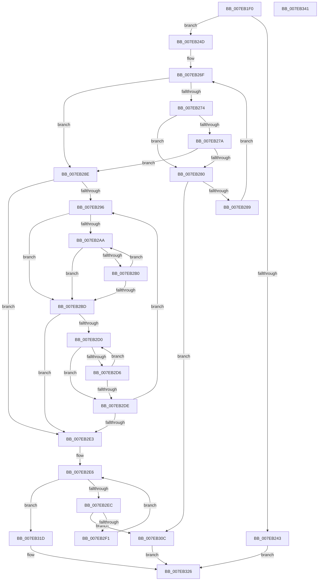

# CmpBuildVirtualReplicationStack

- RVA: `0x007EB1F0`–`0x007EB342` (길이 `338` bytes)
- VA: `0x00000001407EB1F0`
- 실행 섹션: `PAGE`
- PDB 이름 있음: `예`; PDB Function 태그: `아니요`
- unwind 정보 RVA: `0x0005D7BC`
- 디코드: `99`개 명령, `338/338` bytes 표시
- 미해석 바이트: `0` (있으면 어셈블리에 `.byte`로 보존)

> 이 문서는 커널 이미지의 기계어와 PDB 기호를 분석해 생성했습니다. 4번과 5번은 함수 원형과 자료형을 바이너리 사용 방식에서 추정한 C 해석이며 원본 소스 복구 결과는 아닙니다.

## 1. Dependencies

- 직접 호출 지점: **2**; 고유 호출 대상: **2**
- 직접 호출자로 확인된 함수: **1**
- RIP 상대 이미지 참조: **0**

### Outgoing calls
- `0x007EB236` → [ExAllocatePool2](../../poolcode/B8/ExAllocatePool2_function_00B820F0.md) (function, `0x00B820F0`)
- `0x007EB311` → [ExFreePoolWithTag](../../poolcode/B8/ExFreePoolWithTag_function_00B82870.md) (function, `0x00B82870`)

### Direct callers
- [CmpReplicateKeyToVirtual](CmpReplicateKeyToVirtual_function_007EBAEC.md) at `0x007EBC02`

### Static image references
- 디코드된 RIP-relative 메모리 참조가 없습니다.

## 2. Other-region calls and transfers

- 다른 실행 섹션으로 향하는 call: **2**
  - `0x007EB236` → [ExAllocatePool2](../../poolcode/B8/ExAllocatePool2_function_00B820F0.md) (`PAGE` → `POOLCODE`)
  - `0x007EB311` → [ExFreePoolWithTag](../../poolcode/B8/ExFreePoolWithTag_function_00B82870.md) (`PAGE` → `POOLCODE`)
- 별도 외부 분기/꼬리 이동을 확인하지 못했습니다.

## 3. Assembly (complete function range)

```asm
007EB1F0  48 8B C4                        mov rax, rsp
007EB1F3  48 89 58 08                     mov qword ptr [rax + 8], rbx
007EB1F7  48 89 68 10                     mov qword ptr [rax + 0x10], rbp
007EB1FB  48 89 70 18                     mov qword ptr [rax + 0x18], rsi
007EB1FF  48 89 78 20                     mov qword ptr [rax + 0x20], rdi
007EB203  41 56                           push r14
007EB205  48 83 EC 30                     sub rsp, 0x30
007EB209  8B 41 08                        mov eax, dword ptr [rcx + 8]
007EB20C  48 8B FA                        mov rdi, rdx
007EB20F  C1 E8 15                        shr eax, 0x15
007EB212  4D 8B F0                        mov r14, r8
007EB215  25 FF 03 00 00                  and eax, 0x3ff
007EB21A  48 8B D9                        mov rbx, rcx
007EB21D  33 ED                           xor ebp, ebp
007EB21F  B9 00 01 00 00                  mov ecx, 0x100
007EB224  41 B8 43 4D 20 20               mov r8d, 0x20204d43
007EB22A  49 89 29                        mov qword ptr [r9], rbp
007EB22D  49 8B F1                        mov rsi, r9
007EB230  8D 14 40                        lea edx, [rax + rax*2]
007EB233  C1 E2 04                        shl edx, 4
007EB236  E8 B5 6E 39 00                  call 0x140b820f0
007EB23B  4C 8B C8                        mov r9, rax
007EB23E  48 85 C0                        test rax, rax
007EB241  75 0A                           jne 0x1407eb24d
007EB243  B8 9A 00 00 C0                  mov eax, 0xc000009a
007EB248  E9 D9 00 00 00                  jmp 0x1407eb326
007EB24D  0F 10 07                        movups xmm0, xmmword ptr [rdi]
007EB250  41 B8 04 00 00 00               mov r8d, 4
007EB256  BF FE FF 00 00                  mov edi, 0xfffe
007EB25B  F3 0F 7F 44 24 20               movdqu xmmword ptr [rsp + 0x20], xmm0
007EB261  48 8B 54 24 28                  mov rdx, qword ptr [rsp + 0x28]
007EB266  0F B7 4C 24 20                  movzx ecx, word ptr [rsp + 0x20]
007EB26B  45 8D 58 FE                     lea r11d, [r8 - 2]
007EB26F  45 85 C0                        test r8d, r8d
007EB272  74 1A                           je 0x1407eb28e
007EB274  66 83 3A 5C                     cmp word ptr [rdx], 0x5c
007EB278  75 06                           jne 0x1407eb280
007EB27A  41 83 C0 FF                     add r8d, -1
007EB27E  74 0E                           je 0x1407eb28e
007EB280  66 03 CF                        add cx, di
007EB283  0F 84 83 00 00 00               je 0x1407eb30c
007EB289  49 03 D3                        add rdx, r11
007EB28C  EB E1                           jmp 0x1407eb26f
007EB28E  49 03 D3                        add rdx, r11
007EB291  66 03 CF                        add cx, di
007EB294  74 4D                           je 0x1407eb2e3
007EB296  41 8B C0                        mov eax, r8d
007EB299  4C 8D 14 40                     lea r10, [rax + rax*2]
007EB29D  4D 03 D2                        add r10, r10
007EB2A0  4B 89 54 D1 08                  mov qword ptr [r9 + r10*8 + 8], rdx
007EB2A5  66 85 C9                        test cx, cx
007EB2A8  74 13                           je 0x1407eb2bd
007EB2AA  66 83 3A 5C                     cmp word ptr [rdx], 0x5c
007EB2AE  74 0D                           je 0x1407eb2bd
007EB2B0  66 47 01 1C D1                  add word ptr [r9 + r10*8], r11w
007EB2B5  49 03 D3                        add rdx, r11
007EB2B8  66 03 CF                        add cx, di
007EB2BB  75 ED                           jne 0x1407eb2aa
007EB2BD  43 0F B7 04 D1                  movzx eax, word ptr [r9 + r10*8]
007EB2C2  41 FF C0                        inc r8d
007EB2C5  66 43 89 44 D1 02               mov word ptr [r9 + r10*8 + 2], ax
007EB2CB  66 85 C9                        test cx, cx
007EB2CE  74 13                           je 0x1407eb2e3
007EB2D0  66 83 3A 5C                     cmp word ptr [rdx], 0x5c
007EB2D4  75 08                           jne 0x1407eb2de
007EB2D6  49 03 D3                        add rdx, r11
007EB2D9  66 03 CF                        add cx, di
007EB2DC  75 F2                           jne 0x1407eb2d0
007EB2DE  66 85 C9                        test cx, cx
007EB2E1  75 B3                           jne 0x1407eb296
007EB2E3  45 89 06                        mov dword ptr [r14], r8d
007EB2E6  41 83 F8 01                     cmp r8d, 1
007EB2EA  76 31                           jbe 0x1407eb31d
007EB2EC  48 85 DB                        test rbx, rbx
007EB2EF  74 1B                           je 0x1407eb30c
007EB2F1  8B 53 28                        mov edx, dword ptr [rbx + 0x28]
007EB2F4  41 FF C8                        dec r8d
007EB2F7  C1 EA 1F                        shr edx, 0x1f
007EB2FA  4B 8D 0C 40                     lea rcx, [r8 + r8*2]
007EB2FE  48 03 C9                        add rcx, rcx
007EB301  41 89 54 C9 28                  mov dword ptr [r9 + rcx*8 + 0x28], edx
007EB306  48 8B 5B 48                     mov rbx, qword ptr [rbx + 0x48]
007EB30A  EB DA                           jmp 0x1407eb2e6
007EB30C  33 D2                           xor edx, edx
007EB30E  49 8B C9                        mov rcx, r9
007EB311  E8 5A 75 39 00                  call 0x140b82870
007EB316  B8 0D 00 00 C0                  mov eax, 0xc000000d
007EB31B  EB 09                           jmp 0x1407eb326
007EB31D  41 89 69 28                     mov dword ptr [r9 + 0x28], ebp
007EB321  33 C0                           xor eax, eax
007EB323  4C 89 0E                        mov qword ptr [rsi], r9
007EB326  48 8B 5C 24 40                  mov rbx, qword ptr [rsp + 0x40]
007EB32B  48 8B 6C 24 48                  mov rbp, qword ptr [rsp + 0x48]
007EB330  48 8B 74 24 50                  mov rsi, qword ptr [rsp + 0x50]
007EB335  48 8B 7C 24 58                  mov rdi, qword ptr [rsp + 0x58]
007EB33A  48 83 C4 30                     add rsp, 0x30
007EB33E  41 5E                           pop r14
007EB340  C3                              ret
007EB341  CC                              int3
```

## 4. C-style interpretation (structured pseudocode)

```c
__int64 __fastcall CmpBuildVirtualReplicationStack(__int64 a1, __int64 a2, __int64 a3, __int64 a4)
{
    __int64 result;
    __int64 v_r10;
    __int64 v_rbp;
    __int64 v_rsp;
    unsigned __int64 v_stack_m10;
    unsigned __int64 v_stack_m18;
    unsigned __int64 v_stack_p10;
    unsigned __int64 v_stack_p18;
    unsigned __int64 v_stack_p20;
    unsigned __int64 v_stack_p8;

    *(unsigned __int64 *)(v_rsp + 8) = v_rbx;
    *(unsigned __int64 *)(v_rsp + 16) = v_rbp;
    *(unsigned __int64 *)(v_rsp + 24) = v_rsi;
    *(unsigned __int64 *)(v_rsp + 32) = v_rdi;
    v_rsp = (v_rsp) - (48);
    result = (unsigned int)(((unsigned int)(*(unsigned int *)(a1 + 8))) >> (21));
    result = (unsigned int)((result) & (0x3FFULL));
    v_rbp = 0;
    *(unsigned __int64 *)(a4) = 0;
    a2 = (unsigned int)((result + result * 2) << (4));
    result = ExAllocatePool2(256, a2, (unsigned int)(0x20204D43ULL), a4);
    if (result != 0) goto loc_007EB24D;
    goto loc_007EB326;
loc_007EB24D:
    v_stack_m18 = v_xmm0;
loc_007EB26F:
    if (4 == 0) goto loc_007EB28E;
    if ((*(unsigned __int16 *)(v_stack_m10)) != 92) goto loc_007EB280;
    a3 = (unsigned int)((4) + (-1));
    if (condition_is_equal) goto loc_007EB28E;
loc_007EB280:
    a1 = (unsigned __int16)((v_stack_m18) + ((unsigned __int16)((unsigned int)(0xFFFEULL))));
    if (condition_is_equal) goto loc_007EB30C;
    a2 = (v_stack_m10) + (4 - 2);
    goto loc_007EB26F;
loc_007EB28E:
    a2 = (a2) + (4 - 2);
    a1 = (unsigned __int16)((a1) + ((unsigned __int16)((unsigned int)(0xFFFEULL))));
    if (condition_is_equal) goto loc_007EB2E3;
loc_007EB296:
    v_r10 = ((unsigned int)((unsigned int)(a3)) + (unsigned int)((unsigned int)(a3)) * 2) + ((unsigned int)((unsigned int)(a3)) + (unsigned int)((unsigned int)(a3)) * 2);
    *(unsigned __int64 *)(result + v_r10 * 8 + 8) = a2;
    if ((unsigned __int16)(a1) == 0) goto loc_007EB2BD;
loc_007EB2AA:
    if ((*(unsigned __int16 *)(a2)) == 92) goto loc_007EB2BD;
    a2 = (a2) + (4 - 2);
    a1 = (unsigned __int16)((a1) + ((unsigned __int16)((unsigned int)(0xFFFEULL))));
    if (condition_is_not_equal) goto loc_007EB2AA;
loc_007EB2BD:
    a3 = (unsigned int)((a3) + 1);
    *(unsigned __int16 *)(result + v_r10 * 8 + 2) = (unsigned __int16)(*(unsigned __int16 *)(result + v_r10 * 8));
    if ((unsigned __int16)(a1) == 0) goto loc_007EB2E3;
loc_007EB2D0:
    if ((*(unsigned __int16 *)(a2)) != 92) goto loc_007EB2DE;
    a2 = (a2) + (4 - 2);
    a1 = (unsigned __int16)((a1) + ((unsigned __int16)((unsigned int)(0xFFFEULL))));
    if (condition_is_not_equal) goto loc_007EB2D0;
loc_007EB2DE:
    if ((unsigned __int16)(a1) != 0) goto loc_007EB296;
loc_007EB2E3:
    *(unsigned int *)(a3) = (unsigned int)(a3);
loc_007EB2E6:
    if (((unsigned int)(a3)) <= 1) goto loc_007EB31D;
    if (a1 == 0) goto loc_007EB30C;
    a3 = (unsigned int)((a3) - 1);
    a2 = (unsigned int)(((unsigned int)(*(unsigned int *)(a1 + 40))) >> (31));
    a1 = (a3 + a3 * 2) + (a3 + a3 * 2);
    *(unsigned int *)(result + a1 * 8 + 40) = (unsigned int)(a2);
    goto loc_007EB2E6;
loc_007EB30C:
    a2 = 0;
    result = ExFreePoolWithTag(result, a2, a3, result);
    goto loc_007EB326;
loc_007EB31D:
    *(unsigned int *)(result + 40) = 0;
    result = 0;
    *(unsigned __int64 *)(a4) = 0;
loc_007EB326:
    v_rsp = (v_rsp) + (48);
    return result;
}
```

## 5. (Beta) C Style

```c
int64_t CmpBuildVirtualReplicationStack(void *Arg1, void *Arg2, void *Arg3, void *Arg4)
{
    uint8_t *arg1 = (uint8_t *)Arg1;
    uint8_t *arg2 = (uint8_t *)Arg2;
    uint8_t *arg3 = (uint8_t *)Arg3;
    uint8_t *arg4 = (uint8_t *)Arg4;

    int64_t result;
    int64_t local_r10;
    int64_t local_rbp;
    int64_t local_rsp;
    uint64_t v_stack_m10;
    uint64_t v_stack_m18;
    uint64_t v_stack_p10;
    uint64_t v_stack_p18;
    uint64_t v_stack_p20;
    uint64_t v_stack_p8;

    *(uint64_t *)(local_rsp + 0x8) = local_rbx;
    *(uint64_t *)(local_rsp + 0x10) = local_rbp;
    *(uint64_t *)(local_rsp + 0x18) = local_rsi;
    *(uint64_t *)(local_rsp + 0x20) = local_rdi;
    local_rsp = (local_rsp) - (48);
    result = (uint32_t)(((uint32_t)(*(uint32_t *)(arg1 + 0x8))) >> (21));
    result = (uint32_t)((result) & (0x3FFULL));
    local_rbp = 0;
    *(uint64_t *)(arg4) = 0;
    Arg2 = (uint32_t)((result + result * 2) << (4));
    result = ExAllocatePool2(256, Arg2, (uint32_t)(0x20204D43ULL), Arg4);
    if (result != 0) goto loc_007EB24D;
    goto loc_007EB326;
loc_007EB24D:
    v_stack_m18 = v_xmm0;
loc_007EB26F:
    if (4 == 0) goto loc_007EB28E;
    if ((*(uint16_t *)(v_stack_m10)) != 92) goto loc_007EB280;
    Arg3 = (uint32_t)((4) + (-1));
    if (condition_is_equal) goto loc_007EB28E;
loc_007EB280:
    Arg1 = (uint16_t)((v_stack_m18) + ((uint16_t)((uint32_t)(0xFFFEULL))));
    if (condition_is_equal) goto loc_007EB30C;
    Arg2 = (v_stack_m10) + (4 - 2);
    goto loc_007EB26F;
loc_007EB28E:
    Arg2 = (Arg2) + (4 - 2);
    Arg1 = (uint16_t)((Arg1) + ((uint16_t)((uint32_t)(0xFFFEULL))));
    if (condition_is_equal) goto loc_007EB2E3;
loc_007EB296:
    local_r10 = ((uint32_t)((uint32_t)(Arg3)) + (uint32_t)((uint32_t)(Arg3)) * 2) + ((uint32_t)((uint32_t)(Arg3)) + (uint32_t)((uint32_t)(Arg3)) * 2);
    *(void **)(result + local_r10 * 8 + 0x8) = Arg2;
    if ((uint16_t)(Arg1) == 0) goto loc_007EB2BD;
loc_007EB2AA:
    if ((*(uint16_t *)(arg2)) == 92) goto loc_007EB2BD;
    Arg2 = (Arg2) + (4 - 2);
    Arg1 = (uint16_t)((Arg1) + ((uint16_t)((uint32_t)(0xFFFEULL))));
    if (condition_is_not_equal) goto loc_007EB2AA;
loc_007EB2BD:
    Arg3 = (uint32_t)((Arg3) + 1);
    *(uint16_t *)(result + local_r10 * 8 + 0x2) = (uint16_t)(*(uint16_t *)(result + local_r10 * 8));
    if ((uint16_t)(Arg1) == 0) goto loc_007EB2E3;
loc_007EB2D0:
    if ((*(uint16_t *)(arg2)) != 92) goto loc_007EB2DE;
    Arg2 = (Arg2) + (4 - 2);
    Arg1 = (uint16_t)((Arg1) + ((uint16_t)((uint32_t)(0xFFFEULL))));
    if (condition_is_not_equal) goto loc_007EB2D0;
loc_007EB2DE:
    if ((uint16_t)(Arg1) != 0) goto loc_007EB296;
loc_007EB2E3:
    *(uint32_t *)(arg3) = (uint32_t)(Arg3);
loc_007EB2E6:
    if (((uint32_t)(Arg3)) <= 1) goto loc_007EB31D;
    if (Arg1 == NULL) goto loc_007EB30C;
    Arg3 = (uint32_t)((Arg3) - 1);
    Arg2 = (uint32_t)(((uint32_t)(*(uint32_t *)(arg1 + 0x28))) >> (31));
    Arg1 = (Arg3 + Arg3 * 2) + (Arg3 + Arg3 * 2);
    *(uint32_t *)(result + arg1 * 8 + 0x28) = (uint32_t)(Arg2);
    goto loc_007EB2E6;
loc_007EB30C:
    Arg2 = 0;
    result = ExFreePoolWithTag(result, Arg2, Arg3, result);
    goto loc_007EB326;
loc_007EB31D:
    *(uint32_t *)(result + 0x28) = 0;
    result = 0;
    *(uint64_t *)(arg4) = 0;
loc_007EB326:
    local_rsp = (local_rsp) + (48);
    return result;
}
```

### 관측된 메모리 오프셋

구조체 형식이 확인되지 않은 접근은 인자 기준의 오프셋으로만 기록했습니다.

| 기준 인자 | 오프셋 표현 | 폭 (bit) | 접근 |
|---|---:|---:|---|
| `Arg1` | `+ 0x8` | `32` | `R` |
| `Arg2` | `+ 0x0` | `128` | `R` |
| `Arg3` | `+ 0x0` | `32` | `W` |
| `Arg4` | `+ 0x0` | `64` | `W` |

## 6. Execution-region graph

[열기: 2D/3D 그래프와 함수 탐색 컨트롤 패널](../../../control-panel.html?section=page&rva=0x007EB1F0&view=graph)

- 2D 그래프는 위에서 아래로 흐르고, 3D 그래프는 빈 공간을 드래그해 회전합니다. Shift+드래그는 이동, 휠은 확대·축소, 함수 노드 선택은 대상 보고서 이동입니다.

### Static fallback


