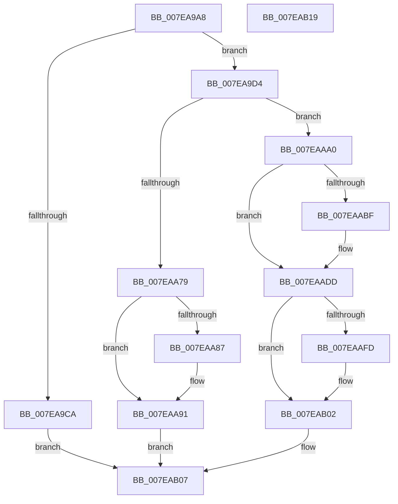

# CmpCloneToUnbackedKcb

- RVA: `0x007EA9A8`–`0x007EAB1A` (길이 `370` bytes)
- VA: `0x00000001407EA9A8`
- 실행 섹션: `PAGE`
- PDB 이름 있음: `예`; PDB Function 태그: `아니요`
- unwind 정보 RVA: `0x00060BC4`
- 디코드: `95`개 명령, `370/370` bytes 표시
- 미해석 바이트: `0` (있으면 어셈블리에 `.byte`로 보존)

> 이 문서는 커널 이미지의 기계어와 PDB 기호를 분석해 생성했습니다. 4번과 5번은 함수 원형과 자료형을 바이너리 사용 방식에서 추정한 C 해석이며 원본 소스 복구 결과는 아닙니다.

## 1. Dependencies

- 직접 호출 지점: **4**; 고유 호출 대상: **4**
- 직접 호출자로 확인된 함수: **1**
- RIP 상대 이미지 참조: **0**

### Outgoing calls
- `0x007EA9BD` → [CmpAllocateKeyControlBlock](../9E/CmpAllocateKeyControlBlock_function_009EB5A0.md) (function, `0x009EB5A0`)
- `0x007EAA87` → [CmpDereferenceNameControlBlockWithLock](../86/CmpDereferenceNameControlBlockWithLock_function_00862840.md) (function, `0x00862840`)
- `0x007EAA99` → [CmpFreeKeyControlBlock](../9D/CmpFreeKeyControlBlock_function_009DB7B0.md) (function, `0x009DB7B0`)
- `0x007EAAD0` → [CmpReferenceKeyControlBlockUnsafe](../87/CmpReferenceKeyControlBlockUnsafe_function_00874DA0.md) (function, `0x00874DA0`)

### Direct callers
- [CmpPrepareDiscardReplacePost](../7F/CmpPrepareDiscardReplacePost_function_007F16B0.md) at `0x007F16DF`

### Static image references
- 디코드된 RIP-relative 메모리 참조가 없습니다.

## 2. Other-region calls and transfers

- 다른 실행 섹션으로 향하는 call: **0**
- 별도 외부 분기/꼬리 이동을 확인하지 못했습니다.

## 3. Assembly (complete function range)

```asm
007EA9A8  48 89 5C 24 08                  mov qword ptr [rsp + 8], rbx
007EA9AD  48 89 74 24 10                  mov qword ptr [rsp + 0x10], rsi
007EA9B2  57                              push rdi
007EA9B3  48 83 EC 20                     sub rsp, 0x20
007EA9B7  48 8B F2                        mov rsi, rdx
007EA9BA  48 8B F9                        mov rdi, rcx
007EA9BD  E8 DE 0B 20 00                  call 0x1409eb5a0
007EA9C2  48 8B D8                        mov rbx, rax
007EA9C5  48 85 C0                        test rax, rax
007EA9C8  75 0A                           jne 0x1407ea9d4
007EA9CA  BF 9A 00 00 C0                  mov edi, 0xc000009a
007EA9CF  E9 33 01 00 00                  jmp 0x1407eab07
007EA9D4  48 83 C0 78                     add rax, 0x78
007EA9D8  83 C9 FF                        or ecx, 0xffffffff
007EA9DB  0F 57 C0                        xorps xmm0, xmm0
007EA9DE  48 89 40 08                     mov qword ptr [rax + 8], rax
007EA9E2  48 89 00                        mov qword ptr [rax], rax
007EA9E5  0F 11 83 88 00 00 00            movups xmmword ptr [rbx + 0x88], xmm0
007EA9EC  0F 11 83 98 00 00 00            movups xmmword ptr [rbx + 0x98], xmm0
007EA9F3  48 C7 03 01 00 00 00            mov qword ptr [rbx], 1
007EA9FA  48 8B 47 20                     mov rax, qword ptr [rdi + 0x20]
007EA9FE  48 89 43 20                     mov qword ptr [rbx + 0x20], rax
007EAA02  89 4B 28                        mov dword ptr [rbx + 0x28], ecx
007EAA05  8B 47 10                        mov eax, dword ptr [rdi + 0x10]
007EAA08  48 83 63 30 00                  and qword ptr [rbx + 0x30], 0
007EAA0D  89 43 10                        mov dword ptr [rbx + 0x10], eax
007EAA10  48 8D 83 D0 00 00 00            lea rax, [rbx + 0xd0]
007EAA17  48 89 40 08                     mov qword ptr [rax + 8], rax
007EAA1B  48 89 00                        mov qword ptr [rax], rax
007EAA1E  48 8D 83 E0 00 00 00            lea rax, [rbx + 0xe0]
007EAA25  48 89 40 08                     mov qword ptr [rax + 8], rax
007EAA29  48 89 00                        mov qword ptr [rax], rax
007EAA2C  48 83 A3 F0 00 00 00 00         and qword ptr [rbx + 0xf0], 0
007EAA34  83 A3 F8 00 00 00 00            and dword ptr [rbx + 0xf8], 0
007EAA3B  48 83 A3 00 01 00 00 00         and qword ptr [rbx + 0x100], 0
007EAA43  83 A3 08 01 00 00 00            and dword ptr [rbx + 0x108], 0
007EAA4A  48 83 A3 10 01 00 00 00         and qword ptr [rbx + 0x110], 0
007EAA52  83 A3 18 01 00 00 00            and dword ptr [rbx + 0x118], 0
007EAA59  48 83 A3 20 01 00 00 00         and qword ptr [rbx + 0x120], 0
007EAA61  89 8B 1C 01 00 00               mov dword ptr [rbx + 0x11c], ecx
007EAA67  B9 FE FF FF FF                  mov ecx, 0xfffffffe
007EAA6C  4C 8B 47 50                     mov r8, qword ptr [rdi + 0x50]
007EAA70  41 8B 00                        mov eax, dword ptr [r8]
007EAA73  23 C1                           and eax, ecx
007EAA75  3B C1                           cmp eax, ecx
007EAA77  75 27                           jne 0x1407eaaa0
007EAA79  48 8B 4B 50                     mov rcx, qword ptr [rbx + 0x50]
007EAA7D  BF 9A 00 00 C0                  mov edi, 0xc000009a
007EAA82  48 85 C9                        test rcx, rcx
007EAA85  74 0A                           je 0x1407eaa91
007EAA87  E8 B4 7D 07 00                  call 0x140862840
007EAA8C  48 83 63 50 00                  and qword ptr [rbx + 0x50], 0
007EAA91  0F BA 6B 08 13                  bts dword ptr [rbx + 8], 0x13
007EAA96  48 8B CB                        mov rcx, rbx
007EAA99  E8 12 0D 1F 00                  call 0x1409db7b0
007EAA9E  EB 67                           jmp 0x1407eab07
007EAAA0  4C 89 43 50                     mov qword ptr [rbx + 0x50], r8
007EAAA4  41 8B 00                        mov eax, dword ptr [r8]
007EAAA7  8D 48 02                        lea ecx, [rax + 2]
007EAAAA  8B D1                           mov edx, ecx
007EAAAC  33 D0                           xor edx, eax
007EAAAE  83 E2 01                        and edx, 1
007EAAB1  33 D1                           xor edx, ecx
007EAAB3  41 89 10                        mov dword ptr [r8], edx
007EAAB6  48 8B 47 48                     mov rax, qword ptr [rdi + 0x48]
007EAABA  48 85 C0                        test rax, rax
007EAABD  74 1E                           je 0x1407eaadd
007EAABF  8A 40 41                        mov al, byte ptr [rax + 0x41]
007EAAC2  FE C8                           dec al
007EAAC4  A8 FD                           test al, 0xfd
007EAAC6  0F 94 C0                        sete al
007EAAC9  88 43 41                        mov byte ptr [rbx + 0x41], al
007EAACC  48 8B 4F 48                     mov rcx, qword ptr [rdi + 0x48]
007EAAD0  E8 CB A2 08 00                  call 0x140874da0
007EAAD5  48 8B 47 48                     mov rax, qword ptr [rdi + 0x48]
007EAAD9  48 89 43 48                     mov qword ptr [rbx + 0x48], rax
007EAADD  8B 43 08                        mov eax, dword ptr [rbx + 8]
007EAAE0  8B C8                           mov ecx, eax
007EAAE2  33 4F 08                        xor ecx, dword ptr [rdi + 8]
007EAAE5  81 E1 00 00 E0 7F               and ecx, 0x7fe00000
007EAAEB  33 C8                           xor ecx, eax
007EAAED  48 8B 43 20                     mov rax, qword ptr [rbx + 0x20]
007EAAF1  89 4B 08                        mov dword ptr [rbx + 8], ecx
007EAAF4  80 B8 80 0B 00 00 01            cmp byte ptr [rax + 0xb80], 1
007EAAFB  75 05                           jne 0x1407eab02
007EAAFD  66 83 4B 08 20                  or word ptr [rbx + 8], 0x20
007EAB02  48 89 1E                        mov qword ptr [rsi], rbx
007EAB05  33 FF                           xor edi, edi
007EAB07  48 8B 5C 24 30                  mov rbx, qword ptr [rsp + 0x30]
007EAB0C  8B C7                           mov eax, edi
007EAB0E  48 8B 74 24 38                  mov rsi, qword ptr [rsp + 0x38]
007EAB13  48 83 C4 20                     add rsp, 0x20
007EAB17  5F                              pop rdi
007EAB18  C3                              ret
007EAB19  CC                              int3
```

## 4. C-style interpretation (structured pseudocode)

```c
__int64 __fastcall CmpCloneToUnbackedKcb(__int64 a1, __int64 a2)
{
    __int64 result;
    __int64 v_rdi;
    __int64 v_rsp;
    unsigned __int64 v_stack_p10;
    unsigned __int64 v_stack_p8;

    v_stack_p8 = v_rbx;
    v_stack_p10 = v_rsi;
    v_rsp = (v_rsp) - (32);
    result = CmpAllocateKeyControlBlock(a1, a2, a3, a4);
    if (result != 0) goto loc_007EA9D4;
    goto loc_007EAB07;
loc_007EA9D4:
    result = (result) + (120);
    a1 = (unsigned int)((a1) | (0xFFFFFFFFULL));
    *(unsigned __int64 *)(result + 8) = result;
    *(unsigned __int64 *)(result) = result;
    *(unsigned __int64 *)(result + 136) = v_xmm0;
    *(unsigned __int64 *)(result + 152) = v_xmm0;
    *(unsigned __int64 *)(result) = 1;
    *(unsigned __int64 *)(result + 32) = *(unsigned __int64 *)((unsigned int)(0xC000009AULL) + 32);
    *(unsigned int *)(result + 40) = (unsigned int)(a1);
    *(unsigned int *)(result + 16) = (unsigned int)((unsigned int)(*(unsigned int *)((unsigned int)(0xC000009AULL) + 16)));
    *(unsigned __int64 *)(result + 208 + 8) = result + 208;
    *(unsigned __int64 *)(result + 208) = result + 208;
    *(unsigned __int64 *)(result + 224 + 8) = result + 224;
    *(unsigned __int64 *)(result + 224) = result + 224;
    *(unsigned int *)(result + 284) = (unsigned int)(a1);
    result = (unsigned int)(((unsigned int)(*(unsigned int *)(*(unsigned __int64 *)((unsigned int)(0xC000009AULL) + 80)))) & ((unsigned int)((unsigned int)(0xFFFFFFFEULL))));
    if (((unsigned int)(result)) != ((unsigned int)((unsigned int)(0xFFFFFFFEULL)))) goto loc_007EAAA0;
    if (*(unsigned __int64 *)(result + 80) != 0) {
        result = CmpDereferenceNameControlBlockWithLock(*(unsigned __int64 *)(result + 80), a2, *(unsigned __int64 *)((unsigned int)(0xC000009AULL) + 80), a4);
    }
    result = CmpFreeKeyControlBlock(result, a2, *(unsigned __int64 *)((unsigned int)(0xC000009AULL) + 80), a4);
    goto loc_007EAB07;
loc_007EAAA0:
    *(unsigned __int64 *)(result + 80) = *(unsigned __int64 *)((unsigned int)(0xC000009AULL) + 80);
    a2 = (unsigned int)(((unsigned int)((unsigned int)((unsigned int)(*(unsigned int *)(*(unsigned __int64 *)((unsigned int)(0xC000009AULL) + 80))) + 2))) ^ ((unsigned int)((unsigned int)(*(unsigned int *)(*(unsigned __int64 *)((unsigned int)(0xC000009AULL) + 80))))));
    a2 = (unsigned int)((a2) & (1));
    a2 = (unsigned int)((a2) ^ ((unsigned int)((unsigned int)(*(unsigned int *)(*(unsigned __int64 *)((unsigned int)(0xC000009AULL) + 80))) + 2)));
    *(unsigned int *)(*(unsigned __int64 *)((unsigned int)(0xC000009AULL) + 80)) = (unsigned int)(a2);
    result = *(unsigned __int64 *)((unsigned int)(0xC000009AULL) + 72);
    if (*(unsigned __int64 *)((unsigned int)(0xC000009AULL) + 72) != 0) {
        result = *(unsigned __int8 *)(*(unsigned __int64 *)((unsigned int)(0xC000009AULL) + 72) + 65);
        result = (unsigned __int8)((result) - 1);
        result = ((((unsigned __int8)(result)) & (253)) == 0) ? 1 : 0;
        *(unsigned __int8 *)(result + 65) = (unsigned __int8)(result);
        a1 = *(unsigned __int64 *)((unsigned int)(0xC000009AULL) + 72);
        result = CmpReferenceKeyControlBlockUnsafe(a1, a2, *(unsigned __int64 *)((unsigned int)(0xC000009AULL) + 80), a4);
        result = *(unsigned __int64 *)((unsigned int)(0xC000009AULL) + 72);
        *(unsigned __int64 *)(result + 72) = result;
    }
    a1 = (unsigned int)(((unsigned int)((unsigned int)((unsigned int)(*(unsigned int *)(result + 8))))) ^ (*(unsigned int *)((unsigned int)(0xC000009AULL) + 8)));
    a1 = (unsigned int)((a1) & (0x7FE00000ULL));
    a1 = (unsigned int)((a1) ^ ((unsigned int)((unsigned int)(*(unsigned int *)(result + 8)))));
    *(unsigned int *)(result + 8) = (unsigned int)(a1);
    if ((*(unsigned __int8 *)(*(unsigned __int64 *)(result + 32) + 2944)) == 1) {
    }
    *(unsigned __int64 *)(a2) = result;
    v_rdi = 0;
loc_007EAB07:
    v_rsp = (v_rsp) + (32);
    return 0;
}
```

## 5. (Beta) C Style

```c
int64_t CmpCloneToUnbackedKcb(void *Arg1, void *Arg2)
{
    uint8_t *arg1 = (uint8_t *)Arg1;
    uint8_t *arg2 = (uint8_t *)Arg2;

    int64_t result;
    int64_t local_rdi;
    int64_t local_rsp;
    uint64_t v_stack_p10;
    uint64_t v_stack_p8;

    v_stack_p8 = local_rbx;
    v_stack_p10 = local_rsi;
    local_rsp = (local_rsp) - (32);
    result = CmpAllocateKeyControlBlock(Arg1, Arg2, a3, a4);
    if (result != 0) goto loc_007EA9D4;
    goto loc_007EAB07;
loc_007EA9D4:
    result = (result) + (120);
    Arg1 = (uint32_t)((Arg1) | (0xFFFFFFFFULL));
    *(uint64_t *)(result + 0x8) = result;
    *(uint64_t *)(result) = result;
    *(uint64_t *)(result + 0x88) = v_xmm0;
    *(uint64_t *)(result + 0x98) = v_xmm0;
    *(uint64_t *)(result) = 1;
    *(uint64_t *)(result + 0x20) = *(uint64_t *)((uint32_t)(0xC000009AULL) + 0x20);
    *(uint32_t *)(result + 0x28) = (uint32_t)(Arg1);
    *(uint32_t *)(result + 0x10) = (uint32_t)((uint32_t)(*(uint32_t *)((uint32_t)(0xC000009AULL) + 0x10)));
    *(uint64_t *)(result + 0xD0 + 0x8) = result + 208;
    *(uint64_t *)(result + 0xD0) = result + 208;
    *(uint64_t *)(result + 0xE0 + 0x8) = result + 224;
    *(uint64_t *)(result + 0xE0) = result + 224;
    *(uint32_t *)(result + 0x11C) = (uint32_t)(Arg1);
    result = (uint32_t)(((uint32_t)(*(uint32_t *)(*(uint64_t *)((uint32_t)(0xC000009AULL) + 0x50)))) & ((uint32_t)((uint32_t)(0xFFFFFFFEULL))));
    if (((uint32_t)(result)) != ((uint32_t)((uint32_t)(0xFFFFFFFEULL)))) goto loc_007EAAA0;
    if (*(uint64_t *)(result + 0x50) != 0) {
        result = CmpDereferenceNameControlBlockWithLock(*(uint64_t *)(result + 0x50), Arg2, *(uint64_t *)((uint32_t)(0xC000009AULL) + 0x50), a4);
    }
    result = CmpFreeKeyControlBlock(result, Arg2, *(uint64_t *)((uint32_t)(0xC000009AULL) + 0x50), a4);
    goto loc_007EAB07;
loc_007EAAA0:
    *(uint64_t *)(result + 0x50) = *(uint64_t *)((uint32_t)(0xC000009AULL) + 0x50);
    Arg2 = (uint32_t)(((uint32_t)((uint32_t)((uint32_t)(*(uint32_t *)(*(uint64_t *)((uint32_t)(0xC000009AULL) + 0x50))) + 2))) ^ ((uint32_t)((uint32_t)(*(uint32_t *)(*(uint64_t *)((uint32_t)(0xC000009AULL) + 0x50))))));
    Arg2 = (uint32_t)((Arg2) & (1));
    Arg2 = (uint32_t)((Arg2) ^ ((uint32_t)((uint32_t)(*(uint32_t *)(*(uint64_t *)((uint32_t)(0xC000009AULL) + 0x50))) + 2)));
    *(uint32_t *)(*(uint64_t *)((uint32_t)(0xC000009AULL) + 0x50)) = (uint32_t)(Arg2);
    result = *(uint64_t *)((uint32_t)(0xC000009AULL) + 0x48);
    if (*(uint64_t *)((uint32_t)(0xC000009AULL) + 0x48) != 0) {
        result = *(uint8_t *)(*(uint64_t *)((uint32_t)(0xC000009AULL) + 0x48) + 0x41);
        result = (uint8_t)((result) - 1);
        result = ((((uint8_t)(result)) & (253)) == 0) ? 1 : 0;
        *(uint8_t *)(result + 0x41) = (uint8_t)(result);
        Arg1 = *(uint64_t *)((uint32_t)(0xC000009AULL) + 0x48);
        result = CmpReferenceKeyControlBlockUnsafe(Arg1, Arg2, *(uint64_t *)((uint32_t)(0xC000009AULL) + 0x50), a4);
        result = *(uint64_t *)((uint32_t)(0xC000009AULL) + 0x48);
        *(uint64_t *)(result + 0x48) = result;
    }
    Arg1 = (uint32_t)(((uint32_t)((uint32_t)((uint32_t)(*(uint32_t *)(result + 0x8))))) ^ (*(uint32_t *)((uint32_t)(0xC000009AULL) + 0x8)));
    Arg1 = (uint32_t)((Arg1) & (0x7FE00000ULL));
    Arg1 = (uint32_t)((Arg1) ^ ((uint32_t)((uint32_t)(*(uint32_t *)(result + 0x8)))));
    *(uint32_t *)(result + 0x8) = (uint32_t)(Arg1);
    if ((*(uint8_t *)(*(uint64_t *)(result + 0x20) + 0xB80)) == 1) {
    }
    *(uint64_t *)(arg2) = result;
    local_rdi = 0;
loc_007EAB07:
    local_rsp = (local_rsp) + (32);
    return 0;
}
```

### 관측된 메모리 오프셋

구조체 형식이 확인되지 않은 접근은 인자 기준의 오프셋으로만 기록했습니다.

| 기준 인자 | 오프셋 표현 | 폭 (bit) | 접근 |
|---|---:|---:|---|
| `Arg1` | `+ 0x8` | `32` | `R` |
| `Arg1` | `+ 0x10` | `32` | `R` |
| `Arg1` | `+ 0x20` | `64` | `R` |
| `Arg1` | `+ 0x48` | `64` | `R` |
| `Arg1` | `+ 0x50` | `64` | `R` |
| `Arg2` | `+ 0x0` | `64` | `W` |

## 6. Execution-region graph

[열기: 2D/3D 그래프와 함수 탐색 컨트롤 패널](../../../control-panel.html?section=page&rva=0x007EA9A8&view=graph)

- 2D 그래프는 위에서 아래로 흐르고, 3D 그래프는 빈 공간을 드래그해 회전합니다. Shift+드래그는 이동, 휠은 확대·축소, 함수 노드 선택은 대상 보고서 이동입니다.

### Static fallback


