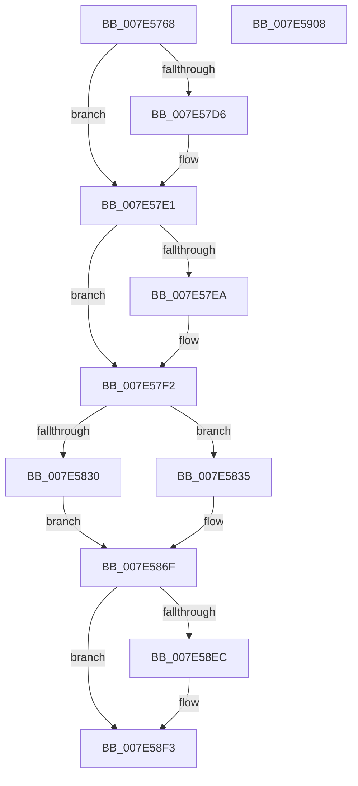

# CmpCmdInit

- RVA: `0x007E5768`–`0x007E5909` (길이 `417` bytes)
- VA: `0x00000001407E5768`
- 실행 섹션: `PAGE`
- PDB 이름 있음: `예`; PDB Function 태그: `아니요`
- unwind 정보 RVA: `0x0007D3C0`
- 디코드: `92`개 명령, `417/417` bytes 표시
- 미해석 바이트: `0` (있으면 어셈블리에 `.byte`로 보존)

> 이 문서는 커널 이미지의 기계어와 PDB 기호를 분석해 생성했습니다. 4번과 5번은 함수 원형과 자료형을 바이너리 사용 방식에서 추정한 C 해석이며 원본 소스 복구 결과는 아닙니다.

## 1. Dependencies

- 직접 호출 지점: **10**; 고유 호출 대상: **8**
- 직접 호출자로 확인된 함수: **1**
- RIP 상대 이미지 참조: **25**

### Outgoing calls
- `0x007E577F` → [CmpInitializeLazyWriters](CmpInitializeLazyWriters_function_007EEF34.md) (function, `0x007EEF34`)
- `0x007E57BA` → [KeInitializeDpc](../../text/45/KeInitializeDpc_function_0045BBD0.md) (function, `0x0045BBD0`)
- `0x007E57C6` → [KeInitializeTimer](../../text/45/KeInitializeTimer_function_0045B590.md) (function, `0x0045B590`)
- `0x007E580D` → [KiSetTimerEx](../../text/23/KiSetTimerEx_function_00232CB0.md) (function, `0x00232CB0`)
- `0x007E5823` → [ExAllocatePool2](../../poolcode/B8/ExAllocatePool2_function_00B820F0.md) (function, `0x00B820F0`)
- `0x007E583A` → [ExFreePoolWithTag](../../poolcode/B8/ExFreePoolWithTag_function_00B82870.md) (function, `0x00B82870`)
- `0x007E585C` → [ExGenRandom](../../text/41/ExGenRandom_function_0041B010.md) (function, `0x0041B010`)
- `0x007E587D` → [KeInitializeDpc](../../text/45/KeInitializeDpc_function_0045BBD0.md) (function, `0x0045BBD0`)
- `0x007E5889` → [KeInitializeTimer](../../text/45/KeInitializeTimer_function_0045B590.md) (function, `0x0045B590`)
- `0x007E58E3` → [PoRegisterCoalescingCallback](../75/PoRegisterCoalescingCallback_function_0075BF00.md) (function, `0x0075BF00`)

### Direct callers
- [CmCompleteRegistryInitialization](../7D/CmCompleteRegistryInitialization_function_007DF1EC.md) at `0x007DF267`

### Static image references
- `0x007E5784` → RVA `0x00EF7AD8` (`.data`; read/write)
- `0x007E578C` → RVA `0x00A6B030` (`CmpForceFlushWorker`; read)
- `0x007E5793` → RVA `0x00EF7AC0` (`.data`; read/write)
- `0x007E579B` → RVA `0x00EF7A60` (`.data`; read)
- `0x007E57A5` → RVA `0x00EF7AD0` (`.data`; write)
- `0x007E57AC` → RVA `0x00E0ECC0` (`.data`; read)
- `0x007E57B3` → RVA `0x0066A990` (`CmpEnableLazyFlushDpcRoutine`; read)
- `0x007E57BF` → RVA `0x00EF7AE0` (`.data`; read)
- `0x007E57CB` → RVA `0x00E0EC78` (`.data`; read)
- `0x007E57DB` → RVA `0x00E0EC78` (`.data`; write)
- `0x007E586F` → RVA `0x0066ABD0` (`CmpFreezeThawDpcRoutine`; read)
- `0x007E5876` → RVA `0x00EF7160` (`.data`; read)
- `0x007E5882` → RVA `0x00EF7120` (`.data`; read)
- `0x007E588E` → RVA `0x00EF71B8` (`.data`; read/write)
- `0x007E5896` → RVA `0x007E8670` (`CmpFreezeThawWorker`; read)
- `0x007E589D` → RVA `0x00EF71A0` (`.data`; read/write)
- `0x007E58A5` → RVA `0x00EF7AA0` (`.data`; read)
- `0x007E58AC` → RVA `0x00EF71B0` (`.data`; write)
- `0x007E58B3` → RVA `0x004B7820` (`CmpCoalescingCallback`; read)
- `0x007E58BA` → RVA `0x00FD8006` (`PAGEDATA`; read)
- `0x007E58C5` → RVA `0x00FD8001` (`PAGEDATA`; write)
- `0x007E58CB` → RVA `0x00EEFBD4` (`.data`; write)
- `0x007E58D2` → RVA `0x00EF7C58` (`.data`; write)
- `0x007E58D9` → RVA `0x00EEFBD8` (`.data`; write)
- `0x007E58EC` → RVA `0x00EEFBDC` (`.data`; write)

## 2. Other-region calls and transfers

- 다른 실행 섹션으로 향하는 call: **8**
  - `0x007E57BA` → [KeInitializeDpc](../../text/45/KeInitializeDpc_function_0045BBD0.md) (`PAGE` → `.text`)
  - `0x007E57C6` → [KeInitializeTimer](../../text/45/KeInitializeTimer_function_0045B590.md) (`PAGE` → `.text`)
  - `0x007E580D` → [KiSetTimerEx](../../text/23/KiSetTimerEx_function_00232CB0.md) (`PAGE` → `.text`)
  - `0x007E5823` → [ExAllocatePool2](../../poolcode/B8/ExAllocatePool2_function_00B820F0.md) (`PAGE` → `POOLCODE`)
  - `0x007E583A` → [ExFreePoolWithTag](../../poolcode/B8/ExFreePoolWithTag_function_00B82870.md) (`PAGE` → `POOLCODE`)
  - `0x007E585C` → [ExGenRandom](../../text/41/ExGenRandom_function_0041B010.md) (`PAGE` → `.text`)
  - `0x007E587D` → [KeInitializeDpc](../../text/45/KeInitializeDpc_function_0045BBD0.md) (`PAGE` → `.text`)
  - `0x007E5889` → [KeInitializeTimer](../../text/45/KeInitializeTimer_function_0045B590.md) (`PAGE` → `.text`)
- 별도 외부 분기/꼬리 이동을 확인하지 못했습니다.

## 3. Assembly (complete function range)

```asm
007E5768  48 89 5C 24 08                  mov qword ptr [rsp + 8], rbx
007E576D  48 89 6C 24 10                  mov qword ptr [rsp + 0x10], rbp
007E5772  48 89 74 24 18                  mov qword ptr [rsp + 0x18], rsi
007E5777  57                              push rdi
007E5778  48 83 EC 40                     sub rsp, 0x40
007E577C  40 8A E9                        mov bpl, cl
007E577F  E8 B0 97 00 00                  call 0x1407eef34
007E5784  48 83 25 4C 23 71 00 00         and qword ptr [rip + 0x71234c], 0
007E578C  48 8D 05 9D 58 28 00            lea rax, [rip + 0x28589d]
007E5793  48 83 25 25 23 71 00 00         and qword ptr [rip + 0x712325], 0
007E579B  48 8D 1D BE 22 71 00            lea rbx, [rip + 0x7122be]
007E57A2  48 8B CB                        mov rcx, rbx
007E57A5  48 89 05 24 23 71 00            mov qword ptr [rip + 0x712324], rax
007E57AC  4C 8D 05 0D 95 62 00            lea r8, [rip + 0x62950d]
007E57B3  48 8D 15 D6 51 E8 FF            lea rdx, [rip - 0x17ae2a]
007E57BA  E8 11 64 C7 FF                  call 0x14045bbd0
007E57BF  48 8D 0D 1A 23 71 00            lea rcx, [rip + 0x71231a]
007E57C6  E8 C5 5D C7 FF                  call 0x14045b590
007E57CB  8B 05 A7 94 62 00               mov eax, dword ptr [rip + 0x6294a7]
007E57D1  83 F8 3C                        cmp eax, 0x3c
007E57D4  7D 0B                           jge 0x1407e57e1
007E57D6  B8 3C 00 00 00                  mov eax, 0x3c
007E57DB  89 05 97 94 62 00               mov dword ptr [rip + 0x629497], eax
007E57E1  BA 58 02 00 00                  mov edx, 0x258
007E57E6  3B C2                           cmp eax, edx
007E57E8  7E 08                           jle 0x1407e57f2
007E57EA  8B C2                           mov eax, edx
007E57EC  89 15 86 94 62 00               mov dword ptr [rip + 0x629486], edx
007E57F2  48 98                           cdqe
007E57F4  48 8D 0D E5 22 71 00            lea rcx, [rip + 0x7122e5]
007E57FB  48 69 D0 80 69 67 FF            imul rdx, rax, -0x989680
007E5802  45 33 C9                        xor r9d, r9d
007E5805  48 89 5C 24 20                  mov qword ptr [rsp + 0x20], rbx
007E580A  45 33 C0                        xor r8d, r8d
007E580D  E8 9E D4 A4 FF                  call 0x140232cb0
007E5812  0F AE E8                        lfence
007E5815  BA 08 00 00 00                  mov edx, 8
007E581A  41 B8 44 70 63 58               mov r8d, 0x58637044
007E5820  8D 4A 38                        lea ecx, [rdx + 0x38]
007E5823  E8 C8 C8 39 00                  call 0x140b820f0
007E5828  48 8B F0                        mov rsi, rax
007E582B  48 85 C0                        test rax, rax
007E582E  75 05                           jne 0x1407e5835
007E5830  45 33 C0                        xor r8d, r8d
007E5833  EB 3A                           jmp 0x1407e586f
007E5835  33 D2                           xor edx, edx
007E5837  48 8B CE                        mov rcx, rsi
007E583A  E8 31 D0 39 00                  call 0x140b82870
007E583F  33 C9                           xor ecx, ecx
007E5841  B8 08 00 00 80                  mov eax, 0x80000008
007E5846  0F A2                           cpuid
007E5848  89 4C 24 38                     mov dword ptr [rsp + 0x38], ecx
007E584C  8B F8                           mov edi, eax
007E584E  33 C9                           xor ecx, ecx
007E5850  89 44 24 30                     mov dword ptr [rsp + 0x30], eax
007E5854  89 5C 24 34                     mov dword ptr [rsp + 0x34], ebx
007E5858  89 54 24 3C                     mov dword ptr [rsp + 0x3c], edx
007E585C  E8 AF 57 C3 FF                  call 0x14041b010
007E5861  8B CF                           mov ecx, edi
007E5863  44 8B C0                        mov r8d, eax
007E5866  C1 E9 08                        shr ecx, 8
007E5869  49 D3 E0                        shl r8, cl
007E586C  4C 33 C6                        xor r8, rsi
007E586F  48 8D 15 5A 53 E8 FF            lea rdx, [rip - 0x17aca6]
007E5876  48 8D 0D E3 18 71 00            lea rcx, [rip + 0x7118e3]
007E587D  E8 4E 63 C7 FF                  call 0x14045bbd0
007E5882  48 8D 0D 97 18 71 00            lea rcx, [rip + 0x711897]
007E5889  E8 02 5D C7 FF                  call 0x14045b590
007E588E  48 83 25 22 19 71 00 00         and qword ptr [rip + 0x711922], 0
007E5896  48 8D 05 D3 2D 00 00            lea rax, [rip + 0x2dd3]
007E589D  48 83 25 FB 18 71 00 00         and qword ptr [rip + 0x7118fb], 0
007E58A5  4C 8D 05 F4 21 71 00            lea r8, [rip + 0x7121f4]
007E58AC  48 89 05 FD 18 71 00            mov qword ptr [rip + 0x7118fd], rax
007E58B3  48 8D 0D 66 1F CD FF            lea rcx, [rip - 0x32e09a]
007E58BA  8A 05 46 27 7F 00               mov al, byte ptr [rip + 0x7f2746]
007E58C0  45 33 C9                        xor r9d, r9d
007E58C3  B2 01                           mov dl, 1
007E58C5  88 05 36 27 7F 00               mov byte ptr [rip + 0x7f2736], al
007E58CB  C6 05 02 A3 70 00 01            mov byte ptr [rip + 0x70a302], 1
007E58D2  40 88 2D 7F 23 71 00            mov byte ptr [rip + 0x71237f], bpl
007E58D9  C7 05 F5 A2 70 00 01 00 00 00   mov dword ptr [rip + 0x70a2f5], 1
007E58E3  E8 18 66 F7 FF                  call 0x14075bf00
007E58E8  85 C0                           test eax, eax
007E58EA  78 07                           js 0x1407e58f3
007E58EC  C6 05 E9 A2 70 00 01            mov byte ptr [rip + 0x70a2e9], 1
007E58F3  48 8B 5C 24 50                  mov rbx, qword ptr [rsp + 0x50]
007E58F8  48 8B 6C 24 58                  mov rbp, qword ptr [rsp + 0x58]
007E58FD  48 8B 74 24 60                  mov rsi, qword ptr [rsp + 0x60]
007E5902  48 83 C4 40                     add rsp, 0x40
007E5906  5F                              pop rdi
007E5907  C3                              ret
007E5908  CC                              int3
```

## 4. C-style interpretation (structured pseudocode)

```c
__int64 __fastcall CmpCmdInit(unsigned __int8 a1, __int64 a2, __int64 a3, int a4)
{
    __int64 result;
    __int64 v_rsp;
    unsigned int v_stack_m10;
    unsigned int v_stack_m14;
    unsigned int v_stack_m18;
    unsigned __int64 v_stack_m28;
    unsigned int v_stack_mC;
    unsigned __int64 v_stack_p10;
    unsigned __int64 v_stack_p18;
    unsigned __int64 v_stack_p8;

    v_stack_p8 = v_rbx;
    v_stack_p10 = v_rbp;
    v_stack_p18 = v_rsi;
    v_rsp = (v_rsp) - (64);
    result = CmpInitializeLazyWriters(a1, a2, a3, a4);
    *(unsigned __int64 *)(v_rip + 7414564) = v_rip + 2644125;
    result = KeInitializeDpc(v_rip + 7414462, v_rip - 1551914, v_rip + 6460685, a4);
    result = KeInitializeTimer(v_rip + 7414554, v_rip - 1551914, v_rip + 6460685, a4);
    result = (unsigned int)(*(unsigned int *)(v_rip + 6460583));
    if (((unsigned int)((unsigned int)(*(unsigned int *)(v_rip + 6460583)))) < 60) {
        result = 60;
        *(unsigned int *)(v_rip + 6460567) = (unsigned int)(result);
    }
    if (((unsigned int)(result)) >= = 600) {
        result = 600;
        *(unsigned int *)(v_rip + 6460550) = 600;
    }
    a2 = (600) * (result);
    a4 = 0;
    v_stack_m28 = v_rip + 7414462;
    a3 = 0;
    result = KiSetTimerEx(v_rip + 7414501, a2, a3, a4);
    result = ExAllocatePool2(8 + 56, 8, (unsigned int)(0x58637044ULL), a4);
    if (result != 0) goto loc_007E5835;
    a3 = 0;
    goto loc_007E586F;
loc_007E5835:
    a2 = 0;
    result = ExFreePoolWithTag(result, a2, a3, a4);
    a1 = 0;
    v_stack_m10 = 0;
    a1 = 0;
    v_stack_m18 = (unsigned int)((unsigned int)(0x80000008ULL));
    v_stack_m14 = (unsigned int)(v_rip + 7414462);
    v_stack_mC = 0;
    result = ExGenRandom(a1, a2, a3, a4);
    a1 = (unsigned int)(((unsigned int)((unsigned int)((unsigned int)((unsigned int)((unsigned int)(0x80000008ULL)))))) >> (8));
    a3 = ((unsigned int)((unsigned int)(result))) << (a1);
    a3 = (a3) ^ (result);
loc_007E586F:
    result = KeInitializeDpc(v_rip + 7411939, v_rip - 1551526, a3, a4);
    result = KeInitializeTimer(v_rip + 7411863, v_rip - 1551526, a3, a4);
    *(unsigned __int64 *)(v_rip + 7411965) = v_rip + 11731;
    a4 = 0;
    *(unsigned __int8 *)(v_rip + 8333110) = (unsigned __int8)(*(unsigned __int8 *)(v_rip + 8333126));
    *(unsigned __int8 *)(v_rip + 7381762) = 1;
    *(unsigned __int8 *)(v_rip + 7414655) = a1;
    *(unsigned int *)(v_rip + 7381749) = 1;
    result = PoRegisterCoalescingCallback(v_rip - 3334298, 1, v_rip + 7414260, a4);
    if (!(sign_flag)) {
        *(unsigned __int8 *)(v_rip + 7381737) = 1;
    }
    v_rsp = (v_rsp) + (64);
    return result;
}
```

## 5. (Beta) C Style

```c
int64_t CmpCmdInit(uint8_t Arg1, int64_t Arg2, int64_t Arg3, int32_t Arg4)
{
    int64_t result;
    int64_t local_rsp;
    uint32_t v_stack_m10;
    uint32_t v_stack_m14;
    uint32_t v_stack_m18;
    uint64_t v_stack_m28;
    uint32_t v_stack_mC;
    uint64_t v_stack_p10;
    uint64_t v_stack_p18;
    uint64_t v_stack_p8;

    v_stack_p8 = local_rbx;
    v_stack_p10 = local_rbp;
    v_stack_p18 = local_rsi;
    local_rsp = (local_rsp) - (64);
    result = CmpInitializeLazyWriters(Arg1, Arg2, Arg3, Arg4);
    *(uint64_t *)(v_rip + 0x712324) = v_rip + 2644125;
    result = KeInitializeDpc(v_rip + 7414462, v_rip - 1551914, v_rip + 6460685, Arg4);
    result = KeInitializeTimer(v_rip + 7414554, v_rip - 1551914, v_rip + 6460685, Arg4);
    result = (uint32_t)(*(uint32_t *)(v_rip + 0x6294A7));
    if (((uint32_t)((uint32_t)(*(uint32_t *)(v_rip + 0x6294A7)))) < 60) {
        result = 60;
        *(uint32_t *)(v_rip + 0x629497) = (uint32_t)(result);
    }
    if (((uint32_t)(result)) >= = 600) {
        result = 600;
        *(uint32_t *)(v_rip + 0x629486) = 600;
    }
    Arg2 = (600) * (result);
    Arg4 = 0;
    v_stack_m28 = v_rip + 7414462;
    Arg3 = 0;
    result = KiSetTimerEx(v_rip + 7414501, Arg2, Arg3, Arg4);
    result = ExAllocatePool2(8 + 56, 8, (uint32_t)(0x58637044ULL), Arg4);
    if (result != 0) goto loc_007E5835;
    Arg3 = 0;
    goto loc_007E586F;
loc_007E5835:
    Arg2 = 0;
    result = ExFreePoolWithTag(result, Arg2, Arg3, Arg4);
    Arg1 = 0;
    v_stack_m10 = 0;
    Arg1 = 0;
    v_stack_m18 = (uint32_t)((uint32_t)(0x80000008ULL));
    v_stack_m14 = (uint32_t)(v_rip + 7414462);
    v_stack_mC = 0;
    result = ExGenRandom(Arg1, Arg2, Arg3, Arg4);
    Arg1 = (uint32_t)(((uint32_t)((uint32_t)((uint32_t)((uint32_t)((uint32_t)(0x80000008ULL)))))) >> (8));
    Arg3 = ((uint32_t)((uint32_t)(result))) << (Arg1);
    Arg3 = (Arg3) ^ (result);
loc_007E586F:
    result = KeInitializeDpc(v_rip + 7411939, v_rip - 1551526, Arg3, Arg4);
    result = KeInitializeTimer(v_rip + 7411863, v_rip - 1551526, Arg3, Arg4);
    *(uint64_t *)(v_rip + 0x7118FD) = v_rip + 11731;
    Arg4 = 0;
    *(uint8_t *)(v_rip + 0x7F2736) = (uint8_t)(*(uint8_t *)(v_rip + 0x7F2746));
    *(uint8_t *)(v_rip + 0x70A302) = 1;
    *(uint8_t *)(v_rip + 0x71237F) = Arg1;
    *(uint32_t *)(v_rip + 0x70A2F5) = 1;
    result = PoRegisterCoalescingCallback(v_rip - 3334298, 1, v_rip + 7414260, Arg4);
    if (!(sign_flag)) {
        *(uint8_t *)(v_rip + 0x70A2E9) = 1;
    }
    local_rsp = (local_rsp) + (64);
    return result;
}
```

## 6. Execution-region graph

[열기: 2D/3D 그래프와 함수 탐색 컨트롤 패널](../../../control-panel.html?section=page&rva=0x007E5768&view=graph)

- 2D 그래프는 위에서 아래로 흐르고, 3D 그래프는 빈 공간을 드래그해 회전합니다. Shift+드래그는 이동, 휠은 확대·축소, 함수 노드 선택은 대상 보고서 이동입니다.

### Static fallback


