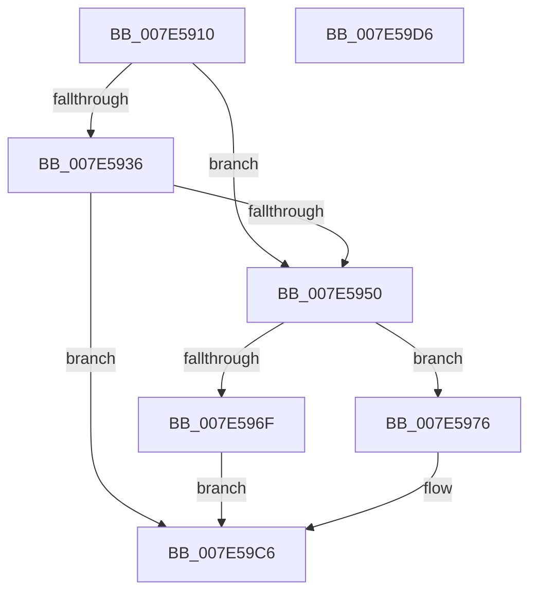

# CmpCmdRenameHive

- RVA: `0x007E5910`–`0x007E59D7` (길이 `199` bytes)
- VA: `0x00000001407E5910`
- 실행 섹션: `PAGE`
- PDB 이름 있음: `예`; PDB Function 태그: `아니요`
- unwind 정보 RVA: `0x000C99BC`
- 디코드: `56`개 명령, `199/199` bytes 표시
- 미해석 바이트: `0` (있으면 어셈블리에 `.byte`로 보존)

> 이 문서는 커널 이미지의 기계어와 PDB 기호를 분석해 생성했습니다. 4번과 5번은 함수 원형과 자료형을 바이너리 사용 방식에서 추정한 C 해석이며 원본 소스 복구 결과는 아닙니다.

## 1. Dependencies

- 직접 호출 지점: **5**; 고유 호출 대상: **5**
- 직접 호출자로 확인된 함수: **2**
- RIP 상대 이미지 참조: **0**

### Outgoing calls
- `0x007E5947` → [ZwQueryObject](../../text/6A/ZwQueryObject_function_006AD2D0.md) (function, `0x006AD2D0`)
- `0x007E5962` → [ExAllocatePool2](../../poolcode/B8/ExAllocatePool2_function_00B820F0.md) (function, `0x00B820F0`)
- `0x007E5993` → [memcpy](../../text/6C/memcpy_function_006C6840.md) (function, `0x006C6840`)
- `0x007E59B3` → [ZwSetInformationFile](../../text/6A/ZwSetInformationFile_function_006AD5B0.md) (function, `0x006AD5B0`)
- `0x007E59BF` → [ExFreePoolWithTag](../../poolcode/B8/ExFreePoolWithTag_function_00B82870.md) (function, `0x00B82870`)

### Direct callers
- [CmReplaceKey](CmReplaceKey_function_007EA1C8.md) at `0x007EA36D`
- [CmReplaceKey](CmReplaceKey_function_007EA1C8.md) at `0x007EA398`
- [CmReplaceKey](CmReplaceKey_function_007EA1C8.md) at `0x007EA3CE`
- [CmpFlushBackupHive](CmpFlushBackupHive_function_007EC1A8.md) at `0x007EC2D2`
- [CmpFlushBackupHive](CmpFlushBackupHive_function_007EC1A8.md) at `0x007EC4F8`

### Static image references
- 디코드된 RIP-relative 메모리 참조가 없습니다.

## 2. Other-region calls and transfers

- 다른 실행 섹션으로 향하는 call: **5**
  - `0x007E5947` → [ZwQueryObject](../../text/6A/ZwQueryObject_function_006AD2D0.md) (`PAGE` → `.text`)
  - `0x007E5962` → [ExAllocatePool2](../../poolcode/B8/ExAllocatePool2_function_00B820F0.md) (`PAGE` → `POOLCODE`)
  - `0x007E5993` → [memcpy](../../text/6C/memcpy_function_006C6840.md) (`PAGE` → `.text`)
  - `0x007E59B3` → [ZwSetInformationFile](../../text/6A/ZwSetInformationFile_function_006AD5B0.md) (`PAGE` → `.text`)
  - `0x007E59BF` → [ExFreePoolWithTag](../../poolcode/B8/ExFreePoolWithTag_function_00B82870.md) (`PAGE` → `POOLCODE`)
- 별도 외부 분기/꼬리 이동을 확인하지 못했습니다.

## 3. Assembly (complete function range)

```asm
007E5910  48 8B C4                        mov rax, rsp
007E5913  48 89 58 08                     mov qword ptr [rax + 8], rbx
007E5917  48 89 70 10                     mov qword ptr [rax + 0x10], rsi
007E591B  44 89 48 20                     mov dword ptr [rax + 0x20], r9d
007E591F  57                              push rdi
007E5920  48 83 EC 40                     sub rsp, 0x40
007E5924  0F 57 C0                        xorps xmm0, xmm0
007E5927  49 8B D8                        mov rbx, r8
007E592A  48 8B F1                        mov rsi, rcx
007E592D  0F 11 40 E8                     movups xmmword ptr [rax - 0x18], xmm0
007E5931  48 85 D2                        test rdx, rdx
007E5934  74 1A                           je 0x1407e5950
007E5936  48 8D 40 20                     lea rax, [rax + 0x20]
007E593A  4C 8B C2                        mov r8, rdx
007E593D  BA 01 00 00 00                  mov edx, 1
007E5942  48 89 44 24 20                  mov qword ptr [rsp + 0x20], rax
007E5947  E8 84 79 EC FF                  call 0x1406ad2d0
007E594C  85 C0                           test eax, eax
007E594E  78 76                           js 0x1407e59c6
007E5950  0F B7 13                        movzx edx, word ptr [rbx]
007E5953  B9 00 01 00 00                  mov ecx, 0x100
007E5958  48 83 C2 18                     add rdx, 0x18
007E595C  41 B8 43 4D 20 20               mov r8d, 0x20204d43
007E5962  E8 89 C7 39 00                  call 0x140b820f0
007E5967  48 8B F8                        mov rdi, rax
007E596A  48 85 C0                        test rax, rax
007E596D  75 07                           jne 0x1407e5976
007E596F  B8 9A 00 00 C0                  mov eax, 0xc000009a
007E5974  EB 50                           jmp 0x1407e59c6
007E5976  48 83 67 08 00                  and qword ptr [rdi + 8], 0
007E597B  48 8D 4F 14                     lea rcx, [rdi + 0x14]
007E597F  8A 44 24 70                     mov al, byte ptr [rsp + 0x70]
007E5983  88 07                           mov byte ptr [rdi], al
007E5985  0F B7 03                        movzx eax, word ptr [rbx]
007E5988  89 47 10                        mov dword ptr [rdi + 0x10], eax
007E598B  44 0F B7 03                     movzx r8d, word ptr [rbx]
007E598F  48 8B 53 08                     mov rdx, qword ptr [rbx + 8]
007E5993  E8 A8 0E EE FF                  call 0x1406c6840
007E5998  44 0F B7 0B                     movzx r9d, word ptr [rbx]
007E599C  48 8D 54 24 30                  lea rdx, [rsp + 0x30]
007E59A1  41 83 C1 18                     add r9d, 0x18
007E59A5  C7 44 24 20 0A 00 00 00         mov dword ptr [rsp + 0x20], 0xa
007E59AD  4C 8B C7                        mov r8, rdi
007E59B0  48 8B CE                        mov rcx, rsi
007E59B3  E8 F8 7B EC FF                  call 0x1406ad5b0
007E59B8  33 D2                           xor edx, edx
007E59BA  48 8B CF                        mov rcx, rdi
007E59BD  8B D8                           mov ebx, eax
007E59BF  E8 AC CE 39 00                  call 0x140b82870
007E59C4  8B C3                           mov eax, ebx
007E59C6  48 8B 5C 24 50                  mov rbx, qword ptr [rsp + 0x50]
007E59CB  48 8B 74 24 58                  mov rsi, qword ptr [rsp + 0x58]
007E59D0  48 83 C4 40                     add rsp, 0x40
007E59D4  5F                              pop rdi
007E59D5  C3                              ret
007E59D6  CC                              int3
```

## 4. C-style interpretation (structured pseudocode)

```c
__int64 __fastcall CmpCmdRenameHive(__int64 a1, __int64 a2, __int64 a3, int a4, unsigned __int8 a5)
{
    __int64 result;
    __int64 v_rsp;
    unsigned __int64 v_stack_m18;
    unsigned __int64 v_stack_m28;
    unsigned __int64 v_stack_p10;
    unsigned __int64 v_stack_p8;

    *(unsigned __int64 *)(v_rsp + 8) = v_rbx;
    *(unsigned __int64 *)(v_rsp + 16) = v_rsi;
    *(unsigned int *)(v_rsp + 32) = a4;
    v_rsp = (v_rsp) - (64);
    *(unsigned __int64 *)(v_rsp - 24) = v_xmm0;
    if (a2 == 0) goto loc_007E5950;
    v_stack_m28 = v_rsp + 32;
    result = ZwQueryObject(a1, 1, a2, a4);
    if (sign_flag) goto loc_007E59C6;
loc_007E5950:
    a2 = (*(unsigned __int16 *)(a3)) + (24);
    result = ExAllocatePool2(256, a2, (unsigned int)(0x20204D43ULL), a4);
    if (result != 0) goto loc_007E5976;
    goto loc_007E59C6;
loc_007E5976:
    *(unsigned __int8 *)(result) = a5;
    *(unsigned int *)(result + 16) = (unsigned int)(*(unsigned __int16 *)(a3));
    result = memcpy(result + 20, *(unsigned __int64 *)(a3 + 8), *(unsigned __int16 *)(a3), a4);
    a4 = (unsigned int)((*(unsigned __int16 *)(a3)) + (24));
    v_stack_m28 = 10;
    result = ZwSetInformationFile(a1, v_stack_m18, result, a4);
    a2 = 0;
    result = ExFreePoolWithTag(result, a2, result, a4);
loc_007E59C6:
    v_rsp = (v_rsp) + (64);
    return (unsigned int)((unsigned int)((unsigned int)((unsigned int)(result))));
}
```

## 5. (Beta) C Style

```c
int64_t CmpCmdRenameHive(int64_t Arg1, int64_t Arg2, void *Arg3, int32_t Arg4, uint8_t Arg5)
{
    uint8_t *arg3 = (uint8_t *)Arg3;

    int64_t result;
    int64_t local_rsp;
    uint64_t v_stack_m18;
    uint64_t v_stack_m28;
    uint64_t v_stack_p10;
    uint64_t v_stack_p8;

    *(uint64_t *)(local_rsp + 0x8) = local_rbx;
    *(uint64_t *)(local_rsp + 0x10) = local_rsi;
    *(uint32_t *)(local_rsp + 0x20) = Arg4;
    local_rsp = (local_rsp) - (64);
    *(uint64_t *)(local_rsp - 0x18) = v_xmm0;
    if (Arg2 == 0) goto loc_007E5950;
    v_stack_m28 = local_rsp + 32;
    result = ZwQueryObject(Arg1, 1, Arg2, Arg4);
    if (sign_flag) goto loc_007E59C6;
loc_007E5950:
    Arg2 = (*(uint16_t *)(arg3)) + (24);
    result = ExAllocatePool2(256, Arg2, (uint32_t)(0x20204D43ULL), Arg4);
    if (result != 0) goto loc_007E5976;
    goto loc_007E59C6;
loc_007E5976:
    *(uint8_t *)(result) = Arg5;
    *(uint32_t *)(result + 0x10) = (uint32_t)(*(uint16_t *)(arg3));
    result = memcpy(result + 20, *(uint64_t *)(arg3 + 0x8), *(uint16_t *)(arg3), Arg4);
    Arg4 = (uint32_t)((*(uint16_t *)(arg3)) + (24));
    v_stack_m28 = 10;
    result = ZwSetInformationFile(Arg1, v_stack_m18, result, Arg4);
    Arg2 = 0;
    result = ExFreePoolWithTag(result, Arg2, result, Arg4);
loc_007E59C6:
    local_rsp = (local_rsp) + (64);
    return (uint32_t)((uint32_t)((uint32_t)((uint32_t)(result))));
}
```

### 관측된 메모리 오프셋

구조체 형식이 확인되지 않은 접근은 인자 기준의 오프셋으로만 기록했습니다.

| 기준 인자 | 오프셋 표현 | 폭 (bit) | 접근 |
|---|---:|---:|---|
| `Arg3` | `+ 0x0` | `16` | `R` |
| `Arg3` | `+ 0x8` | `64` | `R` |

## 6. Execution-region graph

[열기: 2D/3D 그래프와 함수 탐색 컨트롤 패널](../../../control-panel.html?section=page&rva=0x007E5910&view=graph)

- 2D 그래프는 위에서 아래로 흐르고, 3D 그래프는 빈 공간을 드래그해 회전합니다. Shift+드래그는 이동, 휠은 확대·축소, 함수 노드 선택은 대상 보고서 이동입니다.

### Static fallback


