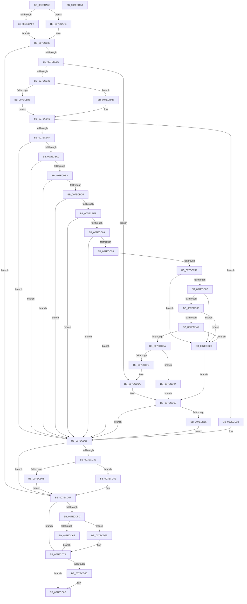

# CmpCopySaclToVirtualKey

- RVA: `0x007ECA6C`–`0x007ECDA9` (길이 `829` bytes)
- VA: `0x00000001407ECA6C`
- 실행 섹션: `PAGE`
- PDB 이름 있음: `예`; PDB Function 태그: `아니요`
- unwind 정보 RVA: `0x000D6F40`
- 디코드: `234`개 명령, `829/829` bytes 표시
- 미해석 바이트: `0` (있으면 어셈블리에 `.byte`로 보존)

> 이 문서는 커널 이미지의 기계어와 PDB 기호를 분석해 생성했습니다. 4번과 5번은 함수 원형과 자료형을 바이너리 사용 방식에서 추정한 C 해석이며 원본 소스 복구 결과는 아닙니다.

## 1. Dependencies

- 직접 호출 지점: **25**; 고유 호출 대상: **19**
- 직접 호출자로 확인된 함수: **1**
- RIP 상대 이미지 참조: **0**

### Outgoing calls
- `0x007ECAF7` → [HvpGetCellFlat](../85/HvpGetCellFlat_function_00854C60.md) (function, `0x00854C60`)
- `0x007ECAFE` → [HvpGetCellPaged](../85/HvpGetCellPaged_function_00854CB0.md) (function, `0x00854CB0`)
- `0x007ECB17` → [RtlGetSaclSecurityDescriptor](../A3/RtlGetSaclSecurityDescriptor_function_00A36710.md) (function, `0x00A36710`)
- `0x007ECB46` → [HvpGetCellFlat](../85/HvpGetCellFlat_function_00854C60.md) (function, `0x00854C60`)
- `0x007ECB4D` → [HvpGetCellPaged](../85/HvpGetCellPaged_function_00854CB0.md) (function, `0x00854CB0`)
- `0x007ECB60` → [RtlCreateSecurityDescriptor](../9F/RtlCreateSecurityDescriptor_function_009F1DF0.md) (function, `0x009F1DF0`)
- `0x007ECB8E` → [RtlSetSaclSecurityDescriptor](../A1/RtlSetSaclSecurityDescriptor_function_00A18B80.md) (function, `0x00A18B80`)
- `0x007ECBAB` → [RtlGetOwnerSecurityDescriptor](../A2/RtlGetOwnerSecurityDescriptor_function_00A22590.md) (function, `0x00A22590`)
- `0x007ECBC6` → [RtlSetOwnerSecurityDescriptor](../91/RtlSetOwnerSecurityDescriptor_function_00916F90.md) (function, `0x00916F90`)
- `0x007ECBE0` → [RtlGetGroupSecurityDescriptor](../A9/RtlGetGroupSecurityDescriptor_function_00A90020.md) (function, `0x00A90020`)
- `0x007ECBFB` → [RtlSetGroupSecurityDescriptor](../A2/RtlSetGroupSecurityDescriptor_function_00A2EB10.md) (function, `0x00A2EB10`)
- `0x007ECC19` → [RtlGetDaclSecurityDescriptor](../../text/45/RtlGetDaclSecurityDescriptor_function_00459570.md) (function, `0x00459570`)
- `0x007ECC37` → [RtlSetDaclSecurityDescriptor](../9E/RtlSetDaclSecurityDescriptor_function_009EC210.md) (function, `0x009EC210`)
- `0x007ECC5C` → [SeCaptureSecurityDescriptor](../92/SeCaptureSecurityDescriptor_function_00929F40.md) (function, `0x00929F40`)
- `0x007ECC77` → [HvpMarkCellDirty](../85/HvpMarkCellDirty_function_00858080.md) (function, `0x00858080`)
- `0x007ECC93` → [HvpMarkCellDirty](../85/HvpMarkCellDirty_function_00858080.md) (function, `0x00858080`)
- `0x007ECCAF` → [HvpMarkCellDirty](../85/HvpMarkCellDirty_function_00858080.md) (function, `0x00858080`)
- `0x007ECCE9` → [CmpGetSecurityDescriptorNodeEx](../94/CmpGetSecurityDescriptorNodeEx_function_00949268.md) (function, `0x00949268`)
- `0x007ECCFA` → [CmpFreeSecurityDescriptor](../84/CmpFreeSecurityDescriptor_function_00849E44.md) (function, `0x00849E44`)
- `0x007ECD1D` → [SeReleaseSecurityDescriptor](../97/SeReleaseSecurityDescriptor_function_00975190.md) (function, `0x00975190`)
- `0x007ECD4B` → [HvpReleaseCellFlat](../85/HvpReleaseCellFlat_function_0085CC20.md) (function, `0x0085CC20`)
- `0x007ECD52` → [HvpReleaseCellPaged](../85/HvpReleaseCellPaged_function_00855F40.md) (function, `0x00855F40`)
- `0x007ECD6E` → [HvpReleaseCellFlat](../85/HvpReleaseCellFlat_function_0085CC20.md) (function, `0x0085CC20`)
- `0x007ECD75` → [HvpReleaseCellPaged](../85/HvpReleaseCellPaged_function_00855F40.md) (function, `0x00855F40`)
- `0x007ECD86` → [CmpDereferenceSecurityNode](../../text/4A/CmpDereferenceSecurityNode_function_004A672C.md) (function, `0x004A672C`)

### Direct callers
- [CmpDoBuildVirtualStack](CmpDoBuildVirtualStack_function_007EB4C4.md) at `0x007EB889`

### Static image references
- 디코드된 RIP-relative 메모리 참조가 없습니다.

## 2. Other-region calls and transfers

- 다른 실행 섹션으로 향하는 call: **2**
  - `0x007ECC19` → [RtlGetDaclSecurityDescriptor](../../text/45/RtlGetDaclSecurityDescriptor_function_00459570.md) (`PAGE` → `.text`)
  - `0x007ECD86` → [CmpDereferenceSecurityNode](../../text/4A/CmpDereferenceSecurityNode_function_004A672C.md) (`PAGE` → `.text`)
- 별도 외부 분기/꼬리 이동을 확인하지 못했습니다.

## 3. Assembly (complete function range)

```asm
007ECA6C  48 89 5C 24 18                  mov qword ptr [rsp + 0x18], rbx
007ECA71  4C 89 4C 24 20                  mov qword ptr [rsp + 0x20], r9
007ECA76  55                              push rbp
007ECA77  56                              push rsi
007ECA78  57                              push rdi
007ECA79  41 54                           push r12
007ECA7B  41 55                           push r13
007ECA7D  41 56                           push r14
007ECA7F  41 57                           push r15
007ECA81  48 8D 6C 24 E1                  lea rbp, [rsp - 0x1f]
007ECA86  48 81 EC A0 00 00 00            sub rsp, 0xa0
007ECA8D  41 8B 41 2C                     mov eax, dword ptr [r9 + 0x2c]
007ECA91  45 33 ED                        xor r13d, r13d
007ECA94  8B 52 2C                        mov edx, dword ptr [rdx + 0x2c]
007ECA97  4C 8B F9                        mov r15, rcx
007ECA9A  33 C9                           xor ecx, ecx
007ECA9C  44 88 6D 67                     mov byte ptr [rbp + 0x67], r13b
007ECAA0  49 8B F8                        mov rdi, r8
007ECAA3  48 89 4D 17                     mov qword ptr [rbp + 0x17], rcx
007ECAA7  41 83 C8 FF                     or r8d, 0xffffffff
007ECAAB  44 88 6D 5F                     mov byte ptr [rbp + 0x5f], r13b
007ECAAF  41 F6 87 8C 00 00 00 01         test byte ptr [r15 + 0x8c], 1
007ECAB7  0F 57 C0                        xorps xmm0, xmm0
007ECABA  44 89 45 CF                     mov dword ptr [rbp - 0x31], r8d
007ECABE  45 8B E0                        mov r12d, r8d
007ECAC1  44 89 45 C7                     mov dword ptr [rbp - 0x39], r8d
007ECAC5  41 8B F5                        mov esi, r13d
007ECAC8  44 89 45 C3                     mov dword ptr [rbp - 0x3d], r8d
007ECACC  45 8B F5                        mov r14d, r13d
007ECACF  44 89 6D D3                     mov dword ptr [rbp - 0x2d], r13d
007ECAD3  4C 8D 45 CF                     lea r8, [rbp - 0x31]
007ECAD7  4C 89 6D D7                     mov qword ptr [rbp - 0x29], r13
007ECADB  49 8B CF                        mov rcx, r15
007ECADE  0F 11 45 F7                     movups xmmword ptr [rbp - 9], xmm0
007ECAE2  44 89 6D CB                     mov dword ptr [rbp - 0x35], r13d
007ECAE6  0F 11 45 07                     movups xmmword ptr [rbp + 7], xmm0
007ECAEA  4C 89 6D DF                     mov qword ptr [rbp - 0x21], r13
007ECAEE  4C 89 6D E7                     mov qword ptr [rbp - 0x19], r13
007ECAF2  89 45 BF                        mov dword ptr [rbp - 0x41], eax
007ECAF5  74 07                           je 0x1407ecafe
007ECAF7  E8 64 81 06 00                  call 0x140854c60
007ECAFC  EB 05                           jmp 0x1407ecb03
007ECAFE  E8 AD 81 06 00                  call 0x140854cb0
007ECB03  48 8D 48 14                     lea rcx, [rax + 0x14]
007ECB07  48 89 45 EF                     mov qword ptr [rbp - 0x11], rax
007ECB0B  4C 8D 4D 5F                     lea r9, [rbp + 0x5f]
007ECB0F  4C 8D 45 DF                     lea r8, [rbp - 0x21]
007ECB13  48 8D 55 67                     lea rdx, [rbp + 0x67]
007ECB17  E8 F4 9B 24 00                  call 0x140a36710
007ECB1C  8B D8                           mov ebx, eax
007ECB1E  85 C0                           test eax, eax
007ECB20  0F 88 31 02 00 00               js 0x1407ecd57
007ECB26  44 8A 6D 67                     mov r13b, byte ptr [rbp + 0x67]
007ECB2A  45 84 ED                        test r13b, r13b
007ECB2D  0F 84 D7 01 00 00               je 0x1407ecd0a
007ECB33  F6 87 8C 00 00 00 01            test byte ptr [rdi + 0x8c], 1
007ECB3A  4C 8D 45 C7                     lea r8, [rbp - 0x39]
007ECB3E  8B 55 BF                        mov edx, dword ptr [rbp - 0x41]
007ECB41  48 8B CF                        mov rcx, rdi
007ECB44  74 07                           je 0x1407ecb4d
007ECB46  E8 15 81 06 00                  call 0x140854c60
007ECB4B  EB 05                           jmp 0x1407ecb52
007ECB4D  E8 5E 81 06 00                  call 0x140854cb0
007ECB52  48 8D 70 14                     lea rsi, [rax + 0x14]
007ECB56  4C 8B F0                        mov r14, rax
007ECB59  0F B6 16                        movzx edx, byte ptr [rsi]
007ECB5C  48 8D 4D F7                     lea rcx, [rbp - 9]
007ECB60  E8 8B 52 20 00                  call 0x1409f1df0
007ECB65  8B D8                           mov ebx, eax
007ECB67  85 C0                           test eax, eax
007ECB69  0F 88 C4 01 00 00               js 0x1407ecd33
007ECB6F  0F B7 46 02                     movzx eax, word ptr [rsi + 2]
007ECB73  B9 FF 7F 00 00                  mov ecx, 0x7fff
007ECB78  44 8A 4D 5F                     mov r9b, byte ptr [rbp + 0x5f]
007ECB7C  66 23 C1                        and ax, cx
007ECB7F  4C 8B 45 DF                     mov r8, qword ptr [rbp - 0x21]
007ECB83  48 8D 4D F7                     lea rcx, [rbp - 9]
007ECB87  41 8A D5                        mov dl, r13b
007ECB8A  66 89 45 F9                     mov word ptr [rbp - 7], ax
007ECB8E  E8 ED BF 22 00                  call 0x140a18b80
007ECB93  45 33 ED                        xor r13d, r13d
007ECB96  8B D8                           mov ebx, eax
007ECB98  85 C0                           test eax, eax
007ECB9A  0F 88 96 01 00 00               js 0x1407ecd36
007ECBA0  4C 8D 45 5F                     lea r8, [rbp + 0x5f]
007ECBA4  48 8B CE                        mov rcx, rsi
007ECBA7  48 8D 55 D7                     lea rdx, [rbp - 0x29]
007ECBAB  E8 E0 59 23 00                  call 0x140a22590
007ECBB0  8B D8                           mov ebx, eax
007ECBB2  85 C0                           test eax, eax
007ECBB4  0F 88 7C 01 00 00               js 0x1407ecd36
007ECBBA  44 8A 45 5F                     mov r8b, byte ptr [rbp + 0x5f]
007ECBBE  48 8D 4D F7                     lea rcx, [rbp - 9]
007ECBC2  48 8B 55 D7                     mov rdx, qword ptr [rbp - 0x29]
007ECBC6  E8 C5 A3 12 00                  call 0x140916f90
007ECBCB  8B D8                           mov ebx, eax
007ECBCD  85 C0                           test eax, eax
007ECBCF  0F 88 61 01 00 00               js 0x1407ecd36
007ECBD5  4C 8D 45 5F                     lea r8, [rbp + 0x5f]
007ECBD9  48 8B CE                        mov rcx, rsi
007ECBDC  48 8D 55 D7                     lea rdx, [rbp - 0x29]
007ECBE0  E8 3B 34 2A 00                  call 0x140a90020
007ECBE5  8B D8                           mov ebx, eax
007ECBE7  85 C0                           test eax, eax
007ECBE9  0F 88 47 01 00 00               js 0x1407ecd36
007ECBEF  44 8A 45 5F                     mov r8b, byte ptr [rbp + 0x5f]
007ECBF3  48 8D 4D F7                     lea rcx, [rbp - 9]
007ECBF7  48 8B 55 D7                     mov rdx, qword ptr [rbp - 0x29]
007ECBFB  E8 10 1F 24 00                  call 0x140a2eb10
007ECC00  8B D8                           mov ebx, eax
007ECC02  85 C0                           test eax, eax
007ECC04  0F 88 2C 01 00 00               js 0x1407ecd36
007ECC0A  4C 8D 4D 5F                     lea r9, [rbp + 0x5f]
007ECC0E  48 8B CE                        mov rcx, rsi
007ECC11  4C 8D 45 DF                     lea r8, [rbp - 0x21]
007ECC15  48 8D 55 67                     lea rdx, [rbp + 0x67]
007ECC19  E8 52 C9 C6 FF                  call 0x140459570
007ECC1E  8B D8                           mov ebx, eax
007ECC20  85 C0                           test eax, eax
007ECC22  0F 88 0E 01 00 00               js 0x1407ecd36
007ECC28  44 8A 4D 5F                     mov r9b, byte ptr [rbp + 0x5f]
007ECC2C  48 8D 4D F7                     lea rcx, [rbp - 9]
007ECC30  4C 8B 45 DF                     mov r8, qword ptr [rbp - 0x21]
007ECC34  8A 55 67                        mov dl, byte ptr [rbp + 0x67]
007ECC37  E8 D4 F5 1F 00                  call 0x1409ec210
007ECC3C  8B D8                           mov ebx, eax
007ECC3E  85 C0                           test eax, eax
007ECC40  0F 88 F0 00 00 00               js 0x1407ecd36
007ECC46  48 8D 45 E7                     lea rax, [rbp - 0x19]
007ECC4A  41 B1 01                        mov r9b, 1
007ECC4D  33 D2                           xor edx, edx
007ECC4F  48 89 44 24 20                  mov qword ptr [rsp + 0x20], rax
007ECC54  45 8D 45 01                     lea r8d, [r13 + 1]
007ECC58  48 8D 4D F7                     lea rcx, [rbp - 9]
007ECC5C  E8 DF D2 13 00                  call 0x140929f40
007ECC61  8B D8                           mov ebx, eax
007ECC63  85 C0                           test eax, eax
007ECC65  0F 88 C2 00 00 00               js 0x1407ecd2d
007ECC6B  8B 55 BF                        mov edx, dword ptr [rbp - 0x41]
007ECC6E  45 33 C9                        xor r9d, r9d
007ECC71  45 33 C0                        xor r8d, r8d
007ECC74  48 8B CF                        mov rcx, rdi
007ECC77  E8 04 B4 06 00                  call 0x140858080
007ECC7C  8B D8                           mov ebx, eax
007ECC7E  85 C0                           test eax, eax
007ECC80  0F 88 A7 00 00 00               js 0x1407ecd2d
007ECC86  41 8B 56 04                     mov edx, dword ptr [r14 + 4]
007ECC8A  45 33 C9                        xor r9d, r9d
007ECC8D  45 33 C0                        xor r8d, r8d
007ECC90  48 8B CF                        mov rcx, rdi
007ECC93  E8 E8 B3 06 00                  call 0x140858080
007ECC98  8B D8                           mov ebx, eax
007ECC9A  85 C0                           test eax, eax
007ECC9C  0F 88 8B 00 00 00               js 0x1407ecd2d
007ECCA2  41 8B 56 08                     mov edx, dword ptr [r14 + 8]
007ECCA6  45 33 C9                        xor r9d, r9d
007ECCA9  45 33 C0                        xor r8d, r8d
007ECCAC  48 8B CF                        mov rcx, rdi
007ECCAF  E8 CC B3 06 00                  call 0x140858080
007ECCB4  8B D8                           mov ebx, eax
007ECCB6  85 C0                           test eax, eax
007ECCB8  78 73                           js 0x1407ecd2d
007ECCBA  44 8B 65 7F                     mov r12d, dword ptr [rbp + 0x7f]
007ECCBE  48 8D 45 C3                     lea rax, [rbp - 0x3d]
007ECCC2  48 8B 75 E7                     mov rsi, qword ptr [rbp - 0x19]
007ECCC6  45 8B CC                        mov r9d, r12d
007ECCC9  48 89 44 24 30                  mov qword ptr [rsp + 0x30], rax
007ECCCE  41 8B D4                        mov edx, r12d
007ECCD1  44 88 6C 24 28                  mov byte ptr [rsp + 0x28], r13b
007ECCD6  48 8B CF                        mov rcx, rdi
007ECCD9  4C 8B 6D 77                     mov r13, qword ptr [rbp + 0x77]
007ECCDD  4D 8B C5                        mov r8, r13
007ECCE0  41 C1 E9 1F                     shr r9d, 0x1f
007ECCE4  48 89 74 24 20                  mov qword ptr [rsp + 0x20], rsi
007ECCE9  E8 7A C5 15 00                  call 0x140949268
007ECCEE  8B D8                           mov ebx, eax
007ECCF0  85 C0                           test eax, eax
007ECCF2  78 30                           js 0x1407ecd24
007ECCF4  41 8B D4                        mov edx, r12d
007ECCF7  48 8B CF                        mov rcx, rdi
007ECCFA  E8 45 D1 05 00                  call 0x140849e44
007ECCFF  8B 45 C3                        mov eax, dword ptr [rbp - 0x3d]
007ECD02  41 83 CC FF                     or r12d, 0xffffffff
007ECD06  41 89 45 2C                     mov dword ptr [r13 + 0x2c], eax
007ECD0A  45 33 ED                        xor r13d, r13d
007ECD0D  41 8B DD                        mov ebx, r13d
007ECD10  48 85 F6                        test rsi, rsi
007ECD13  74 21                           je 0x1407ecd36
007ECD15  41 B0 01                        mov r8b, 1
007ECD18  33 D2                           xor edx, edx
007ECD1A  48 8B CE                        mov rcx, rsi
007ECD1D  E8 6E 84 18 00                  call 0x140975190
007ECD22  EB 12                           jmp 0x1407ecd36
007ECD24  44 8B 65 C3                     mov r12d, dword ptr [rbp - 0x3d]
007ECD28  45 33 ED                        xor r13d, r13d
007ECD2B  EB E3                           jmp 0x1407ecd10
007ECD2D  48 8B 75 E7                     mov rsi, qword ptr [rbp - 0x19]
007ECD31  EB DD                           jmp 0x1407ecd10
007ECD33  45 33 ED                        xor r13d, r13d
007ECD36  4D 85 F6                        test r14, r14
007ECD39  74 1C                           je 0x1407ecd57
007ECD3B  F6 87 8C 00 00 00 01            test byte ptr [rdi + 0x8c], 1
007ECD42  48 8D 55 C7                     lea rdx, [rbp - 0x39]
007ECD46  48 8B CF                        mov rcx, rdi
007ECD49  74 07                           je 0x1407ecd52
007ECD4B  E8 D0 FE 06 00                  call 0x14085cc20
007ECD50  EB 05                           jmp 0x1407ecd57
007ECD52  E8 E9 91 06 00                  call 0x140855f40
007ECD57  4C 39 6D EF                     cmp qword ptr [rbp - 0x11], r13
007ECD5B  74 1D                           je 0x1407ecd7a
007ECD5D  41 F6 87 8C 00 00 00 01         test byte ptr [r15 + 0x8c], 1
007ECD65  48 8D 55 CF                     lea rdx, [rbp - 0x31]
007ECD69  49 8B CF                        mov rcx, r15
007ECD6C  74 07                           je 0x1407ecd75
007ECD6E  E8 AD FE 06 00                  call 0x14085cc20
007ECD73  EB 05                           jmp 0x1407ecd7a
007ECD75  E8 C6 91 06 00                  call 0x140855f40
007ECD7A  41 83 FC FF                     cmp r12d, -1
007ECD7E  74 0B                           je 0x1407ecd8b
007ECD80  41 8B D4                        mov edx, r12d
007ECD83  48 8B CF                        mov rcx, rdi
007ECD86  E8 A1 99 CB FF                  call 0x1404a672c
007ECD8B  8B C3                           mov eax, ebx
007ECD8D  48 8B 9C 24 F0 00 00 00         mov rbx, qword ptr [rsp + 0xf0]
007ECD95  48 81 C4 A0 00 00 00            add rsp, 0xa0
007ECD9C  41 5F                           pop r15
007ECD9E  41 5E                           pop r14
007ECDA0  41 5D                           pop r13
007ECDA2  41 5C                           pop r12
007ECDA4  5F                              pop rdi
007ECDA5  5E                              pop rsi
007ECDA6  5D                              pop rbp
007ECDA7  C3                              ret
007ECDA8  CC                              int3
```

## 4. C-style interpretation (structured pseudocode)

```c
__int64 __fastcall CmpCopySaclToVirtualKey(__int64 a1, __int64 a2, __int64 a3, __int64 a4, unsigned int a5)
{
    __int64 result;
    __int64 v_r12;
    __int64 v_r13;
    __int64 v_rsp;
    unsigned __int64 v_stack_m40;
    unsigned __int64 v_stack_m50;
    unsigned __int64 v_stack_m57;
    unsigned __int16 v_stack_m5E;
    unsigned __int64 v_stack_m60;
    unsigned __int64 v_stack_m68;
    unsigned __int64 v_stack_m70;
    unsigned __int64 v_stack_m78;
    unsigned __int64 v_stack_m80;
    unsigned int v_stack_m84;
    unsigned int v_stack_m88;
    unsigned int v_stack_m8C;
    unsigned int v_stack_m90;
    unsigned int v_stack_m94;
    unsigned int v_stack_m98;
    unsigned __int64 v_stack_mA8;
    unsigned __int8 v_stack_mB0;
    unsigned __int64 v_stack_mB8;
    unsigned __int8 v_stack_p10;
    unsigned __int64 v_stack_p18;
    unsigned __int64 v_stack_p20;
    unsigned __int8 v_stack_p8;

    v_stack_p18 = v_rbx;
    v_stack_p20 = a4;
    v_rsp = (v_rsp) - (160);
    v_r13 = 0;
    a1 = 0;
    v_stack_p10 = 0;
    v_stack_m40 = 0;
    a3 = (unsigned int)((a3) | (0xFFFFFFFFULL));
    v_stack_p8 = 0;
    v_stack_m88 = (unsigned int)(a3);
    v_stack_m90 = (unsigned int)(a3);
    v_stack_m94 = (unsigned int)(a3);
    v_stack_m84 = 0;
    v_stack_m80 = 0;
    v_stack_m60 = v_xmm0;
    v_stack_m8C = 0;
    v_stack_m50 = v_xmm0;
    v_stack_m78 = 0;
    v_stack_m70 = 0;
    v_stack_m98 = (unsigned int)((unsigned int)(*(unsigned int *)(a4 + 44)));
    if (((*(unsigned __int8 *)(a1 + 140)) & (1)) == 0) goto loc_007ECAFE;
    result = HvpGetCellFlat(0, (unsigned int)(*(unsigned int *)(a2 + 44)), v_stack_m88, a4);
    goto loc_007ECB03;
loc_007ECAFE:
    result = HvpGetCellPaged(0, (unsigned int)(*(unsigned int *)(a2 + 44)), v_stack_m88, a4);
loc_007ECB03:
    v_stack_m68 = result;
    result = RtlGetSaclSecurityDescriptor(result + 20, v_stack_p10, v_stack_m78, v_stack_p8);
    if (sign_flag) goto loc_007ECD57;
    if ((unsigned __int8)(v_stack_p10) == 0) goto loc_007ECD0A;
    if (((*(unsigned __int8 *)(a3 + 140)) & (1)) == 0) goto loc_007ECB4D;
    result = HvpGetCellFlat(a3, (unsigned int)(v_stack_m98), v_stack_m90, v_stack_p8);
    goto loc_007ECB52;
loc_007ECB4D:
    result = HvpGetCellPaged(a3, (unsigned int)(v_stack_m98), v_stack_m90, v_stack_p8);
loc_007ECB52:
    result = RtlCreateSecurityDescriptor(v_stack_m60, *(unsigned __int8 *)(result + 20), v_stack_m90, v_stack_p8);
    if (sign_flag) goto loc_007ECD33;
    result = (unsigned __int16)((*(unsigned __int16 *)(result + 20 + 2)) & ((unsigned __int16)((unsigned int)(0x7FFFULL))));
    v_stack_m5E = (unsigned __int16)(result);
    result = RtlSetSaclSecurityDescriptor(v_stack_m60, (unsigned __int8)(v_stack_p10), v_stack_m78, v_stack_p8);
    v_r13 = 0;
    if (sign_flag) goto loc_007ECD36;
    result = RtlGetOwnerSecurityDescriptor(result + 20, v_stack_m80, v_stack_p8, v_stack_p8);
    if (sign_flag) goto loc_007ECD36;
    result = RtlSetOwnerSecurityDescriptor(v_stack_m60, v_stack_m80, v_stack_p8, v_stack_p8);
    if (sign_flag) goto loc_007ECD36;
    result = RtlGetGroupSecurityDescriptor(result + 20, v_stack_m80, v_stack_p8, v_stack_p8);
    if (sign_flag) goto loc_007ECD36;
    result = RtlSetGroupSecurityDescriptor(v_stack_m60, v_stack_m80, v_stack_p8, v_stack_p8);
    if (sign_flag) goto loc_007ECD36;
    result = RtlGetDaclSecurityDescriptor(result + 20, v_stack_p10, v_stack_m78, v_stack_p8);
    if (sign_flag) goto loc_007ECD36;
    result = RtlSetDaclSecurityDescriptor(v_stack_m60, v_stack_p10, v_stack_m78, v_stack_p8);
    if (sign_flag) goto loc_007ECD36;
    a2 = 0;
    v_stack_mB8 = v_stack_m70;
    result = SeCaptureSecurityDescriptor(v_stack_m60, a2, v_r13 + 1, 1);
    if (sign_flag) goto loc_007ECD2D;
    a4 = 0;
    a3 = 0;
    result = HvpMarkCellDirty(0, (unsigned int)(v_stack_m98), a3, a4);
    if (sign_flag) goto loc_007ECD2D;
    a4 = 0;
    a3 = 0;
    result = HvpMarkCellDirty(0, (unsigned int)(*(unsigned int *)(result + 4)), a3, a4);
    if (sign_flag) goto loc_007ECD2D;
    a4 = 0;
    a3 = 0;
    result = HvpMarkCellDirty(0, (unsigned int)(*(unsigned int *)(result + 8)), a3, a4);
    if (sign_flag) goto loc_007ECD2D;
    v_stack_mA8 = v_stack_m94;
    v_stack_mB0 = 0;
    a4 = (unsigned int)(((unsigned int)((unsigned int)((unsigned int)(a5)))) >> (31));
    v_stack_mB8 = v_stack_m70;
    result = CmpGetSecurityDescriptorNodeEx(0, (unsigned int)((unsigned int)((unsigned int)(a5))), v_stack_p20, a4);
    if (sign_flag) goto loc_007ECD24;
    result = CmpFreeSecurityDescriptor(0, (unsigned int)((unsigned int)((unsigned int)(a5))), v_stack_p20, a4);
    v_r12 = (unsigned int)(((unsigned int)(a5)) | (0xFFFFFFFFULL));
    *(unsigned int *)(v_stack_p20 + 44) = (unsigned int)((unsigned int)(v_stack_m94));
loc_007ECD0A:
    v_r13 = 0;
loc_007ECD10:
    if (v_stack_m70 == 0) goto loc_007ECD36;
    a2 = 0;
    result = SeReleaseSecurityDescriptor(v_stack_m70, a2, 1, a4);
    goto loc_007ECD36;
loc_007ECD24:
    v_r13 = 0;
    goto loc_007ECD10;
loc_007ECD2D:
    goto loc_007ECD10;
loc_007ECD33:
    v_r13 = 0;
loc_007ECD36:
    if (result == 0) goto loc_007ECD57;
    if (((*(unsigned __int8 *)(a3 + 140)) & (1)) == 0) goto loc_007ECD52;
    result = HvpReleaseCellFlat(0, v_stack_m90, 1, a4);
    goto loc_007ECD57;
loc_007ECD52:
    result = HvpReleaseCellPaged(0, v_stack_m90, 1, a4);
loc_007ECD57:
    if (v_stack_m68 == 0) goto loc_007ECD7A;
    if (((*(unsigned __int8 *)(a1 + 140)) & (1)) == 0) goto loc_007ECD75;
    result = HvpReleaseCellFlat(0, v_stack_m88, 1, a4);
    goto loc_007ECD7A;
loc_007ECD75:
    result = HvpReleaseCellPaged(0, v_stack_m88, 1, a4);
loc_007ECD7A:
    if (((unsigned int)((unsigned int)(v_stack_m94))) != -1) {
        a2 = (unsigned int)((unsigned int)(v_stack_m94));
        a1 = 0;
        result = CmpDereferenceSecurityNode(a1, a2, 1, a4);
    }
    v_rsp = (v_rsp) + (160);
    return 0;
}
```

## 5. (Beta) C Style

```c
int64_t CmpCopySaclToVirtualKey(void *Arg1, void *Arg2, void *Arg3, void *Arg4, uint32_t Arg5)
{
    uint8_t *arg1 = (uint8_t *)Arg1;
    uint8_t *arg2 = (uint8_t *)Arg2;
    uint8_t *arg3 = (uint8_t *)Arg3;
    uint8_t *arg4 = (uint8_t *)Arg4;

    int64_t result;
    int64_t local_r12;
    int64_t local_r13;
    int64_t local_rsp;
    uint64_t v_stack_m40;
    uint64_t v_stack_m50;
    uint64_t v_stack_m57;
    uint16_t v_stack_m5E;
    uint64_t v_stack_m60;
    uint64_t v_stack_m68;
    uint64_t v_stack_m70;
    uint64_t v_stack_m78;
    uint64_t v_stack_m80;
    uint32_t v_stack_m84;
    uint32_t v_stack_m88;
    uint32_t v_stack_m8C;
    uint32_t v_stack_m90;
    uint32_t v_stack_m94;
    uint32_t v_stack_m98;
    uint64_t v_stack_mA8;
    uint8_t v_stack_mB0;
    uint64_t v_stack_mB8;
    uint8_t v_stack_p10;
    uint64_t v_stack_p18;
    uint64_t v_stack_p20;
    uint8_t v_stack_p8;

    v_stack_p18 = local_rbx;
    v_stack_p20 = Arg4;
    local_rsp = (local_rsp) - (160);
    local_r13 = 0;
    Arg1 = 0;
    v_stack_p10 = 0;
    v_stack_m40 = 0;
    Arg3 = (uint32_t)((Arg3) | (0xFFFFFFFFULL));
    v_stack_p8 = 0;
    v_stack_m88 = (uint32_t)(Arg3);
    v_stack_m90 = (uint32_t)(Arg3);
    v_stack_m94 = (uint32_t)(Arg3);
    v_stack_m84 = 0;
    v_stack_m80 = 0;
    v_stack_m60 = v_xmm0;
    v_stack_m8C = 0;
    v_stack_m50 = v_xmm0;
    v_stack_m78 = 0;
    v_stack_m70 = 0;
    v_stack_m98 = (uint32_t)((uint32_t)(*(uint32_t *)(arg4 + 0x2C)));
    if (((*(uint8_t *)(arg1 + 0x8C)) & (1)) == 0) goto loc_007ECAFE;
    result = HvpGetCellFlat(0, (uint32_t)(*(uint32_t *)(arg2 + 0x2C)), v_stack_m88, Arg4);
    goto loc_007ECB03;
loc_007ECAFE:
    result = HvpGetCellPaged(0, (uint32_t)(*(uint32_t *)(arg2 + 0x2C)), v_stack_m88, Arg4);
loc_007ECB03:
    v_stack_m68 = result;
    result = RtlGetSaclSecurityDescriptor(result + 20, v_stack_p10, v_stack_m78, v_stack_p8);
    if (sign_flag) goto loc_007ECD57;
    if ((uint8_t)(v_stack_p10) == 0) goto loc_007ECD0A;
    if (((*(uint8_t *)(arg3 + 0x8C)) & (1)) == 0) goto loc_007ECB4D;
    result = HvpGetCellFlat(Arg3, (uint32_t)(v_stack_m98), v_stack_m90, v_stack_p8);
    goto loc_007ECB52;
loc_007ECB4D:
    result = HvpGetCellPaged(Arg3, (uint32_t)(v_stack_m98), v_stack_m90, v_stack_p8);
loc_007ECB52:
    result = RtlCreateSecurityDescriptor(v_stack_m60, *(uint8_t *)(result + 0x14), v_stack_m90, v_stack_p8);
    if (sign_flag) goto loc_007ECD33;
    result = (uint16_t)((*(uint16_t *)(result + 0x14 + 0x2)) & ((uint16_t)((uint32_t)(0x7FFFULL))));
    v_stack_m5E = (uint16_t)(result);
    result = RtlSetSaclSecurityDescriptor(v_stack_m60, (uint8_t)(v_stack_p10), v_stack_m78, v_stack_p8);
    local_r13 = 0;
    if (sign_flag) goto loc_007ECD36;
    result = RtlGetOwnerSecurityDescriptor(result + 20, v_stack_m80, v_stack_p8, v_stack_p8);
    if (sign_flag) goto loc_007ECD36;
    result = RtlSetOwnerSecurityDescriptor(v_stack_m60, v_stack_m80, v_stack_p8, v_stack_p8);
    if (sign_flag) goto loc_007ECD36;
    result = RtlGetGroupSecurityDescriptor(result + 20, v_stack_m80, v_stack_p8, v_stack_p8);
    if (sign_flag) goto loc_007ECD36;
    result = RtlSetGroupSecurityDescriptor(v_stack_m60, v_stack_m80, v_stack_p8, v_stack_p8);
    if (sign_flag) goto loc_007ECD36;
    result = RtlGetDaclSecurityDescriptor(result + 20, v_stack_p10, v_stack_m78, v_stack_p8);
    if (sign_flag) goto loc_007ECD36;
    result = RtlSetDaclSecurityDescriptor(v_stack_m60, v_stack_p10, v_stack_m78, v_stack_p8);
    if (sign_flag) goto loc_007ECD36;
    Arg2 = 0;
    v_stack_mB8 = v_stack_m70;
    result = SeCaptureSecurityDescriptor(v_stack_m60, Arg2, local_r13 + 1, 1);
    if (sign_flag) goto loc_007ECD2D;
    Arg4 = 0;
    Arg3 = 0;
    result = HvpMarkCellDirty(0, (uint32_t)(v_stack_m98), Arg3, Arg4);
    if (sign_flag) goto loc_007ECD2D;
    Arg4 = 0;
    Arg3 = 0;
    result = HvpMarkCellDirty(0, (uint32_t)(*(uint32_t *)(result + 0x4)), Arg3, Arg4);
    if (sign_flag) goto loc_007ECD2D;
    Arg4 = 0;
    Arg3 = 0;
    result = HvpMarkCellDirty(0, (uint32_t)(*(uint32_t *)(result + 0x8)), Arg3, Arg4);
    if (sign_flag) goto loc_007ECD2D;
    v_stack_mA8 = v_stack_m94;
    v_stack_mB0 = 0;
    Arg4 = (uint32_t)(((uint32_t)((uint32_t)((uint32_t)(Arg5)))) >> (31));
    v_stack_mB8 = v_stack_m70;
    result = CmpGetSecurityDescriptorNodeEx(0, (uint32_t)((uint32_t)((uint32_t)(Arg5))), v_stack_p20, Arg4);
    if (sign_flag) goto loc_007ECD24;
    result = CmpFreeSecurityDescriptor(0, (uint32_t)((uint32_t)((uint32_t)(Arg5))), v_stack_p20, Arg4);
    local_r12 = (uint32_t)(((uint32_t)(Arg5)) | (0xFFFFFFFFULL));
    *(uint32_t *)(v_stack_p20 + 0x2C) = (uint32_t)((uint32_t)(v_stack_m94));
loc_007ECD0A:
    local_r13 = 0;
loc_007ECD10:
    if (v_stack_m70 == 0) goto loc_007ECD36;
    Arg2 = 0;
    result = SeReleaseSecurityDescriptor(v_stack_m70, Arg2, 1, Arg4);
    goto loc_007ECD36;
loc_007ECD24:
    local_r13 = 0;
    goto loc_007ECD10;
loc_007ECD2D:
    goto loc_007ECD10;
loc_007ECD33:
    local_r13 = 0;
loc_007ECD36:
    if (result == 0) goto loc_007ECD57;
    if (((*(uint8_t *)(arg3 + 0x8C)) & (1)) == 0) goto loc_007ECD52;
    result = HvpReleaseCellFlat(0, v_stack_m90, 1, Arg4);
    goto loc_007ECD57;
loc_007ECD52:
    result = HvpReleaseCellPaged(0, v_stack_m90, 1, Arg4);
loc_007ECD57:
    if (v_stack_m68 == 0) goto loc_007ECD7A;
    if (((*(uint8_t *)(arg1 + 0x8C)) & (1)) == 0) goto loc_007ECD75;
    result = HvpReleaseCellFlat(0, v_stack_m88, 1, Arg4);
    goto loc_007ECD7A;
loc_007ECD75:
    result = HvpReleaseCellPaged(0, v_stack_m88, 1, Arg4);
loc_007ECD7A:
    if (((uint32_t)((uint32_t)(v_stack_m94))) != -1) {
        Arg2 = (uint32_t)((uint32_t)(v_stack_m94));
        Arg1 = 0;
        result = CmpDereferenceSecurityNode(Arg1, Arg2, 1, Arg4);
    }
    local_rsp = (local_rsp) + (160);
    return 0;
}
```

### 관측된 메모리 오프셋

구조체 형식이 확인되지 않은 접근은 인자 기준의 오프셋으로만 기록했습니다.

| 기준 인자 | 오프셋 표현 | 폭 (bit) | 접근 |
|---|---:|---:|---|
| `Arg1` | `+ 0x8C` | `8` | `R` |
| `Arg2` | `+ 0x2C` | `32` | `R` |
| `Arg3` | `+ 0x8C` | `8` | `R` |
| `Arg4` | `+ 0x2C` | `32` | `R` |

## 6. Execution-region graph

[열기: 2D/3D 그래프와 함수 탐색 컨트롤 패널](../../../control-panel.html?section=page&rva=0x007ECA6C&view=graph)

- 2D 그래프는 위에서 아래로 흐르고, 3D 그래프는 빈 공간을 드래그해 회전합니다. Shift+드래그는 이동, 휠은 확대·축소, 함수 노드 선택은 대상 보고서 이동입니다.

### Static fallback


