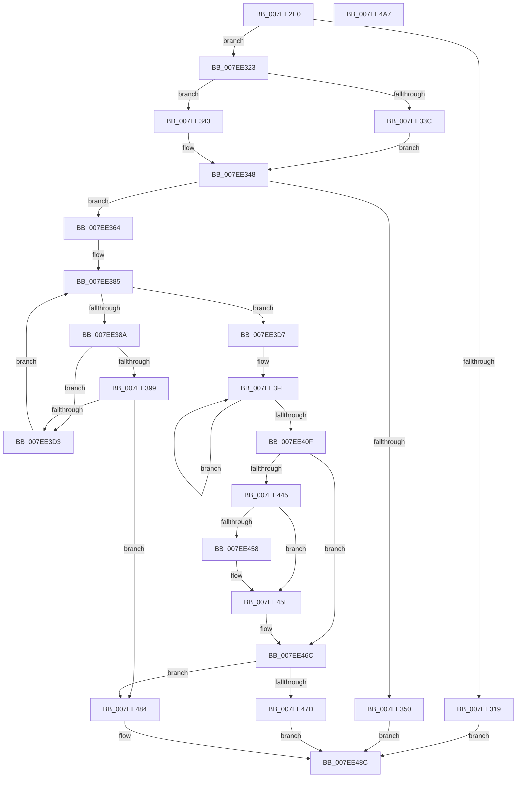

# CmpCreateEmptyHiveClone

- RVA: `0x007EE2E0`–`0x007EE4A8` (길이 `456` bytes)
- VA: `0x00000001407EE2E0`
- 실행 섹션: `PAGE`
- PDB 이름 있음: `예`; PDB Function 태그: `아니요`
- unwind 정보 RVA: `0x00093E28`
- 디코드: `113`개 명령, `456/456` bytes 표시
- 미해석 바이트: `0` (있으면 어셈블리에 `.byte`로 보존)

> 이 문서는 커널 이미지의 기계어와 PDB 기호를 분석해 생성했습니다. 4번과 5번은 함수 원형과 자료형을 바이너리 사용 방식에서 추정한 C 해석이며 원본 소스 복구 결과는 아닙니다.

## 1. Dependencies

- 직접 호출 지점: **8**; 고유 호출 대상: **8**
- 직접 호출자로 확인된 함수: **1**
- RIP 상대 이미지 참조: **1**

### Outgoing calls
- `0x007EE30C` → [ExAllocatePool2](../../poolcode/B8/ExAllocatePool2_function_00B820F0.md) (function, `0x00B820F0`)
- `0x007EE33C` → [CmpAllocateForNonPagedHive](../../text/4D/CmpAllocateForNonPagedHive_function_004D92F0.md) (function, `0x004D92F0`)
- `0x007EE343` → [CmpAllocate](../84/CmpAllocate_function_0084DD40.md) (function, `0x0084DD40`)
- `0x007EE35A` → [ExFreePoolWithTag](../../poolcode/B8/ExFreePoolWithTag_function_00B82870.md) (function, `0x00B82870`)
- `0x007EE36A` → [CmpHiveInitialize](../87/CmpHiveInitialize_function_0087B7AC.md) (function, `0x0087B7AC`)
- `0x007EE3C4` → [ObDuplicateObject](../8C/ObDuplicateObject_function_008C4FA0.md) (function, `0x008C4FA0`)
- `0x007EE472` → [HvHiveStartEmptyClone](HvHiveStartEmptyClone_function_007EF050.md) (function, `0x007EF050`)
- `0x007EE487` → [CmpDestroyHive](../9B/CmpDestroyHive_function_009B1708.md) (function, `0x009B1708`)

### Direct callers
- [sub_00B1845C](../B1/Unknown_function_00B1845C.md) at `0x00B1848F`

### Static image references
- `0x007EE399` → RVA `0x00FC6AB0` (`ALMOSTRO`; read)

## 2. Other-region calls and transfers

- 다른 실행 섹션으로 향하는 call: **3**
  - `0x007EE30C` → [ExAllocatePool2](../../poolcode/B8/ExAllocatePool2_function_00B820F0.md) (`PAGE` → `POOLCODE`)
  - `0x007EE33C` → [CmpAllocateForNonPagedHive](../../text/4D/CmpAllocateForNonPagedHive_function_004D92F0.md) (`PAGE` → `.text`)
  - `0x007EE35A` → [ExFreePoolWithTag](../../poolcode/B8/ExFreePoolWithTag_function_00B82870.md) (`PAGE` → `POOLCODE`)
- 별도 외부 분기/꼬리 이동을 확인하지 못했습니다.

## 3. Assembly (complete function range)

```asm
007EE2E0  48 89 5C 24 08                  mov qword ptr [rsp + 8], rbx
007EE2E5  48 89 6C 24 10                  mov qword ptr [rsp + 0x10], rbp
007EE2EA  48 89 74 24 18                  mov qword ptr [rsp + 0x18], rsi
007EE2EF  57                              push rdi
007EE2F0  41 56                           push r14
007EE2F2  41 57                           push r15
007EE2F4  48 83 EC 40                     sub rsp, 0x40
007EE2F8  48 8B FA                        mov rdi, rdx
007EE2FB  4C 8B F9                        mov r15, rcx
007EE2FE  BA 20 00 00 00                  mov edx, 0x20
007EE303  41 B8 43 4D 39 35               mov r8d, 0x35394d43
007EE309  8D 4A 20                        lea ecx, [rdx + 0x20]
007EE30C  E8 DF 3D 39 00                  call 0x140b820f0
007EE311  48 8B E8                        mov rbp, rax
007EE314  48 85 C0                        test rax, rax
007EE317  75 0A                           jne 0x1407ee323
007EE319  BE 17 00 00 C0                  mov esi, 0xc0000017
007EE31E  E9 69 01 00 00                  jmp 0x1407ee48c
007EE323  33 D2                           xor edx, edx
007EE325  B9 D8 12 00 00                  mov ecx, 0x12d8
007EE32A  F7 87 A0 00 00 00 00 00 00 02   test dword ptr [rdi + 0xa0], 0x2000000
007EE334  41 B8 43 4D 31 30               mov r8d, 0x30314d43
007EE33A  74 07                           je 0x1407ee343
007EE33C  E8 AF AF CE FF                  call 0x1404d92f0
007EE341  EB 05                           jmp 0x1407ee348
007EE343  E8 F8 F9 05 00                  call 0x14084dd40
007EE348  48 8B D8                        mov rbx, rax
007EE34B  48 85 C0                        test rax, rax
007EE34E  75 14                           jne 0x1407ee364
007EE350  33 D2                           xor edx, edx
007EE352  48 8B CD                        mov rcx, rbp
007EE355  BE 9A 00 00 C0                  mov esi, 0xc000009a
007EE35A  E8 11 45 39 00                  call 0x140b82870
007EE35F  E9 28 01 00 00                  jmp 0x1407ee48c
007EE364  48 8B D5                        mov rdx, rbp
007EE367  48 8B CB                        mov rcx, rbx
007EE36A  E8 3D D4 08 00                  call 0x14087b7ac
007EE36F  8B 87 10 10 00 00               mov eax, dword ptr [rdi + 0x1010]
007EE375  0F BA F0 10                     btr eax, 0x10
007EE379  33 ED                           xor ebp, ebp
007EE37B  89 83 10 10 00 00               mov dword ptr [rbx + 0x1010], eax
007EE381  44 8D 75 02                     lea r14d, [rbp + 2]
007EE385  83 FD 06                        cmp ebp, 6
007EE388  73 4D                           jae 0x1407ee3d7
007EE38A  48 8B 94 EF 08 06 00 00         mov rdx, qword ptr [rdi + rbp*8 + 0x608]
007EE392  8B C5                           mov eax, ebp
007EE394  48 85 D2                        test rdx, rdx
007EE397  74 3A                           je 0x1407ee3d3
007EE399  48 8B 0D 10 87 7D 00            mov rcx, qword ptr [rip + 0x7d8710]
007EE3A0  48 05 C1 00 00 00               add rax, 0xc1
007EE3A6  C6 44 24 38 00                  mov byte ptr [rsp + 0x38], 0
007EE3AB  45 33 C0                        xor r8d, r8d
007EE3AE  44 89 74 24 30                  mov dword ptr [rsp + 0x30], r14d
007EE3B3  C7 44 24 28 00 02 00 00         mov dword ptr [rsp + 0x28], 0x200
007EE3BB  83 64 24 20 00                  and dword ptr [rsp + 0x20], 0
007EE3C0  4C 8D 0C C3                     lea r9, [rbx + rax*8]
007EE3C4  E8 D7 6B 0D 00                  call 0x1408c4fa0
007EE3C9  8B F0                           mov esi, eax
007EE3CB  85 C0                           test eax, eax
007EE3CD  0F 88 B1 00 00 00               js 0x1407ee484
007EE3D3  FF C5                           inc ebp
007EE3D5  EB AE                           jmp 0x1407ee385
007EE3D7  8B 87 00 07 00 00               mov eax, dword ptr [rdi + 0x700]
007EE3DD  48 8D 8B 10 07 00 00            lea rcx, [rbx + 0x710]
007EE3E4  89 83 00 07 00 00               mov dword ptr [rbx + 0x700], eax
007EE3EA  48 8B D7                        mov rdx, rdi
007EE3ED  48 8B 87 08 07 00 00            mov rax, qword ptr [rdi + 0x708]
007EE3F4  48 2B D3                        sub rdx, rbx
007EE3F7  48 89 83 08 07 00 00            mov qword ptr [rbx + 0x708], rax
007EE3FE  48 8B 04 0A                     mov rax, qword ptr [rdx + rcx]
007EE402  48 89 01                        mov qword ptr [rcx], rax
007EE405  48 8D 49 08                     lea rcx, [rcx + 8]
007EE409  49 83 EE 01                     sub r14, 1
007EE40D  75 EF                           jne 0x1407ee3fe
007EE40F  48 8B 87 28 10 00 00            mov rax, qword ptr [rdi + 0x1028]
007EE416  48 89 83 28 10 00 00            mov qword ptr [rbx + 0x1028], rax
007EE41D  48 8B 87 30 10 00 00            mov rax, qword ptr [rdi + 0x1030]
007EE424  48 89 83 30 10 00 00            mov qword ptr [rbx + 0x1030], rax
007EE42B  48 8B 87 58 10 00 00            mov rax, qword ptr [rdi + 0x1058]
007EE432  48 89 83 58 10 00 00            mov qword ptr [rbx + 0x1058], rax
007EE439  48 8B 8F B8 12 00 00            mov rcx, qword ptr [rdi + 0x12b8]
007EE440  48 85 C9                        test rcx, rcx
007EE443  74 27                           je 0x1407ee46c
007EE445  41 8D 46 01                     lea eax, [r14 + 1]
007EE449  F0 48 0F C1 41 18               lock xadd qword ptr [rcx + 0x18], rax
007EE44F  48 FF C0                        inc rax
007EE452  48 83 F8 01                     cmp rax, 1
007EE456  7F 06                           jg 0x1407ee45e
007EE458  41 8D 4E 0E                     lea ecx, [r14 + 0xe]
007EE45C  CD 29                           int 0x29
007EE45E  48 8B 87 B8 12 00 00            mov rax, qword ptr [rdi + 0x12b8]
007EE465  48 89 83 B8 12 00 00            mov qword ptr [rbx + 0x12b8], rax
007EE46C  48 8B D7                        mov rdx, rdi
007EE46F  48 8B CB                        mov rcx, rbx
007EE472  E8 D9 0B 00 00                  call 0x1407ef050
007EE477  8B F0                           mov esi, eax
007EE479  85 C0                           test eax, eax
007EE47B  78 07                           js 0x1407ee484
007EE47D  49 89 1F                        mov qword ptr [r15], rbx
007EE480  33 F6                           xor esi, esi
007EE482  EB 08                           jmp 0x1407ee48c
007EE484  48 8B CB                        mov rcx, rbx
007EE487  E8 7C 32 1C 00                  call 0x1409b1708
007EE48C  48 8B 5C 24 60                  mov rbx, qword ptr [rsp + 0x60]
007EE491  8B C6                           mov eax, esi
007EE493  48 8B 74 24 70                  mov rsi, qword ptr [rsp + 0x70]
007EE498  48 8B 6C 24 68                  mov rbp, qword ptr [rsp + 0x68]
007EE49D  48 83 C4 40                     add rsp, 0x40
007EE4A1  41 5F                           pop r15
007EE4A3  41 5E                           pop r14
007EE4A5  5F                              pop rdi
007EE4A6  C3                              ret
007EE4A7  CC                              int3
```

## 4. C-style interpretation (structured pseudocode)

```c
__int64 __fastcall CmpCreateEmptyHiveClone(__int64 a1, __int64 a2)
{
    __int64 result;
    __int64 v_r14;
    __int64 v_rbp;
    __int64 v_rsi;
    __int64 v_rsp;
    unsigned __int8 v_stack_m20;
    unsigned int v_stack_m28;
    unsigned int v_stack_m30;
    unsigned int v_stack_m38;
    unsigned __int64 v_stack_p10;
    unsigned __int64 v_stack_p18;
    unsigned __int64 v_stack_p8;

    v_stack_p8 = v_rbx;
    v_stack_p10 = v_rbp;
    v_stack_p18 = v_rsi;
    v_rsp = (v_rsp) - (64);
    result = ExAllocatePool2(32 + 32, 32, (unsigned int)(0x35394D43ULL), a4);
    if (result != 0) goto loc_007EE323;
    goto loc_007EE48C;
loc_007EE323:
    a2 = 0;
    if (((*(unsigned int *)(a2 + 160)) & (0x2000000ULL)) == 0) goto loc_007EE343;
    result = CmpAllocateForNonPagedHive((unsigned int)(0x12D8ULL), a2, (unsigned int)(0x30314D43ULL), a4);
    goto loc_007EE348;
loc_007EE343:
    result = CmpAllocate((unsigned int)(0x12D8ULL), a2, (unsigned int)(0x30314D43ULL), a4);
loc_007EE348:
    if (result != 0) goto loc_007EE364;
    a2 = 0;
    result = ExFreePoolWithTag(result, a2, (unsigned int)(0x30314D43ULL), a4);
    goto loc_007EE48C;
loc_007EE364:
    result = CmpHiveInitialize(result, result, (unsigned int)(0x30314D43ULL), a4);
    v_rbp = 0;
    *(unsigned int *)(result + 4112) = (unsigned int)((unsigned int)(*(unsigned int *)(a2 + 4112)));
loc_007EE385:
    if (0 >= 6) goto loc_007EE3D7;
    if (*(unsigned __int64 *)(a2 + v_rbp * 8 + 1544) == 0) goto loc_007EE3D3;
    result = (0) + (193);
    v_stack_m20 = 0;
    a3 = 0;
    v_stack_m28 = (unsigned int)(v_rbp + 2);
    v_stack_m30 = 512;
    result = ObDuplicateObject(*(unsigned __int64 *)(v_rip + 8226576), *(unsigned __int64 *)(a2 + v_rbp * 8 + 1544), a3, result + result * 8);
    if (sign_flag) goto loc_007EE484;
loc_007EE3D3:
    v_rbp = (unsigned int)((v_rbp) + 1);
    goto loc_007EE385;
loc_007EE3D7:
    *(unsigned int *)(result + 1792) = (unsigned int)((unsigned int)(*(unsigned int *)(a2 + 1792)));
    a2 = (0) - (result);
    *(unsigned __int64 *)(result + 1800) = *(unsigned __int64 *)(a2 + 1800);
loc_007EE3FE:
    *(unsigned __int64 *)(result + 1808) = *(unsigned __int64 *)(a2 + result + 1808 * 1);
    v_r14 = (v_rbp + 2) - (1);
    if (condition_is_not_equal) goto loc_007EE3FE;
    *(unsigned __int64 *)(result + 4136) = *(unsigned __int64 *)(a2 + 4136);
    *(unsigned __int64 *)(result + 4144) = *(unsigned __int64 *)(a2 + 4144);
    *(unsigned __int64 *)(result + 4184) = *(unsigned __int64 *)(a2 + 4184);
    if (*(unsigned __int64 *)(a2 + 4792) == 0) goto loc_007EE46C;
    result = (v_r14 + 1) + 1;
    if (result <= 1) {
        a1 = v_r14 + 14;
    }
    *(unsigned __int64 *)(result + 4792) = *(unsigned __int64 *)(a2 + 4792);
loc_007EE46C:
    result = HvHiveStartEmptyClone(result, a2, a3, result + result * 8);
    if (sign_flag) goto loc_007EE484;
    *(unsigned __int64 *)(a1) = result;
    v_rsi = 0;
    goto loc_007EE48C;
loc_007EE484:
    result = CmpDestroyHive(result, a2, a3, result + result * 8);
loc_007EE48C:
    v_rsp = (v_rsp) + (64);
    return 0;
}
```

## 5. (Beta) C Style

```c
int64_t CmpCreateEmptyHiveClone(void *Arg1, void *Arg2)
{
    uint8_t *arg1 = (uint8_t *)Arg1;
    uint8_t *arg2 = (uint8_t *)Arg2;

    int64_t result;
    int64_t local_r14;
    int64_t local_rbp;
    int64_t local_rsi;
    int64_t local_rsp;
    uint8_t v_stack_m20;
    uint32_t v_stack_m28;
    uint32_t v_stack_m30;
    uint32_t v_stack_m38;
    uint64_t v_stack_p10;
    uint64_t v_stack_p18;
    uint64_t v_stack_p8;

    v_stack_p8 = local_rbx;
    v_stack_p10 = local_rbp;
    v_stack_p18 = local_rsi;
    local_rsp = (local_rsp) - (64);
    result = ExAllocatePool2(32 + 32, 32, (uint32_t)(0x35394D43ULL), a4);
    if (result != 0) goto loc_007EE323;
    goto loc_007EE48C;
loc_007EE323:
    Arg2 = 0;
    if (((*(uint32_t *)(arg2 + 0xA0)) & (0x2000000ULL)) == 0) goto loc_007EE343;
    result = CmpAllocateForNonPagedHive((uint32_t)(0x12D8ULL), Arg2, (uint32_t)(0x30314D43ULL), a4);
    goto loc_007EE348;
loc_007EE343:
    result = CmpAllocate((uint32_t)(0x12D8ULL), Arg2, (uint32_t)(0x30314D43ULL), a4);
loc_007EE348:
    if (result != 0) goto loc_007EE364;
    Arg2 = 0;
    result = ExFreePoolWithTag(result, Arg2, (uint32_t)(0x30314D43ULL), a4);
    goto loc_007EE48C;
loc_007EE364:
    result = CmpHiveInitialize(result, result, (uint32_t)(0x30314D43ULL), a4);
    local_rbp = 0;
    *(uint32_t *)(result + 0x1010) = (uint32_t)((uint32_t)(*(uint32_t *)(arg2 + 0x1010)));
loc_007EE385:
    if (0 >= 6) goto loc_007EE3D7;
    if (*(uint64_t *)(arg2 + local_rbp * 8 + 0x608) == 0) goto loc_007EE3D3;
    result = (0) + (193);
    v_stack_m20 = 0;
    a3 = 0;
    v_stack_m28 = (uint32_t)(local_rbp + 2);
    v_stack_m30 = 512;
    result = ObDuplicateObject(*(uint64_t *)(v_rip + 0x7D8710), *(uint64_t *)(arg2 + local_rbp * 8 + 0x608), a3, result + result * 8);
    if (sign_flag) goto loc_007EE484;
loc_007EE3D3:
    local_rbp = (uint32_t)((local_rbp) + 1);
    goto loc_007EE385;
loc_007EE3D7:
    *(uint32_t *)(result + 0x700) = (uint32_t)((uint32_t)(*(uint32_t *)(arg2 + 0x700)));
    Arg2 = (0) - (result);
    *(uint64_t *)(result + 0x708) = *(uint64_t *)(arg2 + 0x708);
loc_007EE3FE:
    *(uint64_t *)(result + 0x710) = *(uint64_t *)(arg2 + result + 0x710 * 1);
    local_r14 = (local_rbp + 2) - (1);
    if (condition_is_not_equal) goto loc_007EE3FE;
    *(uint64_t *)(result + 0x1028) = *(uint64_t *)(arg2 + 0x1028);
    *(uint64_t *)(result + 0x1030) = *(uint64_t *)(arg2 + 0x1030);
    *(uint64_t *)(result + 0x1058) = *(uint64_t *)(arg2 + 0x1058);
    if (*(uint64_t *)(arg2 + 0x12B8) == 0) goto loc_007EE46C;
    result = (local_r14 + 1) + 1;
    if (result <= 1) {
        Arg1 = local_r14 + 14;
    }
    *(uint64_t *)(result + 0x12B8) = *(uint64_t *)(arg2 + 0x12B8);
loc_007EE46C:
    result = HvHiveStartEmptyClone(result, Arg2, a3, result + result * 8);
    if (sign_flag) goto loc_007EE484;
    *(uint64_t *)(arg1) = result;
    local_rsi = 0;
    goto loc_007EE48C;
loc_007EE484:
    result = CmpDestroyHive(result, Arg2, a3, result + result * 8);
loc_007EE48C:
    local_rsp = (local_rsp) + (64);
    return 0;
}
```

### 관측된 메모리 오프셋

구조체 형식이 확인되지 않은 접근은 인자 기준의 오프셋으로만 기록했습니다.

| 기준 인자 | 오프셋 표현 | 폭 (bit) | 접근 |
|---|---:|---:|---|
| `Arg1` | `+ 0x0` | `64` | `W` |
| `Arg2` | `+ 0x0 + rcx*1` | `64` | `R` |
| `Arg2` | `+ 0xA0` | `32` | `R` |
| `Arg2` | `+ 0x608 + rbp*8` | `64` | `R` |
| `Arg2` | `+ 0x700` | `32` | `R` |
| `Arg2` | `+ 0x708` | `64` | `R` |
| `Arg2` | `+ 0x1010` | `32` | `R` |
| `Arg2` | `+ 0x1028` | `64` | `R` |
| `Arg2` | `+ 0x1030` | `64` | `R` |
| `Arg2` | `+ 0x1058` | `64` | `R` |
| `Arg2` | `+ 0x12B8` | `64` | `R` |

## 6. Execution-region graph

[열기: 2D/3D 그래프와 함수 탐색 컨트롤 패널](../../../control-panel.html?section=page&rva=0x007EE2E0&view=graph)

- 2D 그래프는 위에서 아래로 흐르고, 3D 그래프는 빈 공간을 드래그해 회전합니다. Shift+드래그는 이동, 휠은 확대·축소, 함수 노드 선택은 대상 보고서 이동입니다.

### Static fallback


