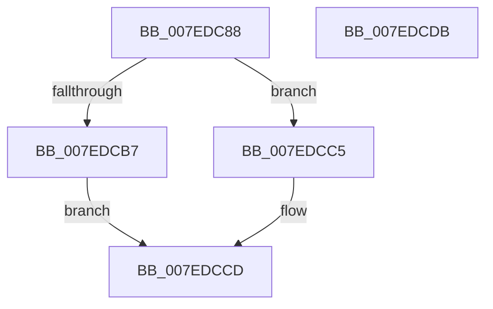

# CmpCreateGlobalKeyLockEntry

- RVA: `0x007EDC88`–`0x007EDCDC` (길이 `84` bytes)
- VA: `0x00000001407EDC88`
- 실행 섹션: `PAGE`
- PDB 이름 있음: `예`; PDB Function 태그: `아니요`
- unwind 정보 RVA: `0x0005CAAC`
- 디코드: `23`개 명령, `84/84` bytes 표시
- 미해석 바이트: `0` (있으면 어셈블리에 `.byte`로 보존)

> 이 문서는 커널 이미지의 기계어와 PDB 기호를 분석해 생성했습니다. 4번과 5번은 함수 원형과 자료형을 바이너리 사용 방식에서 추정한 C 해석이며 원본 소스 복구 결과는 아닙니다.

## 1. Dependencies

- 직접 호출 지점: **3**; 고유 호출 대상: **3**
- 직접 호출자로 확인된 함수: **1**
- RIP 상대 이미지 참조: **0**

### Outgoing calls
- `0x007EDC95` → [CmpReferenceKeyControlBlockUnsafe](../87/CmpReferenceKeyControlBlockUnsafe_function_00874DA0.md) (function, `0x00874DA0`)
- `0x007EDCAA` → [CmpAllocatePool](../../text/3C/CmpAllocatePool_function_003CD504.md) (function, `0x003CD504`)
- `0x007EDCC8` → [CmpDereferenceKeyControlBlockUnsafe](../99/CmpDereferenceKeyControlBlockUnsafe_function_0099F960.md) (function, `0x0099F960`)

### Direct callers
- [CmpGlobalLockKeyForWrite](../A7/CmpGlobalLockKeyForWrite_function_00A7CD88.md) at `0x00A7CE21`

### Static image references
- 디코드된 RIP-relative 메모리 참조가 없습니다.

## 2. Other-region calls and transfers

- 다른 실행 섹션으로 향하는 call: **1**
  - `0x007EDCAA` → [CmpAllocatePool](../../text/3C/CmpAllocatePool_function_003CD504.md) (`PAGE` → `.text`)
- 별도 외부 분기/꼬리 이동을 확인하지 못했습니다.

## 3. Assembly (complete function range)

```asm
007EDC88  48 89 5C 24 08                  mov qword ptr [rsp + 8], rbx
007EDC8D  57                              push rdi
007EDC8E  48 83 EC 20                     sub rsp, 0x20
007EDC92  48 8B F9                        mov rdi, rcx
007EDC95  E8 06 71 08 00                  call 0x140874da0
007EDC9A  BA 20 00 00 00                  mov edx, 0x20
007EDC9F  B9 00 01 00 00                  mov ecx, 0x100
007EDCA4  41 B8 43 4D 37 33               mov r8d, 0x33374d43
007EDCAA  E8 55 F8 BD FF                  call 0x1403cd504
007EDCAF  48 8B D8                        mov rbx, rax
007EDCB2  48 85 C0                        test rax, rax
007EDCB5  74 0E                           je 0x1407edcc5
007EDCB7  48 C7 40 10 01 00 00 00         mov qword ptr [rax + 0x10], 1
007EDCBF  48 89 78 18                     mov qword ptr [rax + 0x18], rdi
007EDCC3  EB 08                           jmp 0x1407edccd
007EDCC5  48 8B CF                        mov rcx, rdi
007EDCC8  E8 93 1C 1B 00                  call 0x14099f960
007EDCCD  48 8B C3                        mov rax, rbx
007EDCD0  48 8B 5C 24 30                  mov rbx, qword ptr [rsp + 0x30]
007EDCD5  48 83 C4 20                     add rsp, 0x20
007EDCD9  5F                              pop rdi
007EDCDA  C3                              ret
007EDCDB  CC                              int3
```

## 4. C-style interpretation (structured pseudocode)

```c
__int64 __fastcall CmpCreateGlobalKeyLockEntry(__int64 a1)
{
    __int64 result;
    __int64 v_rsp;
    unsigned __int64 v_stack_p8;

    v_stack_p8 = v_rbx;
    v_rsp = (v_rsp) - (32);
    result = CmpReferenceKeyControlBlockUnsafe(a1, a2, a3, a4);
    result = CmpAllocatePool(256, 32, (unsigned int)(0x33374D43ULL), a4);
    if (result == 0) goto loc_007EDCC5;
    *(unsigned __int64 *)(result + 16) = 1;
    *(unsigned __int64 *)(result + 24) = a1;
    goto loc_007EDCCD;
loc_007EDCC5:
    result = CmpDereferenceKeyControlBlockUnsafe(a1, 32, (unsigned int)(0x33374D43ULL), a4);
loc_007EDCCD:
    v_rsp = (v_rsp) + (32);
    return result;
}
```

## 5. (Beta) C Style

```c
int64_t CmpCreateGlobalKeyLockEntry(int64_t Arg1)
{
    int64_t result;
    int64_t local_rsp;
    uint64_t v_stack_p8;

    v_stack_p8 = local_rbx;
    local_rsp = (local_rsp) - (32);
    result = CmpReferenceKeyControlBlockUnsafe(Arg1, a2, a3, a4);
    result = CmpAllocatePool(256, 32, (uint32_t)(0x33374D43ULL), a4);
    if (result == 0) goto loc_007EDCC5;
    *(uint64_t *)(result + 0x10) = 1;
    *(uint64_t *)(result + 0x18) = Arg1;
    goto loc_007EDCCD;
loc_007EDCC5:
    result = CmpDereferenceKeyControlBlockUnsafe(Arg1, 32, (uint32_t)(0x33374D43ULL), a4);
loc_007EDCCD:
    local_rsp = (local_rsp) + (32);
    return result;
}
```

## 6. Execution-region graph

[열기: 2D/3D 그래프와 함수 탐색 컨트롤 패널](../../../control-panel.html?section=page&rva=0x007EDC88&view=graph)

- 2D 그래프는 위에서 아래로 흐르고, 3D 그래프는 빈 공간을 드래그해 회전합니다. Shift+드래그는 이동, 휠은 확대·축소, 함수 노드 선택은 대상 보고서 이동입니다.

### Static fallback


