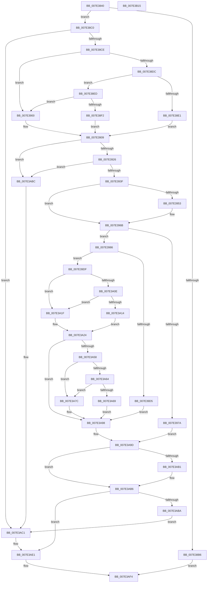

# CmpCreateHwProfileFriendlyName

- RVA: `0x007E3840`–`0x007E3B16` (길이 `726` bytes)
- VA: `0x00000001407E3840`
- 실행 섹션: `PAGE`
- PDB 이름 있음: `예`; PDB Function 태그: `아니요`
- unwind 정보 RVA: `0x000D69C8`
- 디코드: `186`개 명령, `726/726` bytes 표시
- 미해석 바이트: `0` (있으면 어셈블리에 `.byte`로 보존)

> 이 문서는 커널 이미지의 기계어와 PDB 기호를 분석해 생성했습니다. 4번과 5번은 함수 원형과 자료형을 바이너리 사용 방식에서 추정한 C 해석이며 원본 소스 복구 결과는 아닙니다.

## 1. Dependencies

- 직접 호출 지점: **14**; 고유 호출 대상: **12**
- 직접 호출자로 확인된 함수: **1**
- RIP 상대 이미지 참조: **7**

### Outgoing calls
- `0x007E390E` → [RtlInitUnicodeString](../../text/42/RtlInitUnicodeString_function_0042A780.md) (function, `0x0042A780`)
- `0x007E3919` → [KeGetBugMessageText](../../text/5B/KeGetBugMessageText_function_005B38EC.md) (function, `0x005B38EC`)
- `0x007E3932` → [RtlAnsiStringToUnicodeString](../90/RtlAnsiStringToUnicodeString_function_0090BEA0.md) (function, `0x0090BEA0`)
- `0x007E3991` → [RtlInitUnicodeString](../../text/42/RtlInitUnicodeString_function_0042A780.md) (function, `0x0042A780`)
- `0x007E39CA` → [ZwOpenKey](../../text/6A/ZwOpenKey_function_006AD310.md) (function, `0x006AD310`)
- `0x007E3A05` → [ZwQueryValueKey](../../text/6A/ZwQueryValueKey_function_006AD3B0.md) (function, `0x006AD3B0`)
- `0x007E3A4D` → [ZwSetValueKey](../../text/6A/ZwSetValueKey_function_006ADCD0.md) (function, `0x006ADCD0`)
- `0x007E3A75` → [wcscpy_s](../../text/50/wcscpy_s_function_005064B0.md) (function, `0x005064B0`)
- `0x007E3A93` → [swprintf_s](../../text/50/swprintf_s_function_00504B20.md) (function, `0x00504B20`)
- `0x007E3AA2` → [RtlFreeAnsiString](../9C/RtlFreeAnsiString_function_009C0800.md) (function, `0x009C0800`)
- `0x007E3AB1` → [ZwClose](../../text/6A/ZwClose_function_006AD2B0.md) (function, `0x006AD2B0`)
- `0x007E3AD9` → [swprintf_s](../../text/50/swprintf_s_function_00504B20.md) (function, `0x00504B20`)
- `0x007E3AE8` → [RtlCreateUnicodeString](../9B/RtlCreateUnicodeString_function_009BD860.md) (function, `0x009BD860`)
- `0x007E3AFE` → [_security_check_cookie](../../text/6A/_security_check_cookie_function_006AC640.md) (function, `0x006AC640`)

### Direct callers
- [CmpCloneHwProfile](CmpCloneHwProfile_function_007E303C.md) at `0x007E350B`

### Static image references
- `0x007E385A` → RVA `0x00E0A740` (`.data`; read)
- `0x007E38E4` → RVA `0x00B093D0` (` ?? ::NNGAKEGL::`string'`; read)
- `0x007E38F7` → RVA `0x00B09380` (` ?? ::NNGAKEGL::`string'`; read)
- `0x007E3900` → RVA `0x00AFE5E0` (` ?? ::NNGAKEGL::`string'`; read)
- `0x007E3986` → RVA `0x00B09130` (` ?? ::NNGAKEGL::`string'`; read)
- `0x007E3A83` → RVA `0x00B093A0` (` ?? ::NNGAKEGL::`string'`; read)
- `0x007E3AC9` → RVA `0x00B09280` (` ?? ::NNGAKEGL::`string'`; read)

## 2. Other-region calls and transfers

- 다른 실행 섹션으로 향하는 call: **11**
  - `0x007E390E` → [RtlInitUnicodeString](../../text/42/RtlInitUnicodeString_function_0042A780.md) (`PAGE` → `.text`)
  - `0x007E3919` → [KeGetBugMessageText](../../text/5B/KeGetBugMessageText_function_005B38EC.md) (`PAGE` → `.text`)
  - `0x007E3991` → [RtlInitUnicodeString](../../text/42/RtlInitUnicodeString_function_0042A780.md) (`PAGE` → `.text`)
  - `0x007E39CA` → [ZwOpenKey](../../text/6A/ZwOpenKey_function_006AD310.md) (`PAGE` → `.text`)
  - `0x007E3A05` → [ZwQueryValueKey](../../text/6A/ZwQueryValueKey_function_006AD3B0.md) (`PAGE` → `.text`)
  - `0x007E3A4D` → [ZwSetValueKey](../../text/6A/ZwSetValueKey_function_006ADCD0.md) (`PAGE` → `.text`)
  - `0x007E3A75` → [wcscpy_s](../../text/50/wcscpy_s_function_005064B0.md) (`PAGE` → `.text`)
  - `0x007E3A93` → [swprintf_s](../../text/50/swprintf_s_function_00504B20.md) (`PAGE` → `.text`)
  - `0x007E3AB1` → [ZwClose](../../text/6A/ZwClose_function_006AD2B0.md) (`PAGE` → `.text`)
  - `0x007E3AD9` → [swprintf_s](../../text/50/swprintf_s_function_00504B20.md) (`PAGE` → `.text`)
  - `0x007E3AFE` → [_security_check_cookie](../../text/6A/_security_check_cookie_function_006AC640.md) (`PAGE` → `.text`)
- 별도 외부 분기/꼬리 이동을 확인하지 못했습니다.

## 3. Assembly (complete function range)

```asm
007E3840  40 55                           push rbp
007E3842  53                              push rbx
007E3843  56                              push rsi
007E3844  57                              push rdi
007E3845  41 54                           push r12
007E3847  41 56                           push r14
007E3849  41 57                           push r15
007E384B  48 8D AC 24 90 FE FF FF         lea rbp, [rsp - 0x170]
007E3853  48 81 EC 70 02 00 00            sub rsp, 0x270
007E385A  48 8B 05 DF 6E 62 00            mov rax, qword ptr [rip + 0x626edf]
007E3861  48 33 C4                        xor rax, rsp
007E3864  48 89 85 60 01 00 00            mov qword ptr [rbp + 0x160], rax
007E386B  45 33 E4                        xor r12d, r12d
007E386E  0F 57 C0                        xorps xmm0, xmm0
007E3871  33 C0                           xor eax, eax
007E3873  44 89 64 24 40                  mov dword ptr [rsp + 0x40], r12d
007E3878  44 89 64 24 30                  mov dword ptr [rsp + 0x30], r12d
007E387D  0F 57 C9                        xorps xmm1, xmm1
007E3880  4C 89 64 24 38                  mov qword ptr [rsp + 0x38], r12
007E3885  4D 8B F1                        mov r14, r9
007E3888  48 89 45 88                     mov qword ptr [rbp - 0x78], rax
007E388C  45 8B F8                        mov r15d, r8d
007E388F  89 45 90                        mov dword ptr [rbp - 0x70], eax
007E3892  48 8B D9                        mov rbx, rcx
007E3895  0F 11 45 98                     movups xmmword ptr [rbp - 0x68], xmm0
007E3899  0F 11 4C 24 48                  movups xmmword ptr [rsp + 0x48], xmm1
007E389E  0F 11 44 24 58                  movups xmmword ptr [rsp + 0x58], xmm0
007E38A3  0F 11 4D A8                     movups xmmword ptr [rbp - 0x58], xmm1
007E38A7  0F 11 44 24 68                  movups xmmword ptr [rsp + 0x68], xmm0
007E38AC  0F 11 44 24 78                  movups xmmword ptr [rsp + 0x78], xmm0
007E38B1  4D 85 C9                        test r9, r9
007E38B4  75 0A                           jne 0x1407e38c0
007E38B6  B8 0D 00 00 C0                  mov eax, 0xc000000d
007E38BB  E9 34 02 00 00                  jmp 0x1407e3af4
007E38C0  BF 01 00 00 C0                  mov edi, 0xc0000001
007E38C5  48 85 DB                        test rbx, rbx
007E38C8  0F 84 F3 01 00 00               je 0x1407e3ac1
007E38CE  8B C2                           mov eax, edx
007E38D0  B9 03 00 01 40                  mov ecx, 0x40010003
007E38D5  83 E0 03                        and eax, 3
007E38D8  3C 03                           cmp al, 3
007E38DA  74 24                           je 0x1407e3900
007E38DC  F6 C2 02                        test dl, 2
007E38DF  74 0C                           je 0x1407e38ed
007E38E1  8D 79 FF                        lea edi, [rcx - 1]
007E38E4  48 8D 15 E5 5A 32 00            lea rdx, [rip + 0x325ae5]
007E38EB  EB 1C                           jmp 0x1407e3909
007E38ED  F6 C2 01                        test dl, 1
007E38F0  74 0E                           je 0x1407e3900
007E38F2  BF 01 00 01 40                  mov edi, 0x40010001
007E38F7  48 8D 15 82 5A 32 00            lea rdx, [rip + 0x325a82]
007E38FE  EB 09                           jmp 0x1407e3909
007E3900  48 8D 15 D9 AC 31 00            lea rdx, [rip + 0x31acd9]
007E3907  8B F9                           mov edi, ecx
007E3909  48 8D 4C 24 58                  lea rcx, [rsp + 0x58]
007E390E  E8 6D 6E C4 FF                  call 0x14042a780
007E3913  48 8D 55 98                     lea rdx, [rbp - 0x68]
007E3917  8B CF                           mov ecx, edi
007E3919  E8 CE FF DC FF                  call 0x1405b38ec
007E391E  84 C0                           test al, al
007E3920  0F 84 96 01 00 00               je 0x1407e3abc
007E3926  41 B0 01                        mov r8b, 1
007E3929  48 8D 55 98                     lea rdx, [rbp - 0x68]
007E392D  48 8D 4C 24 48                  lea rcx, [rsp + 0x48]
007E3932  E8 69 85 12 00                  call 0x14090bea0
007E3937  85 C0                           test eax, eax
007E3939  0F 88 7D 01 00 00               js 0x1407e3abc
007E393F  0F B7 4C 24 48                  movzx ecx, word ptr [rsp + 0x48]
007E3944  B8 04 00 00 00                  mov eax, 4
007E3949  48 8B 74 24 50                  mov rsi, qword ptr [rsp + 0x50]
007E394E  66 3B C8                        cmp cx, ax
007E3951  76 18                           jbe 0x1407e396b
007E3953  B8 FC FF 00 00                  mov eax, 0xfffc
007E3958  66 03 C8                        add cx, ax
007E395B  0F B7 C1                        movzx eax, cx
007E395E  48 D1 E8                        shr rax, 1
007E3961  66 89 4C 24 48                  mov word ptr [rsp + 0x48], cx
007E3966  66 44 89 24 46                  mov word ptr [rsi + rax*2], r12w
007E396B  0F B7 C1                        movzx eax, cx
007E396E  48 83 C0 0C                     add rax, 0xc
007E3972  48 3D A0 00 00 00               cmp rax, 0xa0
007E3978  76 0C                           jbe 0x1407e3986
007E397A  BF 01 00 00 C0                  mov edi, 0xc0000001
007E397F  8B DF                           mov ebx, edi
007E3981  E9 17 01 00 00                  jmp 0x1407e3a9d
007E3986  48 8D 15 A3 57 32 00            lea rdx, [rip + 0x3257a3]
007E398D  48 8D 4D A8                     lea rcx, [rbp - 0x58]
007E3991  E8 EA 6D C4 FF                  call 0x14042a780
007E3996  48 8D 45 A8                     lea rax, [rbp - 0x58]
007E399A  C7 44 24 68 30 00 00 00         mov dword ptr [rsp + 0x68], 0x30
007E39A2  0F 57 C0                        xorps xmm0, xmm0
007E39A5  48 89 44 24 78                  mov qword ptr [rsp + 0x78], rax
007E39AA  4C 8D 44 24 68                  lea r8, [rsp + 0x68]
007E39AF  48 89 5C 24 70                  mov qword ptr [rsp + 0x70], rbx
007E39B4  BA 19 00 02 00                  mov edx, 0x20019
007E39B9  C7 45 80 40 02 00 00            mov dword ptr [rbp - 0x80], 0x240
007E39C0  48 8D 4C 24 38                  lea rcx, [rsp + 0x38]
007E39C5  F3 0F 7F 45 88                  movdqu xmmword ptr [rbp - 0x78], xmm0
007E39CA  E8 41 99 EC FF                  call 0x1406ad310
007E39CF  8B D8                           mov ebx, eax
007E39D1  85 C0                           test eax, eax
007E39D3  79 0A                           jns 0x1407e39df
007E39D5  4C 89 64 24 38                  mov qword ptr [rsp + 0x38], r12
007E39DA  E9 B9 00 00 00                  jmp 0x1407e3a98
007E39DF  48 8B 4C 24 38                  mov rcx, qword ptr [rsp + 0x38]
007E39E4  48 8D 44 24 40                  lea rax, [rsp + 0x40]
007E39E9  48 89 44 24 28                  mov qword ptr [rsp + 0x28], rax
007E39EE  4C 8D 4D 60                     lea r9, [rbp + 0x60]
007E39F2  41 B8 01 00 00 00               mov r8d, 1
007E39F8  C7 44 24 20 00 01 00 00         mov dword ptr [rsp + 0x20], 0x100
007E3A00  48 8D 54 24 58                  lea rdx, [rsp + 0x58]
007E3A05  E8 A6 99 EC FF                  call 0x1406ad3b0
007E3A0A  85 C0                           test eax, eax
007E3A0C  78 11                           js 0x1407e3a1f
007E3A0E  83 7D 64 04                     cmp dword ptr [rbp + 0x64], 4
007E3A12  75 0B                           jne 0x1407e3a1f
007E3A14  8B 45 68                        mov eax, dword ptr [rbp + 0x68]
007E3A17  8B 4C 05 60                     mov ecx, dword ptr [rbp + rax + 0x60]
007E3A1B  FF C1                           inc ecx
007E3A1D  EB 05                           jmp 0x1407e3a24
007E3A1F  B9 01 00 00 00                  mov ecx, 1
007E3A24  89 4C 24 30                     mov dword ptr [rsp + 0x30], ecx
007E3A28  48 8D 44 24 30                  lea rax, [rsp + 0x30]
007E3A2D  48 8B 4C 24 38                  mov rcx, qword ptr [rsp + 0x38]
007E3A32  48 8D 54 24 58                  lea rdx, [rsp + 0x58]
007E3A37  C7 44 24 28 04 00 00 00         mov dword ptr [rsp + 0x28], 4
007E3A3F  41 B9 04 00 00 00               mov r9d, 4
007E3A45  45 33 C0                        xor r8d, r8d
007E3A48  48 89 44 24 20                  mov qword ptr [rsp + 0x20], rax
007E3A4D  E8 7E A2 EC FF                  call 0x1406adcd0
007E3A52  8B D8                           mov ebx, eax
007E3A54  85 C0                           test eax, eax
007E3A56  78 40                           js 0x1407e3a98
007E3A58  8B 44 24 30                     mov eax, dword ptr [rsp + 0x30]
007E3A5C  81 FF 03 00 01 40               cmp edi, 0x40010003
007E3A62  74 18                           je 0x1407e3a7c
007E3A64  83 F8 01                        cmp eax, 1
007E3A67  77 13                           ja 0x1407e3a7c
007E3A69  4C 8B C6                        mov r8, rsi
007E3A6C  48 8D 4D C0                     lea rcx, [rbp - 0x40]
007E3A70  BA 50 00 00 00                  mov edx, 0x50
007E3A75  E8 36 2A D2 FF                  call 0x1405064b0
007E3A7A  EB 1C                           jmp 0x1407e3a98
007E3A7C  4C 8B CE                        mov r9, rsi
007E3A7F  89 44 24 20                     mov dword ptr [rsp + 0x20], eax
007E3A83  4C 8D 05 16 59 32 00            lea r8, [rip + 0x325916]
007E3A8A  BA 50 00 00 00                  mov edx, 0x50
007E3A8F  48 8D 4D C0                     lea rcx, [rbp - 0x40]
007E3A93  E8 88 10 D2 FF                  call 0x140504b20
007E3A98  BF 01 00 00 C0                  mov edi, 0xc0000001
007E3A9D  48 8D 4C 24 48                  lea rcx, [rsp + 0x48]
007E3AA2  E8 59 CD 1D 00                  call 0x1409c0800
007E3AA7  48 8B 4C 24 38                  mov rcx, qword ptr [rsp + 0x38]
007E3AAC  48 85 C9                        test rcx, rcx
007E3AAF  74 05                           je 0x1407e3ab6
007E3AB1  E8 FA 97 EC FF                  call 0x1406ad2b0
007E3AB6  85 DB                           test ebx, ebx
007E3AB8  79 27                           jns 0x1407e3ae1
007E3ABA  EB 05                           jmp 0x1407e3ac1
007E3ABC  BF 01 00 00 C0                  mov edi, 0xc0000001
007E3AC1  45 8B CF                        mov r9d, r15d
007E3AC4  66 44 89 65 C0                  mov word ptr [rbp - 0x40], r12w
007E3AC9  4C 8D 05 B0 57 32 00            lea r8, [rip + 0x3257b0]
007E3AD0  BA 50 00 00 00                  mov edx, 0x50
007E3AD5  48 8D 4D C0                     lea rcx, [rbp - 0x40]
007E3AD9  E8 42 10 D2 FF                  call 0x140504b20
007E3ADE  41 8B DC                        mov ebx, r12d
007E3AE1  48 8D 55 C0                     lea rdx, [rbp - 0x40]
007E3AE5  49 8B CE                        mov rcx, r14
007E3AE8  E8 73 9D 1D 00                  call 0x1409bd860
007E3AED  84 C0                           test al, al
007E3AEF  0F 44 DF                        cmove ebx, edi
007E3AF2  8B C3                           mov eax, ebx
007E3AF4  48 8B 8D 60 01 00 00            mov rcx, qword ptr [rbp + 0x160]
007E3AFB  48 33 CC                        xor rcx, rsp
007E3AFE  E8 3D 8B EC FF                  call 0x1406ac640
007E3B03  48 81 C4 70 02 00 00            add rsp, 0x270
007E3B0A  41 5F                           pop r15
007E3B0C  41 5E                           pop r14
007E3B0E  41 5C                           pop r12
007E3B10  5F                              pop rdi
007E3B11  5E                              pop rsi
007E3B12  5B                              pop rbx
007E3B13  5D                              pop rbp
007E3B14  C3                              ret
007E3B15  CC                              int3
```

## 4. C-style interpretation (structured pseudocode)

```c
__int64 __fastcall CmpCreateHwProfileFriendlyName(__int64 a1, int a2, int a3, __int64 a4)
{
    __int64 result;
    __int64 v_r12;
    __int64 v_rbx;
    __int64 v_rsp;
    unsigned int v_stack_m140;
    unsigned int v_stack_m144;
    unsigned __int64 v_stack_m148;
    unsigned __int64 v_stack_m1A8;
    unsigned __int64 v_stack_m1E8;
    unsigned __int64 v_stack_m200;
    unsigned __int64 v_stack_m210;
    unsigned int v_stack_m218;
    unsigned __int64 v_stack_m220;
    unsigned int v_stack_m228;
    unsigned __int64 v_stack_m230;
    unsigned __int64 v_stack_m238;
    unsigned __int64 v_stack_m240;
    unsigned __int64 v_stack_m250;
    unsigned __int64 v_stack_m258;
    unsigned __int64 v_stack_m260;
    unsigned int v_stack_m268;
    unsigned __int64 v_stack_m270;
    unsigned int v_stack_m278;
    unsigned __int64 v_stack_m280;
    unsigned int v_stack_m288;
    unsigned __int64 v_stack_m48;

    v_rsp = (v_rsp) - (624);
    result = (*(unsigned __int64 *)(v_rip + 6450911)) ^ (v_rsp);
    v_stack_m48 = result;
    v_r12 = 0;
    result = 0;
    v_stack_m268 = 0;
    v_stack_m278 = 0;
    v_stack_m270 = 0;
    v_stack_m220 = 0;
    v_stack_m218 = 0;
    v_stack_m210 = v_xmm0;
    v_stack_m260 = v_xmm1;
    v_stack_m250 = v_xmm0;
    v_stack_m200 = v_xmm1;
    v_stack_m240 = v_xmm0;
    v_stack_m230 = v_xmm0;
    if (a4 != 0) goto loc_007E38C0;
    goto loc_007E3AF4;
loc_007E38C0:
    if (a1 == 0) goto loc_007E3AC1;
    result = (unsigned int)(((unsigned int)(a2)) & (3));
    if (((unsigned __int8)(result)) == 3) goto loc_007E3900;
    if ((((unsigned __int8)(a2)) & (2)) == 0) goto loc_007E38ED;
    goto loc_007E3909;
loc_007E38ED:
    if ((((unsigned __int8)(v_rip + 3300069)) & (1)) == 0) goto loc_007E3900;
    goto loc_007E3909;
loc_007E3900:
loc_007E3909:
    result = RtlInitUnicodeString(v_stack_m250, v_rip + 3255513, a3, a4);
    result = KeGetBugMessageText((unsigned int)((unsigned int)((unsigned int)((unsigned int)((unsigned int)(0x40010003ULL))))), v_stack_m210, a3, a4);
    if ((unsigned __int8)(result) == 0) goto loc_007E3ABC;
    result = RtlAnsiStringToUnicodeString(v_stack_m260, v_stack_m210, 1, a4);
    if (sign_flag) goto loc_007E3ABC;
    result = 4;
    if (((unsigned __int16)(v_stack_m260)) >= = 4) {
        result = 0xFFFCULL;
        a1 = (unsigned __int16)((v_stack_m260) + ((unsigned __int16)(result)));
        result = (unsigned __int16)(a1);
        result = (result) >> (1);
        v_stack_m260 = (unsigned __int16)(a1);
        *(unsigned __int16 *)(v_stack_m258 + result * 2) = 0;
    }
    result = ((unsigned __int16)(a1)) + (12);
    if (result <= 160) goto loc_007E3986;
    goto loc_007E3A9D;
loc_007E3986:
    result = RtlInitUnicodeString(v_stack_m200, v_rip + 3299235, 1, a4);
    v_stack_m240 = 48;
    v_stack_m230 = v_stack_m200;
    v_stack_m238 = (unsigned int)((unsigned int)((unsigned int)(0xC0000001ULL)));
    v_stack_m228 = 576;
    v_stack_m220 = v_xmm0;
    result = ZwOpenKey(v_stack_m270, (unsigned int)(0x20019ULL), v_stack_m240, a4);
    if (!sign_flag) goto loc_007E39DF;
    v_stack_m270 = 0;
    goto loc_007E3A98;
loc_007E39DF:
    v_stack_m280 = v_stack_m268;
    v_stack_m288 = 256;
    result = ZwQueryValueKey(v_stack_m270, v_stack_m250, 1, v_stack_m148);
    if (sign_flag) goto loc_007E3A1F;
    if (v_stack_m144 != 4) goto loc_007E3A1F;
    a1 = (unsigned int)(((unsigned int)(*(unsigned int *)(v_stack_m1A8 + (unsigned int)(v_stack_m140) * 1 + 96))) + 1);
    goto loc_007E3A24;
loc_007E3A1F:
loc_007E3A24:
    v_stack_m278 = 1;
    v_stack_m280 = 4;
    a3 = 0;
    v_stack_m288 = v_stack_m278;
    result = ZwSetValueKey(v_stack_m270, v_stack_m250, a3, 4);
    if (sign_flag) goto loc_007E3A98;
    if (((unsigned int)((unsigned int)(0xC0000001ULL))) == 0x40010003ULL) goto loc_007E3A7C;
    if (((unsigned int)((unsigned int)(v_stack_m278))) > 1) goto loc_007E3A7C;
    result = wcscpy_s(v_stack_m1E8, 80, v_stack_m258, 4);
    goto loc_007E3A98;
loc_007E3A7C:
    v_stack_m288 = (unsigned int)(result);
    result = swprintf_s(v_stack_m1E8, 80, v_rip + 3299606, v_stack_m258);
loc_007E3A98:
loc_007E3A9D:
    result = RtlFreeAnsiString(v_stack_m260, 80, v_rip + 3299606, v_stack_m258);
    if (v_stack_m270 != 0) {
        result = ZwClose(v_stack_m270, 80, v_rip + 3299606, v_stack_m258);
    }
    if (!sign_flag) goto loc_007E3AE1;
    goto loc_007E3AC1;
loc_007E3ABC:
loc_007E3AC1:
    v_stack_m1E8 = 0;
    result = swprintf_s(v_stack_m1E8, 80, v_rip + 3299248, (unsigned int)((unsigned int)((unsigned int)(a3))));
loc_007E3AE1:
    result = RtlCreateUnicodeString(a4, v_stack_m1E8, v_rip + 3299248, (unsigned int)((unsigned int)((unsigned int)(a3))));
    v_rbx = 0;
    if ((unsigned __int8)(result) == 0) { v_rbx = (unsigned int)((unsigned int)(0xC0000001ULL)); }
loc_007E3AF4:
    a1 = (v_stack_m48) ^ (v_rsp);
    result = _security_check_cookie(a1, v_stack_m1E8, v_rip + 3299248, (unsigned int)((unsigned int)((unsigned int)(a3))));
    v_rsp = (v_rsp) + (624);
    return result;
}
```

## 5. (Beta) C Style

```c
int64_t CmpCreateHwProfileFriendlyName(int64_t Arg1, int32_t Arg2, int32_t Arg3, int64_t Arg4)
{
    int64_t result;
    int64_t local_r12;
    int64_t local_rbx;
    int64_t local_rsp;
    uint32_t v_stack_m140;
    uint32_t v_stack_m144;
    uint64_t v_stack_m148;
    uint64_t v_stack_m1A8;
    uint64_t v_stack_m1E8;
    uint64_t v_stack_m200;
    uint64_t v_stack_m210;
    uint32_t v_stack_m218;
    uint64_t v_stack_m220;
    uint32_t v_stack_m228;
    uint64_t v_stack_m230;
    uint64_t v_stack_m238;
    uint64_t v_stack_m240;
    uint64_t v_stack_m250;
    uint64_t v_stack_m258;
    uint64_t v_stack_m260;
    uint32_t v_stack_m268;
    uint64_t v_stack_m270;
    uint32_t v_stack_m278;
    uint64_t v_stack_m280;
    uint32_t v_stack_m288;
    uint64_t v_stack_m48;

    local_rsp = (local_rsp) - (624);
    result = (*(uint64_t *)(v_rip + 0x626EDF)) ^ (local_rsp);
    v_stack_m48 = result;
    local_r12 = 0;
    result = 0;
    v_stack_m268 = 0;
    v_stack_m278 = 0;
    v_stack_m270 = 0;
    v_stack_m220 = 0;
    v_stack_m218 = 0;
    v_stack_m210 = v_xmm0;
    v_stack_m260 = v_xmm1;
    v_stack_m250 = v_xmm0;
    v_stack_m200 = v_xmm1;
    v_stack_m240 = v_xmm0;
    v_stack_m230 = v_xmm0;
    if (Arg4 != 0) goto loc_007E38C0;
    goto loc_007E3AF4;
loc_007E38C0:
    if (Arg1 == 0) goto loc_007E3AC1;
    result = (uint32_t)(((uint32_t)(Arg2)) & (3));
    if (((uint8_t)(result)) == 3) goto loc_007E3900;
    if ((((uint8_t)(Arg2)) & (2)) == 0) goto loc_007E38ED;
    goto loc_007E3909;
loc_007E38ED:
    if ((((uint8_t)(v_rip + 3300069)) & (1)) == 0) goto loc_007E3900;
    goto loc_007E3909;
loc_007E3900:
loc_007E3909:
    result = RtlInitUnicodeString(v_stack_m250, v_rip + 3255513, Arg3, Arg4);
    result = KeGetBugMessageText((uint32_t)((uint32_t)((uint32_t)((uint32_t)((uint32_t)(0x40010003ULL))))), v_stack_m210, Arg3, Arg4);
    if ((uint8_t)(result) == 0) goto loc_007E3ABC;
    result = RtlAnsiStringToUnicodeString(v_stack_m260, v_stack_m210, 1, Arg4);
    if (sign_flag) goto loc_007E3ABC;
    result = 4;
    if (((uint16_t)(v_stack_m260)) >= = 4) {
        result = 0xFFFCULL;
        Arg1 = (uint16_t)((v_stack_m260) + ((uint16_t)(result)));
        result = (uint16_t)(Arg1);
        result = (result) >> (1);
        v_stack_m260 = (uint16_t)(Arg1);
        *(uint16_t *)(v_stack_m258 + result * 2) = 0;
    }
    result = ((uint16_t)(Arg1)) + (12);
    if (result <= 160) goto loc_007E3986;
    goto loc_007E3A9D;
loc_007E3986:
    result = RtlInitUnicodeString(v_stack_m200, v_rip + 3299235, 1, Arg4);
    v_stack_m240 = 48;
    v_stack_m230 = v_stack_m200;
    v_stack_m238 = (uint32_t)((uint32_t)((uint32_t)(0xC0000001ULL)));
    v_stack_m228 = 576;
    v_stack_m220 = v_xmm0;
    result = ZwOpenKey(v_stack_m270, (uint32_t)(0x20019ULL), v_stack_m240, Arg4);
    if (!sign_flag) goto loc_007E39DF;
    v_stack_m270 = 0;
    goto loc_007E3A98;
loc_007E39DF:
    v_stack_m280 = v_stack_m268;
    v_stack_m288 = 256;
    result = ZwQueryValueKey(v_stack_m270, v_stack_m250, 1, v_stack_m148);
    if (sign_flag) goto loc_007E3A1F;
    if (v_stack_m144 != 4) goto loc_007E3A1F;
    Arg1 = (uint32_t)(((uint32_t)(*(uint32_t *)(v_stack_m1A8 + (uint32_t)(v_stack_m140) * 1 + 0x60))) + 1);
    goto loc_007E3A24;
loc_007E3A1F:
loc_007E3A24:
    v_stack_m278 = 1;
    v_stack_m280 = 4;
    Arg3 = 0;
    v_stack_m288 = v_stack_m278;
    result = ZwSetValueKey(v_stack_m270, v_stack_m250, Arg3, 4);
    if (sign_flag) goto loc_007E3A98;
    if (((uint32_t)((uint32_t)(0xC0000001ULL))) == 0x40010003ULL) goto loc_007E3A7C;
    if (((uint32_t)((uint32_t)(v_stack_m278))) > 1) goto loc_007E3A7C;
    result = wcscpy_s(v_stack_m1E8, 80, v_stack_m258, 4);
    goto loc_007E3A98;
loc_007E3A7C:
    v_stack_m288 = (uint32_t)(result);
    result = swprintf_s(v_stack_m1E8, 80, v_rip + 3299606, v_stack_m258);
loc_007E3A98:
loc_007E3A9D:
    result = RtlFreeAnsiString(v_stack_m260, 80, v_rip + 3299606, v_stack_m258);
    if (v_stack_m270 != 0) {
        result = ZwClose(v_stack_m270, 80, v_rip + 3299606, v_stack_m258);
    }
    if (!sign_flag) goto loc_007E3AE1;
    goto loc_007E3AC1;
loc_007E3ABC:
loc_007E3AC1:
    v_stack_m1E8 = 0;
    result = swprintf_s(v_stack_m1E8, 80, v_rip + 3299248, (uint32_t)((uint32_t)((uint32_t)(Arg3))));
loc_007E3AE1:
    result = RtlCreateUnicodeString(Arg4, v_stack_m1E8, v_rip + 3299248, (uint32_t)((uint32_t)((uint32_t)(Arg3))));
    local_rbx = 0;
    if ((uint8_t)(result) == 0) { local_rbx = (uint32_t)((uint32_t)(0xC0000001ULL)); }
loc_007E3AF4:
    Arg1 = (v_stack_m48) ^ (local_rsp);
    result = _security_check_cookie(Arg1, v_stack_m1E8, v_rip + 3299248, (uint32_t)((uint32_t)((uint32_t)(Arg3))));
    local_rsp = (local_rsp) + (624);
    return result;
}
```

## 6. Execution-region graph

[열기: 2D/3D 그래프와 함수 탐색 컨트롤 패널](../../../control-panel.html?section=page&rva=0x007E3840&view=graph)

- 2D 그래프는 위에서 아래로 흐르고, 3D 그래프는 빈 공간을 드래그해 회전합니다. Shift+드래그는 이동, 휠은 확대·축소, 함수 노드 선택은 대상 보고서 이동입니다.

### Static fallback


