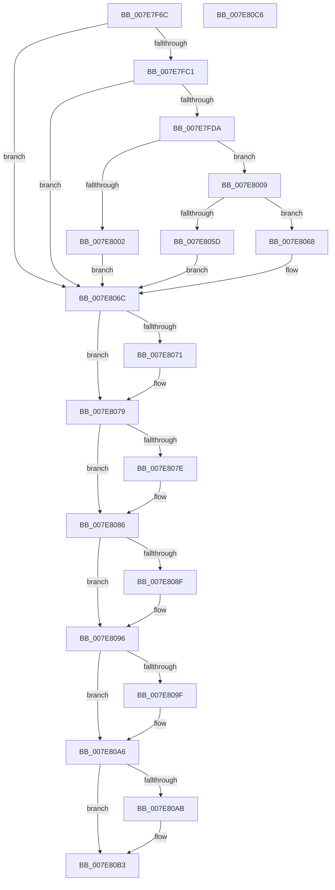

# CmpCreateRegistryProcessToken

- RVA: `0x007E7F6C`–`0x007E80C7` (길이 `347` bytes)
- VA: `0x00000001407E7F6C`
- 실행 섹션: `PAGE`
- PDB 이름 있음: `예`; PDB Function 태그: `아니요`
- unwind 정보 RVA: `0x000C8850`
- 디코드: `106`개 명령, `347/347` bytes 표시
- 미해석 바이트: `0` (있으면 어셈블리에 `.byte`로 보존)

> 이 문서는 커널 이미지의 기계어와 PDB 기호를 분석해 생성했습니다. 4번과 5번은 함수 원형과 자료형을 바이너리 사용 방식에서 추정한 C 해석이며 원본 소스 복구 결과는 아닙니다.

## 1. Dependencies

- 직접 호출 지점: **11**; 고유 호출 대상: **8**
- 직접 호출자로 확인된 함수: **1**
- RIP 상대 이미지 참조: **1**

### Outgoing calls
- `0x007E7FA0` → [PsReferencePrimaryTokenWithTag](../../text/20/PsReferencePrimaryTokenWithTag_function_0020FF80.md) (function, `0x0020FF80`)
- `0x007E7FB2` → [SeQueryInformationToken](../8B/SeQueryInformationToken_function_008B5090.md) (function, `0x008B5090`)
- `0x007E7FCB` → [SeQueryInformationToken](../8B/SeQueryInformationToken_function_008B5090.md) (function, `0x008B5090`)
- `0x007E7FF5` → [CmpAllocatePool](../../text/3C/CmpAllocatePool_function_003CD504.md) (function, `0x003CD504`)
- `0x007E8032` → [memcpy](../../text/6C/memcpy_function_006C6840.md) (function, `0x006C6840`)
- `0x007E8052` → [SeFilterToken](../79/SeFilterToken_function_0079CD00.md) (function, `0x0079CD00`)
- `0x007E8074` → [ObfDereferenceObject](../../text/2F/ObfDereferenceObject_function_002F9350.md) (function, `0x002F9350`)
- `0x007E8081` → [ObfDereferenceObject](../../text/2F/ObfDereferenceObject_function_002F9350.md) (function, `0x002F9350`)
- `0x007E8091` → [ExFreePoolWithTag](../../poolcode/B8/ExFreePoolWithTag_function_00B82870.md) (function, `0x00B82870`)
- `0x007E80A1` → [ExFreePoolWithTag](../../poolcode/B8/ExFreePoolWithTag_function_00B82870.md) (function, `0x00B82870`)
- `0x007E80AE` → [CmSiFreeMemory](../../text/47/CmSiFreeMemory_function_00475D80.md) (function, `0x00475D80`)

### Direct callers
- [CmpInitializeRegistryProcess](CmpInitializeRegistryProcess_function_007E8180.md) at `0x007E81B2`

### Static image references
- `0x007E7F87` → RVA `0x00FC6AB0` (`ALMOSTRO`; read)

## 2. Other-region calls and transfers

- 다른 실행 섹션으로 향하는 call: **8**
  - `0x007E7FA0` → [PsReferencePrimaryTokenWithTag](../../text/20/PsReferencePrimaryTokenWithTag_function_0020FF80.md) (`PAGE` → `.text`)
  - `0x007E7FF5` → [CmpAllocatePool](../../text/3C/CmpAllocatePool_function_003CD504.md) (`PAGE` → `.text`)
  - `0x007E8032` → [memcpy](../../text/6C/memcpy_function_006C6840.md) (`PAGE` → `.text`)
  - `0x007E8074` → [ObfDereferenceObject](../../text/2F/ObfDereferenceObject_function_002F9350.md) (`PAGE` → `.text`)
  - `0x007E8081` → [ObfDereferenceObject](../../text/2F/ObfDereferenceObject_function_002F9350.md) (`PAGE` → `.text`)
  - `0x007E8091` → [ExFreePoolWithTag](../../poolcode/B8/ExFreePoolWithTag_function_00B82870.md) (`PAGE` → `POOLCODE`)
  - `0x007E80A1` → [ExFreePoolWithTag](../../poolcode/B8/ExFreePoolWithTag_function_00B82870.md) (`PAGE` → `POOLCODE`)
  - `0x007E80AE` → [CmSiFreeMemory](../../text/47/CmSiFreeMemory_function_00475D80.md) (`PAGE` → `.text`)
- 별도 외부 분기/꼬리 이동을 확인하지 못했습니다.

## 3. Assembly (complete function range)

```asm
007E7F6C  48 89 5C 24 08                  mov qword ptr [rsp + 8], rbx
007E7F71  55                              push rbp
007E7F72  56                              push rsi
007E7F73  57                              push rdi
007E7F74  41 56                           push r14
007E7F76  41 57                           push r15
007E7F78  48 8B EC                        mov rbp, rsp
007E7F7B  48 83 EC 30                     sub rsp, 0x30
007E7F7F  48 83 65 48 00                  and qword ptr [rbp + 0x48], 0
007E7F84  4C 8B F9                        mov r15, rcx
007E7F87  48 8B 0D 22 EB 7D 00            mov rcx, qword ptr [rip + 0x7deb22]
007E7F8E  33 FF                           xor edi, edi
007E7F90  48 83 65 38 00                  and qword ptr [rbp + 0x38], 0
007E7F95  BA 44 66 6C 74                  mov edx, 0x746c6644
007E7F9A  48 89 7D 40                     mov qword ptr [rbp + 0x40], rdi
007E7F9E  33 F6                           xor esi, esi
007E7FA0  E8 DB 7F A2 FF                  call 0x14020ff80
007E7FA5  4C 8D 45 48                     lea r8, [rbp + 0x48]
007E7FA9  48 8B C8                        mov rcx, rax
007E7FAC  8D 56 01                        lea edx, [rsi + 1]
007E7FAF  4C 8B F0                        mov r14, rax
007E7FB2  E8 D9 D0 0C 00                  call 0x1408b5090
007E7FB7  8B D8                           mov ebx, eax
007E7FB9  85 C0                           test eax, eax
007E7FBB  0F 88 AB 00 00 00               js 0x1407e806c
007E7FC1  4C 8D 45 38                     lea r8, [rbp + 0x38]
007E7FC5  49 8B CE                        mov rcx, r14
007E7FC8  8D 56 02                        lea edx, [rsi + 2]
007E7FCB  E8 C0 D0 0C 00                  call 0x1408b5090
007E7FD0  8B D8                           mov ebx, eax
007E7FD2  85 C0                           test eax, eax
007E7FD4  0F 88 92 00 00 00               js 0x1407e806c
007E7FDA  48 8B 45 38                     mov rax, qword ptr [rbp + 0x38]
007E7FDE  B9 00 01 00 00                  mov ecx, 0x100
007E7FE3  41 B8 43 4D 38 34               mov r8d, 0x34384d43
007E7FE9  8B 10                           mov edx, dword ptr [rax]
007E7FEB  FF C2                           inc edx
007E7FED  48 C1 E2 04                     shl rdx, 4
007E7FF1  48 83 C2 08                     add rdx, 8
007E7FF5  E8 0A 55 BE FF                  call 0x1403cd504
007E7FFA  48 8B F0                        mov rsi, rax
007E7FFD  48 85 C0                        test rax, rax
007E8000  75 07                           jne 0x1407e8009
007E8002  BB 9A 00 00 C0                  mov ebx, 0xc000009a
007E8007  EB 63                           jmp 0x1407e806c
007E8009  48 8B 45 38                     mov rax, qword ptr [rbp + 0x38]
007E800D  8B 08                           mov ecx, dword ptr [rax]
007E800F  FF C1                           inc ecx
007E8011  89 0E                           mov dword ptr [rsi], ecx
007E8013  48 8D 4E 18                     lea rcx, [rsi + 0x18]
007E8017  48 8B 45 48                     mov rax, qword ptr [rbp + 0x48]
007E801B  0F 10 00                        movups xmm0, xmmword ptr [rax]
007E801E  F3 0F 7F 46 08                  movdqu xmmword ptr [rsi + 8], xmm0
007E8023  48 8B 55 38                     mov rdx, qword ptr [rbp + 0x38]
007E8027  44 8B 02                        mov r8d, dword ptr [rdx]
007E802A  48 83 C2 08                     add rdx, 8
007E802E  49 C1 E0 04                     shl r8, 4
007E8032  E8 09 E8 ED FF                  call 0x1406c6840
007E8037  45 33 C9                        xor r9d, r9d
007E803A  48 8D 45 40                     lea rax, [rbp + 0x40]
007E803E  48 89 44 24 28                  mov qword ptr [rsp + 0x28], rax
007E8043  4C 8B C6                        mov r8, rsi
007E8046  48 21 7C 24 20                  and qword ptr [rsp + 0x20], rdi
007E804B  49 8B CE                        mov rcx, r14
007E804E  41 8D 51 01                     lea edx, [r9 + 1]
007E8052  E8 A9 4C FB FF                  call 0x14079cd00
007E8057  8B D8                           mov ebx, eax
007E8059  85 C0                           test eax, eax
007E805B  78 0B                           js 0x1407e8068
007E805D  48 8B 45 40                     mov rax, qword ptr [rbp + 0x40]
007E8061  33 DB                           xor ebx, ebx
007E8063  49 89 07                        mov qword ptr [r15], rax
007E8066  EB 04                           jmp 0x1407e806c
007E8068  48 8B 7D 40                     mov rdi, qword ptr [rbp + 0x40]
007E806C  4D 85 F6                        test r14, r14
007E806F  74 08                           je 0x1407e8079
007E8071  49 8B CE                        mov rcx, r14
007E8074  E8 D7 12 B1 FF                  call 0x1402f9350
007E8079  48 85 FF                        test rdi, rdi
007E807C  74 08                           je 0x1407e8086
007E807E  48 8B CF                        mov rcx, rdi
007E8081  E8 CA 12 B1 FF                  call 0x1402f9350
007E8086  48 8B 4D 48                     mov rcx, qword ptr [rbp + 0x48]
007E808A  48 85 C9                        test rcx, rcx
007E808D  74 07                           je 0x1407e8096
007E808F  33 D2                           xor edx, edx
007E8091  E8 DA A7 39 00                  call 0x140b82870
007E8096  48 8B 4D 38                     mov rcx, qword ptr [rbp + 0x38]
007E809A  48 85 C9                        test rcx, rcx
007E809D  74 07                           je 0x1407e80a6
007E809F  33 D2                           xor edx, edx
007E80A1  E8 CA A7 39 00                  call 0x140b82870
007E80A6  48 85 F6                        test rsi, rsi
007E80A9  74 08                           je 0x1407e80b3
007E80AB  48 8B CE                        mov rcx, rsi
007E80AE  E8 CD DC C8 FF                  call 0x140475d80
007E80B3  8B C3                           mov eax, ebx
007E80B5  48 8B 5C 24 60                  mov rbx, qword ptr [rsp + 0x60]
007E80BA  48 83 C4 30                     add rsp, 0x30
007E80BE  41 5F                           pop r15
007E80C0  41 5E                           pop r14
007E80C2  5F                              pop rdi
007E80C3  5E                              pop rsi
007E80C4  5D                              pop rbp
007E80C5  C3                              ret
007E80C6  CC                              int3
```

## 4. C-style interpretation (structured pseudocode)

```c
__int64 __fastcall CmpCreateRegistryProcessToken(__int64 a1, __int64 a2, __int64 a3, int a4)
{
    __int64 result;
    __int64 v_rbx;
    __int64 v_rdi;
    __int64 v_rsi;
    __int64 v_rsp;
    unsigned __int64 v_stack_m30;
    unsigned __int64 v_stack_m38;
    unsigned __int64 v_stack_p10;
    unsigned __int64 v_stack_p18;
    unsigned __int64 v_stack_p20;
    unsigned __int64 v_stack_p8;

    v_stack_p8 = v_rbx;
    v_rsp = (v_rsp) - (48);
    v_rdi = 0;
    v_stack_p18 = 0;
    v_rsi = 0;
    result = PsReferencePrimaryTokenWithTag(*(unsigned __int64 *)(v_rip + 8252194), (unsigned int)(0x746C6644ULL), a3, a4);
    result = SeQueryInformationToken(result, v_rsi + 1, v_stack_p20, a4);
    if (sign_flag) goto loc_007E806C;
    result = SeQueryInformationToken(result, v_rsi + 2, v_stack_p10, a4);
    if (sign_flag) goto loc_007E806C;
    a2 = (unsigned int)(((unsigned int)(*(unsigned int *)(v_stack_p10))) + 1);
    a2 = (a2) << (4);
    a2 = (a2) + (8);
    result = CmpAllocatePool(256, a2, (unsigned int)(0x34384D43ULL), a4);
    if (result != 0) goto loc_007E8009;
    goto loc_007E806C;
loc_007E8009:
    a1 = (unsigned int)(((unsigned int)(*(unsigned int *)(v_stack_p10))) + 1);
    *(unsigned int *)(result) = (unsigned int)(a1);
    *(unsigned __int64 *)(result + 8) = v_xmm0;
    a2 = (v_stack_p10) + (8);
    a3 = ((unsigned int)(*(unsigned int *)(v_stack_p10))) << (4);
    result = memcpy(result + 24, a2, a3, a4);
    a4 = 0;
    v_stack_m30 = v_stack_p18;
    result = SeFilterToken(result, a4 + 1, result, a4);
    if (sign_flag) goto loc_007E8068;
    v_rbx = 0;
    *(unsigned __int64 *)(a1) = v_stack_p18;
    goto loc_007E806C;
loc_007E8068:
loc_007E806C:
    result = v_stack_p18;
    if (result != 0) {
        a1 = result;
        result = ObfDereferenceObject(a1, a4 + 1, result, a4);
    }
    if (v_stack_p18 != 0) {
        a1 = v_stack_p18;
        result = ObfDereferenceObject(a1, a4 + 1, result, a4);
    }
    if (v_stack_p20 != 0) {
        a2 = 0;
        result = ExFreePoolWithTag(v_stack_p20, a2, result, a4);
    }
    if (v_stack_p10 != 0) {
        a2 = 0;
        result = ExFreePoolWithTag(v_stack_p10, a2, result, a4);
    }
    if (result != 0) {
        a1 = result;
        result = CmSiFreeMemory(a1, a2, result, a4);
    }
    v_rsp = (v_rsp) + (48);
    return 0;
}
```

## 5. (Beta) C Style

```c
int64_t CmpCreateRegistryProcessToken(void *Arg1, int64_t Arg2, int64_t Arg3, int32_t Arg4)
{
    uint8_t *arg1 = (uint8_t *)Arg1;

    int64_t result;
    int64_t local_rbx;
    int64_t local_rdi;
    int64_t local_rsi;
    int64_t local_rsp;
    uint64_t v_stack_m30;
    uint64_t v_stack_m38;
    uint64_t v_stack_p10;
    uint64_t v_stack_p18;
    uint64_t v_stack_p20;
    uint64_t v_stack_p8;

    v_stack_p8 = local_rbx;
    local_rsp = (local_rsp) - (48);
    local_rdi = 0;
    v_stack_p18 = 0;
    local_rsi = 0;
    result = PsReferencePrimaryTokenWithTag(*(uint64_t *)(v_rip + 0x7DEB22), (uint32_t)(0x746C6644ULL), Arg3, Arg4);
    result = SeQueryInformationToken(result, local_rsi + 1, v_stack_p20, Arg4);
    if (sign_flag) goto loc_007E806C;
    result = SeQueryInformationToken(result, local_rsi + 2, v_stack_p10, Arg4);
    if (sign_flag) goto loc_007E806C;
    Arg2 = (uint32_t)(((uint32_t)(*(uint32_t *)(v_stack_p10))) + 1);
    Arg2 = (Arg2) << (4);
    Arg2 = (Arg2) + (8);
    result = CmpAllocatePool(256, Arg2, (uint32_t)(0x34384D43ULL), Arg4);
    if (result != 0) goto loc_007E8009;
    goto loc_007E806C;
loc_007E8009:
    Arg1 = (uint32_t)(((uint32_t)(*(uint32_t *)(v_stack_p10))) + 1);
    *(uint32_t *)(result) = (uint32_t)(Arg1);
    *(uint64_t *)(result + 0x8) = v_xmm0;
    Arg2 = (v_stack_p10) + (8);
    Arg3 = ((uint32_t)(*(uint32_t *)(v_stack_p10))) << (4);
    result = memcpy(result + 24, Arg2, Arg3, Arg4);
    Arg4 = 0;
    v_stack_m30 = v_stack_p18;
    result = SeFilterToken(result, Arg4 + 1, result, Arg4);
    if (sign_flag) goto loc_007E8068;
    local_rbx = 0;
    *(uint64_t *)(arg1) = v_stack_p18;
    goto loc_007E806C;
loc_007E8068:
loc_007E806C:
    result = v_stack_p18;
    if (result != 0) {
        Arg1 = result;
        result = ObfDereferenceObject(Arg1, Arg4 + 1, result, Arg4);
    }
    if (v_stack_p18 != 0) {
        Arg1 = v_stack_p18;
        result = ObfDereferenceObject(Arg1, Arg4 + 1, result, Arg4);
    }
    if (v_stack_p20 != 0) {
        Arg2 = 0;
        result = ExFreePoolWithTag(v_stack_p20, Arg2, result, Arg4);
    }
    if (v_stack_p10 != 0) {
        Arg2 = 0;
        result = ExFreePoolWithTag(v_stack_p10, Arg2, result, Arg4);
    }
    if (result != 0) {
        Arg1 = result;
        result = CmSiFreeMemory(Arg1, Arg2, result, Arg4);
    }
    local_rsp = (local_rsp) + (48);
    return 0;
}
```

### 관측된 메모리 오프셋

구조체 형식이 확인되지 않은 접근은 인자 기준의 오프셋으로만 기록했습니다.

| 기준 인자 | 오프셋 표현 | 폭 (bit) | 접근 |
|---|---:|---:|---|
| `Arg1` | `+ 0x0` | `64` | `W` |

## 6. Execution-region graph

[열기: 2D/3D 그래프와 함수 탐색 컨트롤 패널](../../../control-panel.html?section=page&rva=0x007E7F6C&view=graph)

- 2D 그래프는 위에서 아래로 흐르고, 3D 그래프는 빈 공간을 드래그해 회전합니다. Shift+드래그는 이동, 휠은 확대·축소, 함수 노드 선택은 대상 보고서 이동입니다.

### Static fallback


