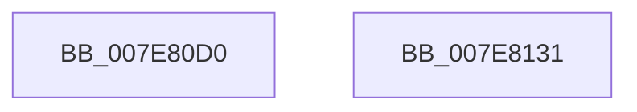

# CmpCreateRegistryThread

- RVA: `0x007E80D0`–`0x007E8132` (길이 `98` bytes)
- VA: `0x00000001407E80D0`
- 실행 섹션: `PAGE`
- PDB 이름 있음: `예`; PDB Function 태그: `아니요`
- unwind 정보 RVA: `0x0007F678`
- 디코드: `22`개 명령, `98/98` bytes 표시
- 미해석 바이트: `0` (있으면 어셈블리에 `.byte`로 보존)

> 이 문서는 커널 이미지의 기계어와 PDB 기호를 분석해 생성했습니다. 4번과 5번은 함수 원형과 자료형을 바이너리 사용 방식에서 추정한 C 해석이며 원본 소스 복구 결과는 아닙니다.

## 1. Dependencies

- 직접 호출 지점: **1**; 고유 호출 대상: **1**
- 직접 호출자로 확인된 함수: **5**
- RIP 상대 이미지 참조: **1**

### Outgoing calls
- `0x007E8124` → [PsCreateSystemThreadEx](../9E/PsCreateSystemThreadEx_function_009ED120.md) (function, `0x009ED120`)

### Direct callers
- [CmpInitializeSystemHivesLoad](../7D/CmpInitializeSystemHivesLoad_function_007DAC7C.md) at `0x007DAD24`
- [CmCompleteRegistryInitialization](../7D/CmCompleteRegistryInitialization_function_007DF1EC.md) at `0x007DF2CE`
- [CmpInitializeRegistryProcess](CmpInitializeRegistryProcess_function_007E8180.md) at `0x007E82A6`
- [CmpInitializeLazyWriters](CmpInitializeLazyWriters_function_007EEF34.md) at `0x007EEFDE`
- [CmpHiveCachePopulateHiveEntry](../7F/CmpHiveCachePopulateHiveEntry_function_007F5EB4.md) at `0x007F5F3F`

### Static image references
- `0x007E80EB` → RVA `0x00EF7200` (`.data`; read)

## 2. Other-region calls and transfers

- 다른 실행 섹션으로 향하는 call: **0**
- 별도 외부 분기/꼬리 이동을 확인하지 못했습니다.

## 3. Assembly (complete function range)

```asm
007E80D0  4C 8B DC                        mov r11, rsp
007E80D3  48 81 EC 88 00 00 00            sub rsp, 0x88
007E80DA  33 D2                           xor edx, edx
007E80DC  49 C7 43 C8 30 00 00 00         mov qword ptr [r11 - 0x38], 0x30
007E80E4  49 89 53 B8                     mov qword ptr [r11 - 0x48], rdx
007E80E8  49 8B C1                        mov rax, r9
007E80EB  4C 8B 0D 0E F1 70 00            mov r9, qword ptr [rip + 0x70f10e]
007E80F2  0F 57 C0                        xorps xmm0, xmm0
007E80F5  49 89 53 B0                     mov qword ptr [r11 - 0x50], rdx
007E80F9  49 89 43 A8                     mov qword ptr [r11 - 0x58], rax
007E80FD  4D 89 43 A0                     mov qword ptr [r11 - 0x60], r8
007E8101  4D 8D 43 C8                     lea r8, [r11 - 0x38]
007E8105  49 89 53 D0                     mov qword ptr [r11 - 0x30], rdx
007E8109  49 89 53 D8                     mov qword ptr [r11 - 0x28], rdx
007E810D  49 89 53 98                     mov qword ptr [r11 - 0x68], rdx
007E8111  BA FF FF 1F 00                  mov edx, 0x1fffff
007E8116  49 C7 43 E0 00 02 00 00         mov qword ptr [r11 - 0x20], 0x200
007E811E  F3 0F 7F 44 24 70               movdqu xmmword ptr [rsp + 0x70], xmm0
007E8124  E8 F7 4F 20 00                  call 0x1409ed120
007E8129  48 81 C4 88 00 00 00            add rsp, 0x88
007E8130  C3                              ret
007E8131  CC                              int3
```

## 4. C-style interpretation (structured pseudocode)

```c
__int64 __fastcall CmpCreateRegistryThread(__int64 a1, int a2, __int64 a3, __int64 a4)
{
    __int64 result;
    __int64 v_rsp;
    unsigned __int64 v_stack_m18;

    v_rsp = (v_rsp) - (136);
    a2 = 0;
    *(unsigned __int64 *)(v_rsp - 56) = 48;
    *(unsigned __int64 *)(v_rsp - 72) = 0;
    *(unsigned __int64 *)(v_rsp - 80) = 0;
    *(unsigned __int64 *)(v_rsp - 88) = a4;
    *(unsigned __int64 *)(v_rsp - 96) = a3;
    *(unsigned __int64 *)(v_rsp - 48) = 0;
    *(unsigned __int64 *)(v_rsp - 40) = 0;
    *(unsigned __int64 *)(v_rsp - 104) = 0;
    *(unsigned __int64 *)(v_rsp - 32) = 512;
    v_stack_m18 = v_xmm0;
    result = PsCreateSystemThreadEx(a1, (unsigned int)(0x1FFFFFULL), v_rsp - 56, *(unsigned __int64 *)(v_rip + 7401742));
    v_rsp = (v_rsp) + (136);
    return result;
}
```

## 5. (Beta) C Style

```c
int64_t CmpCreateRegistryThread(int64_t Arg1, int32_t Arg2, int64_t Arg3, int64_t Arg4)
{
    int64_t result;
    int64_t local_rsp;
    uint64_t v_stack_m18;

    local_rsp = (local_rsp) - (136);
    Arg2 = 0;
    *(uint64_t *)(local_rsp - 0x38) = 48;
    *(uint64_t *)(local_rsp - 0x48) = 0;
    *(uint64_t *)(local_rsp - 0x50) = 0;
    *(uint64_t *)(local_rsp - 0x58) = Arg4;
    *(uint64_t *)(local_rsp - 0x60) = Arg3;
    *(uint64_t *)(local_rsp - 0x30) = 0;
    *(uint64_t *)(local_rsp - 0x28) = 0;
    *(uint64_t *)(local_rsp - 0x68) = 0;
    *(uint64_t *)(local_rsp - 0x20) = 512;
    v_stack_m18 = v_xmm0;
    result = PsCreateSystemThreadEx(Arg1, (uint32_t)(0x1FFFFFULL), local_rsp - 56, *(uint64_t *)(v_rip + 0x70F10E));
    local_rsp = (local_rsp) + (136);
    return result;
}
```

## 6. Execution-region graph

[열기: 2D/3D 그래프와 함수 탐색 컨트롤 패널](../../../control-panel.html?section=page&rva=0x007E80D0&view=graph)

- 2D 그래프는 위에서 아래로 흐르고, 3D 그래프는 빈 공간을 드래그해 회전합니다. Shift+드래그는 이동, 휠은 확대·축소, 함수 노드 선택은 대상 보고서 이동입니다.

### Static fallback


