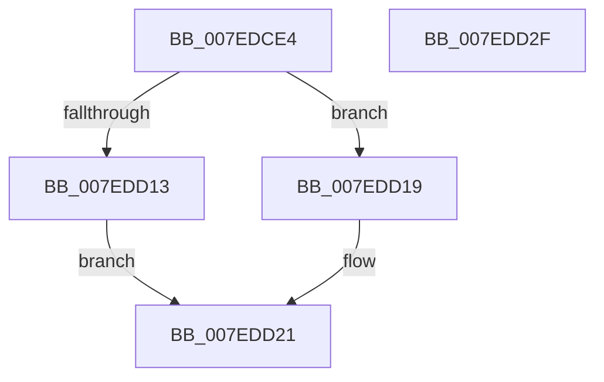

# CmpCreateSiloKeyLockEntry

- RVA: `0x007EDCE4`–`0x007EDD30` (길이 `76` bytes)
- VA: `0x00000001407EDCE4`
- 실행 섹션: `PAGE`
- PDB 이름 있음: `예`; PDB Function 태그: `아니요`
- unwind 정보 RVA: `0x0005CAAC`
- 디코드: `22`개 명령, `76/76` bytes 표시
- 미해석 바이트: `0` (있으면 어셈블리에 `.byte`로 보존)

> 이 문서는 커널 이미지의 기계어와 PDB 기호를 분석해 생성했습니다. 4번과 5번은 함수 원형과 자료형을 바이너리 사용 방식에서 추정한 C 해석이며 원본 소스 복구 결과는 아닙니다.

## 1. Dependencies

- 직접 호출 지점: **3**; 고유 호출 대상: **3**
- 직접 호출자로 확인된 함수: **1**
- RIP 상대 이미지 참조: **0**

### Outgoing calls
- `0x007EDCF1` → [CmpReferenceKeyControlBlockUnsafe](../87/CmpReferenceKeyControlBlockUnsafe_function_00874DA0.md) (function, `0x00874DA0`)
- `0x007EDD06` → [CmpAllocatePool](../../text/3C/CmpAllocatePool_function_003CD504.md) (function, `0x003CD504`)
- `0x007EDD1C` → [CmpDereferenceKeyControlBlockUnsafe](../99/CmpDereferenceKeyControlBlockUnsafe_function_0099F960.md) (function, `0x0099F960`)

### Direct callers
- [CmLockKeyForWrite](../9E/CmLockKeyForWrite_function_009E7EE8.md) at `0x009E7FE3`

### Static image references
- 디코드된 RIP-relative 메모리 참조가 없습니다.

## 2. Other-region calls and transfers

- 다른 실행 섹션으로 향하는 call: **1**
  - `0x007EDD06` → [CmpAllocatePool](../../text/3C/CmpAllocatePool_function_003CD504.md) (`PAGE` → `.text`)
- 별도 외부 분기/꼬리 이동을 확인하지 못했습니다.

## 3. Assembly (complete function range)

```asm
007EDCE4  48 89 5C 24 08                  mov qword ptr [rsp + 8], rbx
007EDCE9  57                              push rdi
007EDCEA  48 83 EC 20                     sub rsp, 0x20
007EDCEE  48 8B F9                        mov rdi, rcx
007EDCF1  E8 AA 70 08 00                  call 0x140874da0
007EDCF6  BA 20 00 00 00                  mov edx, 0x20
007EDCFB  B9 00 01 00 00                  mov ecx, 0x100
007EDD00  41 B8 43 4D 37 34               mov r8d, 0x34374d43
007EDD06  E8 F9 F7 BD FF                  call 0x1403cd504
007EDD0B  48 8B D8                        mov rbx, rax
007EDD0E  48 85 C0                        test rax, rax
007EDD11  74 06                           je 0x1407edd19
007EDD13  48 89 78 10                     mov qword ptr [rax + 0x10], rdi
007EDD17  EB 08                           jmp 0x1407edd21
007EDD19  48 8B CF                        mov rcx, rdi
007EDD1C  E8 3F 1C 1B 00                  call 0x14099f960
007EDD21  48 8B C3                        mov rax, rbx
007EDD24  48 8B 5C 24 30                  mov rbx, qword ptr [rsp + 0x30]
007EDD29  48 83 C4 20                     add rsp, 0x20
007EDD2D  5F                              pop rdi
007EDD2E  C3                              ret
007EDD2F  CC                              int3
```

## 4. C-style interpretation (structured pseudocode)

```c
__int64 __fastcall CmpCreateSiloKeyLockEntry(__int64 a1)
{
    __int64 result;
    __int64 v_rsp;
    unsigned __int64 v_stack_p8;

    v_stack_p8 = v_rbx;
    v_rsp = (v_rsp) - (32);
    result = CmpReferenceKeyControlBlockUnsafe(a1, a2, a3, a4);
    result = CmpAllocatePool(256, 32, (unsigned int)(0x34374D43ULL), a4);
    if (result == 0) goto loc_007EDD19;
    *(unsigned __int64 *)(result + 16) = a1;
    goto loc_007EDD21;
loc_007EDD19:
    result = CmpDereferenceKeyControlBlockUnsafe(a1, 32, (unsigned int)(0x34374D43ULL), a4);
loc_007EDD21:
    v_rsp = (v_rsp) + (32);
    return result;
}
```

## 5. (Beta) C Style

```c
int64_t CmpCreateSiloKeyLockEntry(int64_t Arg1)
{
    int64_t result;
    int64_t local_rsp;
    uint64_t v_stack_p8;

    v_stack_p8 = local_rbx;
    local_rsp = (local_rsp) - (32);
    result = CmpReferenceKeyControlBlockUnsafe(Arg1, a2, a3, a4);
    result = CmpAllocatePool(256, 32, (uint32_t)(0x34374D43ULL), a4);
    if (result == 0) goto loc_007EDD19;
    *(uint64_t *)(result + 0x10) = Arg1;
    goto loc_007EDD21;
loc_007EDD19:
    result = CmpDereferenceKeyControlBlockUnsafe(Arg1, 32, (uint32_t)(0x34374D43ULL), a4);
loc_007EDD21:
    local_rsp = (local_rsp) + (32);
    return result;
}
```

## 6. Execution-region graph

[열기: 2D/3D 그래프와 함수 탐색 컨트롤 패널](../../../control-panel.html?section=page&rva=0x007EDCE4&view=graph)

- 2D 그래프는 위에서 아래로 흐르고, 3D 그래프는 빈 공간을 드래그해 회전합니다. Shift+드래그는 이동, 휠은 확대·축소, 함수 노드 선택은 대상 보고서 이동입니다.

### Static fallback


