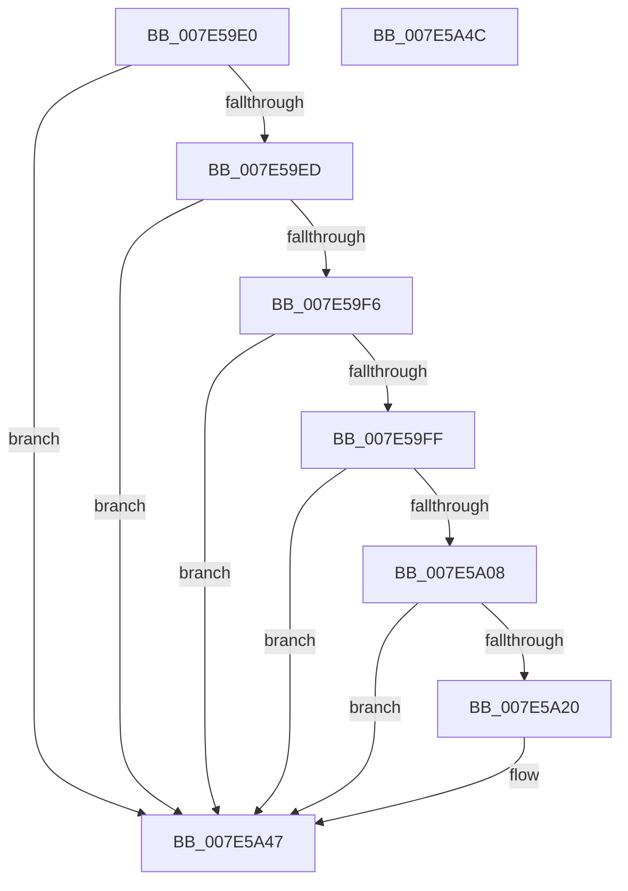

# CmpDiskFullWarning

- RVA: `0x007E59E0`–`0x007E5A4D` (길이 `109` bytes)
- VA: `0x00000001407E59E0`
- 실행 섹션: `PAGE`
- PDB 이름 있음: `예`; PDB Function 태그: `아니요`
- unwind 정보 RVA: `0x0005C788`
- 디코드: `26`개 명령, `109/109` bytes 표시
- 미해석 바이트: `0` (있으면 어셈블리에 `.byte`로 보존)

> 이 문서는 커널 이미지의 기계어와 PDB 기호를 분석해 생성했습니다. 4번과 5번은 함수 원형과 자료형을 바이너리 사용 방식에서 추정한 C 해석이며 원본 소스 복구 결과는 아닙니다.

## 1. Dependencies

- 직접 호출 지점: **2**; 고유 호출 대상: **2**
- 직접 호출자로 확인된 함수: **3**
- RIP 상대 이미지 참조: **6**

### Outgoing calls
- `0x007E5A16` → [ExAllocatePool2](../../poolcode/B8/ExAllocatePool2_function_00B820F0.md) (function, `0x00B820F0`)
- `0x007E5A42` → [ExQueueWorkItem](../../text/2F/ExQueueWorkItem_function_002F9520.md) (function, `0x002F9520`)

### Direct callers
- [CmpLazyWriteWorker](../../text/66/CmpLazyWriteWorker_function_0066ADF0.md) at `0x0066AEA0`
- [CmpLoadHiveThread](../7D/CmpLoadHiveThread_function_007DB040.md) at `0x007DBA10`
- [CmpMountPreloadedHives](../7D/CmpMountPreloadedHives_function_007DBE18.md) at `0x007DC3FC`

### Static image references
- `0x007E59E4` → RVA `0x00FD9A74` (`PAGEDATA`; read)
- `0x007E59ED` → RVA `0x00FD9A63` (`PAGEDATA`; read)
- `0x007E59F6` → RVA `0x00E685D0` (`.data`; read)
- `0x007E59FF` → RVA `0x00FD9A62` (`PAGEDATA`; read)
- `0x007E5A24` → RVA `0x007E5A60` (`CmpDiskFullWarningWorker`; read)
- `0x007E5A37` → RVA `0x00FD9A74` (`PAGEDATA`; write)

## 2. Other-region calls and transfers

- 다른 실행 섹션으로 향하는 call: **2**
  - `0x007E5A16` → [ExAllocatePool2](../../poolcode/B8/ExAllocatePool2_function_00B820F0.md) (`PAGE` → `POOLCODE`)
  - `0x007E5A42` → [ExQueueWorkItem](../../text/2F/ExQueueWorkItem_function_002F9520.md) (`PAGE` → `.text`)
- 별도 외부 분기/꼬리 이동을 확인하지 못했습니다.

## 3. Assembly (complete function range)

```asm
007E59E0  48 83 EC 28                     sub rsp, 0x28
007E59E4  80 3D 89 40 7F 00 00            cmp byte ptr [rip + 0x7f4089], 0
007E59EB  75 5A                           jne 0x1407e5a47
007E59ED  80 3D 6F 40 7F 00 00            cmp byte ptr [rip + 0x7f406f], 0
007E59F4  74 51                           je 0x1407e5a47
007E59F6  80 3D D3 2B 68 00 00            cmp byte ptr [rip + 0x682bd3], 0
007E59FD  74 48                           je 0x1407e5a47
007E59FF  80 3D 5C 40 7F 00 00            cmp byte ptr [rip + 0x7f405c], 0
007E5A06  74 3F                           je 0x1407e5a47
007E5A08  BA 20 00 00 00                  mov edx, 0x20
007E5A0D  41 B8 43 4D 20 20               mov r8d, 0x20204d43
007E5A13  8D 4A 20                        lea ecx, [rdx + 0x20]
007E5A16  E8 D5 C6 39 00                  call 0x140b820f0
007E5A1B  48 85 C0                        test rax, rax
007E5A1E  74 27                           je 0x1407e5a47
007E5A20  48 83 20 00                     and qword ptr [rax], 0
007E5A24  48 8D 0D 35 00 00 00            lea rcx, [rip + 0x35]
007E5A2B  48 89 48 10                     mov qword ptr [rax + 0x10], rcx
007E5A2F  BA 01 00 00 00                  mov edx, 1
007E5A34  48 8B C8                        mov rcx, rax
007E5A37  C6 05 36 40 7F 00 01            mov byte ptr [rip + 0x7f4036], 1
007E5A3E  48 89 40 18                     mov qword ptr [rax + 0x18], rax
007E5A42  E8 D9 3A B1 FF                  call 0x1402f9520
007E5A47  48 83 C4 28                     add rsp, 0x28
007E5A4B  C3                              ret
007E5A4C  CC                              int3
```

## 4. C-style interpretation (structured pseudocode)

```c
__int64 __fastcall CmpDiskFullWarning(void)
{
    __int64 result;
    __int64 v_rsp;

    v_rsp = (v_rsp) - (40);
    if ((*(unsigned __int8 *)(v_rip + 8339593)) != 0) goto loc_007E5A47;
    if ((*(unsigned __int8 *)(v_rip + 8339567)) == 0) goto loc_007E5A47;
    if ((*(unsigned __int8 *)(v_rip + 6826963)) == 0) goto loc_007E5A47;
    if ((*(unsigned __int8 *)(v_rip + 8339548)) == 0) goto loc_007E5A47;
    result = ExAllocatePool2(32 + 32, 32, (unsigned int)(0x20204D43ULL), a4);
    if (result != 0) {
        a1 = v_rip + 53;
        *(unsigned __int64 *)(result + 16) = a1;
        a2 = 1;
        a1 = result;
        *(unsigned __int8 *)(v_rip + 8339510) = 1;
        *(unsigned __int64 *)(result + 24) = result;
        result = ExQueueWorkItem(a1, a2, (unsigned int)(0x20204D43ULL), a4);
    }
    v_rsp = (v_rsp) + (40);
    return result;
}
```

## 5. (Beta) C Style

```c
void CmpDiskFullWarning(void)
{
    int64_t result;
    int64_t local_rsp;

    local_rsp = (local_rsp) - (40);
    if ((*(uint8_t *)(v_rip + 0x7F4089)) != 0) goto loc_007E5A47;
    if ((*(uint8_t *)(v_rip + 0x7F406F)) == 0) goto loc_007E5A47;
    if ((*(uint8_t *)(v_rip + 0x682BD3)) == 0) goto loc_007E5A47;
    if ((*(uint8_t *)(v_rip + 0x7F405C)) == 0) goto loc_007E5A47;
    result = ExAllocatePool2(32 + 32, 32, (uint32_t)(0x20204D43ULL), a4);
    if (result != 0) {
        a1 = v_rip + 53;
        *(uint64_t *)(result + 0x10) = a1;
        a2 = 1;
        a1 = result;
        *(uint8_t *)(v_rip + 0x7F4036) = 1;
        *(uint64_t *)(result + 0x18) = result;
        result = ExQueueWorkItem(a1, a2, (uint32_t)(0x20204D43ULL), a4);
    }
    local_rsp = (local_rsp) + (40);
    return result;
}
```

## 6. Execution-region graph

[열기: 2D/3D 그래프와 함수 탐색 컨트롤 패널](../../../control-panel.html?section=page&rva=0x007E59E0&view=graph)

- 2D 그래프는 위에서 아래로 흐르고, 3D 그래프는 빈 공간을 드래그해 회전합니다. Shift+드래그는 이동, 휠은 확대·축소, 함수 노드 선택은 대상 보고서 이동입니다.

### Static fallback


