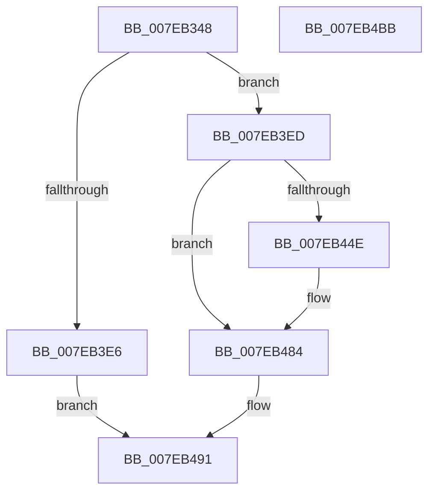

# CmpDoAccessCheckOnKCB

- RVA: `0x007EB348`–`0x007EB4BC` (길이 `372` bytes)
- VA: `0x00000001407EB348`
- 실행 섹션: `PAGE`
- PDB 이름 있음: `예`; PDB Function 태그: `아니요`
- unwind 정보 RVA: `0x000D6E50`
- 디코드: `94`개 명령, `372/372` bytes 표시
- 미해석 바이트: `0` (있으면 어셈블리에 `.byte`로 보존)

> 이 문서는 커널 이미지의 기계어와 PDB 기호를 분석해 생성했습니다. 4번과 5번은 함수 원형과 자료형을 바이너리 사용 방식에서 추정한 C 해석이며 원본 소스 복구 결과는 아닙니다.

## 1. Dependencies

- 직접 호출 지점: **9**; 고유 호출 대상: **8**
- 직접 호출자로 확인된 함수: **1**
- RIP 상대 이미지 참조: **2**

### Outgoing calls
- `0x007EB391` → [memset](../../text/6C/memset_function_006C6C40.md) (function, `0x006C6C40`)
- `0x007EB3A2` → [memset](../../text/6C/memset_function_006C6C40.md) (function, `0x006C6C40`)
- `0x007EB3DD` → [ObCreateObjectEx](../89/ObCreateObjectEx_function_0089B1E0.md) (function, `0x0089B1E0`)
- `0x007EB41D` → [PsGetCurrentThreadProcess](../../text/47/PsGetCurrentThreadProcess_function_0047C7E0.md) (function, `0x0047C7E0`)
- `0x007EB441` → [SeCreateAccessStateEx](../94/SeCreateAccessStateEx_function_00947A80.md) (function, `0x00947A80`)
- `0x007EB46C` → [CmpCheckKeyBodyAccess](../86/CmpCheckKeyBodyAccess_function_0086FA00.md) (function, `0x0086FA00`)
- `0x007EB478` → [SeDeleteAccessState](../8C/SeDeleteAccessState_function_008C5F70.md) (function, `0x008C5F70`)
- `0x007EB489` → [ObfDereferenceObject](../../text/2F/ObfDereferenceObject_function_002F9350.md) (function, `0x002F9350`)
- `0x007EB49B` → [_security_check_cookie](../../text/6A/_security_check_cookie_function_006AC640.md) (function, `0x006AC640`)

### Direct callers
- [sub_00B37F04](../B3/Unknown_function_00B37F04.md) at `0x00B37F54`
- [sub_00B37F04](../B3/Unknown_function_00B37F04.md) at `0x00B37F72`

### Static image references
- `0x007EB367` → RVA `0x00E0A740` (`.data`; read)
- `0x007EB3A7` → RVA `0x00FC6AC0` (`ALMOSTRO`; read)

## 2. Other-region calls and transfers

- 다른 실행 섹션으로 향하는 call: **5**
  - `0x007EB391` → [memset](../../text/6C/memset_function_006C6C40.md) (`PAGE` → `.text`)
  - `0x007EB3A2` → [memset](../../text/6C/memset_function_006C6C40.md) (`PAGE` → `.text`)
  - `0x007EB41D` → [PsGetCurrentThreadProcess](../../text/47/PsGetCurrentThreadProcess_function_0047C7E0.md) (`PAGE` → `.text`)
  - `0x007EB489` → [ObfDereferenceObject](../../text/2F/ObfDereferenceObject_function_002F9350.md) (`PAGE` → `.text`)
  - `0x007EB49B` → [_security_check_cookie](../../text/6A/_security_check_cookie_function_006AC640.md) (`PAGE` → `.text`)
- 별도 외부 분기/꼬리 이동을 확인하지 못했습니다.

## 3. Assembly (complete function range)

```asm
007EB348  48 89 5C 24 08                  mov qword ptr [rsp + 8], rbx
007EB34D  55                              push rbp
007EB34E  56                              push rsi
007EB34F  57                              push rdi
007EB350  41 54                           push r12
007EB352  41 55                           push r13
007EB354  41 56                           push r14
007EB356  41 57                           push r15
007EB358  48 8D AC 24 10 FF FF FF         lea rbp, [rsp - 0xf0]
007EB360  48 81 EC F0 01 00 00            sub rsp, 0x1f0
007EB367  48 8B 05 D2 F3 61 00            mov rax, qword ptr [rip + 0x61f3d2]
007EB36E  48 33 C4                        xor rax, rsp
007EB371  48 89 85 E0 00 00 00            mov qword ptr [rbp + 0xe0], rax
007EB378  45 8B E8                        mov r13d, r8d
007EB37B  4C 8B E2                        mov r12, rdx
007EB37E  4C 8B F9                        mov r15, rcx
007EB381  33 D2                           xor edx, edx
007EB383  41 B8 A0 00 00 00               mov r8d, 0xa0
007EB389  48 8D 4C 24 60                  lea rcx, [rsp + 0x60]
007EB38E  45 8A F1                        mov r14b, r9b
007EB391  E8 AA B8 ED FF                  call 0x1406c6c40
007EB396  33 D2                           xor edx, edx
007EB398  48 8D 4D 00                     lea rcx, [rbp]
007EB39C  41 B8 E0 00 00 00               mov r8d, 0xe0
007EB3A2  E8 99 B8 ED FF                  call 0x1406c6c40
007EB3A7  48 8B 15 12 B7 7D 00            mov rdx, qword ptr [rip + 0x7db712]
007EB3AE  48 8D 44 24 50                  lea rax, [rsp + 0x50]
007EB3B3  33 FF                           xor edi, edi
007EB3B5  45 8A CE                        mov r9b, r14b
007EB3B8  48 89 7C 24 48                  mov qword ptr [rsp + 0x48], rdi
007EB3BD  45 33 C0                        xor r8d, r8d
007EB3C0  48 89 44 24 40                  mov qword ptr [rsp + 0x40], rax
007EB3C5  41 8A CE                        mov cl, r14b
007EB3C8  89 7C 24 38                     mov dword ptr [rsp + 0x38], edi
007EB3CC  89 7C 24 30                     mov dword ptr [rsp + 0x30], edi
007EB3D0  C7 44 24 28 70 00 00 00         mov dword ptr [rsp + 0x28], 0x70
007EB3D8  48 89 7C 24 50                  mov qword ptr [rsp + 0x50], rdi
007EB3DD  E8 FE FD 0A 00                  call 0x14089b1e0
007EB3E2  85 C0                           test eax, eax
007EB3E4  79 07                           jns 0x1407eb3ed
007EB3E6  32 C0                           xor al, al
007EB3E8  E9 A4 00 00 00                  jmp 0x1407eb491
007EB3ED  48 8B 74 24 50                  mov rsi, qword ptr [rsp + 0x50]
007EB3F2  48 89 7E 38                     mov qword ptr [rsi + 0x38], rdi
007EB3F6  48 8D 46 48                     lea rax, [rsi + 0x48]
007EB3FA  48 89 7E 40                     mov qword ptr [rsi + 0x40], rdi
007EB3FE  C7 06 32 30 79 6B               mov dword ptr [rsi], 0x6b793032
007EB404  48 89 7E 08                     mov qword ptr [rsi + 8], rdi
007EB408  89 7E 30                        mov dword ptr [rsi + 0x30], edi
007EB40B  48 89 40 08                     mov qword ptr [rax + 8], rax
007EB40F  48 89 00                        mov qword ptr [rax], rax
007EB412  48 8B 1D A7 B6 7D 00            mov rbx, qword ptr [rip + 0x7db6a7]
007EB419  48 83 C3 4C                     add rbx, 0x4c
007EB41D  E8 BE 13 C9 FF                  call 0x14047c7e0
007EB422  65 48 8B 0C 25 88 01 00 00      mov rcx, qword ptr gs:[0x188]
007EB42B  4C 8D 4D 00                     lea r9, [rbp]
007EB42F  48 8B D0                        mov rdx, rax
007EB432  48 89 5C 24 28                  mov qword ptr [rsp + 0x28], rbx
007EB437  4C 8D 44 24 60                  lea r8, [rsp + 0x60]
007EB43C  44 89 6C 24 20                  mov dword ptr [rsp + 0x20], r13d
007EB441  E8 3A C6 15 00                  call 0x140947a80
007EB446  89 44 24 58                     mov dword ptr [rsp + 0x58], eax
007EB44A  85 C0                           test eax, eax
007EB44C  78 36                           js 0x1407eb484
007EB44E  48 8B 4C 24 50                  mov rcx, qword ptr [rsp + 0x50]
007EB453  48 8D 44 24 58                  lea rax, [rsp + 0x58]
007EB458  45 8A CE                        mov r9b, r14b
007EB45B  48 89 44 24 20                  mov qword ptr [rsp + 0x20], rax
007EB460  4C 8D 44 24 60                  lea r8, [rsp + 0x60]
007EB465  4C 89 7E 08                     mov qword ptr [rsi + 8], r15
007EB469  49 8B D4                        mov rdx, r12
007EB46C  E8 8F 45 08 00                  call 0x14086fa00
007EB471  48 8D 4C 24 60                  lea rcx, [rsp + 0x60]
007EB476  8A D8                           mov bl, al
007EB478  E8 F3 AA 0D 00                  call 0x1408c5f70
007EB47D  48 89 7E 08                     mov qword ptr [rsi + 8], rdi
007EB481  40 8A FB                        mov dil, bl
007EB484  48 8B 4C 24 50                  mov rcx, qword ptr [rsp + 0x50]
007EB489  E8 C2 DE B0 FF                  call 0x1402f9350
007EB48E  40 8A C7                        mov al, dil
007EB491  48 8B 8D E0 00 00 00            mov rcx, qword ptr [rbp + 0xe0]
007EB498  48 33 CC                        xor rcx, rsp
007EB49B  E8 A0 11 EC FF                  call 0x1406ac640
007EB4A0  48 8B 9C 24 30 02 00 00         mov rbx, qword ptr [rsp + 0x230]
007EB4A8  48 81 C4 F0 01 00 00            add rsp, 0x1f0
007EB4AF  41 5F                           pop r15
007EB4B1  41 5E                           pop r14
007EB4B3  41 5D                           pop r13
007EB4B5  41 5C                           pop r12
007EB4B7  5F                              pop rdi
007EB4B8  5E                              pop rsi
007EB4B9  5D                              pop rbp
007EB4BA  C3                              ret
007EB4BB  CC                              int3
```

## 4. C-style interpretation (structured pseudocode)

```c
__int64 __fastcall CmpDoAccessCheckOnKCB(__int64 a1, __int64 a2, int a3, unsigned __int8 a4)
{
    __int64 result;
    __int64 v_rbx;
    __int64 v_rdi;
    __int64 v_rsp;
    unsigned __int64 v_stack_m128;
    unsigned __int64 v_stack_m1C8;
    unsigned int v_stack_m1D0;
    unsigned __int64 v_stack_m1D8;
    unsigned __int64 v_stack_m1E0;
    unsigned __int64 v_stack_m1E8;
    unsigned int v_stack_m1F0;
    unsigned int v_stack_m1F8;
    unsigned int v_stack_m200;
    unsigned int v_stack_m208;
    unsigned __int64 v_stack_m48;
    unsigned __int64 v_stack_p8;

    v_stack_p8 = v_rbx;
    v_rsp = (v_rsp) - (496);
    result = (*(unsigned __int64 *)(v_rip + 6419410)) ^ (v_rsp);
    v_stack_m48 = result;
    a2 = 0;
    result = memset(v_stack_m1C8, a2, 160, a4);
    a2 = 0;
    result = memset(v_stack_m128, a2, 224, a4);
    v_rdi = 0;
    v_stack_m1E0 = 0;
    a3 = 0;
    v_stack_m1E8 = v_stack_m1D8;
    v_stack_m1F0 = 0;
    v_stack_m1F8 = 0;
    v_stack_m200 = 112;
    v_stack_m1D8 = 0;
    result = ObCreateObjectEx(a4, *(unsigned __int64 *)(v_rip + 8238866), a3, a4);
    if (!sign_flag) goto loc_007EB3ED;
    result = 0;
    goto loc_007EB491;
loc_007EB3ED:
    *(unsigned __int64 *)(v_stack_m1D8 + 56) = 0;
    *(unsigned __int64 *)(v_stack_m1D8 + 64) = 0;
    *(unsigned int *)(v_stack_m1D8) = 0x6B793032ULL;
    *(unsigned __int64 *)(v_stack_m1D8 + 8) = 0;
    *(unsigned int *)(v_stack_m1D8 + 48) = 0;
    *(unsigned __int64 *)(v_stack_m1D8 + 72 + 8) = v_stack_m1D8 + 72;
    *(unsigned __int64 *)(v_stack_m1D8 + 72) = v_stack_m1D8 + 72;
    v_rbx = (*(unsigned __int64 *)(v_rip + 8238759)) + (76);
    result = PsGetCurrentThreadProcess(a4, *(unsigned __int64 *)(v_rip + 8238866), a3, a4);
    v_stack_m200 = v_rbx;
    v_stack_m208 = (unsigned int)((unsigned int)(a3));
    result = SeCreateAccessStateEx(*(unsigned __int64 *)(gs_base + (0 + 392)), result, v_stack_m1C8, v_stack_m128);
    v_stack_m1D0 = (unsigned int)(result);
    if (!(sign_flag)) {
        a1 = v_stack_m1D8;
        result = v_stack_m1D0;
        a4 = a4;
        v_stack_m208 = result;
        a3 = v_stack_m1C8;
        *(unsigned __int64 *)(v_stack_m1D8 + 8) = a1;
        a2 = 0;
        result = CmpCheckKeyBodyAccess(a1, a2, a3, a4);
        a1 = v_stack_m1C8;
        v_rbx = (unsigned __int8)(result);
        result = SeDeleteAccessState(a1, a2, a3, a4);
        *(unsigned __int64 *)(v_stack_m1D8 + 8) = 0;
        v_rdi = (unsigned __int8)(v_rbx);
    }
    result = ObfDereferenceObject(v_stack_m1D8, a2, a3, a4);
loc_007EB491:
    a1 = (v_stack_m48) ^ (v_rsp);
    result = _security_check_cookie(a1, a2, a3, a4);
    v_rsp = (v_rsp) + (496);
    return result;
}
```

## 5. (Beta) C Style

```c
int64_t CmpDoAccessCheckOnKCB(int64_t Arg1, int64_t Arg2, int32_t Arg3, uint8_t Arg4)
{
    int64_t result;
    int64_t local_rbx;
    int64_t local_rdi;
    int64_t local_rsp;
    uint64_t v_stack_m128;
    uint64_t v_stack_m1C8;
    uint32_t v_stack_m1D0;
    uint64_t v_stack_m1D8;
    uint64_t v_stack_m1E0;
    uint64_t v_stack_m1E8;
    uint32_t v_stack_m1F0;
    uint32_t v_stack_m1F8;
    uint32_t v_stack_m200;
    uint32_t v_stack_m208;
    uint64_t v_stack_m48;
    uint64_t v_stack_p8;

    v_stack_p8 = local_rbx;
    local_rsp = (local_rsp) - (496);
    result = (*(uint64_t *)(v_rip + 0x61F3D2)) ^ (local_rsp);
    v_stack_m48 = result;
    Arg2 = 0;
    result = memset(v_stack_m1C8, Arg2, 160, Arg4);
    Arg2 = 0;
    result = memset(v_stack_m128, Arg2, 224, Arg4);
    local_rdi = 0;
    v_stack_m1E0 = 0;
    Arg3 = 0;
    v_stack_m1E8 = v_stack_m1D8;
    v_stack_m1F0 = 0;
    v_stack_m1F8 = 0;
    v_stack_m200 = 112;
    v_stack_m1D8 = 0;
    result = ObCreateObjectEx(Arg4, *(uint64_t *)(v_rip + 0x7DB712), Arg3, Arg4);
    if (!sign_flag) goto loc_007EB3ED;
    result = 0;
    goto loc_007EB491;
loc_007EB3ED:
    *(uint64_t *)(v_stack_m1D8 + 0x38) = 0;
    *(uint64_t *)(v_stack_m1D8 + 0x40) = 0;
    *(uint32_t *)(v_stack_m1D8) = 0x6B793032ULL;
    *(uint64_t *)(v_stack_m1D8 + 0x8) = 0;
    *(uint32_t *)(v_stack_m1D8 + 0x30) = 0;
    *(uint64_t *)(v_stack_m1D8 + 0x48 + 0x8) = v_stack_m1D8 + 72;
    *(uint64_t *)(v_stack_m1D8 + 0x48) = v_stack_m1D8 + 72;
    local_rbx = (*(uint64_t *)(v_rip + 0x7DB6A7)) + (76);
    result = PsGetCurrentThreadProcess(Arg4, *(uint64_t *)(v_rip + 0x7DB712), Arg3, Arg4);
    v_stack_m200 = local_rbx;
    v_stack_m208 = (uint32_t)((uint32_t)(Arg3));
    result = SeCreateAccessStateEx(*(uint64_t *)(gs_base + (0 + 0x188)), result, v_stack_m1C8, v_stack_m128);
    v_stack_m1D0 = (uint32_t)(result);
    if (!(sign_flag)) {
        Arg1 = v_stack_m1D8;
        result = v_stack_m1D0;
        Arg4 = Arg4;
        v_stack_m208 = result;
        Arg3 = v_stack_m1C8;
        *(uint64_t *)(v_stack_m1D8 + 0x8) = Arg1;
        Arg2 = 0;
        result = CmpCheckKeyBodyAccess(Arg1, Arg2, Arg3, Arg4);
        Arg1 = v_stack_m1C8;
        local_rbx = (uint8_t)(result);
        result = SeDeleteAccessState(Arg1, Arg2, Arg3, Arg4);
        *(uint64_t *)(v_stack_m1D8 + 0x8) = 0;
        local_rdi = (uint8_t)(local_rbx);
    }
    result = ObfDereferenceObject(v_stack_m1D8, Arg2, Arg3, Arg4);
loc_007EB491:
    Arg1 = (v_stack_m48) ^ (local_rsp);
    result = _security_check_cookie(Arg1, Arg2, Arg3, Arg4);
    local_rsp = (local_rsp) + (496);
    return result;
}
```

## 6. Execution-region graph

[열기: 2D/3D 그래프와 함수 탐색 컨트롤 패널](../../../control-panel.html?section=page&rva=0x007EB348&view=graph)

- 2D 그래프는 위에서 아래로 흐르고, 3D 그래프는 빈 공간을 드래그해 회전합니다. Shift+드래그는 이동, 휠은 확대·축소, 함수 노드 선택은 대상 보고서 이동입니다.

### Static fallback


