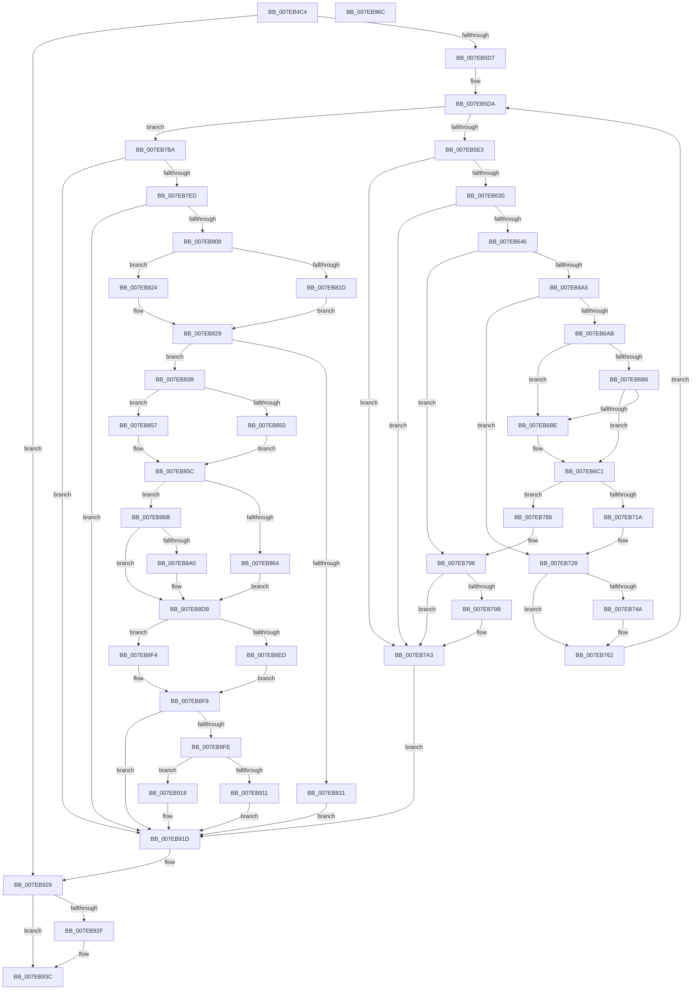

# CmpDoBuildVirtualStack

- RVA: `0x007EB4C4`–`0x007EB96D` (길이 `1,193` bytes)
- VA: `0x00000001407EB4C4`
- 실행 섹션: `PAGE`
- PDB 이름 있음: `예`; PDB Function 태그: `아니요`
- unwind 정보 RVA: `0x000D6E2C`
- 디코드: `301`개 명령, `1,193/1,193` bytes 표시
- 미해석 바이트: `0` (있으면 어셈블리에 `.byte`로 보존)

> 이 문서는 커널 이미지의 기계어와 PDB 기호를 분석해 생성했습니다. 4번과 5번은 함수 원형과 자료형을 바이너리 사용 방식에서 추정한 C 해석이며 원본 소스 복구 결과는 아닙니다.

## 1. Dependencies

- 직접 호출 지점: **43**; 고유 호출 대상: **28**
- 직접 호출자로 확인된 함수: **1**
- RIP 상대 이미지 참조: **2**

### Outgoing calls
- `0x007EB517` → [memset](../../text/6C/memset_function_006C6C40.md) (function, `0x006C6C40`)
- `0x007EB538` → [memset](../../text/6C/memset_function_006C6C40.md) (function, `0x006C6C40`)
- `0x007EB54C` → [memset](../../text/6C/memset_function_006C6C40.md) (function, `0x006C6C40`)
- `0x007EB560` → [HvpGetCellContextInitialize](../85/HvpGetCellContextInitialize_function_00855F10.md) (function, `0x00855F10`)
- `0x007EB56A` → [HvpGetCellContextInitialize](../85/HvpGetCellContextInitialize_function_00855F10.md) (function, `0x00855F10`)
- `0x007EB573` → [CmpInitializeParseContext](../87/CmpInitializeParseContext_function_008767F0.md) (function, `0x008767F0`)
- `0x007EB59A` → [CmpAttachToRegistryProcess](../../pagecmrc/BC/CmpAttachToRegistryProcess_function_00BC98E0.md) (function, `0x00BC98E0`)
- `0x007EB5C8` → [SeCreateAccessStateFromSubjectContext](../A8/SeCreateAccessStateFromSubjectContext_function_00A8B12C.md) (function, `0x00A8B12C`)
- `0x007EB621` → [CmpStartKcbStack](../94/CmpStartKcbStack_function_009451F0.md) (function, `0x009451F0`)
- `0x007EB637` → [CmpStartKcbStackForTopLayerKcb](../84/CmpStartKcbStackForTopLayerKcb_function_00848390.md) (function, `0x00848390`)
- `0x007EB649` → [CmpHashUnicodeComponent](../84/CmpHashUnicodeComponent_function_0084AC24.md) (function, `0x0084AC24`)
- `0x007EB691` → [CmpWalkOneLevel](../85/CmpWalkOneLevel_function_00852BA0.md) (function, `0x00852BA0`)
- `0x007EB6C8` → [CmpLockKcbStackTopExclusiveRestShared](../84/CmpLockKcbStackTopExclusiveRestShared_function_00846B04.md) (function, `0x00846B04`)
- `0x007EB6D1` → [CmpLockKcbStackTopExclusiveRestShared](../84/CmpLockKcbStackTopExclusiveRestShared_function_00846B04.md) (function, `0x00846B04`)
- `0x007EB70B` → [CmpCreateChild](../94/CmpCreateChild_function_0094817C.md) (function, `0x0094817C`)
- `0x007EB71A` → [CmpUnlockKcbStack](../84/CmpUnlockKcbStack_function_00848460.md) (function, `0x00848460`)
- `0x007EB723` → [CmpUnlockKcbStack](../84/CmpUnlockKcbStack_function_00848460.md) (function, `0x00848460`)
- `0x007EB72B` → [CmpUnlockHashEntryByKcb](../86/CmpUnlockHashEntryByKcb_function_00864370.md) (function, `0x00864370`)
- `0x007EB76E` → [CmpCleanupKcbStack](../94/CmpCleanupKcbStack_function_009470A0.md) (function, `0x009470A0`)
- `0x007EB777` → [CmpCleanupKcbStack](../94/CmpCleanupKcbStack_function_009470A0.md) (function, `0x009470A0`)
- `0x007EB788` → [CmpUnlockKcbStack](../84/CmpUnlockKcbStack_function_00848460.md) (function, `0x00848460`)
- `0x007EB791` → [CmpUnlockKcbStack](../84/CmpUnlockKcbStack_function_00848460.md) (function, `0x00848460`)
- `0x007EB79E` → [CmpDereferenceKeyControlBlock](../85/CmpDereferenceKeyControlBlock_function_00851310.md) (function, `0x00851310`)
- `0x007EB7A7` → [CmpCleanupKcbStack](../94/CmpCleanupKcbStack_function_009470A0.md) (function, `0x009470A0`)
- `0x007EB7B0` → [CmpCleanupKcbStack](../94/CmpCleanupKcbStack_function_009470A0.md) (function, `0x009470A0`)
- `0x007EB7DE` → [HvpMarkCellDirty](../85/HvpMarkCellDirty_function_00858080.md) (function, `0x00858080`)
- `0x007EB7F9` → [HvpMarkCellDirty](../85/HvpMarkCellDirty_function_00858080.md) (function, `0x00858080`)
- `0x007EB81D` → [HvpGetCellFlat](../85/HvpGetCellFlat_function_00854C60.md) (function, `0x00854C60`)
- `0x007EB824` → [HvpGetCellPaged](../85/HvpGetCellPaged_function_00854CB0.md) (function, `0x00854CB0`)
- `0x007EB850` → [HvpGetCellFlat](../85/HvpGetCellFlat_function_00854C60.md) (function, `0x00854C60`)
- `0x007EB857` → [HvpGetCellPaged](../85/HvpGetCellPaged_function_00854CB0.md) (function, `0x00854CB0`)
- `0x007EB872` → [CmpLockTwoSecurityCachesExclusiveShared](../A4/CmpLockTwoSecurityCachesExclusiveShared_function_00A45A94.md) (function, `0x00A45A94`)
- `0x007EB889` → [CmpCopySaclToVirtualKey](CmpCopySaclToVirtualKey_function_007ECA6C.md) (function, `0x007ECA6C`)
- `0x007EB897` → [CmpUnlockTwoSecurityCaches](../A4/CmpUnlockTwoSecurityCaches_function_00A4ACD8.md) (function, `0x00A4ACD8`)
- `0x007EB8B1` → [CmpAssignSecurityToKcb](../9D/CmpAssignSecurityToKcb_function_009DA720.md) (function, `0x009DA720`)
- `0x007EB8ED` → [HvpReleaseCellFlat](../85/HvpReleaseCellFlat_function_0085CC20.md) (function, `0x0085CC20`)
- `0x007EB8F4` → [HvpReleaseCellPaged](../85/HvpReleaseCellPaged_function_00855F40.md) (function, `0x00855F40`)
- `0x007EB911` → [HvpReleaseCellFlat](../85/HvpReleaseCellFlat_function_0085CC20.md) (function, `0x0085CC20`)
- `0x007EB918` → [HvpReleaseCellPaged](../85/HvpReleaseCellPaged_function_00855F40.md) (function, `0x00855F40`)
- `0x007EB924` → [SeDeleteAccessState](../8C/SeDeleteAccessState_function_008C5F70.md) (function, `0x008C5F70`)
- `0x007EB933` → [CmpDetachFromRegistryProcess](../../pagecmrc/BC/CmpDetachFromRegistryProcess_function_00BC9920.md) (function, `0x00BC9920`)
- `0x007EB942` → [CmpCleanupParseContext](../87/CmpCleanupParseContext_function_00876910.md) (function, `0x00876910`)
- `0x007EB953` → [_security_check_cookie](../../text/6A/_security_check_cookie_function_006AC640.md) (function, `0x006AC640`)

### Direct callers
- [CmpReplicateKeyToVirtual](CmpReplicateKeyToVirtual_function_007EBAEC.md) at `0x007EBC64`

### Static image references
- `0x007EB4E0` → RVA `0x00E0A740` (`.data`; read)
- `0x007EB59F` → RVA `0x00FC6AC0` (`ALMOSTRO`; read)

## 2. Other-region calls and transfers

- 다른 실행 섹션으로 향하는 call: **6**
  - `0x007EB517` → [memset](../../text/6C/memset_function_006C6C40.md) (`PAGE` → `.text`)
  - `0x007EB538` → [memset](../../text/6C/memset_function_006C6C40.md) (`PAGE` → `.text`)
  - `0x007EB54C` → [memset](../../text/6C/memset_function_006C6C40.md) (`PAGE` → `.text`)
  - `0x007EB59A` → [CmpAttachToRegistryProcess](../../pagecmrc/BC/CmpAttachToRegistryProcess_function_00BC98E0.md) (`PAGE` → `PAGECMRC`)
  - `0x007EB933` → [CmpDetachFromRegistryProcess](../../pagecmrc/BC/CmpDetachFromRegistryProcess_function_00BC9920.md) (`PAGE` → `PAGECMRC`)
  - `0x007EB953` → [_security_check_cookie](../../text/6A/_security_check_cookie_function_006AC640.md) (`PAGE` → `.text`)
- 별도 외부 분기/꼬리 이동을 확인하지 못했습니다.

## 3. Assembly (complete function range)

```asm
007EB4C4  40 55                           push rbp
007EB4C6  53                              push rbx
007EB4C7  56                              push rsi
007EB4C8  57                              push rdi
007EB4C9  41 54                           push r12
007EB4CB  41 55                           push r13
007EB4CD  41 56                           push r14
007EB4CF  41 57                           push r15
007EB4D1  48 8D AC 24 C8 FC FF FF         lea rbp, [rsp - 0x338]
007EB4D9  48 81 EC 38 04 00 00            sub rsp, 0x438
007EB4E0  48 8B 05 59 F2 61 00            mov rax, qword ptr [rip + 0x61f259]
007EB4E7  48 33 C4                        xor rax, rsp
007EB4EA  48 89 85 20 03 00 00            mov qword ptr [rbp + 0x320], rax
007EB4F1  48 8B 9D A0 03 00 00            mov rbx, qword ptr [rbp + 0x3a0]
007EB4F8  4D 8B E8                        mov r13, r8
007EB4FB  8B FA                           mov edi, edx
007EB4FD  89 54 24 64                     mov dword ptr [rsp + 0x64], edx
007EB501  4C 8B E1                        mov r12, rcx
007EB504  48 89 4D C0                     mov qword ptr [rbp - 0x40], rcx
007EB508  33 D2                           xor edx, edx
007EB50A  48 8D 4D D0                     lea rcx, [rbp - 0x30]
007EB50E  41 B8 D0 01 00 00               mov r8d, 0x1d0
007EB514  49 8B F1                        mov rsi, r9
007EB517  E8 24 B7 ED FF                  call 0x1406c6c40
007EB51C  45 33 FF                        xor r15d, r15d
007EB51F  48 8D 8D A0 01 00 00            lea rcx, [rbp + 0x1a0]
007EB526  33 D2                           xor edx, edx
007EB528  4C 89 7C 24 68                  mov qword ptr [rsp + 0x68], r15
007EB52D  41 B8 A0 00 00 00               mov r8d, 0xa0
007EB533  4C 89 7C 24 70                  mov qword ptr [rsp + 0x70], r15
007EB538  E8 03 B7 ED FF                  call 0x1406c6c40
007EB53D  33 D2                           xor edx, edx
007EB53F  48 8D 8D 40 02 00 00            lea rcx, [rbp + 0x240]
007EB546  41 B8 E0 00 00 00               mov r8d, 0xe0
007EB54C  E8 EF B6 ED FF                  call 0x1406c6c40
007EB551  48 8D 4C 24 68                  lea rcx, [rsp + 0x68]
007EB556  44 88 7C 24 60                  mov byte ptr [rsp + 0x60], r15b
007EB55B  4C 89 7C 24 78                  mov qword ptr [rsp + 0x78], r15
007EB560  E8 AB A9 06 00                  call 0x140855f10
007EB565  48 8D 4C 24 70                  lea rcx, [rsp + 0x70]
007EB56A  E8 A1 A9 06 00                  call 0x140855f10
007EB56F  48 8D 4D D0                     lea rcx, [rbp - 0x30]
007EB573  E8 78 B2 08 00                  call 0x1408767f0
007EB578  0F 57 C0                        xorps xmm0, xmm0
007EB57B  48 8D 4D 78                     lea rcx, [rbp + 0x78]
007EB57F  83 C8 FF                        or eax, 0xffffffff
007EB582  0F 11 45 80                     movups xmmword ptr [rbp - 0x80], xmm0
007EB586  66 89 45 82                     mov word ptr [rbp - 0x7e], ax
007EB58A  0F 11 45 A0                     movups xmmword ptr [rbp - 0x60], xmm0
007EB58E  66 89 45 A2                     mov word ptr [rbp - 0x5e], ax
007EB592  0F 11 45 90                     movups xmmword ptr [rbp - 0x70], xmm0
007EB596  0F 11 45 B0                     movups xmmword ptr [rbp - 0x50], xmm0
007EB59A  E8 41 E3 3D 00                  call 0x140bc98e0
007EB59F  48 8B 05 1A B5 7D 00            mov rax, qword ptr [rip + 0x7db51a]
007EB5A6  45 8D 4F 04                     lea r9d, [r15 + 4]
007EB5AA  83 4D 70 01                     or dword ptr [rbp + 0x70], 1
007EB5AE  4C 8D 85 40 02 00 00            lea r8, [rbp + 0x240]
007EB5B5  48 83 C0 4C                     add rax, 0x4c
007EB5B9  48 8D 95 A0 01 00 00            lea rdx, [rbp + 0x1a0]
007EB5C0  48 8B CB                        mov rcx, rbx
007EB5C3  48 89 44 24 20                  mov qword ptr [rsp + 0x20], rax
007EB5C8  E8 5F FB 29 00                  call 0x140a8b12c
007EB5CD  8B D8                           mov ebx, eax
007EB5CF  85 C0                           test eax, eax
007EB5D1  0F 88 52 03 00 00               js 0x1407eb929
007EB5D7  45 8B F7                        mov r14d, r15d
007EB5DA  44 3B F7                        cmp r14d, edi
007EB5DD  0F 83 D7 01 00 00               jae 0x1407eb7ba
007EB5E3  44 89 7D E8                     mov dword ptr [rbp - 0x18], r15d
007EB5E7  48 8D 4D A0                     lea rcx, [rbp - 0x60]
007EB5EB  0F 57 C0                        xorps xmm0, xmm0
007EB5EE  41 8B C6                        mov eax, r14d
007EB5F1  0F 11 45 A0                     movups xmmword ptr [rbp - 0x60], xmm0
007EB5F5  0F 11 45 80                     movups xmmword ptr [rbp - 0x80], xmm0
007EB5F9  4C 8D 3C 40                     lea r15, [rax + rax*2]
007EB5FD  83 C8 FF                        or eax, 0xffffffff
007EB600  0F 11 45 B0                     movups xmmword ptr [rbp - 0x50], xmm0
007EB604  66 89 45 A2                     mov word ptr [rbp - 0x5e], ax
007EB608  0F 11 45 90                     movups xmmword ptr [rbp - 0x70], xmm0
007EB60C  66 89 45 82                     mov word ptr [rbp - 0x7e], ax
007EB610  49 C1 E7 04                     shl r15, 4
007EB614  4D 03 FC                        add r15, r12
007EB617  4D 8B 67 10                     mov r12, qword ptr [r15 + 0x10]
007EB61B  41 0F B7 54 24 42               movzx edx, word ptr [r12 + 0x42]
007EB621  E8 CA 9B 15 00                  call 0x1409451f0
007EB626  8B D8                           mov ebx, eax
007EB628  85 C0                           test eax, eax
007EB62A  0F 88 73 01 00 00               js 0x1407eb7a3
007EB630  49 8B D4                        mov rdx, r12
007EB633  48 8D 4D 80                     lea rcx, [rbp - 0x80]
007EB637  E8 54 CD 05 00                  call 0x140848390
007EB63C  8B D8                           mov ebx, eax
007EB63E  85 C0                           test eax, eax
007EB640  0F 88 5D 01 00 00               js 0x1407eb7a3
007EB646  49 8B CF                        mov rcx, r15
007EB649  E8 D6 F5 05 00                  call 0x14084ac24
007EB64E  41 6B 4C 24 10 25               imul ecx, dword ptr [r12 + 0x10], 0x25
007EB654  48 8D 55 D0                     lea rdx, [rbp - 0x30]
007EB658  48 89 54 24 50                  mov qword ptr [rsp + 0x50], rdx
007EB65D  4C 8D 4D A0                     lea r9, [rbp - 0x60]
007EB661  C6 44 24 48 01                  mov byte ptr [rsp + 0x48], 1
007EB666  4C 8D 44 24 78                  lea r8, [rsp + 0x78]
007EB66B  48 83 64 24 40 00               and qword ptr [rsp + 0x40], 0
007EB671  48 8D 55 80                     lea rdx, [rbp - 0x80]
007EB675  03 C8                           add ecx, eax
007EB677  89 4C 24 38                     mov dword ptr [rsp + 0x38], ecx
007EB67B  49 8B CC                        mov rcx, r12
007EB67E  89 44 24 30                     mov dword ptr [rsp + 0x30], eax
007EB682  48 8D 44 24 60                  lea rax, [rsp + 0x60]
007EB687  4C 89 7C 24 28                  mov qword ptr [rsp + 0x28], r15
007EB68C  48 89 44 24 20                  mov qword ptr [rsp + 0x20], rax
007EB691  E8 0A 75 06 00                  call 0x140852ba0
007EB696  48 8B 7C 24 78                  mov rdi, qword ptr [rsp + 0x78]
007EB69B  8B D8                           mov ebx, eax
007EB69D  85 C0                           test eax, eax
007EB69F  0F 88 F1 00 00 00               js 0x1407eb796
007EB6A5  83 7F 28 FF                     cmp dword ptr [rdi + 0x28], -1
007EB6A9  75 7D                           jne 0x1407eb728
007EB6AB  B8 01 00 00 00                  mov eax, 1
007EB6B0  41 39 47 28                     cmp dword ptr [r15 + 0x28], eax
007EB6B4  74 08                           je 0x1407eb6be
007EB6B6  41 83 7C 24 28 00               cmp dword ptr [r12 + 0x28], 0
007EB6BC  7D 03                           jge 0x1407eb6c1
007EB6BE  89 45 E8                        mov dword ptr [rbp - 0x18], eax
007EB6C1  48 8D 4D 80                     lea rcx, [rbp - 0x80]
007EB6C5  89 45 D0                        mov dword ptr [rbp - 0x30], eax
007EB6C8  E8 37 B4 05 00                  call 0x140846b04
007EB6CD  48 8D 4D A0                     lea rcx, [rbp - 0x60]
007EB6D1  E8 2E B4 05 00                  call 0x140846b04
007EB6D6  48 83 64 24 40 00               and qword ptr [rsp + 0x40], 0
007EB6DC  48 8D 45 D0                     lea rax, [rbp - 0x30]
007EB6E0  C6 44 24 38 00                  mov byte ptr [rsp + 0x38], 0
007EB6E5  4C 8D 85 A0 01 00 00            lea r8, [rbp + 0x1a0]
007EB6EC  C7 44 24 30 03 00 00 00         mov dword ptr [rsp + 0x30], 3
007EB6F4  48 8D 55 A0                     lea rdx, [rbp - 0x60]
007EB6F8  66 C7 44 24 28 00 02            mov word ptr [rsp + 0x28], 0x200
007EB6FF  48 8D 4D 80                     lea rcx, [rbp - 0x80]
007EB703  4D 8B CF                        mov r9, r15
007EB706  48 89 44 24 20                  mov qword ptr [rsp + 0x20], rax
007EB70B  E8 6C CA 15 00                  call 0x14094817c
007EB710  48 8D 4D A0                     lea rcx, [rbp - 0x60]
007EB714  8B D8                           mov ebx, eax
007EB716  85 C0                           test eax, eax
007EB718  78 6E                           js 0x1407eb788
007EB71A  E8 41 CD 05 00                  call 0x140848460
007EB71F  48 8D 4D 80                     lea rcx, [rbp - 0x80]
007EB723  E8 38 CD 05 00                  call 0x140848460
007EB728  48 8B CF                        mov rcx, rdi
007EB72B  E8 40 8C 07 00                  call 0x140864370
007EB730  4C 8B 65 C0                     mov r12, qword ptr [rbp - 0x40]
007EB734  49 89 7F 18                     mov qword ptr [r15 + 0x18], rdi
007EB738  8B 47 28                        mov eax, dword ptr [rdi + 0x28]
007EB73B  41 89 47 24                     mov dword ptr [r15 + 0x24], eax
007EB73F  8B 44 24 64                     mov eax, dword ptr [rsp + 0x64]
007EB743  FF C8                           dec eax
007EB745  44 3B F0                        cmp r14d, eax
007EB748  73 18                           jae 0x1407eb762
007EB74A  41 8D 46 01                     lea eax, [r14 + 1]
007EB74E  48 8D 14 40                     lea rdx, [rax + rax*2]
007EB752  48 03 D2                        add rdx, rdx
007EB755  49 89 7C D4 10                  mov qword ptr [r12 + rdx*8 + 0x10], rdi
007EB75A  8B 47 28                        mov eax, dword ptr [rdi + 0x28]
007EB75D  41 89 44 D4 20                  mov dword ptr [r12 + rdx*8 + 0x20], eax
007EB762  45 33 FF                        xor r15d, r15d
007EB765  48 8D 4D A0                     lea rcx, [rbp - 0x60]
007EB769  4C 89 7C 24 78                  mov qword ptr [rsp + 0x78], r15
007EB76E  E8 2D B9 15 00                  call 0x1409470a0
007EB773  48 8D 4D 80                     lea rcx, [rbp - 0x80]
007EB777  E8 24 B9 15 00                  call 0x1409470a0
007EB77C  8B 7C 24 64                     mov edi, dword ptr [rsp + 0x64]
007EB780  41 FF C6                        inc r14d
007EB783  E9 52 FE FF FF                  jmp 0x1407eb5da
007EB788  E8 D3 CC 05 00                  call 0x140848460
007EB78D  48 8D 4D 80                     lea rcx, [rbp - 0x80]
007EB791  E8 CA CC 05 00                  call 0x140848460
007EB796  48 85 FF                        test rdi, rdi
007EB799  74 08                           je 0x1407eb7a3
007EB79B  48 8B CF                        mov rcx, rdi
007EB79E  E8 6D 5B 06 00                  call 0x140851310
007EB7A3  48 8D 4D A0                     lea rcx, [rbp - 0x60]
007EB7A7  E8 F4 B8 15 00                  call 0x1409470a0
007EB7AC  48 8D 4D 80                     lea rcx, [rbp - 0x80]
007EB7B0  E8 EB B8 15 00                  call 0x1409470a0
007EB7B5  E9 63 01 00 00                  jmp 0x1407eb91d
007EB7BA  0F AE E8                        lfence
007EB7BD  8B 56 28                        mov edx, dword ptr [rsi + 0x28]
007EB7C0  8D 47 FF                        lea eax, [rdi - 1]
007EB7C3  48 8B 4E 20                     mov rcx, qword ptr [rsi + 0x20]
007EB7C7  48 8D 04 40                     lea rax, [rax + rax*2]
007EB7CB  48 03 C0                        add rax, rax
007EB7CE  45 33 C9                        xor r9d, r9d
007EB7D1  45 33 C0                        xor r8d, r8d
007EB7D4  45 8B 7C C4 24                  mov r15d, dword ptr [r12 + rax*8 + 0x24]
007EB7D9  4D 8B 64 C4 18                  mov r12, qword ptr [r12 + rax*8 + 0x18]
007EB7DE  E8 9D C8 06 00                  call 0x140858080
007EB7E3  8B D8                           mov ebx, eax
007EB7E5  85 C0                           test eax, eax
007EB7E7  0F 88 30 01 00 00               js 0x1407eb91d
007EB7ED  45 33 C9                        xor r9d, r9d
007EB7F0  45 33 C0                        xor r8d, r8d
007EB7F3  41 8B D7                        mov edx, r15d
007EB7F6  49 8B CD                        mov rcx, r13
007EB7F9  E8 82 C8 06 00                  call 0x140858080
007EB7FE  8B D8                           mov ebx, eax
007EB800  85 C0                           test eax, eax
007EB802  0F 88 15 01 00 00               js 0x1407eb91d
007EB808  48 8B 4E 20                     mov rcx, qword ptr [rsi + 0x20]
007EB80C  4C 8D 44 24 68                  lea r8, [rsp + 0x68]
007EB811  8B 56 28                        mov edx, dword ptr [rsi + 0x28]
007EB814  F6 81 8C 00 00 00 01            test byte ptr [rcx + 0x8c], 1
007EB81B  74 07                           je 0x1407eb824
007EB81D  E8 3E 94 06 00                  call 0x140854c60
007EB822  EB 05                           jmp 0x1407eb829
007EB824  E8 87 94 06 00                  call 0x140854cb0
007EB829  4C 8B F0                        mov r14, rax
007EB82C  48 85 C0                        test rax, rax
007EB82F  75 0A                           jne 0x1407eb83b
007EB831  BB 9A 00 00 C0                  mov ebx, 0xc000009a
007EB836  E9 E2 00 00 00                  jmp 0x1407eb91d
007EB83B  41 F6 85 8C 00 00 00 01         test byte ptr [r13 + 0x8c], 1
007EB843  4C 8D 44 24 70                  lea r8, [rsp + 0x70]
007EB848  41 8B D7                        mov edx, r15d
007EB84B  49 8B CD                        mov rcx, r13
007EB84E  74 07                           je 0x1407eb857
007EB850  E8 0B 94 06 00                  call 0x140854c60
007EB855  EB 05                           jmp 0x1407eb85c
007EB857  E8 54 94 06 00                  call 0x140854cb0
007EB85C  48 8B F8                        mov rdi, rax
007EB85F  48 85 C0                        test rax, rax
007EB862  75 07                           jne 0x1407eb86b
007EB864  BB 9A 00 00 C0                  mov ebx, 0xc000009a
007EB869  EB 70                           jmp 0x1407eb8db
007EB86B  48 8B 56 20                     mov rdx, qword ptr [rsi + 0x20]
007EB86F  49 8B CD                        mov rcx, r13
007EB872  E8 1D A2 25 00                  call 0x140a45a94
007EB877  48 8B 4E 20                     mov rcx, qword ptr [rsi + 0x20]
007EB87B  4C 8B CF                        mov r9, rdi
007EB87E  4D 8B C5                        mov r8, r13
007EB881  44 89 7C 24 20                  mov dword ptr [rsp + 0x20], r15d
007EB886  49 8B D6                        mov rdx, r14
007EB889  E8 DE 11 00 00                  call 0x1407eca6c
007EB88E  48 8B 56 20                     mov rdx, qword ptr [rsi + 0x20]
007EB892  49 8B CD                        mov rcx, r13
007EB895  8B D8                           mov ebx, eax
007EB897  E8 3C F4 25 00                  call 0x140a4acd8
007EB89C  85 DB                           test ebx, ebx
007EB89E  78 3B                           js 0x1407eb8db
007EB8A0  8B 57 2C                        mov edx, dword ptr [rdi + 0x2c]
007EB8A3  45 33 C9                        xor r9d, r9d
007EB8A6  45 33 C0                        xor r8d, r8d
007EB8A9  C6 44 24 20 00                  mov byte ptr [rsp + 0x20], 0
007EB8AE  49 8B CC                        mov rcx, r12
007EB8B1  E8 6A EE 1E 00                  call 0x1409da720
007EB8B6  B8 00 01 00 00                  mov eax, 0x100
007EB8BB  66 41 09 84 24 BA 00 00 00      or word ptr [r12 + 0xba], ax
007EB8C4  66 09 47 02                     or word ptr [rdi + 2], ax
007EB8C8  B8 80 00 00 00                  mov eax, 0x80
007EB8CD  66 09 86 BA 00 00 00            or word ptr [rsi + 0xba], ax
007EB8D4  66 41 09 46 02                  or word ptr [r14 + 2], ax
007EB8D9  33 DB                           xor ebx, ebx
007EB8DB  48 8B 4E 20                     mov rcx, qword ptr [rsi + 0x20]
007EB8DF  48 8D 54 24 68                  lea rdx, [rsp + 0x68]
007EB8E4  F6 81 8C 00 00 00 01            test byte ptr [rcx + 0x8c], 1
007EB8EB  74 07                           je 0x1407eb8f4
007EB8ED  E8 2E 13 07 00                  call 0x14085cc20
007EB8F2  EB 05                           jmp 0x1407eb8f9
007EB8F4  E8 47 A6 06 00                  call 0x140855f40
007EB8F9  48 85 FF                        test rdi, rdi
007EB8FC  74 1F                           je 0x1407eb91d
007EB8FE  49 8B 4C 24 20                  mov rcx, qword ptr [r12 + 0x20]
007EB903  48 8D 54 24 70                  lea rdx, [rsp + 0x70]
007EB908  F6 81 8C 00 00 00 01            test byte ptr [rcx + 0x8c], 1
007EB90F  74 07                           je 0x1407eb918
007EB911  E8 0A 13 07 00                  call 0x14085cc20
007EB916  EB 05                           jmp 0x1407eb91d
007EB918  E8 23 A6 06 00                  call 0x140855f40
007EB91D  48 8D 8D A0 01 00 00            lea rcx, [rbp + 0x1a0]
007EB924  E8 47 A6 0D 00                  call 0x1408c5f70
007EB929  F6 45 70 01                     test byte ptr [rbp + 0x70], 1
007EB92D  74 0D                           je 0x1407eb93c
007EB92F  48 8D 4D 78                     lea rcx, [rbp + 0x78]
007EB933  E8 E8 DF 3D 00                  call 0x140bc9920
007EB938  83 65 70 FE                     and dword ptr [rbp + 0x70], 0xfffffffe
007EB93C  B2 01                           mov dl, 1
007EB93E  48 8D 4D D0                     lea rcx, [rbp - 0x30]
007EB942  E8 C9 AF 08 00                  call 0x140876910
007EB947  8B C3                           mov eax, ebx
007EB949  48 8B 8D 20 03 00 00            mov rcx, qword ptr [rbp + 0x320]
007EB950  48 33 CC                        xor rcx, rsp
007EB953  E8 E8 0C EC FF                  call 0x1406ac640
007EB958  48 81 C4 38 04 00 00            add rsp, 0x438
007EB95F  41 5F                           pop r15
007EB961  41 5E                           pop r14
007EB963  41 5D                           pop r13
007EB965  41 5C                           pop r12
007EB967  5F                              pop rdi
007EB968  5E                              pop rsi
007EB969  5B                              pop rbx
007EB96A  5D                              pop rbp
007EB96B  C3                              ret
007EB96C  CC                              int3
```

## 4. C-style interpretation (structured pseudocode)

```c
__int64 __fastcall CmpDoBuildVirtualStack(__int64 a1, int a2, __int64 a3, __int64 a4, __int64 a5)
{
    __int64 result;
    __int64 v_r14;
    __int64 v_r15;
    __int64 v_rbx;
    __int64 v_rsp;
    unsigned __int64 v_stack_m138;
    unsigned __int64 v_stack_m1D8;
    unsigned __int64 v_stack_m300;
    unsigned int v_stack_m308;
    unsigned __int64 v_stack_m378;
    unsigned int v_stack_m390;
    unsigned __int64 v_stack_m3A8;
    unsigned __int64 v_stack_m3B8;
    unsigned __int64 v_stack_m3C8;
    unsigned __int16 v_stack_m3D6;
    unsigned __int64 v_stack_m3D8;
    unsigned __int64 v_stack_m3E8;
    unsigned __int16 v_stack_m3F6;
    unsigned __int64 v_stack_m3F8;
    unsigned __int64 v_stack_m400;
    unsigned __int64 v_stack_m408;
    unsigned __int64 v_stack_m410;
    unsigned int v_stack_m414;
    unsigned __int8 v_stack_m418;
    unsigned __int64 v_stack_m428;
    unsigned __int8 v_stack_m430;
    unsigned __int64 v_stack_m438;
    unsigned int v_stack_m440;
    unsigned int v_stack_m448;
    unsigned __int64 v_stack_m450;
    unsigned __int64 v_stack_m458;
    unsigned __int64 v_stack_m58;

    v_rsp = (v_rsp) - (0x438ULL);
    result = (*(unsigned __int64 *)(v_rip + 6419033)) ^ (v_rsp);
    v_stack_m58 = result;
    v_stack_m414 = a2;
    v_stack_m3B8 = a1;
    a2 = 0;
    result = memset(v_stack_m3A8, a2, 464, a4);
    v_r15 = 0;
    a2 = 0;
    v_stack_m410 = 0;
    v_stack_m408 = 0;
    result = memset(v_stack_m1D8, a2, 160, a4);
    a2 = 0;
    result = memset(v_stack_m138, a2, 224, a4);
    v_stack_m418 = 0;
    v_stack_m400 = 0;
    result = HvpGetCellContextInitialize(v_stack_m410, a2, 224, a4);
    result = HvpGetCellContextInitialize(v_stack_m408, a2, 224, a4);
    result = CmpInitializeParseContext(v_stack_m3A8, a2, 224, a4);
    result = (unsigned int)((result) | (0xFFFFFFFFULL));
    v_stack_m3F8 = v_xmm0;
    v_stack_m3F6 = (unsigned __int16)(result);
    v_stack_m3D8 = v_xmm0;
    v_stack_m3D6 = (unsigned __int16)(result);
    v_stack_m3E8 = v_xmm0;
    v_stack_m3C8 = v_xmm0;
    result = CmpAttachToRegistryProcess(v_stack_m300, a2, 224, a4);
    result = (*(unsigned __int64 *)(v_rip + 8238362)) + (76);
    v_stack_m458 = result;
    result = SeCreateAccessStateFromSubjectContext(a5, v_stack_m1D8, v_stack_m138, v_r15 + 4);
    if (sign_flag) goto loc_007EB929;
loc_007EB5DA:
    if (0 >= ((unsigned int)((unsigned int)(a2)))) goto loc_007EB7BA;
    v_stack_m390 = 0;
    v_stack_m3D8 = v_xmm0;
    v_stack_m3F8 = v_xmm0;
    result = (unsigned int)((0) | (0xFFFFFFFFULL));
    v_stack_m3C8 = v_xmm0;
    v_stack_m3D6 = (unsigned __int16)(result);
    v_stack_m3E8 = v_xmm0;
    v_stack_m3F6 = (unsigned __int16)(result);
    v_r15 = (0 + 0 * 2) << (4);
    v_r15 = (v_r15) + (a1);
    result = CmpStartKcbStack(v_stack_m3D8, *(unsigned __int16 *)(*(unsigned __int64 *)(v_r15 + 16) + 66), v_stack_m138, v_r15 + 4);
    if (sign_flag) goto loc_007EB7A3;
    result = CmpStartKcbStackForTopLayerKcb(v_stack_m3F8, *(unsigned __int64 *)(v_r15 + 16), v_stack_m138, v_r15 + 4);
    if (sign_flag) goto loc_007EB7A3;
    result = CmpHashUnicodeComponent(v_r15, *(unsigned __int64 *)(v_r15 + 16), v_stack_m138, v_r15 + 4);
    a1 = (unsigned int)((v_r15) * (*(unsigned int *)(*(unsigned __int64 *)(v_r15 + 16) + 16)));
    v_stack_m428 = v_stack_m3A8;
    v_stack_m430 = 1;
    a1 = (unsigned int)((a1) + ((unsigned int)(result)));
    v_stack_m440 = (unsigned int)(a1);
    v_stack_m448 = (unsigned int)(result);
    v_stack_m450 = v_r15;
    v_stack_m458 = v_stack_m418;
    result = CmpWalkOneLevel(*(unsigned __int64 *)(v_r15 + 16), v_stack_m3F8, v_stack_m400, v_stack_m3D8);
    if (sign_flag) goto loc_007EB796;
    if ((*(unsigned int *)(v_stack_m400 + 40)) != -1) goto loc_007EB728;
    if ((*(unsigned int *)(v_r15 + 40)) == 1) goto loc_007EB6BE;
    if ((*(unsigned int *)(*(unsigned __int64 *)(v_r15 + 16) + 40)) < 0) {
        v_stack_m390 = 1;
    }
    v_stack_m3A8 = 1;
    result = CmpLockKcbStackTopExclusiveRestShared(v_stack_m3F8, v_stack_m3F8, v_stack_m400, v_stack_m3D8);
    result = CmpLockKcbStackTopExclusiveRestShared(v_stack_m3D8, v_stack_m3F8, v_stack_m400, v_stack_m3D8);
    v_stack_m440 = 0;
    v_stack_m448 = 3;
    v_stack_m450 = 512;
    v_stack_m458 = v_stack_m3A8;
    result = CmpCreateChild(v_stack_m3F8, v_stack_m3D8, v_stack_m1D8, v_r15);
    if (sign_flag) goto loc_007EB788;
    result = CmpUnlockKcbStack(v_stack_m3D8, v_stack_m3D8, v_stack_m1D8, v_r15);
    result = CmpUnlockKcbStack(v_stack_m3F8, v_stack_m3D8, v_stack_m1D8, v_r15);
loc_007EB728:
    result = CmpUnlockHashEntryByKcb(v_stack_m400, v_stack_m3D8, v_stack_m1D8, v_r15);
    *(unsigned __int64 *)(v_r15 + 24) = v_stack_m400;
    *(unsigned int *)(v_r15 + 36) = (unsigned int)((unsigned int)(*(unsigned int *)(v_stack_m400 + 40)));
    result = (unsigned int)(((unsigned int)(v_stack_m414)) - 1);
    if (0 < ((unsigned int)(result))) {
        result = 0 + 1;
        a2 = result + result * 2;
        a2 = (a2) + (a2);
        *(unsigned __int64 *)(v_stack_m3B8 + a2 * 8 + 16) = v_stack_m400;
        result = *(unsigned int *)(v_stack_m400 + 40);
        *(unsigned int *)(v_stack_m3B8 + a2 * 8 + 32) = (unsigned int)(result);
    }
    v_r15 = 0;
    v_stack_m400 = 0;
    result = CmpCleanupKcbStack(v_stack_m3D8, a2, v_stack_m1D8, v_r15);
    result = CmpCleanupKcbStack(v_stack_m3F8, a2, v_stack_m1D8, v_r15);
    v_r14 = (unsigned int)((0) + 1);
    goto loc_007EB5DA;
loc_007EB788:
    result = CmpUnlockKcbStack(v_stack_m3F8, a2, v_stack_m1D8, v_r15);
    result = CmpUnlockKcbStack(v_stack_m3F8, a2, v_stack_m1D8, v_r15);
loc_007EB796:
    if ((unsigned int)(v_stack_m414) != 0) {
        a1 = (unsigned int)(v_stack_m414);
        result = CmpDereferenceKeyControlBlock(a1, a2, v_stack_m1D8, v_r15);
    }
    result = CmpCleanupKcbStack(v_stack_m3D8, a2, v_stack_m1D8, v_r15);
    result = CmpCleanupKcbStack(v_stack_m3F8, a2, v_stack_m1D8, v_r15);
    goto loc_007EB91D;
loc_007EB7BA:
    result = ((unsigned int)(v_stack_m414) - 1 + (unsigned int)(v_stack_m414) - 1 * 2) + ((unsigned int)(v_stack_m414) - 1 + (unsigned int)(v_stack_m414) - 1 * 2);
    a4 = 0;
    a3 = 0;
    result = HvpMarkCellDirty(*(unsigned __int64 *)(a4 + 32), (unsigned int)(*(unsigned int *)(a4 + 40)), a3, a4);
    if (sign_flag) goto loc_007EB91D;
    a4 = 0;
    a3 = 0;
    result = HvpMarkCellDirty(0, (unsigned int)((unsigned int)((unsigned int)(*(unsigned int *)(v_stack_m3B8 + result * 8 + 36)))), a3, a4);
    if (sign_flag) goto loc_007EB91D;
    if (((*(unsigned __int8 *)(*(unsigned __int64 *)(a4 + 32) + 140)) & (1)) == 0) goto loc_007EB824;
    result = HvpGetCellFlat(*(unsigned __int64 *)(a4 + 32), (unsigned int)(*(unsigned int *)(a4 + 40)), v_stack_m410, a4);
    goto loc_007EB829;
loc_007EB824:
    result = HvpGetCellPaged(*(unsigned __int64 *)(a4 + 32), (unsigned int)(*(unsigned int *)(a4 + 40)), v_stack_m410, a4);
loc_007EB829:
    if (result != 0) goto loc_007EB83B;
    goto loc_007EB91D;
loc_007EB83B:
    if (((*(unsigned __int8 *)(a3 + 140)) & (1)) == 0) goto loc_007EB857;
    result = HvpGetCellFlat(0, (unsigned int)((unsigned int)((unsigned int)(*(unsigned int *)(v_stack_m3B8 + result * 8 + 36)))), v_stack_m408, a4);
    goto loc_007EB85C;
loc_007EB857:
    result = HvpGetCellPaged(0, (unsigned int)((unsigned int)((unsigned int)(*(unsigned int *)(v_stack_m3B8 + result * 8 + 36)))), v_stack_m408, a4);
loc_007EB85C:
    if (result != 0) goto loc_007EB86B;
    goto loc_007EB8DB;
loc_007EB86B:
    result = CmpLockTwoSecurityCachesExclusiveShared(0, *(unsigned __int64 *)(a4 + 32), v_stack_m408, a4);
    v_stack_m458 = (unsigned int)((unsigned int)(*(unsigned int *)(v_stack_m3B8 + result * 8 + 36)));
    result = CmpCopySaclToVirtualKey(*(unsigned __int64 *)(a4 + 32), result, 0, result);
    result = CmpUnlockTwoSecurityCaches(0, *(unsigned __int64 *)(a4 + 32), 0, result);
    v_rbx = (unsigned int)((unsigned int)(result));
    if (!(sign_flag)) {
        a2 = *(unsigned int *)(result + 44);
        a4 = 0;
        a3 = 0;
        v_stack_m458 = 0;
        a1 = *(unsigned __int64 *)(v_stack_m3B8 + result * 8 + 24);
        result = CmpAssignSecurityToKcb(a1, a2, a3, a4);
        result = 256;
        result = 128;
        v_rbx = 0;
    }
    if (((*(unsigned __int8 *)(*(unsigned __int64 *)(a4 + 32) + 140)) & (1)) == 0) goto loc_007EB8F4;
    result = HvpReleaseCellFlat(*(unsigned __int64 *)(a4 + 32), v_stack_m410, a3, a4);
    goto loc_007EB8F9;
loc_007EB8F4:
    result = HvpReleaseCellPaged(*(unsigned __int64 *)(a4 + 32), v_stack_m410, a3, a4);
loc_007EB8F9:
    if (result == 0) goto loc_007EB91D;
    if (((*(unsigned __int8 *)(*(unsigned __int64 *)(*(unsigned __int64 *)(v_stack_m3B8 + result * 8 + 24) + 32) + 140)) & (1)) == 0) goto loc_007EB918;
    result = HvpReleaseCellFlat(*(unsigned __int64 *)(*(unsigned __int64 *)(v_stack_m3B8 + result * 8 + 24) + 32), v_stack_m408, a3, a4);
    goto loc_007EB91D;
loc_007EB918:
    result = HvpReleaseCellPaged(*(unsigned __int64 *)(*(unsigned __int64 *)(v_stack_m3B8 + result * 8 + 24) + 32), v_stack_m408, a3, a4);
loc_007EB91D:
    result = SeDeleteAccessState(v_stack_m1D8, v_stack_m408, a3, a4);
loc_007EB929:
    if (((v_stack_m308) & (1)) != 0) {
        a1 = v_stack_m300;
        result = CmpDetachFromRegistryProcess(a1, v_stack_m408, a3, a4);
    }
    result = CmpCleanupParseContext(v_stack_m3A8, 1, a3, a4);
    a1 = (v_stack_m58) ^ (v_rsp);
    result = _security_check_cookie(a1, 1, a3, a4);
    v_rsp = (v_rsp) + (0x438ULL);
    return result;
}
```

## 5. (Beta) C Style

```c
int64_t CmpDoBuildVirtualStack(int64_t Arg1, int32_t Arg2, void *Arg3, void *Arg4, int64_t Arg5)
{
    uint8_t *arg3 = (uint8_t *)Arg3;
    uint8_t *arg4 = (uint8_t *)Arg4;

    int64_t result;
    int64_t local_r14;
    int64_t local_r15;
    int64_t local_rbx;
    int64_t local_rsp;
    uint64_t v_stack_m138;
    uint64_t v_stack_m1D8;
    uint64_t v_stack_m300;
    uint32_t v_stack_m308;
    uint64_t v_stack_m378;
    uint32_t v_stack_m390;
    uint64_t v_stack_m3A8;
    uint64_t v_stack_m3B8;
    uint64_t v_stack_m3C8;
    uint16_t v_stack_m3D6;
    uint64_t v_stack_m3D8;
    uint64_t v_stack_m3E8;
    uint16_t v_stack_m3F6;
    uint64_t v_stack_m3F8;
    uint64_t v_stack_m400;
    uint64_t v_stack_m408;
    uint64_t v_stack_m410;
    uint32_t v_stack_m414;
    uint8_t v_stack_m418;
    uint64_t v_stack_m428;
    uint8_t v_stack_m430;
    uint64_t v_stack_m438;
    uint32_t v_stack_m440;
    uint32_t v_stack_m448;
    uint64_t v_stack_m450;
    uint64_t v_stack_m458;
    uint64_t v_stack_m58;

    local_rsp = (local_rsp) - (0x438ULL);
    result = (*(uint64_t *)(v_rip + 0x61F259)) ^ (local_rsp);
    v_stack_m58 = result;
    v_stack_m414 = Arg2;
    v_stack_m3B8 = Arg1;
    Arg2 = 0;
    result = memset(v_stack_m3A8, Arg2, 464, Arg4);
    local_r15 = 0;
    Arg2 = 0;
    v_stack_m410 = 0;
    v_stack_m408 = 0;
    result = memset(v_stack_m1D8, Arg2, 160, Arg4);
    Arg2 = 0;
    result = memset(v_stack_m138, Arg2, 224, Arg4);
    v_stack_m418 = 0;
    v_stack_m400 = 0;
    result = HvpGetCellContextInitialize(v_stack_m410, Arg2, 224, Arg4);
    result = HvpGetCellContextInitialize(v_stack_m408, Arg2, 224, Arg4);
    result = CmpInitializeParseContext(v_stack_m3A8, Arg2, 224, Arg4);
    result = (uint32_t)((result) | (0xFFFFFFFFULL));
    v_stack_m3F8 = v_xmm0;
    v_stack_m3F6 = (uint16_t)(result);
    v_stack_m3D8 = v_xmm0;
    v_stack_m3D6 = (uint16_t)(result);
    v_stack_m3E8 = v_xmm0;
    v_stack_m3C8 = v_xmm0;
    result = CmpAttachToRegistryProcess(v_stack_m300, Arg2, 224, Arg4);
    result = (*(uint64_t *)(v_rip + 0x7DB51A)) + (76);
    v_stack_m458 = result;
    result = SeCreateAccessStateFromSubjectContext(Arg5, v_stack_m1D8, v_stack_m138, local_r15 + 4);
    if (sign_flag) goto loc_007EB929;
loc_007EB5DA:
    if (0 >= ((uint32_t)((uint32_t)(Arg2)))) goto loc_007EB7BA;
    v_stack_m390 = 0;
    v_stack_m3D8 = v_xmm0;
    v_stack_m3F8 = v_xmm0;
    result = (uint32_t)((0) | (0xFFFFFFFFULL));
    v_stack_m3C8 = v_xmm0;
    v_stack_m3D6 = (uint16_t)(result);
    v_stack_m3E8 = v_xmm0;
    v_stack_m3F6 = (uint16_t)(result);
    local_r15 = (0 + 0 * 2) << (4);
    local_r15 = (local_r15) + (Arg1);
    result = CmpStartKcbStack(v_stack_m3D8, *(uint16_t *)(*(uint64_t *)(local_r15 + 0x10) + 0x42), v_stack_m138, local_r15 + 4);
    if (sign_flag) goto loc_007EB7A3;
    result = CmpStartKcbStackForTopLayerKcb(v_stack_m3F8, *(uint64_t *)(local_r15 + 0x10), v_stack_m138, local_r15 + 4);
    if (sign_flag) goto loc_007EB7A3;
    result = CmpHashUnicodeComponent(local_r15, *(uint64_t *)(local_r15 + 0x10), v_stack_m138, local_r15 + 4);
    Arg1 = (uint32_t)((local_r15) * (*(uint32_t *)(*(uint64_t *)(local_r15 + 0x10) + 0x10)));
    v_stack_m428 = v_stack_m3A8;
    v_stack_m430 = 1;
    Arg1 = (uint32_t)((Arg1) + ((uint32_t)(result)));
    v_stack_m440 = (uint32_t)(Arg1);
    v_stack_m448 = (uint32_t)(result);
    v_stack_m450 = local_r15;
    v_stack_m458 = v_stack_m418;
    result = CmpWalkOneLevel(*(uint64_t *)(local_r15 + 0x10), v_stack_m3F8, v_stack_m400, v_stack_m3D8);
    if (sign_flag) goto loc_007EB796;
    if ((*(uint32_t *)(v_stack_m400 + 0x28)) != -1) goto loc_007EB728;
    if ((*(uint32_t *)(local_r15 + 0x28)) == 1) goto loc_007EB6BE;
    if ((*(uint32_t *)(*(uint64_t *)(local_r15 + 0x10) + 0x28)) < 0) {
        v_stack_m390 = 1;
    }
    v_stack_m3A8 = 1;
    result = CmpLockKcbStackTopExclusiveRestShared(v_stack_m3F8, v_stack_m3F8, v_stack_m400, v_stack_m3D8);
    result = CmpLockKcbStackTopExclusiveRestShared(v_stack_m3D8, v_stack_m3F8, v_stack_m400, v_stack_m3D8);
    v_stack_m440 = 0;
    v_stack_m448 = 3;
    v_stack_m450 = 512;
    v_stack_m458 = v_stack_m3A8;
    result = CmpCreateChild(v_stack_m3F8, v_stack_m3D8, v_stack_m1D8, local_r15);
    if (sign_flag) goto loc_007EB788;
    result = CmpUnlockKcbStack(v_stack_m3D8, v_stack_m3D8, v_stack_m1D8, local_r15);
    result = CmpUnlockKcbStack(v_stack_m3F8, v_stack_m3D8, v_stack_m1D8, local_r15);
loc_007EB728:
    result = CmpUnlockHashEntryByKcb(v_stack_m400, v_stack_m3D8, v_stack_m1D8, local_r15);
    *(uint64_t *)(local_r15 + 0x18) = v_stack_m400;
    *(uint32_t *)(local_r15 + 0x24) = (uint32_t)((uint32_t)(*(uint32_t *)(v_stack_m400 + 0x28)));
    result = (uint32_t)(((uint32_t)(v_stack_m414)) - 1);
    if (0 < ((uint32_t)(result))) {
        result = 0 + 1;
        Arg2 = result + result * 2;
        Arg2 = (Arg2) + (Arg2);
        *(uint64_t *)(v_stack_m3B8 + Arg2 * 8 + 0x10) = v_stack_m400;
        result = *(uint32_t *)(v_stack_m400 + 0x28);
        *(uint32_t *)(v_stack_m3B8 + Arg2 * 8 + 0x20) = (uint32_t)(result);
    }
    local_r15 = 0;
    v_stack_m400 = 0;
    result = CmpCleanupKcbStack(v_stack_m3D8, Arg2, v_stack_m1D8, local_r15);
    result = CmpCleanupKcbStack(v_stack_m3F8, Arg2, v_stack_m1D8, local_r15);
    local_r14 = (uint32_t)((0) + 1);
    goto loc_007EB5DA;
loc_007EB788:
    result = CmpUnlockKcbStack(v_stack_m3F8, Arg2, v_stack_m1D8, local_r15);
    result = CmpUnlockKcbStack(v_stack_m3F8, Arg2, v_stack_m1D8, local_r15);
loc_007EB796:
    if ((uint32_t)(v_stack_m414) != 0) {
        Arg1 = (uint32_t)(v_stack_m414);
        result = CmpDereferenceKeyControlBlock(Arg1, Arg2, v_stack_m1D8, local_r15);
    }
    result = CmpCleanupKcbStack(v_stack_m3D8, Arg2, v_stack_m1D8, local_r15);
    result = CmpCleanupKcbStack(v_stack_m3F8, Arg2, v_stack_m1D8, local_r15);
    goto loc_007EB91D;
loc_007EB7BA:
    result = ((uint32_t)(v_stack_m414) - 1 + (uint32_t)(v_stack_m414) - 1 * 2) + ((uint32_t)(v_stack_m414) - 1 + (uint32_t)(v_stack_m414) - 1 * 2);
    Arg4 = 0;
    Arg3 = 0;
    result = HvpMarkCellDirty(*(uint64_t *)(arg4 + 0x20), (uint32_t)(*(uint32_t *)(arg4 + 0x28)), Arg3, Arg4);
    if (sign_flag) goto loc_007EB91D;
    Arg4 = 0;
    Arg3 = 0;
    result = HvpMarkCellDirty(0, (uint32_t)((uint32_t)((uint32_t)(*(uint32_t *)(v_stack_m3B8 + result * 8 + 0x24)))), Arg3, Arg4);
    if (sign_flag) goto loc_007EB91D;
    if (((*(uint8_t *)(*(uint64_t *)(arg4 + 0x20) + 0x8C)) & (1)) == 0) goto loc_007EB824;
    result = HvpGetCellFlat(*(uint64_t *)(arg4 + 0x20), (uint32_t)(*(uint32_t *)(arg4 + 0x28)), v_stack_m410, Arg4);
    goto loc_007EB829;
loc_007EB824:
    result = HvpGetCellPaged(*(uint64_t *)(arg4 + 0x20), (uint32_t)(*(uint32_t *)(arg4 + 0x28)), v_stack_m410, Arg4);
loc_007EB829:
    if (result != 0) goto loc_007EB83B;
    goto loc_007EB91D;
loc_007EB83B:
    if (((*(uint8_t *)(arg3 + 0x8C)) & (1)) == 0) goto loc_007EB857;
    result = HvpGetCellFlat(0, (uint32_t)((uint32_t)((uint32_t)(*(uint32_t *)(v_stack_m3B8 + result * 8 + 0x24)))), v_stack_m408, Arg4);
    goto loc_007EB85C;
loc_007EB857:
    result = HvpGetCellPaged(0, (uint32_t)((uint32_t)((uint32_t)(*(uint32_t *)(v_stack_m3B8 + result * 8 + 0x24)))), v_stack_m408, Arg4);
loc_007EB85C:
    if (result != 0) goto loc_007EB86B;
    goto loc_007EB8DB;
loc_007EB86B:
    result = CmpLockTwoSecurityCachesExclusiveShared(0, *(uint64_t *)(arg4 + 0x20), v_stack_m408, Arg4);
    v_stack_m458 = (uint32_t)((uint32_t)(*(uint32_t *)(v_stack_m3B8 + result * 8 + 0x24)));
    result = CmpCopySaclToVirtualKey(*(uint64_t *)(arg4 + 0x20), result, 0, result);
    result = CmpUnlockTwoSecurityCaches(0, *(uint64_t *)(arg4 + 0x20), 0, result);
    local_rbx = (uint32_t)((uint32_t)(result));
    if (!(sign_flag)) {
        Arg2 = *(uint32_t *)(result + 0x2C);
        Arg4 = 0;
        Arg3 = 0;
        v_stack_m458 = 0;
        Arg1 = *(uint64_t *)(v_stack_m3B8 + result * 8 + 0x18);
        result = CmpAssignSecurityToKcb(Arg1, Arg2, Arg3, Arg4);
        result = 256;
        result = 128;
        local_rbx = 0;
    }
    if (((*(uint8_t *)(*(uint64_t *)(arg4 + 0x20) + 0x8C)) & (1)) == 0) goto loc_007EB8F4;
    result = HvpReleaseCellFlat(*(uint64_t *)(arg4 + 0x20), v_stack_m410, Arg3, Arg4);
    goto loc_007EB8F9;
loc_007EB8F4:
    result = HvpReleaseCellPaged(*(uint64_t *)(arg4 + 0x20), v_stack_m410, Arg3, Arg4);
loc_007EB8F9:
    if (result == 0) goto loc_007EB91D;
    if (((*(uint8_t *)(*(uint64_t *)(*(uint64_t *)(v_stack_m3B8 + result * 8 + 0x18) + 0x20) + 0x8C)) & (1)) == 0) goto loc_007EB918;
    result = HvpReleaseCellFlat(*(uint64_t *)(*(uint64_t *)(v_stack_m3B8 + result * 8 + 0x18) + 0x20), v_stack_m408, Arg3, Arg4);
    goto loc_007EB91D;
loc_007EB918:
    result = HvpReleaseCellPaged(*(uint64_t *)(*(uint64_t *)(v_stack_m3B8 + result * 8 + 0x18) + 0x20), v_stack_m408, Arg3, Arg4);
loc_007EB91D:
    result = SeDeleteAccessState(v_stack_m1D8, v_stack_m408, Arg3, Arg4);
loc_007EB929:
    if (((v_stack_m308) & (1)) != 0) {
        Arg1 = v_stack_m300;
        result = CmpDetachFromRegistryProcess(Arg1, v_stack_m408, Arg3, Arg4);
    }
    result = CmpCleanupParseContext(v_stack_m3A8, 1, Arg3, Arg4);
    Arg1 = (v_stack_m58) ^ (local_rsp);
    result = _security_check_cookie(Arg1, 1, Arg3, Arg4);
    local_rsp = (local_rsp) + (0x438ULL);
    return result;
}
```

### 관측된 메모리 오프셋

구조체 형식이 확인되지 않은 접근은 인자 기준의 오프셋으로만 기록했습니다.

| 기준 인자 | 오프셋 표현 | 폭 (bit) | 접근 |
|---|---:|---:|---|
| `Arg3` | `+ 0x8C` | `8` | `R` |
| `Arg4` | `+ 0x20` | `64` | `R` |
| `Arg4` | `+ 0x28` | `32` | `R` |
| `Arg4` | `+ 0xBA` | `16` | `R/W` |

## 6. Execution-region graph

[열기: 2D/3D 그래프와 함수 탐색 컨트롤 패널](../../../control-panel.html?section=page&rva=0x007EB4C4&view=graph)

- 2D 그래프는 위에서 아래로 흐르고, 3D 그래프는 빈 공간을 드래그해 회전합니다. Shift+드래그는 이동, 휠은 확대·축소, 함수 노드 선택은 대상 보고서 이동입니다.

### Static fallback


