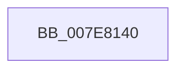

# CmpDummyThreadRoutine

- RVA: `0x007E8140`–`0x007E8177` (길이 `55` bytes)
- VA: `0x00000001407E8140`
- 실행 섹션: `PAGE`
- PDB 이름 있음: `예`; PDB Function 태그: `아니요`
- unwind 정보 RVA: `0x000622F0`
- 디코드: `14`개 명령, `55/55` bytes 표시
- 미해석 바이트: `0` (있으면 어셈블리에 `.byte`로 보존)

> 이 문서는 커널 이미지의 기계어와 PDB 기호를 분석해 생성했습니다. 4번과 5번은 함수 원형과 자료형을 바이너리 사용 방식에서 추정한 C 해석이며 원본 소스 복구 결과는 아닙니다.

## 1. Dependencies

- 직접 호출 지점: **2**; 고유 호출 대상: **2**
- 직접 호출자로 확인된 함수: **0**
- RIP 상대 이미지 참조: **1**

### Outgoing calls
- `0x007E8159` → [KeWaitForSingleObject](../../text/20/KeWaitForSingleObject_function_0020E6B0.md) (function, `0x0020E6B0`)
- `0x007E8171` → [KeBugCheckEx](../../text/4F/KeBugCheckEx_function_004FD660.md) (function, `0x004FD660`)

### Direct callers
- 이 함수 시작 RVA로 연결되는 직접 call은 확인되지 않았습니다. 간접 호출은 완전히 역산할 수 없습니다.

### Static image references
- `0x007E814A` → RVA `0x00EF71E0` (`.data`; read)

## 2. Other-region calls and transfers

- 다른 실행 섹션으로 향하는 call: **2**
  - `0x007E8159` → [KeWaitForSingleObject](../../text/20/KeWaitForSingleObject_function_0020E6B0.md) (`PAGE` → `.text`)
  - `0x007E8171` → [KeBugCheckEx](../../text/4F/KeBugCheckEx_function_004FD660.md) (`PAGE` → `.text`)
- 별도 외부 분기/꼬리 이동을 확인하지 못했습니다.

## 3. Assembly (complete function range)

```asm
007E8140  48 83 EC 38                     sub rsp, 0x38
007E8144  48 83 64 24 20 00               and qword ptr [rsp + 0x20], 0
007E814A  48 8D 0D 8F F0 70 00            lea rcx, [rip + 0x70f08f]
007E8151  45 33 C9                        xor r9d, r9d
007E8154  45 33 C0                        xor r8d, r8d
007E8157  33 D2                           xor edx, edx
007E8159  E8 52 65 A2 FF                  call 0x14020e6b0
007E815E  48 83 64 24 20 00               and qword ptr [rsp + 0x20], 0
007E8164  45 33 C9                        xor r9d, r9d
007E8167  4C 63 C0                        movsxd r8, eax
007E816A  41 8D 51 23                     lea edx, [r9 + 0x23]
007E816E  8D 4A 2E                        lea ecx, [rdx + 0x2e]
007E8171  E8 EA 54 D1 FF                  call 0x1404fd660
007E8176  CC                              int3
```

## 4. C-style interpretation (structured pseudocode)

```c
__int64 __fastcall CmpDummyThreadRoutine(__int64 a1, int a2, int a3, int a4)
{
    __int64 result;
    __int64 v_rsp;
    unsigned __int64 v_stack_m18;

    v_rsp = (v_rsp) - (56);
    a4 = 0;
    a3 = 0;
    a2 = 0;
    result = KeWaitForSingleObject(v_rip + 7401615, a2, a3, a4);
    a4 = 0;
    result = KeBugCheckEx(a4 + 35 + 46, a4 + 35, (int)((unsigned int)(result)), a4);
    return result;
}
```

## 5. (Beta) C Style

```c
int64_t CmpDummyThreadRoutine(int64_t Arg1, int32_t Arg2, int32_t Arg3, int32_t Arg4)
{
    int64_t result;
    int64_t local_rsp;
    uint64_t v_stack_m18;

    local_rsp = (local_rsp) - (56);
    Arg4 = 0;
    Arg3 = 0;
    Arg2 = 0;
    result = KeWaitForSingleObject(v_rip + 7401615, Arg2, Arg3, Arg4);
    Arg4 = 0;
    result = KeBugCheckEx(Arg4 + 35 + 46, Arg4 + 35, (int32_t)((uint32_t)(result)), Arg4);
    return result;
}
```

## 6. Execution-region graph

[열기: 2D/3D 그래프와 함수 탐색 컨트롤 패널](../../../control-panel.html?section=page&rva=0x007E8140&view=graph)

- 2D 그래프는 위에서 아래로 흐르고, 3D 그래프는 빈 공간을 드래그해 회전합니다. Shift+드래그는 이동, 휠은 확대·축소, 함수 노드 선택은 대상 보고서 이동입니다.

### Static fallback


