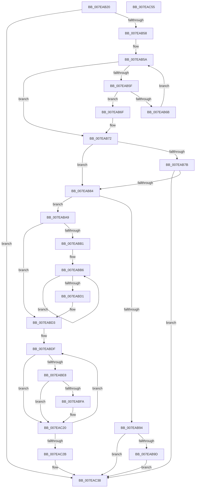

# CmpDumpKeyBodyList

- RVA: `0x007EAB20`–`0x007EAC56` (길이 `310` bytes)
- VA: `0x00000001407EAB20`
- 실행 섹션: `PAGE`
- PDB 이름 있음: `예`; PDB Function 태그: `아니요`
- unwind 정보 RVA: `0x00075C18`
- 디코드: `88`개 명령, `310/310` bytes 표시
- 미해석 바이트: `0` (있으면 어셈블리에 `.byte`로 보존)

> 이 문서는 커널 이미지의 기계어와 PDB 기호를 분석해 생성했습니다. 4번과 5번은 함수 원형과 자료형을 바이너리 사용 방식에서 추정한 C 해석이며 원본 소스 복구 결과는 아닙니다.

## 1. Dependencies

- 직접 호출 지점: **4**; 고유 호출 대상: **3**
- 직접 호출자로 확인된 함수: **3**
- RIP 상대 이미지 참조: **0**

### Outgoing calls
- `0x007EAB87` → [CmpConstructName](../85/CmpConstructName_function_00856BE0.md) (function, `0x00856BE0`)
- `0x007EABC0` → [CmpDumpOneKeyBody](CmpDumpOneKeyBody_function_007EAC5C.md) (function, `0x007EAC5C`)
- `0x007EAC03` → [CmpDumpOneKeyBody](CmpDumpOneKeyBody_function_007EAC5C.md) (function, `0x007EAC5C`)
- `0x007EAC33` → [CmpFreePoolWithTag](../../text/44/CmpFreePoolWithTag_function_004489E0.md) (function, `0x004489E0`)

### Direct callers
- [CmpFreeAllMemory](CmpFreeAllMemory_function_007E51D0.md) at `0x007E524E`
- [CmpSearchAndCountWorker](CmpSearchAndCountWorker_function_007EB180.md) at `0x007EB18C`
- [CmpSearchForOpenSubKeys](../9A/CmpSearchForOpenSubKeys_function_009AE76C.md) at `0x009AE7C0`

### Static image references
- 디코드된 RIP-relative 메모리 참조가 없습니다.

## 2. Other-region calls and transfers

- 다른 실행 섹션으로 향하는 call: **1**
  - `0x007EAC33` → [CmpFreePoolWithTag](../../text/44/CmpFreePoolWithTag_function_004489E0.md) (`PAGE` → `.text`)
- 별도 외부 분기/꼬리 이동을 확인하지 못했습니다.

## 3. Assembly (complete function range)

```asm
007EAB20  48 89 5C 24 08                  mov qword ptr [rsp + 8], rbx
007EAB25  48 89 6C 24 10                  mov qword ptr [rsp + 0x10], rbp
007EAB2A  48 89 74 24 18                  mov qword ptr [rsp + 0x18], rsi
007EAB2F  57                              push rdi
007EAB30  41 54                           push r12
007EAB32  41 55                           push r13
007EAB34  41 56                           push r14
007EAB36  41 57                           push r15
007EAB38  48 83 EC 20                     sub rsp, 0x20
007EAB3C  4C 8B EA                        mov r13, rdx
007EAB3F  33 DB                           xor ebx, ebx
007EAB41  BA 01 00 00 00                  mov edx, 1
007EAB46  49 8B E8                        mov rbp, r8
007EAB49  44 8A C2                        mov r8b, dl
007EAB4C  48 8B F9                        mov rdi, rcx
007EAB4F  48 39 19                        cmp qword ptr [rcx], rbx
007EAB52  0F 84 E0 00 00 00               je 0x1407eac38
007EAB58  8B CB                           mov ecx, ebx
007EAB5A  83 F9 04                        cmp ecx, 4
007EAB5D  73 13                           jae 0x1407eab72
007EAB5F  8B C1                           mov eax, ecx
007EAB61  48 39 9C C7 88 00 00 00         cmp qword ptr [rdi + rax*8 + 0x88], rbx
007EAB69  75 04                           jne 0x1407eab6f
007EAB6B  03 CA                           add ecx, edx
007EAB6D  EB EB                           jmp 0x1407eab5a
007EAB6F  44 8A C3                        mov r8b, bl
007EAB72  48 8D 77 78                     lea rsi, [rdi + 0x78]
007EAB76  48 39 36                        cmp qword ptr [rsi], rsi
007EAB79  75 09                           jne 0x1407eab84
007EAB7B  44 3A C2                        cmp r8b, dl
007EAB7E  0F 84 B4 00 00 00               je 0x1407eac38
007EAB84  48 8B CF                        mov rcx, rdi
007EAB87  E8 54 C0 06 00                  call 0x140856be0
007EAB8C  4C 8B F8                        mov r15, rax
007EAB8F  48 85 C0                        test rax, rax
007EAB92  75 15                           jne 0x1407eaba9
007EAB94  48 85 ED                        test rbp, rbp
007EAB97  0F 84 9B 00 00 00               je 0x1407eac38
007EAB9D  C7 45 14 9A 00 00 C0            mov dword ptr [rbp + 0x14], 0xc000009a
007EABA4  E9 8F 00 00 00                  jmp 0x1407eac38
007EABA9  4C 8B 36                        mov r14, qword ptr [rsi]
007EABAC  4C 3B F6                        cmp r14, rsi
007EABAF  74 22                           je 0x1407eabd3
007EABB1  BB 01 00 00 00                  mov ebx, 1
007EABB6  49 8D 56 E0                     lea rdx, [r14 - 0x20]
007EABBA  4C 8B CD                        mov r9, rbp
007EABBD  4D 8B C7                        mov r8, r15
007EABC0  E8 97 00 00 00                  call 0x1407eac5c
007EABC5  41 01 5D 00                     add dword ptr [r13], ebx
007EABC9  4D 8B 36                        mov r14, qword ptr [r14]
007EABCC  4C 3B F6                        cmp r14, rsi
007EABCF  75 E5                           jne 0x1407eabb6
007EABD1  33 DB                           xor ebx, ebx
007EABD3  48 8D B7 88 00 00 00            lea rsi, [rdi + 0x88]
007EABDA  B9 01 00 00 00                  mov ecx, 1
007EABDF  4C 8B 36                        mov r14, qword ptr [rsi]
007EABE2  49 83 FE 03                     cmp r14, 3
007EABE6  72 38                           jb 0x1407eac20
007EABE8  44 8B E3                        mov r12d, ebx
007EABEB  49 8B C6                        mov rax, r14
007EABEE  F0 4A 0F B1 8C E7 88 00 00 00   lock cmpxchg qword ptr [rdi + r12*8 + 0x88], rcx
007EABF8  75 26                           jne 0x1407eac20
007EABFA  4C 8B CD                        mov r9, rbp
007EABFD  4D 8B C7                        mov r8, r15
007EAC00  49 8B D6                        mov rdx, r14
007EAC03  E8 54 00 00 00                  call 0x1407eac5c
007EAC08  B8 01 00 00 00                  mov eax, 1
007EAC0D  41 01 45 00                     add dword ptr [r13], eax
007EAC11  F0 4E 0F B1 B4 E7 88 00 00 00   lock cmpxchg qword ptr [rdi + r12*8 + 0x88], r14
007EAC1B  B9 01 00 00 00                  mov ecx, 1
007EAC20  03 D9                           add ebx, ecx
007EAC22  48 83 C6 08                     add rsi, 8
007EAC26  83 FB 04                        cmp ebx, 4
007EAC29  72 B4                           jb 0x1407eabdf
007EAC2B  BA 43 4D 4E 62                  mov edx, 0x624e4d43
007EAC30  49 8B CF                        mov rcx, r15
007EAC33  E8 A8 DD C5 FF                  call 0x1404489e0
007EAC38  48 8B 5C 24 50                  mov rbx, qword ptr [rsp + 0x50]
007EAC3D  48 8B 6C 24 58                  mov rbp, qword ptr [rsp + 0x58]
007EAC42  48 8B 74 24 60                  mov rsi, qword ptr [rsp + 0x60]
007EAC47  48 83 C4 20                     add rsp, 0x20
007EAC4B  41 5F                           pop r15
007EAC4D  41 5E                           pop r14
007EAC4F  41 5D                           pop r13
007EAC51  41 5C                           pop r12
007EAC53  5F                              pop rdi
007EAC54  C3                              ret
007EAC55  CC                              int3
```

## 4. C-style interpretation (structured pseudocode)

```c
__int64 __fastcall CmpDumpKeyBodyList(__int64 a1, __int64 a2, __int64 a3)
{
    __int64 result;
    __int64 v_rbx;
    __int64 v_rsi;
    __int64 v_rsp;
    unsigned __int64 v_stack_p10;
    unsigned __int64 v_stack_p18;
    unsigned __int64 v_stack_p8;

    v_stack_p8 = v_rbx;
    v_stack_p10 = v_rbp;
    v_stack_p18 = v_rsi;
    v_rsp = (v_rsp) - (32);
    v_rbx = 0;
    if ((*(unsigned __int64 *)(a1)) == 0) goto loc_007EAC38;
loc_007EAB5A:
    if (0 >= 4) goto loc_007EAB72;
    if ((*(unsigned __int64 *)(a1 + 0 * 8 + 136)) != 0) goto loc_007EAB6F;
    a1 = (unsigned int)((0) + (1));
    goto loc_007EAB5A;
loc_007EAB6F:
loc_007EAB72:
    if ((*(unsigned __int64 *)(a1 + 120)) != (a1 + 120)) goto loc_007EAB84;
    if (0 == 1) goto loc_007EAC38;
loc_007EAB84:
    result = CmpConstructName(a1, 1, 0, a4);
    if (result != 0) goto loc_007EABA9;
    if (a3 == 0) goto loc_007EAC38;
    *(unsigned int *)(a3 + 20) = 0xC000009AULL;
    goto loc_007EAC38;
loc_007EABA9:
    if ((*(unsigned __int64 *)(a1 + 120)) == (a1 + 120)) goto loc_007EABD3;
loc_007EABB6:
    result = CmpDumpOneKeyBody(a1, *(unsigned __int64 *)(a1 + 120) - 32, result, a3);
    if ((*(unsigned __int64 *)(*(unsigned __int64 *)(a1 + 120))) != (a1 + 120)) goto loc_007EABB6;
    v_rbx = 0;
loc_007EABD3:
loc_007EABDF:
    if ((*(unsigned __int64 *)(a1 + 136)) < 3) goto loc_007EAC20;
    result = *(unsigned __int64 *)(a1 + 136);
    if ((*(unsigned __int64 *)(a1 + 136)) == 3) {
        a4 = a3;
        a3 = result;
        a2 = *(unsigned __int64 *)(a1 + 136);
        result = CmpDumpOneKeyBody(1, a2, a3, a4);
        result = 1;
        a1 = 1;
    }
    v_rbx = (unsigned int)((v_rbx) + ((unsigned int)(a1)));
    v_rsi = (a1 + 136) + (8);
    if (((unsigned int)(v_rbx)) < 4) goto loc_007EABDF;
    result = CmpFreePoolWithTag(result, (unsigned int)(0x624E4D43ULL), a3, a4);
loc_007EAC38:
    v_rsp = (v_rsp) + (32);
    return result;
}
```

## 5. (Beta) C Style

```c
int64_t CmpDumpKeyBodyList(void *Arg1, void *Arg2, int64_t Arg3)
{
    uint8_t *arg1 = (uint8_t *)Arg1;
    uint8_t *arg2 = (uint8_t *)Arg2;

    int64_t result;
    int64_t local_rbx;
    int64_t local_rsi;
    int64_t local_rsp;
    uint64_t v_stack_p10;
    uint64_t v_stack_p18;
    uint64_t v_stack_p8;

    v_stack_p8 = local_rbx;
    v_stack_p10 = local_rbp;
    v_stack_p18 = local_rsi;
    local_rsp = (local_rsp) - (32);
    local_rbx = 0;
    if ((*(uint64_t *)(arg1)) == 0) goto loc_007EAC38;
loc_007EAB5A:
    if (0 >= 4) goto loc_007EAB72;
    if ((*(uint64_t *)(arg1 + 0x0 * 8 + 0x88)) != 0) goto loc_007EAB6F;
    Arg1 = (uint32_t)((0) + (1));
    goto loc_007EAB5A;
loc_007EAB6F:
loc_007EAB72:
    if ((*(uint64_t *)(arg1 + 0x78)) != (Arg1 + 120)) goto loc_007EAB84;
    if (0 == 1) goto loc_007EAC38;
loc_007EAB84:
    result = CmpConstructName(Arg1, 1, 0, a4);
    if (result != 0) goto loc_007EABA9;
    if (Arg3 == 0) goto loc_007EAC38;
    *(uint32_t *)(Arg3 + 0x14) = 0xC000009AULL;
    goto loc_007EAC38;
loc_007EABA9:
    if ((*(uint64_t *)(arg1 + 0x78)) == (Arg1 + 120)) goto loc_007EABD3;
loc_007EABB6:
    result = CmpDumpOneKeyBody(Arg1, *(uint64_t *)(arg1 + 0x78) - 32, result, Arg3);
    if ((*(uint64_t *)(*(uint64_t *)(arg1 + 0x78))) != (Arg1 + 120)) goto loc_007EABB6;
    local_rbx = 0;
loc_007EABD3:
loc_007EABDF:
    if ((*(uint64_t *)(arg1 + 0x88)) < 3) goto loc_007EAC20;
    result = *(uint64_t *)(arg1 + 0x88);
    if ((*(uint64_t *)(arg1 + 0x88)) == 3) {
        a4 = Arg3;
        Arg3 = result;
        Arg2 = *(uint64_t *)(arg1 + 0x88);
        result = CmpDumpOneKeyBody(1, Arg2, Arg3, a4);
        result = 1;
        Arg1 = 1;
    }
    local_rbx = (uint32_t)((local_rbx) + ((uint32_t)(Arg1)));
    local_rsi = (Arg1 + 136) + (8);
    if (((uint32_t)(local_rbx)) < 4) goto loc_007EABDF;
    result = CmpFreePoolWithTag(result, (uint32_t)(0x624E4D43ULL), Arg3, a4);
loc_007EAC38:
    local_rsp = (local_rsp) + (32);
    return result;
}
```

### 관측된 메모리 오프셋

구조체 형식이 확인되지 않은 접근은 인자 기준의 오프셋으로만 기록했습니다.

| 기준 인자 | 오프셋 표현 | 폭 (bit) | 접근 |
|---|---:|---:|---|
| `Arg1` | `+ 0x0` | `64` | `R` |
| `Arg1` | `+ 0x78` | `64` | `R` |
| `Arg1` | `+ 0x88` | `64` | `R` |
| `Arg1` | `+ 0x88 + r12*8` | `64` | `R` |
| `Arg1` | `+ 0x88 + rax*8` | `64` | `R` |
| `Arg2` | `+ 0x0` | `32` | `R/W` |

## 6. Execution-region graph

[열기: 2D/3D 그래프와 함수 탐색 컨트롤 패널](../../../control-panel.html?section=page&rva=0x007EAB20&view=graph)

- 2D 그래프는 위에서 아래로 흐르고, 3D 그래프는 빈 공간을 드래그해 회전합니다. Shift+드래그는 이동, 휠은 확대·축소, 함수 노드 선택은 대상 보고서 이동입니다.

### Static fallback


