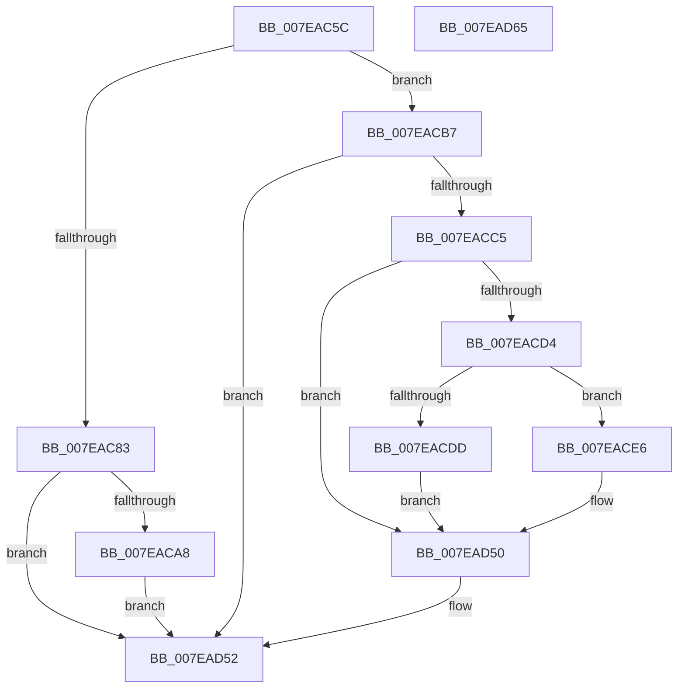

# CmpDumpOneKeyBody

- RVA: `0x007EAC5C`–`0x007EAD66` (길이 `266` bytes)
- VA: `0x00000001407EAC5C`
- 실행 섹션: `PAGE`
- PDB 이름 있음: `예`; PDB Function 태그: `아니요`
- unwind 정보 RVA: `0x000D6DD4`
- 디코드: `78`개 명령, `266/266` bytes 표시
- 미해석 바이트: `0` (있으면 어셈블리에 `.byte`로 보존)

> 이 문서는 커널 이미지의 기계어와 PDB 기호를 분석해 생성했습니다. 4번과 5번은 함수 원형과 자료형을 바이너리 사용 방식에서 추정한 C 해석이며 원본 소스 복구 결과는 아닙니다.

## 1. Dependencies

- 직접 호출 지점: **3**; 고유 호출 대상: **3**
- 직접 호출자로 확인된 함수: **1**
- RIP 상대 이미지 참조: **0**

### Outgoing calls
- `0x007EAC8F` → [PsLookupProcessByProcessId](../8A/PsLookupProcessByProcessId_function_008A2AA0.md) (function, `0x008A2AA0`)
- `0x007EACAD` → [ObfDereferenceObjectWithTag](../../text/2F/ObfDereferenceObjectWithTag_function_002F78E0.md) (function, `0x002F78E0`)
- `0x007EAD40` → [memcpy](../../text/6C/memcpy_function_006C6840.md) (function, `0x006C6840`)

### Direct callers
- [CmpDumpKeyBodyList](CmpDumpKeyBodyList_function_007EAB20.md) at `0x007EABC0`
- [CmpDumpKeyBodyList](CmpDumpKeyBodyList_function_007EAB20.md) at `0x007EAC03`

### Static image references
- 디코드된 RIP-relative 메모리 참조가 없습니다.

## 2. Other-region calls and transfers

- 다른 실행 섹션으로 향하는 call: **2**
  - `0x007EACAD` → [ObfDereferenceObjectWithTag](../../text/2F/ObfDereferenceObjectWithTag_function_002F78E0.md) (`PAGE` → `.text`)
  - `0x007EAD40` → [memcpy](../../text/6C/memcpy_function_006C6840.md) (`PAGE` → `.text`)
- 별도 외부 분기/꼬리 이동을 확인하지 못했습니다.

## 3. Assembly (complete function range)

```asm
007EAC5C  48 8B C4                        mov rax, rsp
007EAC5F  48 89 58 10                     mov qword ptr [rax + 0x10], rbx
007EAC63  48 89 68 18                     mov qword ptr [rax + 0x18], rbp
007EAC67  48 89 48 08                     mov qword ptr [rax + 8], rcx
007EAC6B  56                              push rsi
007EAC6C  57                              push rdi
007EAC6D  41 56                           push r14
007EAC6F  48 83 EC 20                     sub rsp, 0x20
007EAC73  49 8B D9                        mov rbx, r9
007EAC76  33 ED                           xor ebp, ebp
007EAC78  4D 8B F0                        mov r14, r8
007EAC7B  4C 8B CA                        mov r9, rdx
007EAC7E  48 85 DB                        test rbx, rbx
007EAC81  75 34                           jne 0x1407eacb7
007EAC83  49 8B 49 18                     mov rcx, qword ptr [r9 + 0x18]
007EAC87  48 8D 50 08                     lea rdx, [rax + 8]
007EAC8B  48 89 68 08                     mov qword ptr [rax + 8], rbp
007EAC8F  E8 0C 7E 0B 00                  call 0x1408a2aa0
007EAC94  48 8B 4C 24 40                  mov rcx, qword ptr [rsp + 0x40]
007EAC99  85 C0                           test eax, eax
007EAC9B  48 0F 48 CD                     cmovs rcx, rbp
007EAC9F  48 85 C9                        test rcx, rcx
007EACA2  0F 84 AA 00 00 00               je 0x1407ead52
007EACA8  BA 44 66 6C 74                  mov edx, 0x746c6644
007EACAD  E8 2E CC B0 FF                  call 0x1402f78e0
007EACB2  E9 9B 00 00 00                  jmp 0x1407ead52
007EACB7  48 8B 7B 08                     mov rdi, qword ptr [rbx + 8]
007EACBB  4C 39 4B 20                     cmp qword ptr [rbx + 0x20], r9
007EACBF  0F 84 8D 00 00 00               je 0x1407ead52
007EACC5  41 0F B7 30                     movzx esi, word ptr [r8]
007EACC9  83 C6 18                        add esi, 0x18
007EACCC  01 73 10                        add dword ptr [rbx + 0x10], esi
007EACCF  39 6B 14                        cmp dword ptr [rbx + 0x14], ebp
007EACD2  7C 7C                           jl 0x1407ead50
007EACD4  8B 4B 18                        mov ecx, dword ptr [rbx + 0x18]
007EACD7  03 CE                           add ecx, esi
007EACD9  3B 0B                           cmp ecx, dword ptr [rbx]
007EACDB  76 09                           jbe 0x1407eace6
007EACDD  C7 43 14 05 00 00 80            mov dword ptr [rbx + 0x14], 0x80000005
007EACE4  EB 6A                           jmp 0x1407ead50
007EACE6  8B 07                           mov eax, dword ptr [rdi]
007EACE8  48 8D 0C 40                     lea rcx, [rax + rax*2]
007EACEC  48 8B 42 18                     mov rax, qword ptr [rdx + 0x18]
007EACF0  48 89 44 CF 08                  mov qword ptr [rdi + rcx*8 + 8], rax
007EACF5  8B 07                           mov eax, dword ptr [rdi]
007EACF7  48 8D 0C 40                     lea rcx, [rax + rax*2]
007EACFB  41 0F B7 00                     movzx eax, word ptr [r8]
007EACFF  66 89 44 CF 10                  mov word ptr [rdi + rcx*8 + 0x10], ax
007EAD04  8B 07                           mov eax, dword ptr [rdi]
007EAD06  48 8D 0C 40                     lea rcx, [rax + rax*2]
007EAD0A  41 0F B7 00                     movzx eax, word ptr [r8]
007EAD0E  66 89 44 CF 12                  mov word ptr [rdi + rcx*8 + 0x12], ax
007EAD13  41 0F B7 00                     movzx eax, word ptr [r8]
007EAD17  48 8B 4B 28                     mov rcx, qword ptr [rbx + 0x28]
007EAD1B  48 2B C8                        sub rcx, rax
007EAD1E  8B 07                           mov eax, dword ptr [rdi]
007EAD20  48 FF C0                        inc rax
007EAD23  48 8D 04 40                     lea rax, [rax + rax*2]
007EAD27  48 89 0C C7                     mov qword ptr [rdi + rax*8], rcx
007EAD2B  8B 07                           mov eax, dword ptr [rdi]
007EAD2D  45 0F B7 00                     movzx r8d, word ptr [r8]
007EAD31  48 FF C0                        inc rax
007EAD34  49 8B 56 08                     mov rdx, qword ptr [r14 + 8]
007EAD38  48 8D 0C 40                     lea rcx, [rax + rax*2]
007EAD3C  48 8B 0C CF                     mov rcx, qword ptr [rdi + rcx*8]
007EAD40  E8 FB BA ED FF                  call 0x1406c6840
007EAD45  41 0F B7 06                     movzx eax, word ptr [r14]
007EAD49  48 29 43 28                     sub qword ptr [rbx + 0x28], rax
007EAD4D  01 73 18                        add dword ptr [rbx + 0x18], esi
007EAD50  FF 07                           inc dword ptr [rdi]
007EAD52  48 8B 5C 24 48                  mov rbx, qword ptr [rsp + 0x48]
007EAD57  48 8B 6C 24 50                  mov rbp, qword ptr [rsp + 0x50]
007EAD5C  48 83 C4 20                     add rsp, 0x20
007EAD60  41 5E                           pop r14
007EAD62  5F                              pop rdi
007EAD63  5E                              pop rsi
007EAD64  C3                              ret
007EAD65  CC                              int3
```

## 4. C-style interpretation (structured pseudocode)

```c
__int64 __fastcall CmpDumpOneKeyBody(__int64 a1, __int64 a2, __int64 a3, __int64 a4)
{
    __int64 result;
    __int64 v_rbp;
    __int64 v_rsi;
    __int64 v_rsp;
    unsigned __int64 v_stack_p10;
    unsigned __int64 v_stack_p18;
    unsigned __int64 v_stack_p8;

    *(unsigned __int64 *)(v_rsp + 16) = v_rbx;
    *(unsigned __int64 *)(v_rsp + 24) = v_rbp;
    *(unsigned __int64 *)(v_rsp + 8) = a1;
    v_rsp = (v_rsp) - (32);
    v_rbp = 0;
    if (a4 != 0) goto loc_007EACB7;
    *(unsigned __int64 *)(v_rsp + 8) = 0;
    result = PsLookupProcessByProcessId(*(unsigned __int64 *)(a2 + 24), v_rsp + 8, a3, a2);
    a1 = v_stack_p8;
    if (sign_flag) { a1 = 0; }
    if (a1 == 0) goto loc_007EAD52;
    result = ObfDereferenceObjectWithTag(a1, (unsigned int)(0x746C6644ULL), a3, a2);
    goto loc_007EAD52;
loc_007EACB7:
    if ((*(unsigned __int64 *)(a4 + 32)) == a2) goto loc_007EAD52;
    v_rsi = (unsigned int)((*(unsigned __int16 *)(a3)) + (24));
    if ((*(unsigned int *)(a4 + 20)) < 0) goto loc_007EAD50;
    a1 = (unsigned int)(((unsigned int)(*(unsigned int *)(a4 + 24))) + ((unsigned int)(v_rsi)));
    if (((unsigned int)(a1)) <= (*(unsigned int *)(a4))) goto loc_007EACE6;
    *(unsigned int *)(a4 + 20) = 0x80000005ULL;
    goto loc_007EAD50;
loc_007EACE6:
    *(unsigned __int64 *)(*(unsigned __int64 *)(a4 + 8) + (unsigned int)(*(unsigned int *)(*(unsigned __int64 *)(a4 + 8))) + (unsigned int)(*(unsigned int *)(*(unsigned __int64 *)(a4 + 8))) * 2 * 8 + 8) = *(unsigned __int64 *)((unsigned int)(0x746C6644ULL) + 24);
    *(unsigned __int16 *)(*(unsigned __int64 *)(a4 + 8) + (unsigned int)(*(unsigned int *)(*(unsigned __int64 *)(a4 + 8))) + (unsigned int)(*(unsigned int *)(*(unsigned __int64 *)(a4 + 8))) * 2 * 8 + 16) = (unsigned __int16)(*(unsigned __int16 *)(a3));
    *(unsigned __int16 *)(*(unsigned __int64 *)(a4 + 8) + (unsigned int)(*(unsigned int *)(*(unsigned __int64 *)(a4 + 8))) + (unsigned int)(*(unsigned int *)(*(unsigned __int64 *)(a4 + 8))) * 2 * 8 + 18) = (unsigned __int16)(*(unsigned __int16 *)(a3));
    a1 = (*(unsigned __int64 *)(a4 + 40)) - (*(unsigned __int16 *)(a3));
    result = ((unsigned int)(*(unsigned int *)(*(unsigned __int64 *)(a4 + 8)))) + 1;
    *(unsigned __int64 *)(*(unsigned __int64 *)(a4 + 8) + result + result * 2 * 8) = a1;
    result = ((unsigned int)(*(unsigned int *)(*(unsigned __int64 *)(a4 + 8)))) + 1;
    result = memcpy(*(unsigned __int64 *)(*(unsigned __int64 *)(a4 + 8) + result + result * 2 * 8), *(unsigned __int64 *)(a3 + 8), *(unsigned __int16 *)(a3), a2);
loc_007EAD50:
loc_007EAD52:
    v_rsp = (v_rsp) + (32);
    return *(unsigned __int16 *)(a3);
}
```

## 5. (Beta) C Style

```c
int64_t CmpDumpOneKeyBody(int64_t Arg1, void *Arg2, void *Arg3, int64_t Arg4)
{
    uint8_t *arg2 = (uint8_t *)Arg2;
    uint8_t *arg3 = (uint8_t *)Arg3;

    int64_t result;
    int64_t local_rbp;
    int64_t local_rsi;
    int64_t local_rsp;
    uint64_t v_stack_p10;
    uint64_t v_stack_p18;
    uint64_t v_stack_p8;

    *(uint64_t *)(local_rsp + 0x10) = local_rbx;
    *(uint64_t *)(local_rsp + 0x18) = local_rbp;
    *(uint64_t *)(local_rsp + 0x8) = Arg1;
    local_rsp = (local_rsp) - (32);
    local_rbp = 0;
    if (Arg4 != 0) goto loc_007EACB7;
    *(uint64_t *)(local_rsp + 0x8) = 0;
    result = PsLookupProcessByProcessId(*(uint64_t *)(arg2 + 0x18), local_rsp + 8, Arg3, Arg2);
    Arg1 = v_stack_p8;
    if (sign_flag) { Arg1 = 0; }
    if (Arg1 == 0) goto loc_007EAD52;
    result = ObfDereferenceObjectWithTag(Arg1, (uint32_t)(0x746C6644ULL), Arg3, Arg2);
    goto loc_007EAD52;
loc_007EACB7:
    if ((*(uint64_t *)(Arg4 + 0x20)) == Arg2) goto loc_007EAD52;
    local_rsi = (uint32_t)((*(uint16_t *)(arg3)) + (24));
    if ((*(uint32_t *)(Arg4 + 0x14)) < 0) goto loc_007EAD50;
    Arg1 = (uint32_t)(((uint32_t)(*(uint32_t *)(Arg4 + 0x18))) + ((uint32_t)(local_rsi)));
    if (((uint32_t)(Arg1)) <= (*(uint32_t *)(Arg4))) goto loc_007EACE6;
    *(uint32_t *)(Arg4 + 0x14) = 0x80000005ULL;
    goto loc_007EAD50;
loc_007EACE6:
    *(uint64_t *)(*(uint64_t *)(Arg4 + 0x8) + (uint32_t)(*(uint32_t *)(*(uint64_t *)(Arg4 + 0x8))) + (uint32_t)(*(uint32_t *)(*(uint64_t *)(Arg4 + 0x8))) * 2 * 8 + 0x8) = *(uint64_t *)((uint32_t)(0x746C6644ULL) + 0x18);
    *(uint16_t *)(*(uint64_t *)(Arg4 + 0x8) + (uint32_t)(*(uint32_t *)(*(uint64_t *)(Arg4 + 0x8))) + (uint32_t)(*(uint32_t *)(*(uint64_t *)(Arg4 + 0x8))) * 2 * 8 + 0x10) = (uint16_t)(*(uint16_t *)(arg3));
    *(uint16_t *)(*(uint64_t *)(Arg4 + 0x8) + (uint32_t)(*(uint32_t *)(*(uint64_t *)(Arg4 + 0x8))) + (uint32_t)(*(uint32_t *)(*(uint64_t *)(Arg4 + 0x8))) * 2 * 8 + 0x12) = (uint16_t)(*(uint16_t *)(arg3));
    Arg1 = (*(uint64_t *)(Arg4 + 0x28)) - (*(uint16_t *)(arg3));
    result = ((uint32_t)(*(uint32_t *)(*(uint64_t *)(Arg4 + 0x8)))) + 1;
    *(uint64_t *)(*(uint64_t *)(Arg4 + 0x8) + result + result * 2 * 8) = Arg1;
    result = ((uint32_t)(*(uint32_t *)(*(uint64_t *)(Arg4 + 0x8)))) + 1;
    result = memcpy(*(uint64_t *)(*(uint64_t *)(Arg4 + 0x8) + result + result * 2 * 8), *(uint64_t *)(arg3 + 0x8), *(uint16_t *)(arg3), Arg2);
loc_007EAD50:
loc_007EAD52:
    local_rsp = (local_rsp) + (32);
    return *(uint16_t *)(arg3);
}
```

### 관측된 메모리 오프셋

구조체 형식이 확인되지 않은 접근은 인자 기준의 오프셋으로만 기록했습니다.

| 기준 인자 | 오프셋 표현 | 폭 (bit) | 접근 |
|---|---:|---:|---|
| `Arg2` | `+ 0x18` | `64` | `R` |
| `Arg3` | `+ 0x0` | `16` | `R` |
| `Arg3` | `+ 0x8` | `64` | `R` |

## 6. Execution-region graph

[열기: 2D/3D 그래프와 함수 탐색 컨트롤 패널](../../../control-panel.html?section=page&rva=0x007EAC5C&view=graph)

- 2D 그래프는 위에서 아래로 흐르고, 3D 그래프는 빈 공간을 드래그해 회전합니다. Shift+드래그는 이동, 휠은 확대·축소, 함수 노드 선택은 대상 보고서 이동입니다.

### Static fallback


