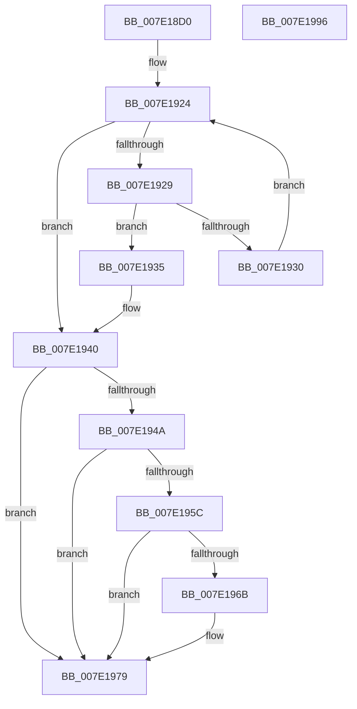

# CmpEnumerateCallback

- RVA: `0x007E18D0`–`0x007E1997` (길이 `199` bytes)
- VA: `0x00000001407E18D0`
- 실행 섹션: `PAGE`
- PDB 이름 있음: `예`; PDB Function 태그: `아니요`
- unwind 정보 RVA: `0x000718AC`
- 디코드: `57`개 명령, `199/199` bytes 표시
- 미해석 바이트: `0` (있으면 어셈블리에 `.byte`로 보존)

> 이 문서는 커널 이미지의 기계어와 PDB 기호를 분석해 생성했습니다. 4번과 5번은 함수 원형과 자료형을 바이너리 사용 방식에서 추정한 C 해석이며 원본 소스 복구 결과는 아닙니다.

## 1. Dependencies

- 직접 호출 지점: **5**; 고유 호출 대상: **5**
- 직접 호출자로 확인된 함수: **0**
- RIP 상대 이미지 참조: **2**

### Outgoing calls
- `0x007E18F5` → [CmpInitializeThreadInfo](../../text/3F/CmpInitializeThreadInfo_function_003FBE70.md) (function, `0x003FBE70`)
- `0x007E18FA` → [CmpLockCallbackListShared](../99/CmpLockCallbackListShared_function_0099E9B0.md) (function, `0x0099E9B0`)
- `0x007E1940` → [CmpUnlockCallbackList](../97/CmpUnlockCallbackList_function_0097D760.md) (function, `0x0097D760`)
- `0x007E1974` → [ExfUnblockPushLock](../../text/2A/ExfUnblockPushLock_function_002A3FE0.md) (function, `0x002A3FE0`)
- `0x007E197E` → [CmCleanupThreadInfo](../../text/41/CmCleanupThreadInfo_function_0041FD50.md) (function, `0x0041FD50`)

### Direct callers
- 이 함수 시작 RVA로 연결되는 직접 call은 확인되지 않았습니다. 간접 호출은 완전히 역산할 수 없습니다.

### Static image references
- `0x007E1902` → RVA `0x00EF7BE0` (`.data`; read)
- `0x007E1961` → RVA `0x00EF7BB8` (`.data`; read)

## 2. Other-region calls and transfers

- 다른 실행 섹션으로 향하는 call: **3**
  - `0x007E18F5` → [CmpInitializeThreadInfo](../../text/3F/CmpInitializeThreadInfo_function_003FBE70.md) (`PAGE` → `.text`)
  - `0x007E1974` → [ExfUnblockPushLock](../../text/2A/ExfUnblockPushLock_function_002A3FE0.md) (`PAGE` → `.text`)
  - `0x007E197E` → [CmCleanupThreadInfo](../../text/41/CmCleanupThreadInfo_function_0041FD50.md) (`PAGE` → `.text`)
- 별도 외부 분기/꼬리 이동을 확인하지 못했습니다.

## 3. Assembly (complete function range)

```asm
007E18D0  4C 8B DC                        mov r11, rsp
007E18D3  49 89 5B 08                     mov qword ptr [r11 + 8], rbx
007E18D7  49 89 73 10                     mov qword ptr [r11 + 0x10], rsi
007E18DB  57                              push rdi
007E18DC  48 83 EC 40                     sub rsp, 0x40
007E18E0  0F 57 C0                        xorps xmm0, xmm0
007E18E3  33 C0                           xor eax, eax
007E18E5  0F 11 44 24 20                  movups xmmword ptr [rsp + 0x20], xmm0
007E18EA  48 8B F1                        mov rsi, rcx
007E18ED  49 89 43 E8                     mov qword ptr [r11 - 0x18], rax
007E18F1  49 8D 4B D8                     lea rcx, [r11 - 0x28]
007E18F5  E8 76 A5 C1 FF                  call 0x1403fbe70
007E18FA  E8 B1 D0 1B 00                  call 0x14099e9b0
007E18FF  4C 8B 06                        mov r8, qword ptr [rsi]
007E1902  4C 8D 0D D7 62 71 00            lea r9, [rip + 0x7162d7]
007E1909  4D 85 C0                        test r8, r8
007E190C  49 8B D1                        mov rdx, r9
007E190F  49 8B C0                        mov rax, r8
007E1912  49 0F 45 D0                     cmovne rdx, r8
007E1916  48 F7 D8                        neg rax
007E1919  48 1B DB                        sbb rbx, rbx
007E191C  49 23 D8                        and rbx, r8
007E191F  48 8B 0A                        mov rcx, qword ptr [rdx]
007E1922  33 FF                           xor edi, edi
007E1924  49 3B C9                        cmp rcx, r9
007E1927  74 17                           je 0x1407e1940
007E1929  8B 41 10                        mov eax, dword ptr [rcx + 0x10]
007E192C  85 C0                           test eax, eax
007E192E  79 05                           jns 0x1407e1935
007E1930  48 8B 09                        mov rcx, qword ptr [rcx]
007E1933  EB EF                           jmp 0x1407e1924
007E1935  F0 FF 41 10                     lock inc dword ptr [rcx + 0x10]
007E1939  48 8B 79 28                     mov rdi, qword ptr [rcx + 0x28]
007E193D  48 89 0E                        mov qword ptr [rsi], rcx
007E1940  E8 1B BE 19 00                  call 0x14097d760
007E1945  48 85 DB                        test rbx, rbx
007E1948  74 2F                           je 0x1407e1979
007E194A  83 C9 FF                        or ecx, 0xffffffff
007E194D  F0 0F C1 4B 10                  lock xadd dword ptr [rbx + 0x10], ecx
007E1952  FF C9                           dec ecx
007E1954  81 F9 00 00 00 80               cmp ecx, 0x80000000
007E195A  75 1D                           jne 0x1407e1979
007E195C  F0 83 0C 24 00                  lock or dword ptr [rsp], 0
007E1961  48 83 3D 4F 62 71 00 00         cmp qword ptr [rip + 0x71624f], 0
007E1969  74 0E                           je 0x1407e1979
007E196B  33 D2                           xor edx, edx
007E196D  48 8D 0D 44 62 71 00            lea rcx, [rip + 0x716244]
007E1974  E8 67 26 AC FF                  call 0x1402a3fe0
007E1979  48 8D 4C 24 20                  lea rcx, [rsp + 0x20]
007E197E  E8 CD E3 C3 FF                  call 0x14041fd50
007E1983  48 8B 5C 24 50                  mov rbx, qword ptr [rsp + 0x50]
007E1988  48 8B C7                        mov rax, rdi
007E198B  48 8B 74 24 58                  mov rsi, qword ptr [rsp + 0x58]
007E1990  48 83 C4 40                     add rsp, 0x40
007E1994  5F                              pop rdi
007E1995  C3                              ret
007E1996  CC                              int3
```

## 4. C-style interpretation (structured pseudocode)

```c
__int64 __fastcall CmpEnumerateCallback(__int64 a1)
{
    __int64 result;
    __int64 v_rbx;
    __int64 v_rdi;
    __int64 v_rsp;
    unsigned __int64 v_stack_m28;
    unsigned int v_stack_m48;
    unsigned __int64 v_stack_p10;
    unsigned __int64 v_stack_p8;

    *(unsigned __int64 *)(v_rsp + 8) = v_rbx;
    *(unsigned __int64 *)(v_rsp + 16) = v_rsi;
    v_rsp = (v_rsp) - (64);
    result = 0;
    v_stack_m28 = v_xmm0;
    *(unsigned __int64 *)(v_rsp - 24) = 0;
    result = CmpInitializeThreadInfo(v_rsp - 40, a2, a3, a4);
    result = CmpLockCallbackListShared(v_rsp - 40, a2, a3, a4);
    a2 = v_rip + 7430871;
    if (*(unsigned __int64 *)(a1) != 0) { a2 = *(unsigned __int64 *)(a1); }
    result = -(*(unsigned __int64 *)(a1));
    v_rbx = (v_rbx) & (*(unsigned __int64 *)(a1));
    v_rdi = 0;
loc_007E1924:
    if ((*(unsigned __int64 *)(a2)) == (v_rip + 7430871)) goto loc_007E1940;
    if (!sign_flag) goto loc_007E1935;
    goto loc_007E1924;
loc_007E1935:
    *(unsigned __int64 *)(a1) = *(unsigned __int64 *)(*(unsigned __int64 *)(a2));
loc_007E1940:
    result = CmpUnlockCallbackList(*(unsigned __int64 *)(*(unsigned __int64 *)(a2)), a2, *(unsigned __int64 *)(a1), v_rip + 7430871);
    if (v_rbx == 0) goto loc_007E1979;
    a1 = (unsigned int)((*(unsigned __int64 *)(*(unsigned __int64 *)(a2))) | (0xFFFFFFFFULL));
    a1 = (unsigned int)((a1) - 1);
    if (((unsigned int)(a1)) != 0x80000000ULL) goto loc_007E1979;
    if ((*(unsigned __int64 *)(v_rip + 7430735)) != 0) {
        a2 = 0;
        a1 = v_rip + 7430724;
        result = ExfUnblockPushLock(a1, a2, *(unsigned __int64 *)(a1), v_rip + 7430871);
    }
    result = CmCleanupThreadInfo(v_stack_m28, a2, *(unsigned __int64 *)(a1), v_rip + 7430871);
    v_rsp = (v_rsp) + (64);
    return *(unsigned __int64 *)(*(unsigned __int64 *)(*(unsigned __int64 *)(a2)) + 40);
}
```

## 5. (Beta) C Style

```c
int64_t CmpEnumerateCallback(void *Arg1)
{
    uint8_t *arg1 = (uint8_t *)Arg1;

    int64_t result;
    int64_t local_rbx;
    int64_t local_rdi;
    int64_t local_rsp;
    uint64_t v_stack_m28;
    uint32_t v_stack_m48;
    uint64_t v_stack_p10;
    uint64_t v_stack_p8;

    *(uint64_t *)(local_rsp + 0x8) = local_rbx;
    *(uint64_t *)(local_rsp + 0x10) = local_rsi;
    local_rsp = (local_rsp) - (64);
    result = 0;
    v_stack_m28 = v_xmm0;
    *(uint64_t *)(local_rsp - 0x18) = 0;
    result = CmpInitializeThreadInfo(local_rsp - 40, a2, a3, a4);
    result = CmpLockCallbackListShared(local_rsp - 40, a2, a3, a4);
    a2 = v_rip + 7430871;
    if (*(uint64_t *)(arg1) != 0) { a2 = *(uint64_t *)(arg1); }
    result = -(*(uint64_t *)(arg1));
    local_rbx = (local_rbx) & (*(uint64_t *)(arg1));
    local_rdi = 0;
loc_007E1924:
    if ((*(uint64_t *)(a2)) == (v_rip + 7430871)) goto loc_007E1940;
    if (!sign_flag) goto loc_007E1935;
    goto loc_007E1924;
loc_007E1935:
    *(uint64_t *)(arg1) = *(uint64_t *)(*(uint64_t *)(a2));
loc_007E1940:
    result = CmpUnlockCallbackList(*(uint64_t *)(*(uint64_t *)(a2)), a2, *(uint64_t *)(arg1), v_rip + 7430871);
    if (local_rbx == 0) goto loc_007E1979;
    Arg1 = (uint32_t)((*(uint64_t *)(*(uint64_t *)(a2))) | (0xFFFFFFFFULL));
    Arg1 = (uint32_t)((Arg1) - 1);
    if (((uint32_t)(Arg1)) != 0x80000000ULL) goto loc_007E1979;
    if ((*(uint64_t *)(v_rip + 0x71624F)) != 0) {
        a2 = 0;
        Arg1 = v_rip + 7430724;
        result = ExfUnblockPushLock(Arg1, a2, *(uint64_t *)(arg1), v_rip + 7430871);
    }
    result = CmCleanupThreadInfo(v_stack_m28, a2, *(uint64_t *)(arg1), v_rip + 7430871);
    local_rsp = (local_rsp) + (64);
    return *(uint64_t *)(*(uint64_t *)(*(uint64_t *)(a2)) + 0x28);
}
```

### 관측된 메모리 오프셋

구조체 형식이 확인되지 않은 접근은 인자 기준의 오프셋으로만 기록했습니다.

| 기준 인자 | 오프셋 표현 | 폭 (bit) | 접근 |
|---|---:|---:|---|
| `Arg1` | `+ 0x0` | `64` | `R` |
| `Arg1` | `+ 0x0` | `64` | `W` |

## 6. Execution-region graph

[열기: 2D/3D 그래프와 함수 탐색 컨트롤 패널](../../../control-panel.html?section=page&rva=0x007E18D0&view=graph)

- 2D 그래프는 위에서 아래로 흐르고, 3D 그래프는 빈 공간을 드래그해 회전합니다. Shift+드래그는 이동, 휠은 확대·축소, 함수 노드 선택은 대상 보고서 이동입니다.

### Static fallback


