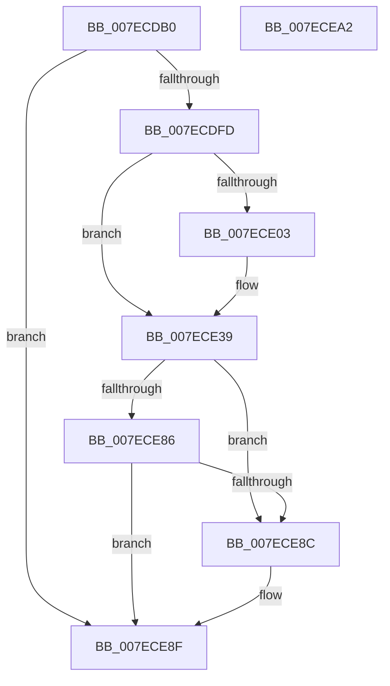

# CmpExamineSaclForAuditEvent

- RVA: `0x007ECDB0`–`0x007ECEA3` (길이 `243` bytes)
- VA: `0x00000001407ECDB0`
- 실행 섹션: `PAGE`
- PDB 이름 있음: `예`; PDB Function 태그: `아니요`
- unwind 정보 RVA: `0x000D6F04`
- 디코드: `66`개 명령, `243/243` bytes 표시
- 미해석 바이트: `0` (있으면 어셈블리에 `.byte`로 보존)

> 이 문서는 커널 이미지의 기계어와 PDB 기호를 분석해 생성했습니다. 4번과 5번은 함수 원형과 자료형을 바이너리 사용 방식에서 추정한 C 해석이며 원본 소스 복구 결과는 아닙니다.

## 1. Dependencies

- 직접 호출 지점: **6**; 고유 호출 대상: **5**
- 직접 호출자로 확인된 함수: **2**
- RIP 상대 이미지 참조: **1**

### Outgoing calls
- `0x007ECDEE` → [RtlGetSaclSecurityDescriptor](../A3/RtlGetSaclSecurityDescriptor_function_00A36710.md) (function, `0x00A36710`)
- `0x007ECE08` → [CmpEffectiveTokenForSubject](../9C/CmpEffectiveTokenForSubject_function_009C40A0.md) (function, `0x009C40A0`)
- `0x007ECE34` → [SeExamineSacl](../97/SeExamineSacl_function_00973A30.md) (function, `0x00973A30`)
- `0x007ECE44` → [RtlInitUnicodeString](../../text/42/RtlInitUnicodeString_function_0042A780.md) (function, `0x0042A780`)
- `0x007ECE4E` → [CmpEffectiveTokenForSubject](../9C/CmpEffectiveTokenForSubject_function_009C40A0.md) (function, `0x009C40A0`)
- `0x007ECE7B` → [SeExamineGlobalSacl](../97/SeExamineGlobalSacl_function_00973C98.md) (function, `0x00973C98`)

### Direct callers
- [CmKeyBodyReplicateToVirtual](../84/CmKeyBodyReplicateToVirtual_function_00843FE4.md) at `0x008441C3`
- [sub_00B37F04](../B3/Unknown_function_00B37F04.md) at `0x00B37FEC`

### Static image references
- `0x007ECE39` → RVA `0x00B05E30` (` ?? ::NNGAKEGL::`string'`; read)

## 2. Other-region calls and transfers

- 다른 실행 섹션으로 향하는 call: **1**
  - `0x007ECE44` → [RtlInitUnicodeString](../../text/42/RtlInitUnicodeString_function_0042A780.md) (`PAGE` → `.text`)
- 별도 외부 분기/꼬리 이동을 확인하지 못했습니다.

## 3. Assembly (complete function range)

```asm
007ECDB0  48 89 5C 24 08                  mov qword ptr [rsp + 8], rbx
007ECDB5  55                              push rbp
007ECDB6  56                              push rsi
007ECDB7  41 56                           push r14
007ECDB9  48 8B EC                        mov rbp, rsp
007ECDBC  48 83 EC 60                     sub rsp, 0x60
007ECDC0  48 83 65 E8 00                  and qword ptr [rbp - 0x18], 0
007ECDC5  4C 8D 4D E1                     lea r9, [rbp - 0x1f]
007ECDC9  49 8B F0                        mov rsi, r8
007ECDCC  41 C6 00 00                     mov byte ptr [r8], 0
007ECDD0  4C 8B F2                        mov r14, rdx
007ECDD3  C6 45 30 00                     mov byte ptr [rbp + 0x30], 0
007ECDD7  0F 57 C0                        xorps xmm0, xmm0
007ECDDA  C6 45 38 00                     mov byte ptr [rbp + 0x38], 0
007ECDDE  4C 8D 45 E8                     lea r8, [rbp - 0x18]
007ECDE2  C6 45 E0 00                     mov byte ptr [rbp - 0x20], 0
007ECDE6  48 8D 55 E0                     lea rdx, [rbp - 0x20]
007ECDEA  0F 11 45 F0                     movups xmmword ptr [rbp - 0x10], xmm0
007ECDEE  E8 1D 99 24 00                  call 0x140a36710
007ECDF3  8B D8                           mov ebx, eax
007ECDF5  85 C0                           test eax, eax
007ECDF7  0F 88 92 00 00 00               js 0x1407ece8f
007ECDFD  80 7D E0 00                     cmp byte ptr [rbp - 0x20], 0
007ECE01  74 36                           je 0x1407ece39
007ECE03  33 D2                           xor edx, edx
007ECE05  49 8B CE                        mov rcx, r14
007ECE08  E8 93 72 1D 00                  call 0x1409c40a0
007ECE0D  48 8B 55 E8                     mov rdx, qword ptr [rbp - 0x18]
007ECE11  4C 8B C0                        mov r8, rax
007ECE14  48 8D 45 38                     lea rax, [rbp + 0x38]
007ECE18  41 B9 3F 00 0F 00               mov r9d, 0xf003f
007ECE1E  48 89 44 24 30                  mov qword ptr [rsp + 0x30], rax
007ECE23  48 8B CA                        mov rcx, rdx
007ECE26  48 8D 45 30                     lea rax, [rbp + 0x30]
007ECE2A  48 89 44 24 28                  mov qword ptr [rsp + 0x28], rax
007ECE2F  C6 44 24 20 01                  mov byte ptr [rsp + 0x20], 1
007ECE34  E8 F7 6B 18 00                  call 0x140973a30
007ECE39  48 8D 15 F0 8F 31 00            lea rdx, [rip + 0x318ff0]
007ECE40  48 8D 4D F0                     lea rcx, [rbp - 0x10]
007ECE44  E8 37 D9 C3 FF                  call 0x14042a780
007ECE49  33 D2                           xor edx, edx
007ECE4B  49 8B CE                        mov rcx, r14
007ECE4E  E8 4D 72 1D 00                  call 0x1409c40a0
007ECE53  48 8B 55 E8                     mov rdx, qword ptr [rbp - 0x18]
007ECE57  48 8D 4D F0                     lea rcx, [rbp - 0x10]
007ECE5B  4C 8B C0                        mov r8, rax
007ECE5E  41 B9 3F 00 0F 00               mov r9d, 0xf003f
007ECE64  48 8D 45 38                     lea rax, [rbp + 0x38]
007ECE68  48 89 44 24 30                  mov qword ptr [rsp + 0x30], rax
007ECE6D  48 8D 45 30                     lea rax, [rbp + 0x30]
007ECE71  48 89 44 24 28                  mov qword ptr [rsp + 0x28], rax
007ECE76  C6 44 24 20 01                  mov byte ptr [rsp + 0x20], 1
007ECE7B  E8 18 6E 18 00                  call 0x140973c98
007ECE80  80 7D 30 00                     cmp byte ptr [rbp + 0x30], 0
007ECE84  75 06                           jne 0x1407ece8c
007ECE86  80 7D 38 00                     cmp byte ptr [rbp + 0x38], 0
007ECE8A  74 03                           je 0x1407ece8f
007ECE8C  C6 06 01                        mov byte ptr [rsi], 1
007ECE8F  8B C3                           mov eax, ebx
007ECE91  48 8B 9C 24 80 00 00 00         mov rbx, qword ptr [rsp + 0x80]
007ECE99  48 83 C4 60                     add rsp, 0x60
007ECE9D  41 5E                           pop r14
007ECE9F  5E                              pop rsi
007ECEA0  5D                              pop rbp
007ECEA1  C3                              ret
007ECEA2  CC                              int3
```

## 4. C-style interpretation (structured pseudocode)

```c
__int64 __fastcall CmpExamineSaclForAuditEvent(__int64 a1, __int64 a2, __int64 a3)
{
    __int64 result;
    __int64 v_rsp;
    unsigned __int64 v_stack_m28;
    unsigned __int64 v_stack_m30;
    unsigned __int64 v_stack_m37;
    unsigned __int8 v_stack_m38;
    unsigned __int64 v_stack_m48;
    unsigned __int64 v_stack_m50;
    unsigned __int8 v_stack_m58;
    unsigned __int8 v_stack_p18;
    unsigned __int8 v_stack_p20;
    unsigned __int64 v_stack_p8;

    v_stack_p8 = v_rbx;
    v_rsp = (v_rsp) - (96);
    *(unsigned __int8 *)(a3) = 0;
    v_stack_p18 = 0;
    v_stack_p20 = 0;
    v_stack_m38 = 0;
    v_stack_m28 = v_xmm0;
    result = RtlGetSaclSecurityDescriptor(a1, v_stack_m38, v_stack_m30, v_stack_m37);
    if (sign_flag) goto loc_007ECE8F;
    if (v_stack_m38 != 0) {
        a2 = 0;
        a1 = 0;
        result = CmpEffectiveTokenForSubject(a1, a2, v_stack_m30, v_stack_m37);
        a2 = v_stack_m30;
        a3 = result;
        result = v_stack_p20;
        a4 = 0xF003FULL;
        v_stack_m48 = result;
        a1 = a2;
        result = v_stack_p18;
        v_stack_m50 = result;
        v_stack_m58 = 1;
        result = SeExamineSacl(a1, a2, a3, a4);
    }
    result = RtlInitUnicodeString(v_stack_m28, v_rip + 3248112, a3, a4);
    a2 = 0;
    result = CmpEffectiveTokenForSubject(0, a2, a3, a4);
    v_stack_m48 = v_stack_p20;
    v_stack_m50 = v_stack_p18;
    v_stack_m58 = 1;
    result = SeExamineGlobalSacl(v_stack_m28, v_stack_m30, result, (unsigned int)(0xF003FULL));
    if (v_stack_p18 != 0) goto loc_007ECE8C;
    if (v_stack_p20 != 0) {
        *(unsigned __int8 *)(a3) = 1;
    }
    v_rsp = (v_rsp) + (96);
    return (unsigned int)((unsigned int)((unsigned int)((unsigned int)(result))));
}
```

## 5. (Beta) C Style

```c
int64_t CmpExamineSaclForAuditEvent(int64_t Arg1, int64_t Arg2, void *Arg3)
{
    uint8_t *arg3 = (uint8_t *)Arg3;

    int64_t result;
    int64_t local_rsp;
    uint64_t v_stack_m28;
    uint64_t v_stack_m30;
    uint64_t v_stack_m37;
    uint8_t v_stack_m38;
    uint64_t v_stack_m48;
    uint64_t v_stack_m50;
    uint8_t v_stack_m58;
    uint8_t v_stack_p18;
    uint8_t v_stack_p20;
    uint64_t v_stack_p8;

    v_stack_p8 = local_rbx;
    local_rsp = (local_rsp) - (96);
    *(uint8_t *)(arg3) = 0;
    v_stack_p18 = 0;
    v_stack_p20 = 0;
    v_stack_m38 = 0;
    v_stack_m28 = v_xmm0;
    result = RtlGetSaclSecurityDescriptor(Arg1, v_stack_m38, v_stack_m30, v_stack_m37);
    if (sign_flag) goto loc_007ECE8F;
    if (v_stack_m38 != 0) {
        Arg2 = 0;
        Arg1 = 0;
        result = CmpEffectiveTokenForSubject(Arg1, Arg2, v_stack_m30, v_stack_m37);
        Arg2 = v_stack_m30;
        Arg3 = result;
        result = v_stack_p20;
        a4 = 0xF003FULL;
        v_stack_m48 = result;
        Arg1 = Arg2;
        result = v_stack_p18;
        v_stack_m50 = result;
        v_stack_m58 = 1;
        result = SeExamineSacl(Arg1, Arg2, Arg3, a4);
    }
    result = RtlInitUnicodeString(v_stack_m28, v_rip + 3248112, Arg3, a4);
    Arg2 = 0;
    result = CmpEffectiveTokenForSubject(0, Arg2, Arg3, a4);
    v_stack_m48 = v_stack_p20;
    v_stack_m50 = v_stack_p18;
    v_stack_m58 = 1;
    result = SeExamineGlobalSacl(v_stack_m28, v_stack_m30, result, (uint32_t)(0xF003FULL));
    if (v_stack_p18 != 0) goto loc_007ECE8C;
    if (v_stack_p20 != 0) {
        *(uint8_t *)(arg3) = 1;
    }
    local_rsp = (local_rsp) + (96);
    return (uint32_t)((uint32_t)((uint32_t)((uint32_t)(result))));
}
```

### 관측된 메모리 오프셋

구조체 형식이 확인되지 않은 접근은 인자 기준의 오프셋으로만 기록했습니다.

| 기준 인자 | 오프셋 표현 | 폭 (bit) | 접근 |
|---|---:|---:|---|
| `Arg3` | `+ 0x0` | `8` | `W` |

## 6. Execution-region graph

[열기: 2D/3D 그래프와 함수 탐색 컨트롤 패널](../../../control-panel.html?section=page&rva=0x007ECDB0&view=graph)

- 2D 그래프는 위에서 아래로 흐르고, 3D 그래프는 빈 공간을 드래그해 회전합니다. Shift+드래그는 이동, 휠은 확대·축소, 함수 노드 선택은 대상 보고서 이동입니다.

### Static fallback


