# CmpFilterAcpiDockingState

- RVA: `0x007E3B1C`–`0x007E3D74` (길이 `600` bytes)
- VA: `0x00000001407E3B1C`
- 실행 섹션: `PAGE`
- PDB 이름 있음: `예`; PDB Function 태그: `아니요`
- unwind 정보 RVA: `0x000D1914`
- 디코드: `173`개 명령, `600/600` bytes 표시
- 미해석 바이트: `0` (있으면 어셈블리에 `.byte`로 보존)

> 이 문서는 커널 이미지의 기계어와 PDB 기호를 분석해 생성했습니다. 4번과 5번은 함수 원형과 자료형을 바이너리 사용 방식에서 추정한 C 해석이며 원본 소스 복구 결과는 아닙니다.

## 1. Dependencies

- 직접 호출 지점: **3**; 고유 호출 대상: **3**
- 직접 호출자로 확인된 함수: **1**
- RIP 상대 이미지 참조: **0**

### Outgoing calls
- `0x007E3BC2` → [RtlCompareMemory](../../text/6B/RtlCompareMemory_function_006BA670.md) (function, `0x006BA670`)
- `0x007E3CEE` → [ExFreePoolWithTag](../../poolcode/B8/ExFreePoolWithTag_function_00B82870.md) (function, `0x00B82870`)
- `0x007E3D2A` → [memcpy](../../text/6C/memcpy_function_006C6840.md) (function, `0x006C6840`)

### Direct callers
- [CmSetAcpiHwProfile](CmSetAcpiHwProfile_function_007E2584.md) at `0x007E28A5`

### Static image references
- 디코드된 RIP-relative 메모리 참조가 없습니다.

## 2. Other-region calls and transfers

- 다른 실행 섹션으로 향하는 call: **3**
  - `0x007E3BC2` → [RtlCompareMemory](../../text/6B/RtlCompareMemory_function_006BA670.md) (`PAGE` → `.text`)
  - `0x007E3CEE` → [ExFreePoolWithTag](../../poolcode/B8/ExFreePoolWithTag_function_00B82870.md) (`PAGE` → `POOLCODE`)
  - `0x007E3D2A` → [memcpy](../../text/6C/memcpy_function_006C6840.md) (`PAGE` → `.text`)
- 별도 외부 분기/꼬리 이동을 확인하지 못했습니다.

## 3. Assembly (complete function range)

```asm
007E3B1C  48 8B C4                        mov rax, rsp
007E3B1F  48 89 58 08                     mov qword ptr [rax + 8], rbx
007E3B23  48 89 68 10                     mov qword ptr [rax + 0x10], rbp
007E3B27  48 89 70 18                     mov qword ptr [rax + 0x18], rsi
007E3B2B  44 89 48 20                     mov dword ptr [rax + 0x20], r9d
007E3B2F  57                              push rdi
007E3B30  41 54                           push r12
007E3B32  41 55                           push r13
007E3B34  41 56                           push r14
007E3B36  41 57                           push r15
007E3B38  48 83 EC 30                     sub rsp, 0x30
007E3B3C  48 8B 9C 24 88 00 00 00         mov rbx, qword ptr [rsp + 0x88]
007E3B44  45 33 F6                        xor r14d, r14d
007E3B47  48 8B B4 24 80 00 00 00         mov rsi, qword ptr [rsp + 0x80]
007E3B4F  45 32 ED                        xor r13b, r13b
007E3B52  45 32 D2                        xor r10b, r10b
007E3B55  44 89 74 24 2C                  mov dword ptr [rsp + 0x2c], r14d
007E3B5A  44 8B E2                        mov r12d, edx
007E3B5D  44 89 54 24 24                  mov dword ptr [rsp + 0x24], r10d
007E3B62  32 D2                           xor dl, dl
007E3B64  44 88 6C 24 20                  mov byte ptr [rsp + 0x20], r13b
007E3B69  89 54 24 28                     mov dword ptr [rsp + 0x28], edx
007E3B6D  45 8D 5E 01                     lea r11d, [r14 + 1]
007E3B71  4D 8B F8                        mov r15, r8
007E3B74  48 8B E9                        mov rbp, rcx
007E3B77  48 85 DB                        test rbx, rbx
007E3B7A  0F 84 DD 00 00 00               je 0x1407e3c5d
007E3B80  44 39 73 04                     cmp dword ptr [rbx + 4], r14d
007E3B84  0F 86 D3 00 00 00               jbe 0x1407e3c5d
007E3B8A  4B 8D 3C 76                     lea rdi, [r14 + r14*2]
007E3B8E  8B 4C FB 0C                     mov ecx, dword ptr [rbx + rdi*8 + 0xc]
007E3B92  83 E1 03                        and ecx, 3
007E3B95  74 0F                           je 0x1407e3ba6
007E3B97  0F B7 45 00                     movzx eax, word ptr [rbp]
007E3B9B  83 E0 03                        and eax, 3
007E3B9E  3B C8                           cmp ecx, eax
007E3BA0  0F 85 9D 00 00 00               jne 0x1407e3c43
007E3BA6  8B 4C FB 10                     mov ecx, dword ptr [rbx + rdi*8 + 0x10]
007E3BAA  0F B7 45 02                     movzx eax, word ptr [rbp + 2]
007E3BAE  3B C8                           cmp ecx, eax
007E3BB0  0F 85 8D 00 00 00               jne 0x1407e3c43
007E3BB6  48 8B 54 FB 18                  mov rdx, qword ptr [rbx + rdi*8 + 0x18]
007E3BBB  44 8B C1                        mov r8d, ecx
007E3BBE  48 8D 4D 04                     lea rcx, [rbp + 4]
007E3BC2  E8 A9 6A ED FF                  call 0x1406ba670
007E3BC7  8B 4C FB 10                     mov ecx, dword ptr [rbx + rdi*8 + 0x10]
007E3BCB  41 BB 01 00 00 00               mov r11d, 1
007E3BD1  44 8B 4C 24 78                  mov r9d, dword ptr [rsp + 0x78]
007E3BD6  44 8B 54 24 24                  mov r10d, dword ptr [rsp + 0x24]
007E3BDB  48 3B C8                        cmp rcx, rax
007E3BDE  75 63                           jne 0x1407e3c43
007E3BE0  8B 56 04                        mov edx, dword ptr [rsi + 4]
007E3BE3  45 33 C0                        xor r8d, r8d
007E3BE6  85 D2                           test edx, edx
007E3BE8  74 59                           je 0x1407e3c43
007E3BEA  44 8B 74 24 28                  mov r14d, dword ptr [rsp + 0x28]
007E3BEF  8B 44 FB 08                     mov eax, dword ptr [rbx + rdi*8 + 8]
007E3BF3  41 8B C8                        mov ecx, r8d
007E3BF6  48 C1 E1 05                     shl rcx, 5
007E3BFA  39 44 31 1C                     cmp dword ptr [rcx + rsi + 0x1c], eax
007E3BFE  75 0B                           jne 0x1407e3c0b
007E3C00  83 4C 31 20 02                  or dword ptr [rcx + rsi + 0x20], 2
007E3C05  45 8A EB                        mov r13b, r11b
007E3C08  8B 56 04                        mov edx, dword ptr [rsi + 4]
007E3C0B  0F B7 45 00                     movzx eax, word ptr [rbp]
007E3C0F  44 3B E0                        cmp r12d, eax
007E3C12  75 0B                           jne 0x1407e3c1f
007E3C14  4D 85 FF                        test r15, r15
007E3C17  45 0F B6 F6                     movzx r14d, r14b
007E3C1B  45 0F 44 F3                     cmove r14d, r11d
007E3C1F  44 39 4C FB 08                  cmp dword ptr [rbx + rdi*8 + 8], r9d
007E3C24  45 0F B6 D2                     movzx r10d, r10b
007E3C28  45 0F 44 D3                     cmove r10d, r11d
007E3C2C  45 03 C3                        add r8d, r11d
007E3C2F  44 3B C2                        cmp r8d, edx
007E3C32  72 BB                           jb 0x1407e3bef
007E3C34  44 89 74 24 28                  mov dword ptr [rsp + 0x28], r14d
007E3C39  44 8B 74 24 2C                  mov r14d, dword ptr [rsp + 0x2c]
007E3C3E  44 89 54 24 24                  mov dword ptr [rsp + 0x24], r10d
007E3C43  45 03 F3                        add r14d, r11d
007E3C46  44 89 74 24 2C                  mov dword ptr [rsp + 0x2c], r14d
007E3C4B  44 3B 73 04                     cmp r14d, dword ptr [rbx + 4]
007E3C4F  0F 82 35 FF FF FF               jb 0x1407e3b8a
007E3C55  8B 54 24 28                     mov edx, dword ptr [rsp + 0x28]
007E3C59  84 D2                           test dl, dl
007E3C5B  75 20                           jne 0x1407e3c7d
007E3C5D  4D 85 FF                        test r15, r15
007E3C60  75 1B                           jne 0x1407e3c7d
007E3C62  45 84 ED                        test r13b, r13b
007E3C65  75 16                           jne 0x1407e3c7d
007E3C67  0F B7 45 00                     movzx eax, word ptr [rbp]
007E3C6B  44 3B E0                        cmp r12d, eax
007E3C6E  75 0D                           jne 0x1407e3c7d
007E3C70  45 8A C3                        mov r8b, r11b
007E3C73  44 88 5C 24 20                  mov byte ptr [rsp + 0x20], r11b
007E3C78  45 8A EB                        mov r13b, r11b
007E3C7B  EB 05                           jmp 0x1407e3c82
007E3C7D  44 8A 44 24 20                  mov r8b, byte ptr [rsp + 0x20]
007E3C82  33 DB                           xor ebx, ebx
007E3C84  39 5E 04                        cmp dword ptr [rsi + 4], ebx
007E3C87  0F 86 C7 00 00 00               jbe 0x1407e3d54
007E3C8D  41 8B FB                        mov edi, r11d
007E3C90  8B CB                           mov ecx, ebx
007E3C92  48 C1 E1 05                     shl rcx, 5
007E3C96  8B 44 31 20                     mov eax, dword ptr [rcx + rsi + 0x20]
007E3C9A  84 D2                           test dl, dl
007E3C9C  74 24                           je 0x1407e3cc2
007E3C9E  A8 02                           test al, 2
007E3CA0  74 37                           je 0x1407e3cd9
007E3CA2  45 84 D2                        test r10b, r10b
007E3CA5  74 12                           je 0x1407e3cb9
007E3CA7  44 39 4C 31 1C                  cmp dword ptr [rcx + rsi + 0x1c], r9d
007E3CAC  75 2B                           jne 0x1407e3cd9
007E3CAE  41 03 DB                        add ebx, r11d
007E3CB1  41 03 FB                        add edi, r11d
007E3CB4  E9 83 00 00 00                  jmp 0x1407e3d3c
007E3CB9  83 C8 08                        or eax, 8
007E3CBC  89 44 31 20                     mov dword ptr [rcx + rsi + 0x20], eax
007E3CC0  EB EC                           jmp 0x1407e3cae
007E3CC2  A8 04                           test al, 4
007E3CC4  74 05                           je 0x1407e3ccb
007E3CC6  45 84 ED                        test r13b, r13b
007E3CC9  74 E3                           je 0x1407e3cae
007E3CCB  41 84 C3                        test r11b, al
007E3CCE  75 DE                           jne 0x1407e3cae
007E3CD0  A8 02                           test al, 2
007E3CD2  75 DA                           jne 0x1407e3cae
007E3CD4  45 84 C0                        test r8b, r8b
007E3CD7  75 CE                           jne 0x1407e3ca7
007E3CD9  8B EB                           mov ebp, ebx
007E3CDB  48 C1 E5 05                     shl rbp, 5
007E3CDF  48 8B 4C 2E 10                  mov rcx, qword ptr [rsi + rbp + 0x10]
007E3CE4  48 85 C9                        test rcx, rcx
007E3CE7  74 16                           je 0x1407e3cff
007E3CE9  BA 43 4D 20 20                  mov edx, 0x20204d43
007E3CEE  E8 7D EB 39 00                  call 0x140b82870
007E3CF3  48 83 64 2E 10 00               and qword ptr [rsi + rbp + 0x10], 0
007E3CF9  41 BB 01 00 00 00               mov r11d, 1
007E3CFF  8B 46 04                        mov eax, dword ptr [rsi + 4]
007E3D02  2B C3                           sub eax, ebx
007E3D04  41 2B C3                        sub eax, r11d
007E3D07  74 2C                           je 0x1407e3d35
007E3D09  44 8B C0                        mov r8d, eax
007E3D0C  8B D7                           mov edx, edi
007E3D0E  48 C1 E2 05                     shl rdx, 5
007E3D12  48 83 C2 08                     add rdx, 8
007E3D16  8B CB                           mov ecx, ebx
007E3D18  48 C1 E1 05                     shl rcx, 5
007E3D1C  48 03 D6                        add rdx, rsi
007E3D1F  48 83 C1 08                     add rcx, 8
007E3D23  49 C1 E0 05                     shl r8, 5
007E3D27  48 03 CE                        add rcx, rsi
007E3D2A  E8 11 2B EE FF                  call 0x1406c6840
007E3D2F  41 BB 01 00 00 00               mov r11d, 1
007E3D35  FF 4E 04                        dec dword ptr [rsi + 4]
007E3D38  8B 54 24 28                     mov edx, dword ptr [rsp + 0x28]
007E3D3C  44 8B 4C 24 78                  mov r9d, dword ptr [rsp + 0x78]
007E3D41  44 8A 44 24 20                  mov r8b, byte ptr [rsp + 0x20]
007E3D46  44 8B 54 24 24                  mov r10d, dword ptr [rsp + 0x24]
007E3D4B  3B 5E 04                        cmp ebx, dword ptr [rsi + 4]
007E3D4E  0F 82 3C FF FF FF               jb 0x1407e3c90
007E3D54  48 8B 5C 24 60                  mov rbx, qword ptr [rsp + 0x60]
007E3D59  33 C0                           xor eax, eax
007E3D5B  48 8B 6C 24 68                  mov rbp, qword ptr [rsp + 0x68]
007E3D60  48 8B 74 24 70                  mov rsi, qword ptr [rsp + 0x70]
007E3D65  48 83 C4 30                     add rsp, 0x30
007E3D69  41 5F                           pop r15
007E3D6B  41 5E                           pop r14
007E3D6D  41 5D                           pop r13
007E3D6F  41 5C                           pop r12
007E3D71  5F                              pop rdi
007E3D72  C3                              ret
007E3D73  CC                              int3
```

## 4. C-style interpretation (structured pseudocode)

```c
__int64 __fastcall CmpFilterAcpiDockingState(__int64 a1, int a2, __int64 a3, int a4, __int64 a5, __int64 a6)
{
    __int64 result;
    __int64 v_r10;
    __int64 v_r11;
    __int64 v_r13;
    __int64 v_r14;
    __int64 v_rbp;
    __int64 v_rbx;
    __int64 v_rdi;
    __int64 v_rsp;
    unsigned int v_stack_m2C;
    unsigned int v_stack_m30;
    unsigned int v_stack_m34;
    unsigned __int8 v_stack_m38;
    unsigned __int64 v_stack_p10;
    unsigned __int64 v_stack_p18;
    unsigned int v_stack_p20;
    unsigned __int64 v_stack_p8;

    *(unsigned __int64 *)(v_rsp + 8) = v_rbx;
    *(unsigned __int64 *)(v_rsp + 16) = v_rbp;
    *(unsigned __int64 *)(v_rsp + 24) = v_rsi;
    *(unsigned int *)(v_rsp + 32) = a4;
    v_rsp = (v_rsp) - (48);
    v_r14 = 0;
    v_r13 = 0;
    v_r10 = 0;
    v_stack_m2C = 0;
    v_stack_m34 = 0;
    a2 = 0;
    v_stack_m38 = 0;
    v_stack_m30 = 0;
    if (a6 == 0) goto loc_007E3C5D;
    if ((*(unsigned int *)(a6 + 4)) <= 0) goto loc_007E3C5D;
loc_007E3B8A:
    a1 = (unsigned int)(((unsigned int)(*(unsigned int *)(a6 + v_r14 + v_r14 * 2 * 8 + 12))) & (3));
    if (condition_is_equal) goto loc_007E3BA6;
    result = (unsigned int)((*(unsigned __int16 *)(a1)) & (3));
    if (((unsigned int)(a1)) != ((unsigned int)(result))) goto loc_007E3C43;
loc_007E3BA6:
    if (((unsigned int)((unsigned int)(*(unsigned int *)(a6 + v_r14 + v_r14 * 2 * 8 + 16)))) != ((unsigned int)(*(unsigned __int16 *)(a1 + 2)))) goto loc_007E3C43;
    result = RtlCompareMemory(a1 + 4, *(unsigned __int64 *)(a6 + v_r14 + v_r14 * 2 * 8 + 24), (unsigned int)((unsigned int)((unsigned int)(*(unsigned int *)(a6 + v_r14 + v_r14 * 2 * 8 + 16)))), a4);
    if (((unsigned int)(*(unsigned int *)(a6 + v_r14 + v_r14 * 2 * 8 + 16))) != result) goto loc_007E3C43;
    a3 = 0;
    if ((unsigned int)((unsigned int)(*(unsigned int *)(a5 + 4))) == 0) goto loc_007E3C43;
loc_007E3BEF:
    a1 = (0) << (5);
    if ((*(unsigned int *)(a1 + a5 * 1 + 28)) == ((unsigned int)((unsigned int)(*(unsigned int *)(a6 + v_r14 + v_r14 * 2 * 8 + 8))))) {
        v_r13 = 1;
        a2 = *(unsigned int *)(a5 + 4);
    }
    v_r14 = (unsigned int)(v_stack_m30);
    if (((unsigned int)((unsigned int)(a2))) == ((unsigned int)(*(unsigned __int16 *)(a1)))) {
        v_r14 = (unsigned __int8)((unsigned int)(v_stack_m30));
        if (0 == 0) { v_r14 = 1; }
    }
    v_r10 = (unsigned __int8)((unsigned int)(v_stack_m34));
    if ((*(unsigned int *)(a6 + v_r14 + v_r14 * 2 * 8 + 8)) == ((unsigned int)((unsigned int)(v_stack_p20)))) { v_r10 = 1; }
    a3 = (unsigned int)((a3) + (1));
    if (((unsigned int)(a3)) < a2) goto loc_007E3BEF;
    v_stack_m30 = (unsigned int)(v_r14);
    v_stack_m34 = (unsigned int)(v_r10);
loc_007E3C43:
    v_r14 = (unsigned int)(((unsigned int)(v_stack_m2C)) + (1));
    v_stack_m2C = (unsigned int)(v_r14);
    if (((unsigned int)(v_r14)) < (*(unsigned int *)(a6 + 4))) goto loc_007E3B8A;
    if ((unsigned __int8)((unsigned int)(v_stack_m30)) != 0) goto loc_007E3C7D;
loc_007E3C5D:
    if (a3 != 0) goto loc_007E3C7D;
    if ((unsigned __int8)(v_r13) != 0) goto loc_007E3C7D;
    if (((unsigned int)((unsigned int)(a2))) != ((unsigned int)(*(unsigned __int16 *)(a1)))) goto loc_007E3C7D;
    v_stack_m38 = 1;
    goto loc_007E3C82;
loc_007E3C7D:
loc_007E3C82:
    v_rbx = 0;
    if ((*(unsigned int *)(a5 + 4)) <= 0) goto loc_007E3D54;
loc_007E3C90:
    a1 = (0) << (5);
    if ((unsigned __int8)((unsigned int)(v_stack_m30)) == 0) goto loc_007E3CC2;
    if ((((unsigned __int8)((unsigned int)(*(unsigned int *)(a1 + a5 * 1 + 32)))) & (2)) == 0) goto loc_007E3CD9;
    if ((unsigned __int8)(v_r10) == 0) goto loc_007E3CB9;
loc_007E3CA7:
    if ((*(unsigned int *)(a1 + a5 * 1 + 28)) != ((unsigned int)((unsigned int)(v_stack_p20)))) goto loc_007E3CD9;
loc_007E3CAE:
    v_rbx = (unsigned int)((v_rbx) + (1));
    v_rdi = (unsigned int)((1) + (1));
    goto loc_007E3D3C;
loc_007E3CB9:
    result = (unsigned int)(((unsigned int)(*(unsigned int *)(a1 + a5 * 1 + 32))) | (8));
    *(unsigned int *)(a1 + a5 * 1 + 32) = (unsigned int)(result);
    goto loc_007E3CAE;
loc_007E3CC2:
    if ((((unsigned __int8)(result)) & (4)) == 0) goto loc_007E3CCB;
    if (1 == 0) goto loc_007E3CAE;
loc_007E3CCB:
    if (((1) & ((unsigned __int8)(result))) != 0) goto loc_007E3CAE;
    if ((((unsigned __int8)(result)) & (2)) != 0) goto loc_007E3CAE;
    if ((unsigned __int8)(v_stack_m38) != 0) goto loc_007E3CA7;
loc_007E3CD9:
    v_rbp = ((unsigned int)((unsigned int)(v_rbx))) << (5);
    v_r11 = 1;
    if (*(unsigned __int64 *)(a5 + v_rbp * 1 + 16) != 0) {
        a2 = 0x20204D43ULL;
        result = ExFreePoolWithTag(*(unsigned __int64 *)(a5 + v_rbp * 1 + 16), a2, v_stack_m38, (unsigned int)(v_stack_p20));
        v_r11 = 1;
    }
    result = (unsigned int)(((unsigned int)(*(unsigned int *)(a5 + 4))) - ((unsigned int)(v_rbx)));
    result = (unsigned int)((result) - ((unsigned int)(v_r11)));
    if (!(condition_is_equal)) {
        a3 = (unsigned int)(result);
        a2 = (unsigned int)(v_rdi);
        a2 = (a2) << (5);
        a2 = (a2) + (8);
        a1 = (unsigned int)(v_rbx);
        a1 = (a1) << (5);
        a2 = (a2) + (a5);
        a1 = (a1) + (8);
        a3 = (a3) << (5);
        a1 = (a1) + (a5);
        result = memcpy(a1, a2, a3, (unsigned int)(v_stack_p20));
        v_r11 = 1;
    }
loc_007E3D3C:
    if (((unsigned int)(v_rbx)) < (*(unsigned int *)(a5 + 4))) goto loc_007E3C90;
loc_007E3D54:
    result = 0;
    v_rsp = (v_rsp) + (48);
    return result;
}
```

## 5. (Beta) C Style

```c
int64_t CmpFilterAcpiDockingState(void *Arg1, int32_t Arg2, int64_t Arg3, int32_t Arg4, void *Arg5, int64_t Arg6)
{
    uint8_t *arg1 = (uint8_t *)Arg1;
    uint8_t *arg5 = (uint8_t *)Arg5;

    int64_t result;
    int64_t local_r10;
    int64_t local_r11;
    int64_t local_r13;
    int64_t local_r14;
    int64_t local_rbp;
    int64_t local_rbx;
    int64_t local_rdi;
    int64_t local_rsp;
    uint32_t v_stack_m2C;
    uint32_t v_stack_m30;
    uint32_t v_stack_m34;
    uint8_t v_stack_m38;
    uint64_t v_stack_p10;
    uint64_t v_stack_p18;
    uint32_t v_stack_p20;
    uint64_t v_stack_p8;

    *(uint64_t *)(local_rsp + 0x8) = local_rbx;
    *(uint64_t *)(local_rsp + 0x10) = local_rbp;
    *(uint64_t *)(local_rsp + 0x18) = local_rsi;
    *(uint32_t *)(local_rsp + 0x20) = Arg4;
    local_rsp = (local_rsp) - (48);
    local_r14 = 0;
    local_r13 = 0;
    local_r10 = 0;
    v_stack_m2C = 0;
    v_stack_m34 = 0;
    Arg2 = 0;
    v_stack_m38 = 0;
    v_stack_m30 = 0;
    if (Arg6 == 0) goto loc_007E3C5D;
    if ((*(uint32_t *)(Arg6 + 0x4)) <= 0) goto loc_007E3C5D;
loc_007E3B8A:
    Arg1 = (uint32_t)(((uint32_t)(*(uint32_t *)(Arg6 + local_r14 + local_r14 * 2 * 8 + 0xC))) & (3));
    if (condition_is_equal) goto loc_007E3BA6;
    result = (uint32_t)((*(uint16_t *)(arg1)) & (3));
    if (((uint32_t)(Arg1)) != ((uint32_t)(result))) goto loc_007E3C43;
loc_007E3BA6:
    if (((uint32_t)((uint32_t)(*(uint32_t *)(Arg6 + local_r14 + local_r14 * 2 * 8 + 0x10)))) != ((uint32_t)(*(uint16_t *)(arg1 + 0x2)))) goto loc_007E3C43;
    result = RtlCompareMemory(Arg1 + 4, *(uint64_t *)(Arg6 + local_r14 + local_r14 * 2 * 8 + 0x18), (uint32_t)((uint32_t)((uint32_t)(*(uint32_t *)(Arg6 + local_r14 + local_r14 * 2 * 8 + 0x10)))), Arg4);
    if (((uint32_t)(*(uint32_t *)(Arg6 + local_r14 + local_r14 * 2 * 8 + 0x10))) != result) goto loc_007E3C43;
    Arg3 = 0;
    if ((uint32_t)((uint32_t)(*(uint32_t *)(arg5 + 0x4))) == 0) goto loc_007E3C43;
loc_007E3BEF:
    Arg1 = (0) << (5);
    if ((*(uint32_t *)(arg1 + arg5 * 1 + 0x1C)) == ((uint32_t)((uint32_t)(*(uint32_t *)(Arg6 + local_r14 + local_r14 * 2 * 8 + 0x8))))) {
        local_r13 = 1;
        Arg2 = *(uint32_t *)(arg5 + 0x4);
    }
    local_r14 = (uint32_t)(v_stack_m30);
    if (((uint32_t)((uint32_t)(Arg2))) == ((uint32_t)(*(uint16_t *)(arg1)))) {
        local_r14 = (uint8_t)((uint32_t)(v_stack_m30));
        if (0 == 0) { local_r14 = 1; }
    }
    local_r10 = (uint8_t)((uint32_t)(v_stack_m34));
    if ((*(uint32_t *)(Arg6 + local_r14 + local_r14 * 2 * 8 + 0x8)) == ((uint32_t)((uint32_t)(v_stack_p20)))) { local_r10 = 1; }
    Arg3 = (uint32_t)((Arg3) + (1));
    if (((uint32_t)(Arg3)) < Arg2) goto loc_007E3BEF;
    v_stack_m30 = (uint32_t)(local_r14);
    v_stack_m34 = (uint32_t)(local_r10);
loc_007E3C43:
    local_r14 = (uint32_t)(((uint32_t)(v_stack_m2C)) + (1));
    v_stack_m2C = (uint32_t)(local_r14);
    if (((uint32_t)(local_r14)) < (*(uint32_t *)(Arg6 + 0x4))) goto loc_007E3B8A;
    if ((uint8_t)((uint32_t)(v_stack_m30)) != 0) goto loc_007E3C7D;
loc_007E3C5D:
    if (Arg3 != 0) goto loc_007E3C7D;
    if ((uint8_t)(local_r13) != 0) goto loc_007E3C7D;
    if (((uint32_t)((uint32_t)(Arg2))) != ((uint32_t)(*(uint16_t *)(arg1)))) goto loc_007E3C7D;
    v_stack_m38 = 1;
    goto loc_007E3C82;
loc_007E3C7D:
loc_007E3C82:
    local_rbx = 0;
    if ((*(uint32_t *)(arg5 + 0x4)) <= 0) goto loc_007E3D54;
loc_007E3C90:
    Arg1 = (0) << (5);
    if ((uint8_t)((uint32_t)(v_stack_m30)) == 0) goto loc_007E3CC2;
    if ((((uint8_t)((uint32_t)(*(uint32_t *)(arg1 + arg5 * 1 + 0x20)))) & (2)) == 0) goto loc_007E3CD9;
    if ((uint8_t)(local_r10) == 0) goto loc_007E3CB9;
loc_007E3CA7:
    if ((*(uint32_t *)(arg1 + arg5 * 1 + 0x1C)) != ((uint32_t)((uint32_t)(v_stack_p20)))) goto loc_007E3CD9;
loc_007E3CAE:
    local_rbx = (uint32_t)((local_rbx) + (1));
    local_rdi = (uint32_t)((1) + (1));
    goto loc_007E3D3C;
loc_007E3CB9:
    result = (uint32_t)(((uint32_t)(*(uint32_t *)(arg1 + arg5 * 1 + 0x20))) | (8));
    *(uint32_t *)(arg1 + arg5 * 1 + 0x20) = (uint32_t)(result);
    goto loc_007E3CAE;
loc_007E3CC2:
    if ((((uint8_t)(result)) & (4)) == 0) goto loc_007E3CCB;
    if (1 == 0) goto loc_007E3CAE;
loc_007E3CCB:
    if (((1) & ((uint8_t)(result))) != 0) goto loc_007E3CAE;
    if ((((uint8_t)(result)) & (2)) != 0) goto loc_007E3CAE;
    if ((uint8_t)(v_stack_m38) != 0) goto loc_007E3CA7;
loc_007E3CD9:
    local_rbp = ((uint32_t)((uint32_t)(local_rbx))) << (5);
    local_r11 = 1;
    if (*(uint64_t *)(arg5 + local_rbp * 1 + 0x10) != 0) {
        Arg2 = 0x20204D43ULL;
        result = ExFreePoolWithTag(*(uint64_t *)(arg5 + local_rbp * 1 + 0x10), Arg2, v_stack_m38, (uint32_t)(v_stack_p20));
        local_r11 = 1;
    }
    result = (uint32_t)(((uint32_t)(*(uint32_t *)(arg5 + 0x4))) - ((uint32_t)(local_rbx)));
    result = (uint32_t)((result) - ((uint32_t)(local_r11)));
    if (!(condition_is_equal)) {
        Arg3 = (uint32_t)(result);
        Arg2 = (uint32_t)(local_rdi);
        Arg2 = (Arg2) << (5);
        Arg2 = (Arg2) + (8);
        Arg1 = (uint32_t)(local_rbx);
        Arg1 = (Arg1) << (5);
        Arg2 = (Arg2) + (Arg5);
        Arg1 = (Arg1) + (8);
        Arg3 = (Arg3) << (5);
        Arg1 = (Arg1) + (Arg5);
        result = memcpy(Arg1, Arg2, Arg3, (uint32_t)(v_stack_p20));
        local_r11 = 1;
    }
loc_007E3D3C:
    if (((uint32_t)(local_rbx)) < (*(uint32_t *)(arg5 + 0x4))) goto loc_007E3C90;
loc_007E3D54:
    result = 0;
    local_rsp = (local_rsp) + (48);
    return result;
}
```

### 관측된 메모리 오프셋

구조체 형식이 확인되지 않은 접근은 인자 기준의 오프셋으로만 기록했습니다.

| 기준 인자 | 오프셋 표현 | 폭 (bit) | 접근 |
|---|---:|---:|---|
| `Arg1` | `+ 0x0` | `16` | `R` |
| `Arg1` | `+ 0x2` | `16` | `R` |
| `Arg1` | `+ 0x4` | `64` | `R` |
| `Arg5` | `+ 0x4` | `32` | `R` |
| `Arg5` | `+ 0x4` | `32` | `R/W` |
| `Arg5` | `+ 0x10 + rbp*1` | `64` | `R` |
| `Arg5` | `+ 0x10 + rbp*1` | `64` | `R/W` |

## 6. Execution-region graph

[열기: 2D/3D 그래프와 함수 탐색 컨트롤 패널](../../../control-panel.html?section=page&rva=0x007E3B1C&view=graph)

- 2D 그래프는 위에서 아래로 흐르고, 3D 그래프는 빈 공간을 드래그해 회전합니다. Shift+드래그는 이동, 휠은 확대·축소, 함수 노드 선택은 대상 보고서 이동입니다.

### Static fallback

```mermaid
flowchart TD
  bb_007E3B1C[BB_007E3B1C]
  bb_007E3B80[BB_007E3B80]
  bb_007E3B8A[BB_007E3B8A]
  bb_007E3B97[BB_007E3B97]
  bb_007E3BA6[BB_007E3BA6]
  bb_007E3BB6[BB_007E3BB6]
  bb_007E3BE0[BB_007E3BE0]
  bb_007E3BEA[BB_007E3BEA]
  bb_007E3BEF[BB_007E3BEF]
  bb_007E3C00[BB_007E3C00]
  bb_007E3C0B[BB_007E3C0B]
  bb_007E3C14[BB_007E3C14]
  bb_007E3C1F[BB_007E3C1F]
  bb_007E3C34[BB_007E3C34]
  bb_007E3C43[BB_007E3C43]
  bb_007E3C55[BB_007E3C55]
  bb_007E3C5D[BB_007E3C5D]
  bb_007E3C62[BB_007E3C62]
  bb_007E3C67[BB_007E3C67]
  bb_007E3C70[BB_007E3C70]
  bb_007E3C7D[BB_007E3C7D]
  bb_007E3C82[BB_007E3C82]
  bb_007E3C8D[BB_007E3C8D]
  bb_007E3C90[BB_007E3C90]
  bb_007E3C9E[BB_007E3C9E]
  bb_007E3CA2[BB_007E3CA2]
  bb_007E3CA7[BB_007E3CA7]
  bb_007E3CAE[BB_007E3CAE]
  bb_007E3CB9[BB_007E3CB9]
  bb_007E3CC2[BB_007E3CC2]
  bb_007E3CC6[BB_007E3CC6]
  bb_007E3CCB[BB_007E3CCB]
  bb_007E3CD0[BB_007E3CD0]
  bb_007E3CD4[BB_007E3CD4]
  bb_007E3CD9[BB_007E3CD9]
  bb_007E3CE9[BB_007E3CE9]
  bb_007E3CFF[BB_007E3CFF]
  bb_007E3D09[BB_007E3D09]
  bb_007E3D35[BB_007E3D35]
  bb_007E3D3C[BB_007E3D3C]
  bb_007E3D54[BB_007E3D54]
  bb_007E3D73[BB_007E3D73]
  bb_007E3B1C -->|branch| bb_007E3C5D
  bb_007E3B1C -->|fallthrough| bb_007E3B80
  bb_007E3B80 -->|branch| bb_007E3C5D
  bb_007E3B80 -->|fallthrough| bb_007E3B8A
  bb_007E3B8A -->|branch| bb_007E3BA6
  bb_007E3B8A -->|fallthrough| bb_007E3B97
  bb_007E3B97 -->|branch| bb_007E3C43
  bb_007E3B97 -->|fallthrough| bb_007E3BA6
  bb_007E3BA6 -->|branch| bb_007E3C43
  bb_007E3BA6 -->|fallthrough| bb_007E3BB6
  bb_007E3BB6 -->|branch| bb_007E3C43
  bb_007E3BB6 -->|fallthrough| bb_007E3BE0
  bb_007E3BE0 -->|branch| bb_007E3C43
  bb_007E3BE0 -->|fallthrough| bb_007E3BEA
  bb_007E3BEA -->|flow| bb_007E3BEF
  bb_007E3BEF -->|branch| bb_007E3C0B
  bb_007E3BEF -->|fallthrough| bb_007E3C00
  bb_007E3C00 -->|flow| bb_007E3C0B
  bb_007E3C0B -->|branch| bb_007E3C1F
  bb_007E3C0B -->|fallthrough| bb_007E3C14
  bb_007E3C14 -->|flow| bb_007E3C1F
  bb_007E3C1F -->|branch| bb_007E3BEF
  bb_007E3C1F -->|fallthrough| bb_007E3C34
  bb_007E3C34 -->|flow| bb_007E3C43
  bb_007E3C43 -->|branch| bb_007E3B8A
  bb_007E3C43 -->|fallthrough| bb_007E3C55
  bb_007E3C55 -->|branch| bb_007E3C7D
  bb_007E3C55 -->|fallthrough| bb_007E3C5D
  bb_007E3C5D -->|branch| bb_007E3C7D
  bb_007E3C5D -->|fallthrough| bb_007E3C62
  bb_007E3C62 -->|branch| bb_007E3C7D
  bb_007E3C62 -->|fallthrough| bb_007E3C67
  bb_007E3C67 -->|branch| bb_007E3C7D
  bb_007E3C67 -->|fallthrough| bb_007E3C70
  bb_007E3C70 -->|branch| bb_007E3C82
  bb_007E3C7D -->|flow| bb_007E3C82
  bb_007E3C82 -->|branch| bb_007E3D54
  bb_007E3C82 -->|fallthrough| bb_007E3C8D
  bb_007E3C8D -->|flow| bb_007E3C90
  bb_007E3C90 -->|branch| bb_007E3CC2
  bb_007E3C90 -->|fallthrough| bb_007E3C9E
  bb_007E3C9E -->|branch| bb_007E3CD9
  bb_007E3C9E -->|fallthrough| bb_007E3CA2
  bb_007E3CA2 -->|branch| bb_007E3CB9
  bb_007E3CA2 -->|fallthrough| bb_007E3CA7
  bb_007E3CA7 -->|branch| bb_007E3CD9
  bb_007E3CA7 -->|fallthrough| bb_007E3CAE
  bb_007E3CAE -->|branch| bb_007E3D3C
  bb_007E3CB9 -->|branch| bb_007E3CAE
  bb_007E3CC2 -->|branch| bb_007E3CCB
  bb_007E3CC2 -->|fallthrough| bb_007E3CC6
  bb_007E3CC6 -->|branch| bb_007E3CAE
  bb_007E3CC6 -->|fallthrough| bb_007E3CCB
  bb_007E3CCB -->|branch| bb_007E3CAE
  bb_007E3CCB -->|fallthrough| bb_007E3CD0
  bb_007E3CD0 -->|branch| bb_007E3CAE
  bb_007E3CD0 -->|fallthrough| bb_007E3CD4
  bb_007E3CD4 -->|branch| bb_007E3CA7
  bb_007E3CD4 -->|fallthrough| bb_007E3CD9
  bb_007E3CD9 -->|branch| bb_007E3CFF
  bb_007E3CD9 -->|fallthrough| bb_007E3CE9
  bb_007E3CE9 -->|flow| bb_007E3CFF
  bb_007E3CFF -->|branch| bb_007E3D35
  bb_007E3CFF -->|fallthrough| bb_007E3D09
  bb_007E3D09 -->|flow| bb_007E3D35
  bb_007E3D35 -->|flow| bb_007E3D3C
  bb_007E3D3C -->|branch| bb_007E3C90
  bb_007E3D3C -->|fallthrough| bb_007E3D54
```


