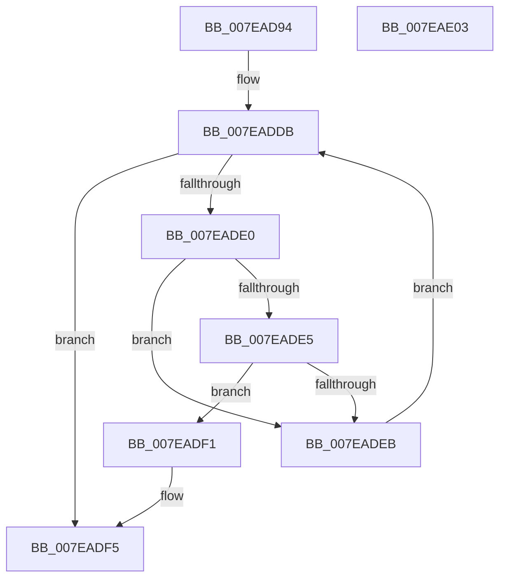

# CmpFindKcbInHashEntryByCellIndex

- RVA: `0x007EAD94`–`0x007EAE04` (길이 `112` bytes)
- VA: `0x00000001407EAD94`
- 실행 섹션: `PAGE`
- PDB 이름 있음: `예`; PDB Function 태그: `아니요`
- unwind 정보 RVA: `0x000950EC`
- 디코드: `33`개 명령, `112/112` bytes 표시
- 미해석 바이트: `0` (있으면 어셈블리에 `.byte`로 보존)

> 이 문서는 커널 이미지의 기계어와 PDB 기호를 분석해 생성했습니다. 4번과 5번은 함수 원형과 자료형을 바이너리 사용 방식에서 추정한 C 해석이며 원본 소스 복구 결과는 아닙니다.

## 1. Dependencies

- 직접 호출 지점: **0**; 고유 호출 대상: **0**
- 직접 호출자로 확인된 함수: **2**
- RIP 상대 이미지 참조: **0**

### Outgoing calls
- 직접 디코드된 call 명령이 없습니다.

### Direct callers
- [sub_006ED542](../../text/6E/Unknown_function_006ED542.md) at `0x006ED6C2`
- [CmpGetVirtualStoreRoot](CmpGetVirtualStoreRoot_function_007EB974.md) at `0x007EB9E0`

### Static image references
- 디코드된 RIP-relative 메모리 참조가 없습니다.

## 2. Other-region calls and transfers

- 다른 실행 섹션으로 향하는 call: **0**
- 별도 외부 분기/꼬리 이동을 확인하지 못했습니다.

## 3. Assembly (complete function range)

```asm
007EAD94  48 89 5C 24 08                  mov qword ptr [rsp + 8], rbx
007EAD99  48 89 7C 24 10                  mov qword ptr [rsp + 0x10], rdi
007EAD9E  4C 8B D9                        mov r11, rcx
007EADA1  8B C2                           mov eax, edx
007EADA3  8B 89 78 06 00 00               mov ecx, dword ptr [rcx + 0x678]
007EADA9  33 DB                           xor ebx, ebx
007EADAB  C1 E8 09                        shr eax, 9
007EADAE  FF C9                           dec ecx
007EADB0  33 C2                           xor eax, edx
007EADB2  41 8B F8                        mov edi, r8d
007EADB5  69 C0 A3 8A 01 00               imul eax, eax, 0x18aa3
007EADBB  44 8B D0                        mov r10d, eax
007EADBE  49 C1 EA 09                     shr r10, 9
007EADC2  44 8B C8                        mov r9d, eax
007EADC5  49 8B 83 70 06 00 00            mov rax, qword ptr [r11 + 0x670]
007EADCC  4D 33 D1                        xor r10, r9
007EADCF  4C 23 D1                        and r10, rcx
007EADD2  4B 8D 0C 52                     lea rcx, [r10 + r10*2]
007EADD6  4C 8B 44 C8 10                  mov r8, qword ptr [rax + rcx*8 + 0x10]
007EADDB  4D 85 C0                        test r8, r8
007EADDE  74 15                           je 0x1407eadf5
007EADE0  41 39 10                        cmp dword ptr [r8], edx
007EADE3  75 06                           jne 0x1407eadeb
007EADE5  41 39 78 18                     cmp dword ptr [r8 + 0x18], edi
007EADE9  74 06                           je 0x1407eadf1
007EADEB  4D 8B 40 08                     mov r8, qword ptr [r8 + 8]
007EADEF  EB EA                           jmp 0x1407eaddb
007EADF1  49 8D 58 F0                     lea rbx, [r8 - 0x10]
007EADF5  48 8B 7C 24 10                  mov rdi, qword ptr [rsp + 0x10]
007EADFA  48 8B C3                        mov rax, rbx
007EADFD  48 8B 5C 24 08                  mov rbx, qword ptr [rsp + 8]
007EAE02  C3                              ret
007EAE03  CC                              int3
```

## 4. C-style interpretation (structured pseudocode)

```c
__int64 __fastcall CmpFindKcbInHashEntryByCellIndex(__int64 a1, int a2, int a3)
{
    __int64 result;
    __int64 v_r10;
    __int64 v_rbx;
    unsigned __int64 v_stack_p10;
    unsigned __int64 v_stack_p8;

    v_stack_p8 = v_rbx;
    v_stack_p10 = v_rdi;
    v_rbx = 0;
    result = (unsigned int)(((unsigned int)(a2)) >> (9));
    a1 = (unsigned int)(((unsigned int)(*(unsigned int *)(a1 + 1656))) - 1);
    result = (unsigned int)((result) ^ (a2));
    result = (unsigned int)((result) * ((unsigned int)(result)));
    v_r10 = ((unsigned int)((unsigned int)(result))) >> (9);
    v_r10 = (v_r10) ^ ((unsigned int)((unsigned int)(result)));
    v_r10 = (v_r10) & (a1);
loc_007EADDB:
    if (*(unsigned __int64 *)(*(unsigned __int64 *)(a1 + 1648) + v_r10 + v_r10 * 2 * 8 + 16) == 0) goto loc_007EADF5;
    if ((*(unsigned int *)(*(unsigned __int64 *)(*(unsigned __int64 *)(a1 + 1648) + v_r10 + v_r10 * 2 * 8 + 16))) != a2) goto loc_007EADEB;
    if ((*(unsigned int *)(*(unsigned __int64 *)(*(unsigned __int64 *)(a1 + 1648) + v_r10 + v_r10 * 2 * 8 + 16) + 24)) == ((unsigned int)((unsigned int)(a3)))) goto loc_007EADF1;
loc_007EADEB:
    goto loc_007EADDB;
loc_007EADF1:
loc_007EADF5:
    return *(unsigned __int64 *)(*(unsigned __int64 *)(*(unsigned __int64 *)(a1 + 1648) + v_r10 + v_r10 * 2 * 8 + 16) + 8) - 16;
}
```

## 5. (Beta) C Style

```c
int64_t CmpFindKcbInHashEntryByCellIndex(void *Arg1, int32_t Arg2, int32_t Arg3)
{
    uint8_t *arg1 = (uint8_t *)Arg1;

    int64_t result;
    int64_t local_r10;
    int64_t local_rbx;
    uint64_t v_stack_p10;
    uint64_t v_stack_p8;

    v_stack_p8 = local_rbx;
    v_stack_p10 = local_rdi;
    local_rbx = 0;
    result = (uint32_t)(((uint32_t)(Arg2)) >> (9));
    Arg1 = (uint32_t)(((uint32_t)(*(uint32_t *)(arg1 + 0x678))) - 1);
    result = (uint32_t)((result) ^ (Arg2));
    result = (uint32_t)((result) * ((uint32_t)(result)));
    local_r10 = ((uint32_t)((uint32_t)(result))) >> (9);
    local_r10 = (local_r10) ^ ((uint32_t)((uint32_t)(result)));
    local_r10 = (local_r10) & (Arg1);
loc_007EADDB:
    if (*(uint64_t *)(*(uint64_t *)(arg1 + 0x670) + local_r10 + local_r10 * 2 * 8 + 0x10) == 0) goto loc_007EADF5;
    if ((*(uint32_t *)(*(uint64_t *)(*(uint64_t *)(arg1 + 0x670) + local_r10 + local_r10 * 2 * 8 + 0x10))) != Arg2) goto loc_007EADEB;
    if ((*(uint32_t *)(*(uint64_t *)(*(uint64_t *)(arg1 + 0x670) + local_r10 + local_r10 * 2 * 8 + 0x10) + 0x18)) == ((uint32_t)((uint32_t)(Arg3)))) goto loc_007EADF1;
loc_007EADEB:
    goto loc_007EADDB;
loc_007EADF1:
loc_007EADF5:
    return *(uint64_t *)(*(uint64_t *)(*(uint64_t *)(arg1 + 0x670) + local_r10 + local_r10 * 2 * 8 + 0x10) + 0x8) - 16;
}
```

### 관측된 메모리 오프셋

구조체 형식이 확인되지 않은 접근은 인자 기준의 오프셋으로만 기록했습니다.

| 기준 인자 | 오프셋 표현 | 폭 (bit) | 접근 |
|---|---:|---:|---|
| `Arg1` | `+ 0x670` | `64` | `R` |
| `Arg1` | `+ 0x678` | `32` | `R` |

## 6. Execution-region graph

[열기: 2D/3D 그래프와 함수 탐색 컨트롤 패널](../../../control-panel.html?section=page&rva=0x007EAD94&view=graph)

- 2D 그래프는 위에서 아래로 흐르고, 3D 그래프는 빈 공간을 드래그해 회전합니다. Shift+드래그는 이동, 휠은 확대·축소, 함수 노드 선택은 대상 보고서 이동입니다.

### Static fallback


