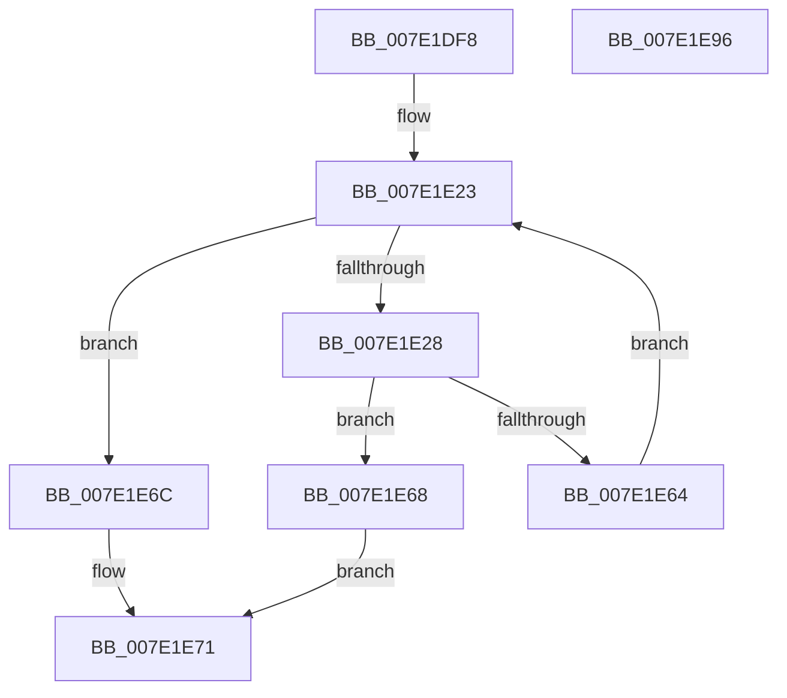

# CmpFindMachineHiveByMountPoint

- RVA: `0x007E1DF8`–`0x007E1E97` (길이 `159` bytes)
- VA: `0x00000001407E1DF8`
- 실행 섹션: `PAGE`
- PDB 이름 있음: `예`; PDB Function 태그: `아니요`
- unwind 정보 RVA: `0x000D690C`
- 디코드: `45`개 명령, `159/159` bytes 표시
- 미해석 바이트: `0` (있으면 어셈블리에 `.byte`로 보존)

> 이 문서는 커널 이미지의 기계어와 PDB 기호를 분석해 생성했습니다. 4번과 5번은 함수 원형과 자료형을 바이너리 사용 방식에서 추정한 C 해석이며 원본 소스 복구 결과는 아닙니다.

## 1. Dependencies

- 직접 호출 지점: **3**; 고유 호출 대상: **3**
- 직접 호출자로 확인된 함수: **1**
- RIP 상대 이미지 참조: **1**

### Outgoing calls
- `0x007E1E4B` → [CmpBuildMachineHiveMountPoint](../7D/CmpBuildMachineHiveMountPoint_function_007D9F00.md) (function, `0x007D9F00`)
- `0x007E1E5B` → [RtlEqualUnicodeString](../93/RtlEqualUnicodeString_function_00932A20.md) (function, `0x00932A20`)
- `0x007E1E7E` → [_security_check_cookie](../../text/6A/_security_check_cookie_function_006AC640.md) (function, `0x006AC640`)

### Direct callers
- [CmRegisterMachineHiveLoadedNotification](CmRegisterMachineHiveLoadedNotification_function_007E1A90.md) at `0x007E1AF1`

### Static image references
- `0x007E1E07` → RVA `0x00E0A740` (`.data`; read)

## 2. Other-region calls and transfers

- 다른 실행 섹션으로 향하는 call: **1**
  - `0x007E1E7E` → [_security_check_cookie](../../text/6A/_security_check_cookie_function_006AC640.md) (`PAGE` → `.text`)
- 별도 외부 분기/꼬리 이동을 확인하지 못했습니다.

## 3. Assembly (complete function range)

```asm
007E1DF8  48 89 5C 24 18                  mov qword ptr [rsp + 0x18], rbx
007E1DFD  55                              push rbp
007E1DFE  56                              push rsi
007E1DFF  57                              push rdi
007E1E00  48 81 EC C0 00 00 00            sub rsp, 0xc0
007E1E07  48 8B 05 32 89 62 00            mov rax, qword ptr [rip + 0x628932]
007E1E0E  48 33 C4                        xor rax, rsp
007E1E11  48 89 84 24 B0 00 00 00         mov qword ptr [rsp + 0xb0], rax
007E1E19  33 FF                           xor edi, edi
007E1E1B  48 8B F2                        mov rsi, rdx
007E1E1E  8B DF                           mov ebx, edi
007E1E20  48 8B E9                        mov rbp, rcx
007E1E23  83 FB 07                        cmp ebx, 7
007E1E26  73 44                           jae 0x1407e1e6c
007E1E28  0F 57 C0                        xorps xmm0, xmm0
007E1E2B  48 8D 54 24 20                  lea rdx, [rsp + 0x20]
007E1E30  0F 11 44 24 20                  movups xmmword ptr [rsp + 0x20], xmm0
007E1E35  B8 80 00 00 00                  mov eax, 0x80
007E1E3A  8B CB                           mov ecx, ebx
007E1E3C  66 89 44 24 22                  mov word ptr [rsp + 0x22], ax
007E1E41  48 8D 44 24 30                  lea rax, [rsp + 0x30]
007E1E46  48 89 44 24 28                  mov qword ptr [rsp + 0x28], rax
007E1E4B  E8 B0 80 FF FF                  call 0x1407d9f00
007E1E50  41 B0 01                        mov r8b, 1
007E1E53  48 8D 4C 24 20                  lea rcx, [rsp + 0x20]
007E1E58  48 8B D5                        mov rdx, rbp
007E1E5B  E8 C0 0B 15 00                  call 0x140932a20
007E1E60  84 C0                           test al, al
007E1E62  75 04                           jne 0x1407e1e68
007E1E64  FF C3                           inc ebx
007E1E66  EB BB                           jmp 0x1407e1e23
007E1E68  89 1E                           mov dword ptr [rsi], ebx
007E1E6A  EB 05                           jmp 0x1407e1e71
007E1E6C  BF 3A 00 00 C0                  mov edi, 0xc000003a
007E1E71  8B C7                           mov eax, edi
007E1E73  48 8B 8C 24 B0 00 00 00         mov rcx, qword ptr [rsp + 0xb0]
007E1E7B  48 33 CC                        xor rcx, rsp
007E1E7E  E8 BD A7 EC FF                  call 0x1406ac640
007E1E83  48 8B 9C 24 F0 00 00 00         mov rbx, qword ptr [rsp + 0xf0]
007E1E8B  48 81 C4 C0 00 00 00            add rsp, 0xc0
007E1E92  5F                              pop rdi
007E1E93  5E                              pop rsi
007E1E94  5D                              pop rbp
007E1E95  C3                              ret
007E1E96  CC                              int3
```

## 4. C-style interpretation (structured pseudocode)

```c
__int64 __fastcall CmpFindMachineHiveByMountPoint(__int64 a1, __int64 a2)
{
    __int64 result;
    __int64 v_rbx;
    __int64 v_rdi;
    __int64 v_rsp;
    unsigned __int64 v_stack_m28;
    unsigned __int64 v_stack_mA8;
    unsigned __int64 v_stack_mB0;
    unsigned __int16 v_stack_mB6;
    unsigned __int64 v_stack_mB8;
    unsigned __int64 v_stack_p18;

    v_stack_p18 = v_rbx;
    v_rsp = (v_rsp) - (192);
    result = (*(unsigned __int64 *)(v_rip + 6457650)) ^ (v_rsp);
    v_stack_m28 = result;
    v_rdi = 0;
loc_007E1E23:
    if (0 >= 7) goto loc_007E1E6C;
    v_stack_mB8 = v_xmm0;
    v_stack_mB6 = 128;
    v_stack_mB0 = v_stack_mA8;
    result = CmpBuildMachineHiveMountPoint(0, v_stack_mB8, a3, a4);
    result = RtlEqualUnicodeString(v_stack_mB8, a1, 1, a4);
    if ((unsigned __int8)(result) != 0) goto loc_007E1E68;
    v_rbx = (unsigned int)((0) + 1);
    goto loc_007E1E23;
loc_007E1E68:
    *(unsigned int *)(a2) = (unsigned int)(v_rbx);
    goto loc_007E1E71;
loc_007E1E6C:
loc_007E1E71:
    a1 = (v_stack_m28) ^ (v_rsp);
    result = _security_check_cookie(a1, a1, 1, a4);
    v_rsp = (v_rsp) + (192);
    return result;
}
```

## 5. (Beta) C Style

```c
int64_t CmpFindMachineHiveByMountPoint(int64_t Arg1, void *Arg2)
{
    uint8_t *arg2 = (uint8_t *)Arg2;

    int64_t result;
    int64_t local_rbx;
    int64_t local_rdi;
    int64_t local_rsp;
    uint64_t v_stack_m28;
    uint64_t v_stack_mA8;
    uint64_t v_stack_mB0;
    uint16_t v_stack_mB6;
    uint64_t v_stack_mB8;
    uint64_t v_stack_p18;

    v_stack_p18 = local_rbx;
    local_rsp = (local_rsp) - (192);
    result = (*(uint64_t *)(v_rip + 0x628932)) ^ (local_rsp);
    v_stack_m28 = result;
    local_rdi = 0;
loc_007E1E23:
    if (0 >= 7) goto loc_007E1E6C;
    v_stack_mB8 = v_xmm0;
    v_stack_mB6 = 128;
    v_stack_mB0 = v_stack_mA8;
    result = CmpBuildMachineHiveMountPoint(0, v_stack_mB8, a3, a4);
    result = RtlEqualUnicodeString(v_stack_mB8, Arg1, 1, a4);
    if ((uint8_t)(result) != 0) goto loc_007E1E68;
    local_rbx = (uint32_t)((0) + 1);
    goto loc_007E1E23;
loc_007E1E68:
    *(uint32_t *)(arg2) = (uint32_t)(local_rbx);
    goto loc_007E1E71;
loc_007E1E6C:
loc_007E1E71:
    Arg1 = (v_stack_m28) ^ (local_rsp);
    result = _security_check_cookie(Arg1, Arg1, 1, a4);
    local_rsp = (local_rsp) + (192);
    return result;
}
```

### 관측된 메모리 오프셋

구조체 형식이 확인되지 않은 접근은 인자 기준의 오프셋으로만 기록했습니다.

| 기준 인자 | 오프셋 표현 | 폭 (bit) | 접근 |
|---|---:|---:|---|
| `Arg2` | `+ 0x0` | `32` | `W` |

## 6. Execution-region graph

[열기: 2D/3D 그래프와 함수 탐색 컨트롤 패널](../../../control-panel.html?section=page&rva=0x007E1DF8&view=graph)

- 2D 그래프는 위에서 아래로 흐르고, 3D 그래프는 빈 공간을 드래그해 회전합니다. Shift+드래그는 이동, 휠은 확대·축소, 함수 노드 선택은 대상 보고서 이동입니다.

### Static fallback


