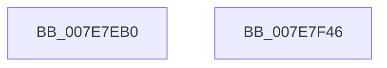

# CmpFinishBeingActiveFlusherAndReconciler

- RVA: `0x007E7EB0`–`0x007E7F47` (길이 `151` bytes)
- VA: `0x00000001407E7EB0`
- 실행 섹션: `PAGE`
- PDB 이름 있음: `예`; PDB Function 태그: `아니요`
- unwind 정보 RVA: `0x0005E6B4`
- 디코드: `39`개 명령, `151/151` bytes 표시
- 미해석 바이트: `0` (있으면 어셈블리에 `.byte`로 보존)

> 이 문서는 커널 이미지의 기계어와 PDB 기호를 분석해 생성했습니다. 4번과 5번은 함수 원형과 자료형을 바이너리 사용 방식에서 추정한 C 해석이며 원본 소스 복구 결과는 아닙니다.

## 1. Dependencies

- 직접 호출 지점: **8**; 고유 호출 대상: **6**
- 직접 호출자로 확인된 함수: **6**
- RIP 상대 이미지 참조: **0**

### Outgoing calls
- `0x007E7ECC` → [CmpLockRegistry](../../pagecmrc/BC/CmpLockRegistry_function_00BC9B34.md) (function, `0x00BC9B34`)
- `0x007E7ED4` → [HvLockHiveFlusherExclusive](../../pagecmrc/BC/HvLockHiveFlusherExclusive_function_00BC9C50.md) (function, `0x00BC9C50`)
- `0x007E7EE3` → [CmpReleaseWriteQueue](../9B/CmpReleaseWriteQueue_function_009B4EE0.md) (function, `0x009B4EE0`)
- `0x007E7EF5` → [CmpReleaseWriteQueue](../9B/CmpReleaseWriteQueue_function_009B4EE0.md) (function, `0x009B4EE0`)
- `0x007E7F00` → [HvUnlockHiveFlusherExclusive](../../pagecmrc/BC/HvUnlockHiveFlusherExclusive_function_00BC9C34.md) (function, `0x00BC9C34`)
- `0x007E7F05` → [CmpUnlockRegistry](../../pagecmrc/BC/CmpUnlockRegistry_function_00BC9A84.md) (function, `0x00BC9A84`)
- `0x007E7F18` → [CmpWakeWriteQueueWaiters](../A6/CmpWakeWriteQueueWaiters_function_00A6B0C8.md) (function, `0x00A6B0C8`)
- `0x007E7F26` → [CmpWakeWriteQueueWaiters](../A6/CmpWakeWriteQueueWaiters_function_00A6B0C8.md) (function, `0x00A6B0C8`)

### Direct callers
- [CmShutdownSystem1](../../text/66/CmShutdownSystem1_function_0066A5B0.md) at `0x0066A786`
- [CmpLoadHiveThread](../7D/CmpLoadHiveThread_function_007DB040.md) at `0x007DB9A7`
- [CmpMountPreloadedHives](../7D/CmpMountPreloadedHives_function_007DBE18.md) at `0x007DC3A3`
- [CmpRefreshHive](../7D/CmpRefreshHive_function_007DEAD0.md) at `0x007DED61`
- [CmpSaveKeyByFileCopy](../7D/CmpSaveKeyByFileCopy_function_007DEFC0.md) at `0x007DF1A2`
- [CmReplaceKey](CmReplaceKey_function_007EA1C8.md) at `0x007EA3F1`

### Static image references
- 디코드된 RIP-relative 메모리 참조가 없습니다.

## 2. Other-region calls and transfers

- 다른 실행 섹션으로 향하는 call: **4**
  - `0x007E7ECC` → [CmpLockRegistry](../../pagecmrc/BC/CmpLockRegistry_function_00BC9B34.md) (`PAGE` → `PAGECMRC`)
  - `0x007E7ED4` → [HvLockHiveFlusherExclusive](../../pagecmrc/BC/HvLockHiveFlusherExclusive_function_00BC9C50.md) (`PAGE` → `PAGECMRC`)
  - `0x007E7F00` → [HvUnlockHiveFlusherExclusive](../../pagecmrc/BC/HvUnlockHiveFlusherExclusive_function_00BC9C34.md) (`PAGE` → `PAGECMRC`)
  - `0x007E7F05` → [CmpUnlockRegistry](../../pagecmrc/BC/CmpUnlockRegistry_function_00BC9A84.md) (`PAGE` → `PAGECMRC`)
- 별도 외부 분기/꼬리 이동을 확인하지 못했습니다.

## 3. Assembly (complete function range)

```asm
007E7EB0  48 8B C4                        mov rax, rsp
007E7EB3  48 89 58 08                     mov qword ptr [rax + 8], rbx
007E7EB7  48 89 68 10                     mov qword ptr [rax + 0x10], rbp
007E7EBB  48 89 70 18                     mov qword ptr [rax + 0x18], rsi
007E7EBF  48 89 78 20                     mov qword ptr [rax + 0x20], rdi
007E7EC3  41 56                           push r14
007E7EC5  48 83 EC 20                     sub rsp, 0x20
007E7EC9  48 8B F1                        mov rsi, rcx
007E7ECC  E8 63 1C 3E 00                  call 0x140bc9b34
007E7ED1  48 8B CE                        mov rcx, rsi
007E7ED4  E8 77 1D 3E 00                  call 0x140bc9c50
007E7ED9  48 8D AE 60 10 00 00            lea rbp, [rsi + 0x1060]
007E7EE0  48 8B D5                        mov rdx, rbp
007E7EE3  E8 F8 CF 1C 00                  call 0x1409b4ee0
007E7EE8  4C 8D B6 70 10 00 00            lea r14, [rsi + 0x1070]
007E7EEF  48 8B D8                        mov rbx, rax
007E7EF2  49 8B D6                        mov rdx, r14
007E7EF5  E8 E6 CF 1C 00                  call 0x1409b4ee0
007E7EFA  48 8B CE                        mov rcx, rsi
007E7EFD  48 8B F8                        mov rdi, rax
007E7F00  E8 2F 1D 3E 00                  call 0x140bc9c34
007E7F05  E8 7A 1B 3E 00                  call 0x140bc9a84
007E7F0A  BE 01 00 00 C0                  mov esi, 0xc0000001
007E7F0F  48 8B D3                        mov rdx, rbx
007E7F12  44 8B C6                        mov r8d, esi
007E7F15  48 8B CD                        mov rcx, rbp
007E7F18  E8 AB 31 28 00                  call 0x140a6b0c8
007E7F1D  44 8B C6                        mov r8d, esi
007E7F20  48 8B D7                        mov rdx, rdi
007E7F23  49 8B CE                        mov rcx, r14
007E7F26  E8 9D 31 28 00                  call 0x140a6b0c8
007E7F2B  48 8B 5C 24 30                  mov rbx, qword ptr [rsp + 0x30]
007E7F30  48 8B 6C 24 38                  mov rbp, qword ptr [rsp + 0x38]
007E7F35  48 8B 74 24 40                  mov rsi, qword ptr [rsp + 0x40]
007E7F3A  48 8B 7C 24 48                  mov rdi, qword ptr [rsp + 0x48]
007E7F3F  48 83 C4 20                     add rsp, 0x20
007E7F43  41 5E                           pop r14
007E7F45  C3                              ret
007E7F46  CC                              int3
```

## 4. C-style interpretation (structured pseudocode)

```c
__int64 __fastcall CmpFinishBeingActiveFlusherAndReconciler(__int64 a1)
{
    __int64 result;
    __int64 v_rsp;
    unsigned __int64 v_stack_p10;
    unsigned __int64 v_stack_p18;
    unsigned __int64 v_stack_p20;
    unsigned __int64 v_stack_p8;

    *(unsigned __int64 *)(v_rsp + 8) = v_rbx;
    *(unsigned __int64 *)(v_rsp + 16) = v_rbp;
    *(unsigned __int64 *)(v_rsp + 24) = v_rsi;
    *(unsigned __int64 *)(v_rsp + 32) = v_rdi;
    v_rsp = (v_rsp) - (32);
    result = CmpLockRegistry(a1, a2, a3, a4);
    result = HvLockHiveFlusherExclusive(a1, a2, a3, a4);
    result = CmpReleaseWriteQueue(a1, a1 + 4192, a3, a4);
    result = CmpReleaseWriteQueue(a1, a1 + 4208, a3, a4);
    result = HvUnlockHiveFlusherExclusive(a1, a1 + 4208, a3, a4);
    result = CmpUnlockRegistry(a1, a1 + 4208, a3, a4);
    result = CmpWakeWriteQueueWaiters(a1 + 4192, result, (unsigned int)((unsigned int)((unsigned int)(0xC0000001ULL))), a4);
    result = CmpWakeWriteQueueWaiters(a1 + 4208, result, (unsigned int)((unsigned int)((unsigned int)(0xC0000001ULL))), a4);
    v_rsp = (v_rsp) + (32);
    return result;
}
```

## 5. (Beta) C Style

```c
int64_t CmpFinishBeingActiveFlusherAndReconciler(void *Arg1)
{
    uint8_t *arg1 = (uint8_t *)Arg1;

    int64_t result;
    int64_t local_rsp;
    uint64_t v_stack_p10;
    uint64_t v_stack_p18;
    uint64_t v_stack_p20;
    uint64_t v_stack_p8;

    *(uint64_t *)(local_rsp + 0x8) = local_rbx;
    *(uint64_t *)(local_rsp + 0x10) = local_rbp;
    *(uint64_t *)(local_rsp + 0x18) = local_rsi;
    *(uint64_t *)(local_rsp + 0x20) = local_rdi;
    local_rsp = (local_rsp) - (32);
    result = CmpLockRegistry(Arg1, a2, a3, a4);
    result = HvLockHiveFlusherExclusive(Arg1, a2, a3, a4);
    result = CmpReleaseWriteQueue(Arg1, Arg1 + 4192, a3, a4);
    result = CmpReleaseWriteQueue(Arg1, Arg1 + 4208, a3, a4);
    result = HvUnlockHiveFlusherExclusive(Arg1, Arg1 + 4208, a3, a4);
    result = CmpUnlockRegistry(Arg1, Arg1 + 4208, a3, a4);
    result = CmpWakeWriteQueueWaiters(Arg1 + 4192, result, (uint32_t)((uint32_t)((uint32_t)(0xC0000001ULL))), a4);
    result = CmpWakeWriteQueueWaiters(Arg1 + 4208, result, (uint32_t)((uint32_t)((uint32_t)(0xC0000001ULL))), a4);
    local_rsp = (local_rsp) + (32);
    return result;
}
```

### 관측된 메모리 오프셋

구조체 형식이 확인되지 않은 접근은 인자 기준의 오프셋으로만 기록했습니다.

| 기준 인자 | 오프셋 표현 | 폭 (bit) | 접근 |
|---|---:|---:|---|
| `Arg1` | `+ 0x1060` | `64` | `R` |
| `Arg1` | `+ 0x1070` | `64` | `R` |

## 6. Execution-region graph

[열기: 2D/3D 그래프와 함수 탐색 컨트롤 패널](../../../control-panel.html?section=page&rva=0x007E7EB0&view=graph)

- 2D 그래프는 위에서 아래로 흐르고, 3D 그래프는 빈 공간을 드래그해 회전합니다. Shift+드래그는 이동, 휠은 확대·축소, 함수 노드 선택은 대상 보고서 이동입니다.

### Static fallback


