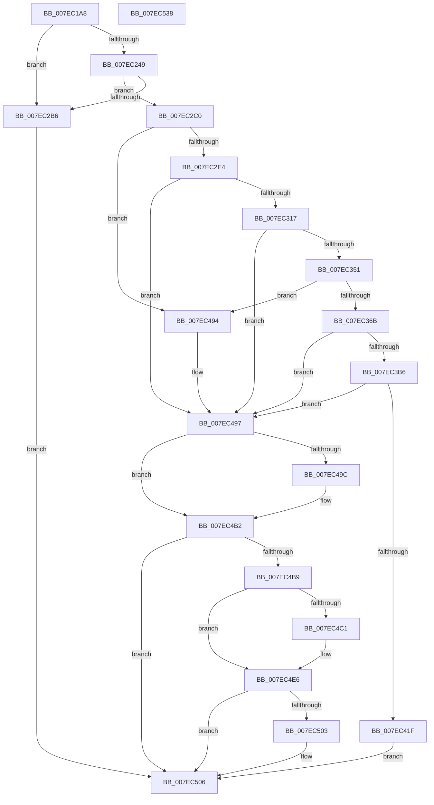

# CmpFlushBackupHive

- RVA: `0x007EC1A8`–`0x007EC539` (길이 `913` bytes)
- VA: `0x00000001407EC1A8`
- 실행 섹션: `PAGE`
- PDB 이름 있음: `예`; PDB Function 태그: `아니요`
- unwind 정보 RVA: `0x000D6E78`
- 디코드: `221`개 명령, `913/913` bytes 표시
- 미해석 바이트: `0` (있으면 어셈블리에 `.byte`로 보존)

> 이 문서는 커널 이미지의 기계어와 PDB 기호를 분석해 생성했습니다. 4번과 5번은 함수 원형과 자료형을 바이너리 사용 방식에서 추정한 C 해석이며 원본 소스 복구 결과는 아닙니다.

## 1. Dependencies

- 직접 호출 지점: **34**; 고유 호출 대상: **22**
- 직접 호출자로 확인된 함수: **1**
- RIP 상대 이미지 참조: **5**

### Outgoing calls
- `0x007EC221` → [memset](../../text/6C/memset_function_006C6C40.md) (function, `0x006C6C40`)
- `0x007EC268` → [RtlInitUnicodeString](../../text/42/RtlInitUnicodeString_function_0042A780.md) (function, `0x0042A780`)
- `0x007EC276` → [RtlAppendStringToString](../A9/RtlAppendStringToString_function_00A97740.md) (function, `0x00A97740`)
- `0x007EC283` → [RtlInitUnicodeString](../../text/42/RtlInitUnicodeString_function_0042A780.md) (function, `0x0042A780`)
- `0x007EC291` → [RtlAppendStringToString](../A9/RtlAppendStringToString_function_00A97740.md) (function, `0x00A97740`)
- `0x007EC2A2` → [RtlAppendUnicodeToString](../../text/40/RtlAppendUnicodeToString_function_0040F990.md) (function, `0x0040F990`)
- `0x007EC2D2` → [CmpCmdRenameHive](CmpCmdRenameHive_function_007E5910.md) (function, `0x007E5910`)
- `0x007EC305` → [CmpInitBackupHive](CmpInitBackupHive_function_007EC594.md) (function, `0x007EC594`)
- `0x007EC31B` → [CmpAttachToRegistryProcess](../../pagecmrc/BC/CmpAttachToRegistryProcess_function_00BC98E0.md) (function, `0x00BC98E0`)
- `0x007EC320` → [CmpLockRegistry](../../pagecmrc/BC/CmpLockRegistry_function_00BC9B34.md) (function, `0x00BC9B34`)
- `0x007EC32B` → [HvLockHiveFlusherExclusive](../../pagecmrc/BC/HvLockHiveFlusherExclusive_function_00BC9C50.md) (function, `0x00BC9C50`)
- `0x007EC342` → [HvAllocateOffsetArraysForHiveSnapshot](../7F/HvAllocateOffsetArraysForHiveSnapshot_function_007F3A24.md) (function, `0x007F3A24`)
- `0x007EC35C` → [HvSnapshotHiveToOffsetArray](../../pagecmrc/BC/HvSnapshotHiveToOffsetArray_function_00BC9508.md) (function, `0x00BC9508`)
- `0x007EC36E` → [HvUnlockHiveFlusherExclusive](../../pagecmrc/BC/HvUnlockHiveFlusherExclusive_function_00BC9C34.md) (function, `0x00BC9C34`)
- `0x007EC373` → [CmpUnlockRegistry](../../pagecmrc/BC/CmpUnlockRegistry_function_00BC9A84.md) (function, `0x00BC9A84`)
- `0x007EC37F` → [CmpDetachFromRegistryProcess](../../pagecmrc/BC/CmpDetachFromRegistryProcess_function_00BC9920.md) (function, `0x00BC9920`)
- `0x007EC398` → [CmpWriteOffsetArrayToFile](CmpWriteOffsetArrayToFile_function_007EC82C.md) (function, `0x007EC82C`)
- `0x007EC3A6` → [CmpFreeOffsetArray](CmpFreeOffsetArray_function_007EC540.md) (function, `0x007EC540`)
- `0x007EC3CE` → [ZwSetInformationObject](../../text/6A/ZwSetInformationObject_function_006ADC50.md) (function, `0x006ADC50`)
- `0x007EC3D6` → [ZwClose](../../text/6A/ZwClose_function_006AD2B0.md) (function, `0x006AD2B0`)
- `0x007EC414` → [CmpCmdHiveOpen](../87/CmpCmdHiveOpen_function_00878404.md) (function, `0x00878404`)
- `0x007EC439` → [CmpAttachToRegistryProcess](../../pagecmrc/BC/CmpAttachToRegistryProcess_function_00BC98E0.md) (function, `0x00BC98E0`)
- `0x007EC441` → [CmpDestroyHive](../9B/CmpDestroyHive_function_009B1708.md) (function, `0x009B1708`)
- `0x007EC44A` → [CmpDetachFromRegistryProcess](../../pagecmrc/BC/CmpDetachFromRegistryProcess_function_00BC9920.md) (function, `0x00BC9920`)
- `0x007EC468` → [ZwSetInformationFile](../../text/6A/ZwSetInformationFile_function_006AD5B0.md) (function, `0x006AD5B0`)
- `0x007EC485` → [ZwSetInformationObject](../../text/6A/ZwSetInformationObject_function_006ADC50.md) (function, `0x006ADC50`)
- `0x007EC48D` → [ZwClose](../../text/6A/ZwClose_function_006AD2B0.md) (function, `0x006AD2B0`)
- `0x007EC49F` → [HvUnlockHiveFlusherExclusive](../../pagecmrc/BC/HvUnlockHiveFlusherExclusive_function_00BC9C34.md) (function, `0x00BC9C34`)
- `0x007EC4A4` → [CmpUnlockRegistry](../../pagecmrc/BC/CmpUnlockRegistry_function_00BC9A84.md) (function, `0x00BC9A84`)
- `0x007EC4AD` → [CmpDetachFromRegistryProcess](../../pagecmrc/BC/CmpDetachFromRegistryProcess_function_00BC9920.md) (function, `0x00BC9920`)
- `0x007EC4D6` → [ZwSetInformationObject](../../text/6A/ZwSetInformationObject_function_006ADC50.md) (function, `0x006ADC50`)
- `0x007EC4DE` → [ZwClose](../../text/6A/ZwClose_function_006AD2B0.md) (function, `0x006AD2B0`)
- `0x007EC4F8` → [CmpCmdRenameHive](CmpCmdRenameHive_function_007E5910.md) (function, `0x007E5910`)
- `0x007EC512` → [_security_check_cookie](../../text/6A/_security_check_cookie_function_006AC640.md) (function, `0x006AC640`)

### Direct callers
- [CmpSyncNextBackupHive](CmpSyncNextBackupHive_function_007EC6C8.md) at `0x007EC774`

### Static image references
- `0x007EC1CE` → RVA `0x00E0A740` (`.data`; read)
- `0x007EC22D` → RVA `0x00EEFC20` (`.data`; read)
- `0x007EC233` → RVA `0x00E098A0` (`.data`; read)
- `0x007EC258` → RVA `0x00B09940` (` ?? ::NNGAKEGL::`string'`; read)
- `0x007EC296` → RVA `0x00B09990` (` ?? ::NNGAKEGL::`string'`; read)

## 2. Other-region calls and transfers

- 다른 실행 섹션으로 향하는 call: **24**
  - `0x007EC221` → [memset](../../text/6C/memset_function_006C6C40.md) (`PAGE` → `.text`)
  - `0x007EC268` → [RtlInitUnicodeString](../../text/42/RtlInitUnicodeString_function_0042A780.md) (`PAGE` → `.text`)
  - `0x007EC283` → [RtlInitUnicodeString](../../text/42/RtlInitUnicodeString_function_0042A780.md) (`PAGE` → `.text`)
  - `0x007EC2A2` → [RtlAppendUnicodeToString](../../text/40/RtlAppendUnicodeToString_function_0040F990.md) (`PAGE` → `.text`)
  - `0x007EC31B` → [CmpAttachToRegistryProcess](../../pagecmrc/BC/CmpAttachToRegistryProcess_function_00BC98E0.md) (`PAGE` → `PAGECMRC`)
  - `0x007EC320` → [CmpLockRegistry](../../pagecmrc/BC/CmpLockRegistry_function_00BC9B34.md) (`PAGE` → `PAGECMRC`)
  - `0x007EC32B` → [HvLockHiveFlusherExclusive](../../pagecmrc/BC/HvLockHiveFlusherExclusive_function_00BC9C50.md) (`PAGE` → `PAGECMRC`)
  - `0x007EC35C` → [HvSnapshotHiveToOffsetArray](../../pagecmrc/BC/HvSnapshotHiveToOffsetArray_function_00BC9508.md) (`PAGE` → `PAGECMRC`)
  - `0x007EC36E` → [HvUnlockHiveFlusherExclusive](../../pagecmrc/BC/HvUnlockHiveFlusherExclusive_function_00BC9C34.md) (`PAGE` → `PAGECMRC`)
  - `0x007EC373` → [CmpUnlockRegistry](../../pagecmrc/BC/CmpUnlockRegistry_function_00BC9A84.md) (`PAGE` → `PAGECMRC`)
  - `0x007EC37F` → [CmpDetachFromRegistryProcess](../../pagecmrc/BC/CmpDetachFromRegistryProcess_function_00BC9920.md) (`PAGE` → `PAGECMRC`)
  - `0x007EC3CE` → [ZwSetInformationObject](../../text/6A/ZwSetInformationObject_function_006ADC50.md) (`PAGE` → `.text`)
  - `0x007EC3D6` → [ZwClose](../../text/6A/ZwClose_function_006AD2B0.md) (`PAGE` → `.text`)
  - `0x007EC439` → [CmpAttachToRegistryProcess](../../pagecmrc/BC/CmpAttachToRegistryProcess_function_00BC98E0.md) (`PAGE` → `PAGECMRC`)
  - `0x007EC44A` → [CmpDetachFromRegistryProcess](../../pagecmrc/BC/CmpDetachFromRegistryProcess_function_00BC9920.md) (`PAGE` → `PAGECMRC`)
  - `0x007EC468` → [ZwSetInformationFile](../../text/6A/ZwSetInformationFile_function_006AD5B0.md) (`PAGE` → `.text`)
  - `0x007EC485` → [ZwSetInformationObject](../../text/6A/ZwSetInformationObject_function_006ADC50.md) (`PAGE` → `.text`)
  - `0x007EC48D` → [ZwClose](../../text/6A/ZwClose_function_006AD2B0.md) (`PAGE` → `.text`)
  - `0x007EC49F` → [HvUnlockHiveFlusherExclusive](../../pagecmrc/BC/HvUnlockHiveFlusherExclusive_function_00BC9C34.md) (`PAGE` → `PAGECMRC`)
  - `0x007EC4A4` → [CmpUnlockRegistry](../../pagecmrc/BC/CmpUnlockRegistry_function_00BC9A84.md) (`PAGE` → `PAGECMRC`)
  - `0x007EC4AD` → [CmpDetachFromRegistryProcess](../../pagecmrc/BC/CmpDetachFromRegistryProcess_function_00BC9920.md) (`PAGE` → `PAGECMRC`)
  - `0x007EC4D6` → [ZwSetInformationObject](../../text/6A/ZwSetInformationObject_function_006ADC50.md) (`PAGE` → `.text`)
  - `0x007EC4DE` → [ZwClose](../../text/6A/ZwClose_function_006AD2B0.md) (`PAGE` → `.text`)
  - `0x007EC512` → [_security_check_cookie](../../text/6A/_security_check_cookie_function_006AC640.md) (`PAGE` → `.text`)
- 별도 외부 분기/꼬리 이동을 확인하지 못했습니다.

## 3. Assembly (complete function range)

```asm
007EC1A8  48 8B C4                        mov rax, rsp
007EC1AB  48 89 58 10                     mov qword ptr [rax + 0x10], rbx
007EC1AF  48 89 70 18                     mov qword ptr [rax + 0x18], rsi
007EC1B3  48 89 78 20                     mov qword ptr [rax + 0x20], rdi
007EC1B7  55                              push rbp
007EC1B8  41 54                           push r12
007EC1BA  41 55                           push r13
007EC1BC  41 56                           push r14
007EC1BE  41 57                           push r15
007EC1C0  48 8D A8 C8 FD FF FF            lea rbp, [rax - 0x238]
007EC1C7  48 81 EC 10 03 00 00            sub rsp, 0x310
007EC1CE  48 8B 05 6B E5 61 00            mov rax, qword ptr [rip + 0x61e56b]
007EC1D5  48 33 C4                        xor rax, rsp
007EC1D8  48 89 85 00 02 00 00            mov qword ptr [rbp + 0x200], rax
007EC1DF  0F 57 C0                        xorps xmm0, xmm0
007EC1E2  8B D9                           mov ebx, ecx
007EC1E4  33 FF                           xor edi, edi
007EC1E6  C6 44 24 55 01                  mov byte ptr [rsp + 0x55], 1
007EC1EB  48 8D 4D D0                     lea rcx, [rbp - 0x30]
007EC1EF  89 7C 24 64                     mov dword ptr [rsp + 0x64], edi
007EC1F3  33 D2                           xor edx, edx
007EC1F5  48 89 7C 24 78                  mov qword ptr [rsp + 0x78], rdi
007EC1FA  41 B8 B0 01 00 00               mov r8d, 0x1b0
007EC200  89 7C 24 50                     mov dword ptr [rsp + 0x50], edi
007EC204  0F 11 45 80                     movups xmmword ptr [rbp - 0x80], xmm0
007EC208  48 89 7C 24 70                  mov qword ptr [rsp + 0x70], rdi
007EC20D  89 7C 24 58                     mov dword ptr [rsp + 0x58], edi
007EC211  0F 11 45 90                     movups xmmword ptr [rbp - 0x70], xmm0
007EC215  0F 11 45 A0                     movups xmmword ptr [rbp - 0x60], xmm0
007EC219  0F 11 45 B0                     movups xmmword ptr [rbp - 0x50], xmm0
007EC21D  0F 11 45 C0                     movups xmmword ptr [rbp - 0x40], xmm0
007EC221  E8 1A AA ED FF                  call 0x1406c6c40
007EC226  4C 69 E3 B8 00 00 00            imul r12, rbx, 0xb8
007EC22D  39 3D ED 39 70 00               cmp dword ptr [rip + 0x7039ed], edi
007EC233  48 8D 1D 66 D6 61 00            lea rbx, [rip + 0x61d666]
007EC23A  44 8A EF                        mov r13b, dil
007EC23D  40 88 7C 24 54                  mov byte ptr [rsp + 0x54], dil
007EC242  4D 8B 74 1C 30                  mov r14, qword ptr [r12 + rbx + 0x30]
007EC247  74 6D                           je 0x1407ec2b6
007EC249  48 8D 85 80 01 00 00            lea rax, [rbp + 0x180]
007EC250  C7 44 24 60 00 00 80 00         mov dword ptr [rsp + 0x60], 0x800000
007EC258  48 8D 15 E1 D6 31 00            lea rdx, [rip + 0x31d6e1]
007EC25F  48 89 44 24 68                  mov qword ptr [rsp + 0x68], rax
007EC264  48 8D 4D 80                     lea rcx, [rbp - 0x80]
007EC268  E8 13 E5 C3 FF                  call 0x14042a780
007EC26D  48 8D 55 80                     lea rdx, [rbp - 0x80]
007EC271  48 8D 4C 24 60                  lea rcx, [rsp + 0x60]
007EC276  E8 C5 B4 2A 00                  call 0x140a97740
007EC27B  49 8B 14 1C                     mov rdx, qword ptr [r12 + rbx]
007EC27F  48 8D 4D 80                     lea rcx, [rbp - 0x80]
007EC283  E8 F8 E4 C3 FF                  call 0x14042a780
007EC288  48 8D 55 80                     lea rdx, [rbp - 0x80]
007EC28C  48 8D 4C 24 60                  lea rcx, [rsp + 0x60]
007EC291  E8 AA B4 2A 00                  call 0x140a97740
007EC296  48 8D 15 F3 D6 31 00            lea rdx, [rip + 0x31d6f3]
007EC29D  48 8D 4C 24 60                  lea rcx, [rsp + 0x60]
007EC2A2  E8 E9 36 C2 FF                  call 0x14040f990
007EC2A7  49 8D B6 20 06 00 00            lea rsi, [r14 + 0x620]
007EC2AE  4C 8B 3E                        mov r15, qword ptr [rsi]
007EC2B1  4D 85 FF                        test r15, r15
007EC2B4  75 0A                           jne 0x1407ec2c0
007EC2B6  BF 89 01 00 C0                  mov edi, 0xc0000189
007EC2BB  E9 46 02 00 00                  jmp 0x1407ec506
007EC2C0  45 33 C9                        xor r9d, r9d
007EC2C3  C6 44 24 20 01                  mov byte ptr [rsp + 0x20], 1
007EC2C8  4C 8D 44 24 60                  lea r8, [rsp + 0x60]
007EC2CD  33 D2                           xor edx, edx
007EC2CF  49 8B CF                        mov rcx, r15
007EC2D2  E8 39 96 FF FF                  call 0x1407e5910
007EC2D7  8B F8                           mov edi, eax
007EC2D9  48 8B DE                        mov rbx, rsi
007EC2DC  85 C0                           test eax, eax
007EC2DE  0F 88 B0 01 00 00               js 0x1407ec494
007EC2E4  B8 F8 FF 00 00                  mov eax, 0xfff8
007EC2E9  C6 44 24 54 01                  mov byte ptr [rsp + 0x54], 1
007EC2EE  66 01 44 24 60                  add word ptr [rsp + 0x60], ax
007EC2F3  48 8D 15 A6 D5 61 00            lea rdx, [rip + 0x61d5a6]
007EC2FA  48 83 26 00                     and qword ptr [rsi], 0
007EC2FE  49 8B CE                        mov rcx, r14
007EC301  49 8B 14 14                     mov rdx, qword ptr [r12 + rdx]
007EC305  E8 8A 02 00 00                  call 0x1407ec594
007EC30A  45 33 E4                        xor r12d, r12d
007EC30D  8B F8                           mov edi, eax
007EC30F  85 C0                           test eax, eax
007EC311  0F 88 80 01 00 00               js 0x1407ec497
007EC317  48 8D 4D A0                     lea rcx, [rbp - 0x60]
007EC31B  E8 C0 D5 3D 00                  call 0x140bc98e0
007EC320  E8 0F D8 3D 00                  call 0x140bc9b34
007EC325  49 8B CE                        mov rcx, r14
007EC328  41 B5 01                        mov r13b, 1
007EC32B  E8 20 D9 3D 00                  call 0x140bc9c50
007EC330  4C 8D 4C 24 58                  lea r9, [rsp + 0x58]
007EC335  49 8B CE                        mov rcx, r14
007EC338  4C 8D 44 24 70                  lea r8, [rsp + 0x70]
007EC33D  48 8D 54 24 50                  lea rdx, [rsp + 0x50]
007EC342  E8 DD 76 00 00                  call 0x1407f3a24
007EC347  8B F8                           mov edi, eax
007EC349  85 C0                           test eax, eax
007EC34B  0F 88 46 01 00 00               js 0x1407ec497
007EC351  4C 8B 64 24 70                  mov r12, qword ptr [rsp + 0x70]
007EC356  49 8B CE                        mov rcx, r14
007EC359  4D 8B C4                        mov r8, r12
007EC35C  E8 A7 D1 3D 00                  call 0x140bc9508
007EC361  8B F8                           mov edi, eax
007EC363  85 C0                           test eax, eax
007EC365  0F 88 29 01 00 00               js 0x1407ec494
007EC36B  49 8B CE                        mov rcx, r14
007EC36E  E8 C1 D8 3D 00                  call 0x140bc9c34
007EC373  E8 0C D7 3D 00                  call 0x140bc9a84
007EC378  48 8D 4D A0                     lea rcx, [rbp - 0x60]
007EC37C  45 32 ED                        xor r13b, r13b
007EC37F  E8 9C D5 3D 00                  call 0x140bc9920
007EC384  48 8B 06                        mov rax, qword ptr [rsi]
007EC387  4D 8B C4                        mov r8, r12
007EC38A  44 8B 4C 24 58                  mov r9d, dword ptr [rsp + 0x58]
007EC38F  8B 54 24 50                     mov edx, dword ptr [rsp + 0x50]
007EC393  48 89 44 24 20                  mov qword ptr [rsp + 0x20], rax
007EC398  E8 8F 04 00 00                  call 0x1407ec82c
007EC39D  8B 4C 24 50                     mov ecx, dword ptr [rsp + 0x50]
007EC3A1  49 8B D4                        mov rdx, r12
007EC3A4  8B F8                           mov edi, eax
007EC3A6  E8 95 01 00 00                  call 0x1407ec540
007EC3AB  45 33 E4                        xor r12d, r12d
007EC3AE  85 FF                           test edi, edi
007EC3B0  0F 88 E1 00 00 00               js 0x1407ec497
007EC3B6  48 8B 0E                        mov rcx, qword ptr [rsi]
007EC3B9  45 8D 4C 24 02                  lea r9d, [r12 + 2]
007EC3BE  4C 8D 44 24 50                  lea r8, [rsp + 0x50]
007EC3C3  66 44 89 64 24 50               mov word ptr [rsp + 0x50], r12w
007EC3C9  41 8D 54 24 04                  lea edx, [r12 + 4]
007EC3CE  E8 7D 18 EC FF                  call 0x1406adc50
007EC3D3  48 8B 0E                        mov rcx, qword ptr [rsi]
007EC3D6  E8 D5 0E EC FF                  call 0x1406ad2b0
007EC3DB  48 8D 45 D0                     lea rax, [rbp - 0x30]
007EC3DF  4C 89 26                        mov qword ptr [rsi], r12
007EC3E2  48 89 44 24 40                  mov qword ptr [rsp + 0x40], rax
007EC3E7  4C 8D 4C 24 78                  lea r9, [rsp + 0x78]
007EC3EC  4C 89 64 24 38                  mov qword ptr [rsp + 0x38], r12
007EC3F1  4C 8D 44 24 50                  lea r8, [rsp + 0x50]
007EC3F6  4C 89 64 24 30                  mov qword ptr [rsp + 0x30], r12
007EC3FB  48 8D 4C 24 60                  lea rcx, [rsp + 0x60]
007EC400  44 89 64 24 28                  mov dword ptr [rsp + 0x28], r12d
007EC405  33 D2                           xor edx, edx
007EC407  C7 44 24 20 01 00 19 01         mov dword ptr [rsp + 0x20], 0x1190001
007EC40F  44 88 64 24 50                  mov byte ptr [rsp + 0x50], r12b
007EC414  E8 EB BF 08 00                  call 0x140878404
007EC419  8B F8                           mov edi, eax
007EC41B  85 C0                           test eax, eax
007EC41D  78 78                           js 0x1407ec497
007EC41F  48 8B 5C 24 78                  mov rbx, qword ptr [rsp + 0x78]
007EC424  48 8D 4D A0                     lea rcx, [rbp - 0x60]
007EC428  48 8B 83 08 06 00 00            mov rax, qword ptr [rbx + 0x608]
007EC42F  48 89 06                        mov qword ptr [rsi], rax
007EC432  4C 89 A3 08 06 00 00            mov qword ptr [rbx + 0x608], r12
007EC439  E8 A2 D4 3D 00                  call 0x140bc98e0
007EC43E  48 8B CB                        mov rcx, rbx
007EC441  E8 C2 52 1C 00                  call 0x1409b1708
007EC446  48 8D 4D A0                     lea rcx, [rbp - 0x60]
007EC44A  E8 D1 D4 3D 00                  call 0x140bc9920
007EC44F  45 8D 4C 24 01                  lea r9d, [r12 + 1]
007EC454  C7 44 24 20 0D 00 00 00         mov dword ptr [rsp + 0x20], 0xd
007EC45C  4C 8D 44 24 55                  lea r8, [rsp + 0x55]
007EC461  49 8B CF                        mov rcx, r15
007EC464  48 8D 55 90                     lea rdx, [rbp - 0x70]
007EC468  E8 43 11 EC FF                  call 0x1406ad5b0
007EC46D  45 8D 4C 24 02                  lea r9d, [r12 + 2]
007EC472  66 44 89 64 24 50               mov word ptr [rsp + 0x50], r12w
007EC478  4C 8D 44 24 50                  lea r8, [rsp + 0x50]
007EC47D  49 8B CF                        mov rcx, r15
007EC480  41 8D 54 24 04                  lea edx, [r12 + 4]
007EC485  E8 C6 17 EC FF                  call 0x1406adc50
007EC48A  49 8B CF                        mov rcx, r15
007EC48D  E8 1E 0E EC FF                  call 0x1406ad2b0
007EC492  EB 72                           jmp 0x1407ec506
007EC494  45 33 E4                        xor r12d, r12d
007EC497  45 84 ED                        test r13b, r13b
007EC49A  74 16                           je 0x1407ec4b2
007EC49C  49 8B CE                        mov rcx, r14
007EC49F  E8 90 D7 3D 00                  call 0x140bc9c34
007EC4A4  E8 DB D5 3D 00                  call 0x140bc9a84
007EC4A9  48 8D 4D A0                     lea rcx, [rbp - 0x60]
007EC4AD  E8 6E D4 3D 00                  call 0x140bc9920
007EC4B2  44 38 64 24 54                  cmp byte ptr [rsp + 0x54], r12b
007EC4B7  74 4D                           je 0x1407ec506
007EC4B9  48 8B 0B                        mov rcx, qword ptr [rbx]
007EC4BC  48 85 C9                        test rcx, rcx
007EC4BF  74 25                           je 0x1407ec4e6
007EC4C1  66 83 64 24 50 00               and word ptr [rsp + 0x50], 0
007EC4C7  4C 8D 44 24 50                  lea r8, [rsp + 0x50]
007EC4CC  41 B9 02 00 00 00               mov r9d, 2
007EC4D2  41 8D 51 02                     lea edx, [r9 + 2]
007EC4D6  E8 75 17 EC FF                  call 0x1406adc50
007EC4DB  48 8B 0B                        mov rcx, qword ptr [rbx]
007EC4DE  E8 CD 0D EC FF                  call 0x1406ad2b0
007EC4E3  4C 89 23                        mov qword ptr [rbx], r12
007EC4E6  45 33 C9                        xor r9d, r9d
007EC4E9  C6 44 24 20 01                  mov byte ptr [rsp + 0x20], 1
007EC4EE  4C 8D 44 24 60                  lea r8, [rsp + 0x60]
007EC4F3  33 D2                           xor edx, edx
007EC4F5  49 8B CF                        mov rcx, r15
007EC4F8  E8 13 94 FF FF                  call 0x1407e5910
007EC4FD  8B F8                           mov edi, eax
007EC4FF  85 C0                           test eax, eax
007EC501  78 03                           js 0x1407ec506
007EC503  4C 89 3B                        mov qword ptr [rbx], r15
007EC506  8B C7                           mov eax, edi
007EC508  48 8B 8D 00 02 00 00            mov rcx, qword ptr [rbp + 0x200]
007EC50F  48 33 CC                        xor rcx, rsp
007EC512  E8 29 01 EC FF                  call 0x1406ac640
007EC517  4C 8D 9C 24 10 03 00 00         lea r11, [rsp + 0x310]
007EC51F  49 8B 5B 38                     mov rbx, qword ptr [r11 + 0x38]
007EC523  49 8B 73 40                     mov rsi, qword ptr [r11 + 0x40]
007EC527  49 8B 7B 48                     mov rdi, qword ptr [r11 + 0x48]
007EC52B  49 8B E3                        mov rsp, r11
007EC52E  41 5F                           pop r15
007EC530  41 5E                           pop r14
007EC532  41 5D                           pop r13
007EC534  41 5C                           pop r12
007EC536  5D                              pop rbp
007EC537  C3                              ret
007EC538  CC                              int3
```

## 4. C-style interpretation (structured pseudocode)

```c
__int64 __fastcall CmpFlushBackupHive(int a1, int a2, __int64 a3, int a4)
{
    __int64 result;
    __int64 v_r12;
    __int64 v_r13;
    __int64 v_rdi;
    __int64 v_rsp;
    unsigned __int64 v_stack_m28;
    unsigned __int64 v_stack_m2C0;
    unsigned __int64 v_stack_m2C8;
    unsigned __int64 v_stack_m2D0;
    unsigned int v_stack_m2D4;
    unsigned int v_stack_m2D8;
    unsigned int v_stack_m2E0;
    unsigned __int8 v_stack_m2E3;
    unsigned __int8 v_stack_m2E4;
    unsigned int v_stack_m2E8;
    unsigned __int64 v_stack_m2F8;
    unsigned __int64 v_stack_m300;
    unsigned __int64 v_stack_m308;
    unsigned int v_stack_m310;
    unsigned __int8 v_stack_m318;

    *(unsigned __int64 *)(v_rsp + 16) = v_rbx;
    *(unsigned __int64 *)(v_rsp + 24) = v_rsi;
    *(unsigned __int64 *)(v_rsp + 32) = v_rdi;
    v_rsp = (v_rsp) - (784);
    result = (*(unsigned __int64 *)(v_rip + 6415723)) ^ (v_rsp);
    *(unsigned __int64 *)(v_rsp - 568 + 512) = result;
    v_rdi = 0;
    v_stack_m2E3 = 1;
    v_stack_m2D4 = 0;
    a2 = 0;
    v_stack_m2C0 = 0;
    v_stack_m2E8 = 0;
    *(unsigned __int64 *)(v_rsp - 568 - 128) = v_xmm0;
    v_stack_m2C8 = 0;
    v_stack_m2E0 = 0;
    *(unsigned __int64 *)(v_rsp - 568 - 112) = v_xmm0;
    *(unsigned __int64 *)(v_rsp - 568 - 96) = v_xmm0;
    *(unsigned __int64 *)(v_rsp - 568 - 80) = v_xmm0;
    *(unsigned __int64 *)(v_rsp - 568 - 64) = v_xmm0;
    result = memset(v_rsp - 568 - 48, a2, 432, a4);
    v_r12 = (v_r12) * ((unsigned int)(a1));
    v_stack_m2E4 = 0;
    if ((*(unsigned int *)(v_rip + 7354861)) == 0) goto loc_007EC2B6;
    v_stack_m2D8 = 0x800000ULL;
    v_stack_m2D0 = v_rsp - 568 + 384;
    result = RtlInitUnicodeString(v_rsp - 568 - 128, v_rip + 3266273, 432, a4);
    result = RtlAppendStringToString(v_stack_m2D8, v_rsp - 568 - 128, 432, a4);
    result = RtlInitUnicodeString(v_rsp - 568 - 128, *(unsigned __int64 *)(v_r12 + v_rip + 6411878 * 1), 432, a4);
    result = RtlAppendStringToString(v_stack_m2D8, v_rsp - 568 - 128, 432, a4);
    result = RtlAppendUnicodeToString(v_stack_m2D8, v_rip + 3266291, 432, a4);
    if (*(unsigned __int64 *)(*(unsigned __int64 *)(v_r12 + v_rip + 6411878 * 1 + 48) + 1568) != 0) goto loc_007EC2C0;
loc_007EC2B6:
    goto loc_007EC506;
loc_007EC2C0:
    a4 = 0;
    v_stack_m318 = 1;
    a2 = 0;
    result = CmpCmdRenameHive(*(unsigned __int64 *)(*(unsigned __int64 *)(v_r12 + v_rip + 6411878 * 1 + 48) + 1568), a2, v_stack_m2D8, a4);
    if (sign_flag) goto loc_007EC494;
    v_stack_m2E4 = 1;
    result = CmpInitBackupHive(*(unsigned __int64 *)(v_r12 + v_rip + 6411878 * 1 + 48), *(unsigned __int64 *)(v_r12 + v_rip + 6411686 * 1), v_stack_m2D8, a4);
    v_r12 = 0;
    if (sign_flag) goto loc_007EC497;
    result = CmpAttachToRegistryProcess(v_rsp - 568 - 96, *(unsigned __int64 *)(v_r12 + v_rip + 6411686 * 1), v_stack_m2D8, a4);
    result = CmpLockRegistry(v_rsp - 568 - 96, *(unsigned __int64 *)(v_r12 + v_rip + 6411686 * 1), v_stack_m2D8, a4);
    result = HvLockHiveFlusherExclusive(*(unsigned __int64 *)(v_r12 + v_rip + 6411878 * 1 + 48), *(unsigned __int64 *)(v_r12 + v_rip + 6411686 * 1), v_stack_m2D8, a4);
    result = HvAllocateOffsetArraysForHiveSnapshot(*(unsigned __int64 *)(v_r12 + v_rip + 6411878 * 1 + 48), v_stack_m2E8, v_stack_m2C8, v_stack_m2E0);
    if (sign_flag) goto loc_007EC497;
    result = HvSnapshotHiveToOffsetArray(*(unsigned __int64 *)(v_r12 + v_rip + 6411878 * 1 + 48), v_stack_m2E8, v_stack_m2C8, v_stack_m2E0);
    if (sign_flag) goto loc_007EC494;
    result = HvUnlockHiveFlusherExclusive(*(unsigned __int64 *)(v_r12 + v_rip + 6411878 * 1 + 48), v_stack_m2E8, v_stack_m2C8, v_stack_m2E0);
    result = CmpUnlockRegistry(*(unsigned __int64 *)(v_r12 + v_rip + 6411878 * 1 + 48), v_stack_m2E8, v_stack_m2C8, v_stack_m2E0);
    v_r13 = 0;
    result = CmpDetachFromRegistryProcess(v_rsp - 568 - 96, v_stack_m2E8, v_stack_m2C8, v_stack_m2E0);
    v_stack_m318 = *(unsigned __int64 *)(*(unsigned __int64 *)(v_r12 + v_rip + 6411878 * 1 + 48) + 1568);
    result = CmpWriteOffsetArrayToFile(v_rsp - 568 - 96, (unsigned int)(v_stack_m2E8), v_stack_m2C8, (unsigned int)(v_stack_m2E0));
    result = CmpFreeOffsetArray((unsigned int)(v_stack_m2E8), v_stack_m2C8, v_stack_m2C8, (unsigned int)(v_stack_m2E0));
    v_r12 = 0;
    if (sign_flag) goto loc_007EC497;
    v_stack_m2E8 = 0;
    result = ZwSetInformationObject(*(unsigned __int64 *)(*(unsigned __int64 *)(v_r12 + v_rip + 6411878 * 1 + 48) + 1568), v_r12 + 4, v_stack_m2E8, v_r12 + 2);
    result = ZwClose(*(unsigned __int64 *)(*(unsigned __int64 *)(v_r12 + v_rip + 6411878 * 1 + 48) + 1568), v_r12 + 4, v_stack_m2E8, v_r12 + 2);
    *(unsigned __int64 *)(*(unsigned __int64 *)(v_r12 + v_rip + 6411878 * 1 + 48) + 1568) = 0;
    v_stack_m2F8 = v_rsp - 568 - 48;
    v_stack_m300 = 0;
    v_stack_m308 = 0;
    v_stack_m310 = 0;
    a2 = 0;
    v_stack_m318 = 0x1190001ULL;
    v_stack_m2E8 = 0;
    result = CmpCmdHiveOpen(v_stack_m2D8, a2, v_stack_m2E8, v_stack_m2C0);
    if (sign_flag) goto loc_007EC497;
    *(unsigned __int64 *)(*(unsigned __int64 *)(v_r12 + v_rip + 6411878 * 1 + 48) + 1568) = *(unsigned __int64 *)(v_stack_m2C0 + 1544);
    *(unsigned __int64 *)(v_stack_m2C0 + 1544) = 0;
    result = CmpAttachToRegistryProcess(v_rsp - 568 - 96, a2, v_stack_m2E8, v_stack_m2C0);
    result = CmpDestroyHive(v_stack_m2C0, a2, v_stack_m2E8, v_stack_m2C0);
    result = CmpDetachFromRegistryProcess(v_rsp - 568 - 96, a2, v_stack_m2E8, v_stack_m2C0);
    v_stack_m318 = 13;
    result = ZwSetInformationFile(*(unsigned __int64 *)(*(unsigned __int64 *)(v_r12 + v_rip + 6411878 * 1 + 48) + 1568), v_rsp - 568 - 112, v_stack_m2E3, v_r12 + 1);
    v_stack_m2E8 = 0;
    result = ZwSetInformationObject(*(unsigned __int64 *)(*(unsigned __int64 *)(v_r12 + v_rip + 6411878 * 1 + 48) + 1568), v_r12 + 4, v_stack_m2E8, v_r12 + 2);
    result = ZwClose(*(unsigned __int64 *)(*(unsigned __int64 *)(v_r12 + v_rip + 6411878 * 1 + 48) + 1568), v_r12 + 4, v_stack_m2E8, v_r12 + 2);
    goto loc_007EC506;
loc_007EC494:
    v_r12 = 0;
loc_007EC497:
    if (0 != 0) {
        a1 = *(unsigned __int64 *)(v_r12 + v_rip + 6411878 * 1 + 48);
        result = HvUnlockHiveFlusherExclusive(a1, v_r12 + 4, v_stack_m2E8, v_r12 + 2);
        result = CmpUnlockRegistry(a1, v_r12 + 4, v_stack_m2E8, v_r12 + 2);
        a1 = v_rsp - 568 - 96;
        result = CmpDetachFromRegistryProcess(a1, v_r12 + 4, v_stack_m2E8, v_r12 + 2);
    }
    if (v_stack_m2E4 == 0) goto loc_007EC506;
    if (*(unsigned __int64 *)(v_stack_m2C0) != 0) {
        a3 = v_stack_m2E8;
        a4 = 2;
        a2 = a4 + 2;
        result = ZwSetInformationObject(*(unsigned __int64 *)(v_stack_m2C0), a2, a3, a4);
        a1 = *(unsigned __int64 *)(v_stack_m2C0);
        result = ZwClose(a1, a2, a3, a4);
        *(unsigned __int64 *)(v_stack_m2C0) = 0;
    }
    a4 = 0;
    v_stack_m318 = 1;
    a2 = 0;
    result = CmpCmdRenameHive(*(unsigned __int64 *)(*(unsigned __int64 *)(v_r12 + v_rip + 6411878 * 1 + 48) + 1568), a2, v_stack_m2D8, a4);
    if (!(sign_flag)) {
        *(unsigned __int64 *)(v_stack_m2C0) = *(unsigned __int64 *)(*(unsigned __int64 *)(v_r12 + v_rip + 6411878 * 1 + 48) + 1568);
    }
    a1 = (*(unsigned __int64 *)(v_rsp - 568 + 512)) ^ (v_rsp);
    result = _security_check_cookie(a1, a2, v_stack_m2D8, a4);
    return result;
}
```

## 5. (Beta) C Style

```c
int64_t CmpFlushBackupHive(int32_t Arg1, int32_t Arg2, int64_t Arg3, int32_t Arg4)
{
    int64_t result;
    int64_t local_r12;
    int64_t local_r13;
    int64_t local_rdi;
    int64_t local_rsp;
    uint64_t v_stack_m28;
    uint64_t v_stack_m2C0;
    uint64_t v_stack_m2C8;
    uint64_t v_stack_m2D0;
    uint32_t v_stack_m2D4;
    uint32_t v_stack_m2D8;
    uint32_t v_stack_m2E0;
    uint8_t v_stack_m2E3;
    uint8_t v_stack_m2E4;
    uint32_t v_stack_m2E8;
    uint64_t v_stack_m2F8;
    uint64_t v_stack_m300;
    uint64_t v_stack_m308;
    uint32_t v_stack_m310;
    uint8_t v_stack_m318;

    *(uint64_t *)(local_rsp + 0x10) = local_rbx;
    *(uint64_t *)(local_rsp + 0x18) = local_rsi;
    *(uint64_t *)(local_rsp + 0x20) = local_rdi;
    local_rsp = (local_rsp) - (784);
    result = (*(uint64_t *)(v_rip + 0x61E56B)) ^ (local_rsp);
    *(uint64_t *)(local_rsp - 0x238 + 0x200) = result;
    local_rdi = 0;
    v_stack_m2E3 = 1;
    v_stack_m2D4 = 0;
    Arg2 = 0;
    v_stack_m2C0 = 0;
    v_stack_m2E8 = 0;
    *(uint64_t *)(local_rsp - 0x238 - 0x80) = v_xmm0;
    v_stack_m2C8 = 0;
    v_stack_m2E0 = 0;
    *(uint64_t *)(local_rsp - 0x238 - 0x70) = v_xmm0;
    *(uint64_t *)(local_rsp - 0x238 - 0x60) = v_xmm0;
    *(uint64_t *)(local_rsp - 0x238 - 0x50) = v_xmm0;
    *(uint64_t *)(local_rsp - 0x238 - 0x40) = v_xmm0;
    result = memset(local_rsp - 568 - 48, Arg2, 432, Arg4);
    local_r12 = (local_r12) * ((uint32_t)(Arg1));
    v_stack_m2E4 = 0;
    if ((*(uint32_t *)(v_rip + 0x7039ED)) == 0) goto loc_007EC2B6;
    v_stack_m2D8 = 0x800000ULL;
    v_stack_m2D0 = local_rsp - 568 + 384;
    result = RtlInitUnicodeString(local_rsp - 568 - 128, v_rip + 3266273, 432, Arg4);
    result = RtlAppendStringToString(v_stack_m2D8, local_rsp - 568 - 128, 432, Arg4);
    result = RtlInitUnicodeString(local_rsp - 568 - 128, *(uint64_t *)(local_r12 + v_rip + 0x61D666 * 1), 432, Arg4);
    result = RtlAppendStringToString(v_stack_m2D8, local_rsp - 568 - 128, 432, Arg4);
    result = RtlAppendUnicodeToString(v_stack_m2D8, v_rip + 3266291, 432, Arg4);
    if (*(uint64_t *)(*(uint64_t *)(local_r12 + v_rip + 0x61D666 * 1 + 0x30) + 0x620) != 0) goto loc_007EC2C0;
loc_007EC2B6:
    goto loc_007EC506;
loc_007EC2C0:
    Arg4 = 0;
    v_stack_m318 = 1;
    Arg2 = 0;
    result = CmpCmdRenameHive(*(uint64_t *)(*(uint64_t *)(local_r12 + v_rip + 0x61D666 * 1 + 0x30) + 0x620), Arg2, v_stack_m2D8, Arg4);
    if (sign_flag) goto loc_007EC494;
    v_stack_m2E4 = 1;
    result = CmpInitBackupHive(*(uint64_t *)(local_r12 + v_rip + 0x61D666 * 1 + 0x30), *(uint64_t *)(local_r12 + v_rip + 0x61D5A6 * 1), v_stack_m2D8, Arg4);
    local_r12 = 0;
    if (sign_flag) goto loc_007EC497;
    result = CmpAttachToRegistryProcess(local_rsp - 568 - 96, *(uint64_t *)(local_r12 + v_rip + 0x61D5A6 * 1), v_stack_m2D8, Arg4);
    result = CmpLockRegistry(local_rsp - 568 - 96, *(uint64_t *)(local_r12 + v_rip + 0x61D5A6 * 1), v_stack_m2D8, Arg4);
    result = HvLockHiveFlusherExclusive(*(uint64_t *)(local_r12 + v_rip + 0x61D666 * 1 + 0x30), *(uint64_t *)(local_r12 + v_rip + 0x61D5A6 * 1), v_stack_m2D8, Arg4);
    result = HvAllocateOffsetArraysForHiveSnapshot(*(uint64_t *)(local_r12 + v_rip + 0x61D666 * 1 + 0x30), v_stack_m2E8, v_stack_m2C8, v_stack_m2E0);
    if (sign_flag) goto loc_007EC497;
    result = HvSnapshotHiveToOffsetArray(*(uint64_t *)(local_r12 + v_rip + 0x61D666 * 1 + 0x30), v_stack_m2E8, v_stack_m2C8, v_stack_m2E0);
    if (sign_flag) goto loc_007EC494;
    result = HvUnlockHiveFlusherExclusive(*(uint64_t *)(local_r12 + v_rip + 0x61D666 * 1 + 0x30), v_stack_m2E8, v_stack_m2C8, v_stack_m2E0);
    result = CmpUnlockRegistry(*(uint64_t *)(local_r12 + v_rip + 0x61D666 * 1 + 0x30), v_stack_m2E8, v_stack_m2C8, v_stack_m2E0);
    local_r13 = 0;
    result = CmpDetachFromRegistryProcess(local_rsp - 568 - 96, v_stack_m2E8, v_stack_m2C8, v_stack_m2E0);
    v_stack_m318 = *(uint64_t *)(*(uint64_t *)(local_r12 + v_rip + 0x61D666 * 1 + 0x30) + 0x620);
    result = CmpWriteOffsetArrayToFile(local_rsp - 568 - 96, (uint32_t)(v_stack_m2E8), v_stack_m2C8, (uint32_t)(v_stack_m2E0));
    result = CmpFreeOffsetArray((uint32_t)(v_stack_m2E8), v_stack_m2C8, v_stack_m2C8, (uint32_t)(v_stack_m2E0));
    local_r12 = 0;
    if (sign_flag) goto loc_007EC497;
    v_stack_m2E8 = 0;
    result = ZwSetInformationObject(*(uint64_t *)(*(uint64_t *)(local_r12 + v_rip + 0x61D666 * 1 + 0x30) + 0x620), local_r12 + 4, v_stack_m2E8, local_r12 + 2);
    result = ZwClose(*(uint64_t *)(*(uint64_t *)(local_r12 + v_rip + 0x61D666 * 1 + 0x30) + 0x620), local_r12 + 4, v_stack_m2E8, local_r12 + 2);
    *(uint64_t *)(*(uint64_t *)(local_r12 + v_rip + 0x61D666 * 1 + 0x30) + 0x620) = 0;
    v_stack_m2F8 = local_rsp - 568 - 48;
    v_stack_m300 = 0;
    v_stack_m308 = 0;
    v_stack_m310 = 0;
    Arg2 = 0;
    v_stack_m318 = 0x1190001ULL;
    v_stack_m2E8 = 0;
    result = CmpCmdHiveOpen(v_stack_m2D8, Arg2, v_stack_m2E8, v_stack_m2C0);
    if (sign_flag) goto loc_007EC497;
    *(uint64_t *)(*(uint64_t *)(local_r12 + v_rip + 0x61D666 * 1 + 0x30) + 0x620) = *(uint64_t *)(v_stack_m2C0 + 0x608);
    *(uint64_t *)(v_stack_m2C0 + 0x608) = 0;
    result = CmpAttachToRegistryProcess(local_rsp - 568 - 96, Arg2, v_stack_m2E8, v_stack_m2C0);
    result = CmpDestroyHive(v_stack_m2C0, Arg2, v_stack_m2E8, v_stack_m2C0);
    result = CmpDetachFromRegistryProcess(local_rsp - 568 - 96, Arg2, v_stack_m2E8, v_stack_m2C0);
    v_stack_m318 = 13;
    result = ZwSetInformationFile(*(uint64_t *)(*(uint64_t *)(local_r12 + v_rip + 0x61D666 * 1 + 0x30) + 0x620), local_rsp - 568 - 112, v_stack_m2E3, local_r12 + 1);
    v_stack_m2E8 = 0;
    result = ZwSetInformationObject(*(uint64_t *)(*(uint64_t *)(local_r12 + v_rip + 0x61D666 * 1 + 0x30) + 0x620), local_r12 + 4, v_stack_m2E8, local_r12 + 2);
    result = ZwClose(*(uint64_t *)(*(uint64_t *)(local_r12 + v_rip + 0x61D666 * 1 + 0x30) + 0x620), local_r12 + 4, v_stack_m2E8, local_r12 + 2);
    goto loc_007EC506;
loc_007EC494:
    local_r12 = 0;
loc_007EC497:
    if (0 != 0) {
        Arg1 = *(uint64_t *)(local_r12 + v_rip + 0x61D666 * 1 + 0x30);
        result = HvUnlockHiveFlusherExclusive(Arg1, local_r12 + 4, v_stack_m2E8, local_r12 + 2);
        result = CmpUnlockRegistry(Arg1, local_r12 + 4, v_stack_m2E8, local_r12 + 2);
        Arg1 = local_rsp - 568 - 96;
        result = CmpDetachFromRegistryProcess(Arg1, local_r12 + 4, v_stack_m2E8, local_r12 + 2);
    }
    if (v_stack_m2E4 == 0) goto loc_007EC506;
    if (*(uint64_t *)(v_stack_m2C0) != 0) {
        Arg3 = v_stack_m2E8;
        Arg4 = 2;
        Arg2 = Arg4 + 2;
        result = ZwSetInformationObject(*(uint64_t *)(v_stack_m2C0), Arg2, Arg3, Arg4);
        Arg1 = *(uint64_t *)(v_stack_m2C0);
        result = ZwClose(Arg1, Arg2, Arg3, Arg4);
        *(uint64_t *)(v_stack_m2C0) = 0;
    }
    Arg4 = 0;
    v_stack_m318 = 1;
    Arg2 = 0;
    result = CmpCmdRenameHive(*(uint64_t *)(*(uint64_t *)(local_r12 + v_rip + 0x61D666 * 1 + 0x30) + 0x620), Arg2, v_stack_m2D8, Arg4);
    if (!(sign_flag)) {
        *(uint64_t *)(v_stack_m2C0) = *(uint64_t *)(*(uint64_t *)(local_r12 + v_rip + 0x61D666 * 1 + 0x30) + 0x620);
    }
    Arg1 = (*(uint64_t *)(local_rsp - 0x238 + 0x200)) ^ (local_rsp);
    result = _security_check_cookie(Arg1, Arg2, v_stack_m2D8, Arg4);
    return result;
}
```

## 6. Execution-region graph

[열기: 2D/3D 그래프와 함수 탐색 컨트롤 패널](../../../control-panel.html?section=page&rva=0x007EC1A8&view=graph)

- 2D 그래프는 위에서 아래로 흐르고, 3D 그래프는 빈 공간을 드래그해 회전합니다. Shift+드래그는 이동, 휠은 확대·축소, 함수 노드 선택은 대상 보고서 이동입니다.

### Static fallback


