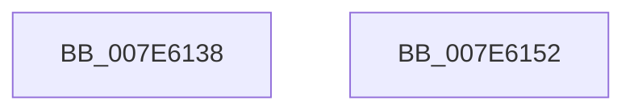

# CmpFlushTraceLoggingProvider

- RVA: `0x007E6138`–`0x007E6153` (길이 `27` bytes)
- VA: `0x00000001407E6138`
- 실행 섹션: `PAGE`
- PDB 이름 있음: `예`; PDB Function 태그: `아니요`
- unwind 정보 RVA: `0x0005C788`
- 디코드: `7`개 명령, `27/27` bytes 표시
- 미해석 바이트: `0` (있으면 어셈블리에 `.byte`로 보존)

> 이 문서는 커널 이미지의 기계어와 PDB 기호를 분석해 생성했습니다. 4번과 5번은 함수 원형과 자료형을 바이너리 사용 방식에서 추정한 C 해석이며 원본 소스 복구 결과는 아닙니다.

## 1. Dependencies

- 직접 호출 지점: **2**; 고유 호출 대상: **2**
- 직접 호출자로 확인된 함수: **1**
- RIP 상대 이미지 참조: **1**

### Outgoing calls
- `0x007E613C` → [CmpFlushUnsupportedOperationTelemetry](../AB/CmpFlushUnsupportedOperationTelemetry_function_00AB77B4.md) (function, `0x00AB77B4`)
- `0x007E6148` → [TlgAggregateFlush](../../text/6A/TlgAggregateFlush_function_006A5DCC.md) (function, `0x006A5DCC`)

### Direct callers
- [CmShutdownSystem2](../../text/66/CmShutdownSystem2_function_0066A7FC.md) at `0x0066A851`

### Static image references
- `0x007E6141` → RVA `0x00E09F58` (`.data`; read)

## 2. Other-region calls and transfers

- 다른 실행 섹션으로 향하는 call: **1**
  - `0x007E6148` → [TlgAggregateFlush](../../text/6A/TlgAggregateFlush_function_006A5DCC.md) (`PAGE` → `.text`)
- 별도 외부 분기/꼬리 이동을 확인하지 못했습니다.

## 3. Assembly (complete function range)

```asm
007E6138  48 83 EC 28                     sub rsp, 0x28
007E613C  E8 73 16 2D 00                  call 0x140ab77b4
007E6141  48 8D 0D 10 3E 62 00            lea rcx, [rip + 0x623e10]
007E6148  E8 7F FC EB FF                  call 0x1406a5dcc
007E614D  48 83 C4 28                     add rsp, 0x28
007E6151  C3                              ret
007E6152  CC                              int3
```

## 4. C-style interpretation (structured pseudocode)

```c
__int64 __fastcall CmpFlushTraceLoggingProvider(void)
{
    __int64 result;
    __int64 v_rsp;

    v_rsp = (v_rsp) - (40);
    result = CmpFlushUnsupportedOperationTelemetry(a1, a2, a3, a4);
    result = TlgAggregateFlush(v_rip + 6438416, a2, a3, a4);
    v_rsp = (v_rsp) + (40);
    return result;
}
```

## 5. (Beta) C Style

```c
void CmpFlushTraceLoggingProvider(void)
{
    int64_t result;
    int64_t local_rsp;

    local_rsp = (local_rsp) - (40);
    result = CmpFlushUnsupportedOperationTelemetry(a1, a2, a3, a4);
    result = TlgAggregateFlush(v_rip + 6438416, a2, a3, a4);
    local_rsp = (local_rsp) + (40);
    return result;
}
```

## 6. Execution-region graph

[열기: 2D/3D 그래프와 함수 탐색 컨트롤 패널](../../../control-panel.html?section=page&rva=0x007E6138&view=graph)

- 2D 그래프는 위에서 아래로 흐르고, 3D 그래프는 빈 공간을 드래그해 회전합니다. Shift+드래그는 이동, 휠은 확대·축소, 함수 노드 선택은 대상 보고서 이동입니다.

### Static fallback


