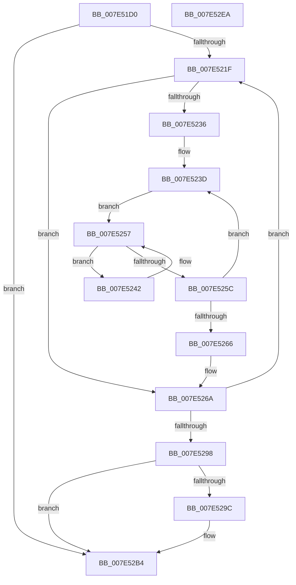

# CmpFreeAllMemory

- RVA: `0x007E51D0`–`0x007E52EB` (길이 `283` bytes)
- VA: `0x00000001407E51D0`
- 실행 섹션: `PAGE`
- PDB 이름 있음: `예`; PDB Function 태그: `아니요`
- unwind 정보 RVA: `0x000D6B3C`
- 디코드: `77`개 명령, `283/283` bytes 표시
- 미해석 바이트: `0` (있으면 어셈블리에 `.byte`로 보존)

> 이 문서는 커널 이미지의 기계어와 PDB 기호를 분석해 생성했습니다. 4번과 5번은 함수 원형과 자료형을 바이너리 사용 방식에서 추정한 C 해석이며 원본 소스 복구 결과는 아닙니다.

## 1. Dependencies

- 직접 호출 지점: **9**; 고유 호출 대상: **8**
- 직접 호출자로 확인된 함수: **1**
- RIP 상대 이미지 참조: **2**

### Outgoing calls
- `0x007E520E` → [CmpGetNextActiveHive](../84/CmpGetNextActiveHive_function_0084E2A0.md) (function, `0x0084E2A0`)
- `0x007E524E` → [CmpDumpKeyBodyList](CmpDumpKeyBodyList_function_007EAB20.md) (function, `0x007EAB20`)
- `0x007E5271` → [CmpAttachToRegistryProcess](../../pagecmrc/BC/CmpAttachToRegistryProcess_function_00BC98E0.md) (function, `0x00BC98E0`)
- `0x007E5279` → [CmpDestroyHive](../9B/CmpDestroyHive_function_009B1708.md) (function, `0x009B1708`)
- `0x007E5283` → [CmpDetachFromRegistryProcess](../../pagecmrc/BC/CmpDetachFromRegistryProcess_function_00BC9920.md) (function, `0x00BC9920`)
- `0x007E528B` → [CmpGetNextActiveHive](../84/CmpGetNextActiveHive_function_0084E2A0.md) (function, `0x0084E2A0`)
- `0x007E52AE` → [KeBugCheckEx](../../text/4F/KeBugCheckEx_function_004FD660.md) (function, `0x004FD660`)
- `0x007E52BD` → [ExFreePoolWithTag](../../poolcode/B8/ExFreePoolWithTag_function_00B82870.md) (function, `0x00B82870`)
- `0x007E52CA` → [_security_check_cookie](../../text/6A/_security_check_cookie_function_006AC640.md) (function, `0x006AC640`)

### Direct callers
- [CmShutdownSystem2](../../text/66/CmShutdownSystem2_function_0066A7FC.md) at `0x0066A91D`

### Static image references
- `0x007E51E9` → RVA `0x00E0A740` (`.data`; read)
- `0x007E52B4` → RVA `0x00EF5978` (`.data`; read)

## 2. Other-region calls and transfers

- 다른 실행 섹션으로 향하는 call: **5**
  - `0x007E5271` → [CmpAttachToRegistryProcess](../../pagecmrc/BC/CmpAttachToRegistryProcess_function_00BC98E0.md) (`PAGE` → `PAGECMRC`)
  - `0x007E5283` → [CmpDetachFromRegistryProcess](../../pagecmrc/BC/CmpDetachFromRegistryProcess_function_00BC9920.md) (`PAGE` → `PAGECMRC`)
  - `0x007E52AE` → [KeBugCheckEx](../../text/4F/KeBugCheckEx_function_004FD660.md) (`PAGE` → `.text`)
  - `0x007E52BD` → [ExFreePoolWithTag](../../poolcode/B8/ExFreePoolWithTag_function_00B82870.md) (`PAGE` → `POOLCODE`)
  - `0x007E52CA` → [_security_check_cookie](../../text/6A/_security_check_cookie_function_006AC640.md) (`PAGE` → `.text`)
- 별도 외부 분기/꼬리 이동을 확인하지 못했습니다.

## 3. Assembly (complete function range)

```asm
007E51D0  48 8B C4                        mov rax, rsp
007E51D3  48 89 58 08                     mov qword ptr [rax + 8], rbx
007E51D7  48 89 68 10                     mov qword ptr [rax + 0x10], rbp
007E51DB  48 89 70 18                     mov qword ptr [rax + 0x18], rsi
007E51DF  48 89 78 20                     mov qword ptr [rax + 0x20], rdi
007E51E3  41 56                           push r14
007E51E5  48 83 EC 70                     sub rsp, 0x70
007E51E9  48 8B 05 50 55 62 00            mov rax, qword ptr [rip + 0x625550]
007E51F0  48 33 C4                        xor rax, rsp
007E51F3  48 89 44 24 68                  mov qword ptr [rsp + 0x68], rax
007E51F8  0F 57 C0                        xorps xmm0, xmm0
007E51FB  33 C9                           xor ecx, ecx
007E51FD  0F 11 44 24 38                  movups xmmword ptr [rsp + 0x38], xmm0
007E5202  33 ED                           xor ebp, ebp
007E5204  0F 11 44 24 48                  movups xmmword ptr [rsp + 0x48], xmm0
007E5209  0F 11 44 24 58                  movups xmmword ptr [rsp + 0x58], xmm0
007E520E  E8 8D 90 06 00                  call 0x14084e2a0
007E5213  48 8B D8                        mov rbx, rax
007E5216  48 85 C0                        test rax, rax
007E5219  0F 84 95 00 00 00               je 0x1407e52b4
007E521F  8B 8B 78 06 00 00               mov ecx, dword ptr [rbx + 0x678]
007E5225  33 C0                           xor eax, eax
007E5227  48 8B B3 70 06 00 00            mov rsi, qword ptr [rbx + 0x670]
007E522E  89 44 24 30                     mov dword ptr [rsp + 0x30], eax
007E5232  85 C9                           test ecx, ecx
007E5234  7E 34                           jle 0x1407e526a
007E5236  48 83 C6 10                     add rsi, 0x10
007E523A  44 8B F1                        mov r14d, ecx
007E523D  48 8B 3E                        mov rdi, qword ptr [rsi]
007E5240  EB 15                           jmp 0x1407e5257
007E5242  48 8D 4F F0                     lea rcx, [rdi - 0x10]
007E5246  45 33 C0                        xor r8d, r8d
007E5249  48 8D 54 24 30                  lea rdx, [rsp + 0x30]
007E524E  E8 CD 58 00 00                  call 0x1407eab20
007E5253  48 8B 7F 08                     mov rdi, qword ptr [rdi + 8]
007E5257  48 85 FF                        test rdi, rdi
007E525A  75 E6                           jne 0x1407e5242
007E525C  48 83 C6 18                     add rsi, 0x18
007E5260  49 83 EE 01                     sub r14, 1
007E5264  75 D7                           jne 0x1407e523d
007E5266  8B 44 24 30                     mov eax, dword ptr [rsp + 0x30]
007E526A  48 8D 4C 24 38                  lea rcx, [rsp + 0x38]
007E526F  03 E8                           add ebp, eax
007E5271  E8 6A 46 3E 00                  call 0x140bc98e0
007E5276  48 8B CB                        mov rcx, rbx
007E5279  E8 8A C4 1C 00                  call 0x1409b1708
007E527E  48 8D 4C 24 38                  lea rcx, [rsp + 0x38]
007E5283  E8 98 46 3E 00                  call 0x140bc9920
007E5288  48 8B CB                        mov rcx, rbx
007E528B  E8 10 90 06 00                  call 0x14084e2a0
007E5290  48 8B D8                        mov rbx, rax
007E5293  48 85 C0                        test rax, rax
007E5296  75 87                           jne 0x1407e521f
007E5298  85 ED                           test ebp, ebp
007E529A  74 18                           je 0x1407e52b4
007E529C  48 21 44 24 20                  and qword ptr [rsp + 0x20], rax
007E52A1  8D 50 0F                        lea edx, [rax + 0xf]
007E52A4  44 8B CD                        mov r9d, ebp
007E52A7  8D 48 51                        lea ecx, [rax + 0x51]
007E52AA  44 8D 40 01                     lea r8d, [rax + 1]
007E52AE  E8 AD 83 D1 FF                  call 0x1404fd660
007E52B3  CC                              int3
007E52B4  48 8B 0D BD 06 71 00            mov rcx, qword ptr [rip + 0x7106bd]
007E52BB  33 D2                           xor edx, edx
007E52BD  E8 AE D5 39 00                  call 0x140b82870
007E52C2  48 8B 4C 24 68                  mov rcx, qword ptr [rsp + 0x68]
007E52C7  48 33 CC                        xor rcx, rsp
007E52CA  E8 71 73 EC FF                  call 0x1406ac640
007E52CF  4C 8D 5C 24 70                  lea r11, [rsp + 0x70]
007E52D4  49 8B 5B 10                     mov rbx, qword ptr [r11 + 0x10]
007E52D8  49 8B 6B 18                     mov rbp, qword ptr [r11 + 0x18]
007E52DC  49 8B 73 20                     mov rsi, qword ptr [r11 + 0x20]
007E52E0  49 8B 7B 28                     mov rdi, qword ptr [r11 + 0x28]
007E52E4  49 8B E3                        mov rsp, r11
007E52E7  41 5E                           pop r14
007E52E9  C3                              ret
007E52EA  CC                              int3
```

## 4. C-style interpretation (structured pseudocode)

```c
__int64 __fastcall CmpFreeAllMemory(int a1, __int64 a2, int a3)
{
    __int64 result;
    __int64 v_r14;
    __int64 v_rbp;
    __int64 v_rsi;
    __int64 v_rsp;
    unsigned __int64 v_stack_m10;
    unsigned __int64 v_stack_m20;
    unsigned __int64 v_stack_m30;
    unsigned __int64 v_stack_m40;
    unsigned int v_stack_m48;
    unsigned __int64 v_stack_m58;
    unsigned __int64 v_stack_m8;

    *(unsigned __int64 *)(v_rsp + 8) = v_rbx;
    *(unsigned __int64 *)(v_rsp + 16) = v_rbp;
    *(unsigned __int64 *)(v_rsp + 24) = v_rsi;
    *(unsigned __int64 *)(v_rsp + 32) = v_rdi;
    v_rsp = (v_rsp) - (112);
    result = (*(unsigned __int64 *)(v_rip + 6444368)) ^ (v_rsp);
    v_stack_m10 = result;
    a1 = 0;
    v_stack_m40 = v_xmm0;
    v_rbp = 0;
    v_stack_m30 = v_xmm0;
    v_stack_m20 = v_xmm0;
    result = CmpGetNextActiveHive(a1, a2, a3, a4);
    if (result == 0) goto loc_007E52B4;
loc_007E521F:
    result = 0;
    v_stack_m48 = 0;
    if (condition_is_less_or_equal) goto loc_007E526A;
    v_rsi = (*(unsigned __int64 *)(result + 1648)) + (16);
loc_007E523D:
    goto loc_007E5257;
loc_007E5242:
    a3 = 0;
    result = CmpDumpKeyBodyList(*(unsigned __int64 *)(v_rsi) - 16, v_stack_m48, a3, a4);
loc_007E5257:
    if (*(unsigned __int64 *)(*(unsigned __int64 *)(v_rsi) + 8) != 0) goto loc_007E5242;
    v_rsi = (v_rsi) + (24);
    v_r14 = ((unsigned int)((unsigned int)((unsigned int)(*(unsigned int *)(result + 1656))))) - (1);
    if (condition_is_not_equal) goto loc_007E523D;
loc_007E526A:
    v_rbp = (unsigned int)((v_rbp) + ((unsigned int)((unsigned int)(v_stack_m48))));
    result = CmpAttachToRegistryProcess(v_stack_m40, v_stack_m48, a3, a4);
    result = CmpDestroyHive(result, v_stack_m48, a3, a4);
    result = CmpDetachFromRegistryProcess(v_stack_m40, v_stack_m48, a3, a4);
    result = CmpGetNextActiveHive(result, v_stack_m48, a3, a4);
    if (result != 0) goto loc_007E521F;
    if ((unsigned int)(v_rbp) != 0) {
        a2 = result + 15;
        a4 = (unsigned int)(v_rbp);
        a1 = result + 81;
        a3 = result + 1;
        result = KeBugCheckEx(a1, a2, a3, a4);
    }
    a2 = 0;
    result = ExFreePoolWithTag(*(unsigned __int64 *)(v_rip + 7407293), a2, a3, a4);
    a1 = (v_stack_m10) ^ (v_rsp);
    result = _security_check_cookie(a1, a2, a3, a4);
    return result;
}
```

## 5. (Beta) C Style

```c
int64_t CmpFreeAllMemory(int32_t Arg1, int64_t Arg2, int32_t Arg3)
{
    int64_t result;
    int64_t local_r14;
    int64_t local_rbp;
    int64_t local_rsi;
    int64_t local_rsp;
    uint64_t v_stack_m10;
    uint64_t v_stack_m20;
    uint64_t v_stack_m30;
    uint64_t v_stack_m40;
    uint32_t v_stack_m48;
    uint64_t v_stack_m58;
    uint64_t v_stack_m8;

    *(uint64_t *)(local_rsp + 0x8) = local_rbx;
    *(uint64_t *)(local_rsp + 0x10) = local_rbp;
    *(uint64_t *)(local_rsp + 0x18) = local_rsi;
    *(uint64_t *)(local_rsp + 0x20) = local_rdi;
    local_rsp = (local_rsp) - (112);
    result = (*(uint64_t *)(v_rip + 0x625550)) ^ (local_rsp);
    v_stack_m10 = result;
    Arg1 = 0;
    v_stack_m40 = v_xmm0;
    local_rbp = 0;
    v_stack_m30 = v_xmm0;
    v_stack_m20 = v_xmm0;
    result = CmpGetNextActiveHive(Arg1, Arg2, Arg3, a4);
    if (result == 0) goto loc_007E52B4;
loc_007E521F:
    result = 0;
    v_stack_m48 = 0;
    if (condition_is_less_or_equal) goto loc_007E526A;
    local_rsi = (*(uint64_t *)(result + 0x670)) + (16);
loc_007E523D:
    goto loc_007E5257;
loc_007E5242:
    Arg3 = 0;
    result = CmpDumpKeyBodyList(*(uint64_t *)(local_rsi) - 16, v_stack_m48, Arg3, a4);
loc_007E5257:
    if (*(uint64_t *)(*(uint64_t *)(local_rsi) + 0x8) != 0) goto loc_007E5242;
    local_rsi = (local_rsi) + (24);
    local_r14 = ((uint32_t)((uint32_t)((uint32_t)(*(uint32_t *)(result + 0x678))))) - (1);
    if (condition_is_not_equal) goto loc_007E523D;
loc_007E526A:
    local_rbp = (uint32_t)((local_rbp) + ((uint32_t)((uint32_t)(v_stack_m48))));
    result = CmpAttachToRegistryProcess(v_stack_m40, v_stack_m48, Arg3, a4);
    result = CmpDestroyHive(result, v_stack_m48, Arg3, a4);
    result = CmpDetachFromRegistryProcess(v_stack_m40, v_stack_m48, Arg3, a4);
    result = CmpGetNextActiveHive(result, v_stack_m48, Arg3, a4);
    if (result != 0) goto loc_007E521F;
    if ((uint32_t)(local_rbp) != 0) {
        Arg2 = result + 15;
        a4 = (uint32_t)(local_rbp);
        Arg1 = result + 81;
        Arg3 = result + 1;
        result = KeBugCheckEx(Arg1, Arg2, Arg3, a4);
    }
    Arg2 = 0;
    result = ExFreePoolWithTag(*(uint64_t *)(v_rip + 0x7106BD), Arg2, Arg3, a4);
    Arg1 = (v_stack_m10) ^ (local_rsp);
    result = _security_check_cookie(Arg1, Arg2, Arg3, a4);
    return result;
}
```

## 6. Execution-region graph

[열기: 2D/3D 그래프와 함수 탐색 컨트롤 패널](../../../control-panel.html?section=page&rva=0x007E51D0&view=graph)

- 2D 그래프는 위에서 아래로 흐르고, 3D 그래프는 빈 공간을 드래그해 회전합니다. Shift+드래그는 이동, 휠은 확대·축소, 함수 노드 선택은 대상 보고서 이동입니다.

### Static fallback


