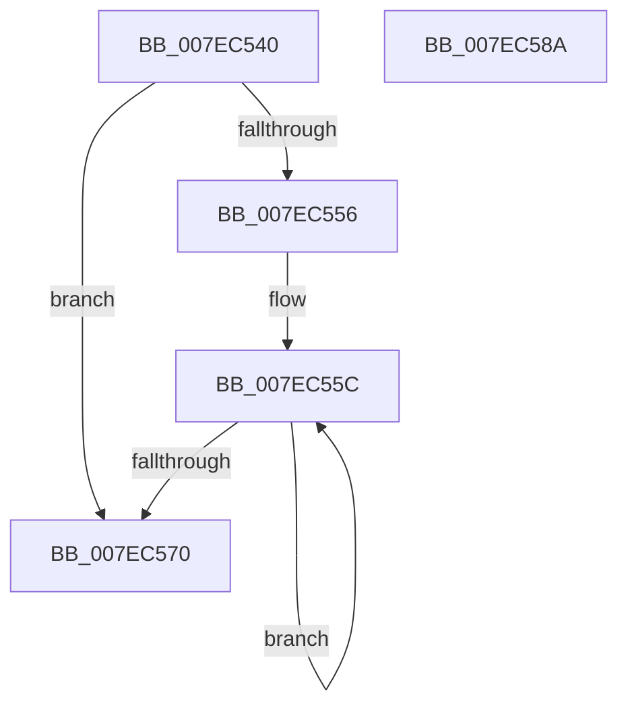

# CmpFreeOffsetArray

- RVA: `0x007EC540`–`0x007EC58B` (길이 `75` bytes)
- VA: `0x00000001407EC540`
- 실행 섹션: `PAGE`
- PDB 이름 있음: `예`; PDB Function 태그: `아니요`
- unwind 정보 RVA: `0x00060BC4`
- 디코드: `24`개 명령, `75/75` bytes 표시
- 미해석 바이트: `0` (있으면 어셈블리에 `.byte`로 보존)

> 이 문서는 커널 이미지의 기계어와 PDB 기호를 분석해 생성했습니다. 4번과 5번은 함수 원형과 자료형을 바이너리 사용 방식에서 추정한 C 해석이며 원본 소스 복구 결과는 아닙니다.

## 1. Dependencies

- 직접 호출 지점: **2**; 고유 호출 대상: **1**
- 직접 호출자로 확인된 함수: **2**
- RIP 상대 이미지 참조: **0**

### Outgoing calls
- `0x007EC561` → [ExFreePoolWithTag](../../poolcode/B8/ExFreePoolWithTag_function_00B82870.md) (function, `0x00B82870`)
- `0x007EC575` → [ExFreePoolWithTag](../../poolcode/B8/ExFreePoolWithTag_function_00B82870.md) (function, `0x00B82870`)

### Direct callers
- [CmDumpKeyToFile](../7D/CmDumpKeyToFile_function_007DCD64.md) at `0x007DCEBD`
- [CmpFlushBackupHive](CmpFlushBackupHive_function_007EC1A8.md) at `0x007EC3A6`

### Static image references
- 디코드된 RIP-relative 메모리 참조가 없습니다.

## 2. Other-region calls and transfers

- 다른 실행 섹션으로 향하는 call: **2**
  - `0x007EC561` → [ExFreePoolWithTag](../../poolcode/B8/ExFreePoolWithTag_function_00B82870.md) (`PAGE` → `POOLCODE`)
  - `0x007EC575` → [ExFreePoolWithTag](../../poolcode/B8/ExFreePoolWithTag_function_00B82870.md) (`PAGE` → `POOLCODE`)
- 별도 외부 분기/꼬리 이동을 확인하지 못했습니다.

## 3. Assembly (complete function range)

```asm
007EC540  48 89 5C 24 08                  mov qword ptr [rsp + 8], rbx
007EC545  48 89 74 24 10                  mov qword ptr [rsp + 0x10], rsi
007EC54A  57                              push rdi
007EC54B  48 83 EC 20                     sub rsp, 0x20
007EC54F  48 8B FA                        mov rdi, rdx
007EC552  85 C9                           test ecx, ecx
007EC554  74 1A                           je 0x1407ec570
007EC556  48 8D 5A 08                     lea rbx, [rdx + 8]
007EC55A  8B F1                           mov esi, ecx
007EC55C  48 8B 0B                        mov rcx, qword ptr [rbx]
007EC55F  33 D2                           xor edx, edx
007EC561  E8 0A 63 39 00                  call 0x140b82870
007EC566  48 8D 5B 18                     lea rbx, [rbx + 0x18]
007EC56A  48 83 EE 01                     sub rsi, 1
007EC56E  75 EC                           jne 0x1407ec55c
007EC570  33 D2                           xor edx, edx
007EC572  48 8B CF                        mov rcx, rdi
007EC575  E8 F6 62 39 00                  call 0x140b82870
007EC57A  48 8B 5C 24 30                  mov rbx, qword ptr [rsp + 0x30]
007EC57F  48 8B 74 24 38                  mov rsi, qword ptr [rsp + 0x38]
007EC584  48 83 C4 20                     add rsp, 0x20
007EC588  5F                              pop rdi
007EC589  C3                              ret
007EC58A  CC                              int3
```

## 4. C-style interpretation (structured pseudocode)

```c
__int64 __fastcall CmpFreeOffsetArray(int a1, __int64 a2)
{
    __int64 result;
    __int64 v_rsi;
    __int64 v_rsp;
    unsigned __int64 v_stack_p10;
    unsigned __int64 v_stack_p8;

    v_stack_p8 = v_rbx;
    v_stack_p10 = v_rsi;
    v_rsp = (v_rsp) - (32);
    if (a1 == 0) goto loc_007EC570;
loc_007EC55C:
    a2 = 0;
    result = ExFreePoolWithTag(*(unsigned __int64 *)(a2 + 8), a2, a3, a4);
    v_rsi = ((unsigned int)(a1)) - (1);
    if (condition_is_not_equal) goto loc_007EC55C;
loc_007EC570:
    a2 = 0;
    result = ExFreePoolWithTag(0, a2, a3, a4);
    v_rsp = (v_rsp) + (32);
    return result;
}
```

## 5. (Beta) C Style

```c
int64_t CmpFreeOffsetArray(int32_t Arg1, void *Arg2)
{
    uint8_t *arg2 = (uint8_t *)Arg2;

    int64_t result;
    int64_t local_rsi;
    int64_t local_rsp;
    uint64_t v_stack_p10;
    uint64_t v_stack_p8;

    v_stack_p8 = local_rbx;
    v_stack_p10 = local_rsi;
    local_rsp = (local_rsp) - (32);
    if (Arg1 == 0) goto loc_007EC570;
loc_007EC55C:
    Arg2 = 0;
    result = ExFreePoolWithTag(*(uint64_t *)(arg2 + 0x8), Arg2, a3, a4);
    local_rsi = ((uint32_t)(Arg1)) - (1);
    if (condition_is_not_equal) goto loc_007EC55C;
loc_007EC570:
    Arg2 = 0;
    result = ExFreePoolWithTag(0, Arg2, a3, a4);
    local_rsp = (local_rsp) + (32);
    return result;
}
```

### 관측된 메모리 오프셋

구조체 형식이 확인되지 않은 접근은 인자 기준의 오프셋으로만 기록했습니다.

| 기준 인자 | 오프셋 표현 | 폭 (bit) | 접근 |
|---|---:|---:|---|
| `Arg2` | `+ 0x0` | `64` | `R` |
| `Arg2` | `+ 0x8` | `64` | `R` |
| `Arg2` | `+ 0x18` | `64` | `R` |

## 6. Execution-region graph

[열기: 2D/3D 그래프와 함수 탐색 컨트롤 패널](../../../control-panel.html?section=page&rva=0x007EC540&view=graph)

- 2D 그래프는 위에서 아래로 흐르고, 3D 그래프는 빈 공간을 드래그해 회전합니다. Shift+드래그는 이동, 휠은 확대·축소, 함수 노드 선택은 대상 보고서 이동입니다.

### Static fallback


