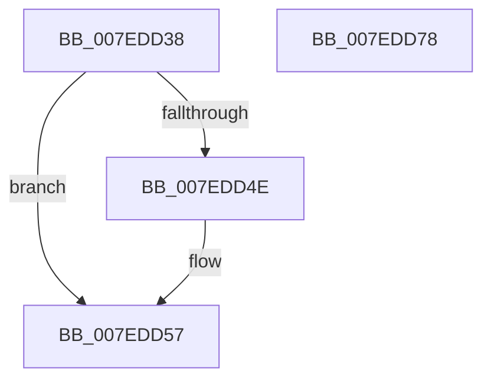

# CmpFreeSiloKeyLockEntry

- RVA: `0x007EDD38`–`0x007EDD79` (길이 `65` bytes)
- VA: `0x00000001407EDD38`
- 실행 섹션: `PAGE`
- PDB 이름 있음: `예`; PDB Function 태그: `아니요`
- unwind 정보 RVA: `0x0005CAAC`
- 디코드: `19`개 명령, `65/65` bytes 표시
- 미해석 바이트: `0` (있으면 어셈블리에 `.byte`로 보존)

> 이 문서는 커널 이미지의 기계어와 PDB 기호를 분석해 생성했습니다. 4번과 5번은 함수 원형과 자료형을 바이너리 사용 방식에서 추정한 C 해석이며 원본 소스 복구 결과는 아닙니다.

## 1. Dependencies

- 직접 호출 지점: **3**; 고유 호출 대상: **3**
- 직접 호출자로 확인된 함수: **2**
- RIP 상대 이미지 참조: **0**

### Outgoing calls
- `0x007EDD52` → [CmpGlobalUnlockKeyForWrite](CmpGlobalUnlockKeyForWrite_function_007EDD80.md) (function, `0x007EDD80`)
- `0x007EDD5B` → [CmpDereferenceKeyControlBlock](../85/CmpDereferenceKeyControlBlock_function_00851310.md) (function, `0x00851310`)
- `0x007EDD68` → [CmpFreePoolWithTag](../../text/44/CmpFreePoolWithTag_function_004489E0.md) (function, `0x004489E0`)

### Direct callers
- [CmpStopSiloKeyLockTracker](../9E/CmpStopSiloKeyLockTracker_function_009E7BF0.md) at `0x009E7C81`
- [CmLockKeyForWrite](../9E/CmLockKeyForWrite_function_009E7EE8.md) at `0x009E800D`

### Static image references
- 디코드된 RIP-relative 메모리 참조가 없습니다.

## 2. Other-region calls and transfers

- 다른 실행 섹션으로 향하는 call: **1**
  - `0x007EDD68` → [CmpFreePoolWithTag](../../text/44/CmpFreePoolWithTag_function_004489E0.md) (`PAGE` → `.text`)
- 별도 외부 분기/꼬리 이동을 확인하지 못했습니다.

## 3. Assembly (complete function range)

```asm
007EDD38  48 89 5C 24 08                  mov qword ptr [rsp + 8], rbx
007EDD3D  57                              push rdi
007EDD3E  48 83 EC 20                     sub rsp, 0x20
007EDD42  48 8B 51 18                     mov rdx, qword ptr [rcx + 0x18]
007EDD46  48 8B F9                        mov rdi, rcx
007EDD49  48 85 D2                        test rdx, rdx
007EDD4C  74 09                           je 0x1407edd57
007EDD4E  48 8B 49 10                     mov rcx, qword ptr [rcx + 0x10]
007EDD52  E8 29 00 00 00                  call 0x1407edd80
007EDD57  48 8B 4F 10                     mov rcx, qword ptr [rdi + 0x10]
007EDD5B  E8 B0 35 06 00                  call 0x140851310
007EDD60  BA 43 4D 37 34                  mov edx, 0x34374d43
007EDD65  48 8B CF                        mov rcx, rdi
007EDD68  E8 73 AC C5 FF                  call 0x1404489e0
007EDD6D  48 8B 5C 24 30                  mov rbx, qword ptr [rsp + 0x30]
007EDD72  48 83 C4 20                     add rsp, 0x20
007EDD76  5F                              pop rdi
007EDD77  C3                              ret
007EDD78  CC                              int3
```

## 4. C-style interpretation (structured pseudocode)

```c
__int64 __fastcall CmpFreeSiloKeyLockEntry(__int64 a1)
{
    __int64 result;
    __int64 v_rsp;
    unsigned __int64 v_stack_p8;

    v_stack_p8 = v_rbx;
    v_rsp = (v_rsp) - (32);
    if (*(unsigned __int64 *)(a1 + 24) != 0) {
        a1 = *(unsigned __int64 *)(a1 + 16);
        result = CmpGlobalUnlockKeyForWrite(a1, *(unsigned __int64 *)(a1 + 24), a3, a4);
    }
    result = CmpDereferenceKeyControlBlock(*(unsigned __int64 *)(a1 + 16), *(unsigned __int64 *)(a1 + 24), a3, a4);
    result = CmpFreePoolWithTag(a1, (unsigned int)(0x34374D43ULL), a3, a4);
    v_rsp = (v_rsp) + (32);
    return result;
}
```

## 5. (Beta) C Style

```c
int64_t CmpFreeSiloKeyLockEntry(void *Arg1)
{
    uint8_t *arg1 = (uint8_t *)Arg1;

    int64_t result;
    int64_t local_rsp;
    uint64_t v_stack_p8;

    v_stack_p8 = local_rbx;
    local_rsp = (local_rsp) - (32);
    if (*(uint64_t *)(arg1 + 0x18) != 0) {
        Arg1 = *(uint64_t *)(arg1 + 0x10);
        result = CmpGlobalUnlockKeyForWrite(Arg1, *(uint64_t *)(arg1 + 0x18), a3, a4);
    }
    result = CmpDereferenceKeyControlBlock(*(uint64_t *)(arg1 + 0x10), *(uint64_t *)(arg1 + 0x18), a3, a4);
    result = CmpFreePoolWithTag(Arg1, (uint32_t)(0x34374D43ULL), a3, a4);
    local_rsp = (local_rsp) + (32);
    return result;
}
```

### 관측된 메모리 오프셋

구조체 형식이 확인되지 않은 접근은 인자 기준의 오프셋으로만 기록했습니다.

| 기준 인자 | 오프셋 표현 | 폭 (bit) | 접근 |
|---|---:|---:|---|
| `Arg1` | `+ 0x10` | `64` | `R` |
| `Arg1` | `+ 0x18` | `64` | `R` |

## 6. Execution-region graph

[열기: 2D/3D 그래프와 함수 탐색 컨트롤 패널](../../../control-panel.html?section=page&rva=0x007EDD38&view=graph)

- 2D 그래프는 위에서 아래로 흐르고, 3D 그래프는 빈 공간을 드래그해 회전합니다. Shift+드래그는 이동, 휠은 확대·축소, 함수 노드 선택은 대상 보고서 이동입니다.

### Static fallback


