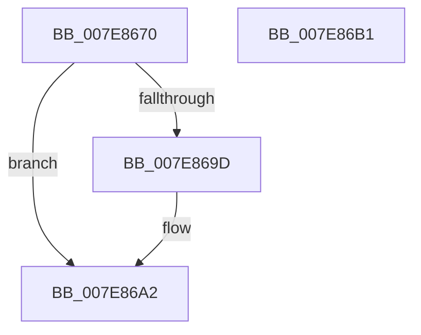

# CmpFreezeThawWorker

- RVA: `0x007E8670`–`0x007E86B2` (길이 `66` bytes)
- VA: `0x00000001407E8670`
- 실행 섹션: `PAGE`
- PDB 이름 있음: `예`; PDB Function 태그: `아니요`
- unwind 정보 RVA: `0x00063458`
- 디코드: `16`개 명령, `66/66` bytes 표시
- 미해석 바이트: `0` (있으면 어셈블리에 `.byte`로 보존)

> 이 문서는 커널 이미지의 기계어와 PDB 기호를 분석해 생성했습니다. 4번과 5번은 함수 원형과 자료형을 바이너리 사용 방식에서 추정한 C 해석이며 원본 소스 복구 결과는 아닙니다.

## 1. Dependencies

- 직접 호출 지점: **3**; 고유 호출 대상: **3**
- 직접 호출자로 확인된 함수: **0**
- RIP 상대 이미지 참조: **2**

### Outgoing calls
- `0x007E8688` → [CmpInitializeThreadInfo](../../text/3F/CmpInitializeThreadInfo_function_003FBE70.md) (function, `0x003FBE70`)
- `0x007E869D` → [CmThawRegistry](CmThawRegistry_function_007E8510.md) (function, `0x007E8510`)
- `0x007E86A7` → [CmCleanupThreadInfo](../../text/41/CmCleanupThreadInfo_function_0041FD50.md) (function, `0x0041FD50`)

### Direct callers
- 이 함수 시작 RVA로 연결되는 직접 call은 확인되지 않았습니다. 간접 호출은 완전히 역산할 수 없습니다.

### Static image references
- `0x007E868D` → RVA `0x00EEFBFC` (`.data`; read/write)
- `0x007E8694` → RVA `0x00EEFBF8` (`.data`; read)

## 2. Other-region calls and transfers

- 다른 실행 섹션으로 향하는 call: **2**
  - `0x007E8688` → [CmpInitializeThreadInfo](../../text/3F/CmpInitializeThreadInfo_function_003FBE70.md) (`PAGE` → `.text`)
  - `0x007E86A7` → [CmCleanupThreadInfo](../../text/41/CmCleanupThreadInfo_function_0041FD50.md) (`PAGE` → `.text`)
- 별도 외부 분기/꼬리 이동을 확인하지 못했습니다.

## 3. Assembly (complete function range)

```asm
007E8670  48 83 EC 48                     sub rsp, 0x48
007E8674  0F 57 C0                        xorps xmm0, xmm0
007E8677  48 8D 4C 24 20                  lea rcx, [rsp + 0x20]
007E867C  33 C0                           xor eax, eax
007E867E  0F 11 44 24 20                  movups xmmword ptr [rsp + 0x20], xmm0
007E8683  48 89 44 24 30                  mov qword ptr [rsp + 0x30], rax
007E8688  E8 E3 37 C1 FF                  call 0x1403fbe70
007E868D  83 25 68 75 70 00 00            and dword ptr [rip + 0x707568], 0
007E8694  83 3D 5D 75 70 00 01            cmp dword ptr [rip + 0x70755d], 1
007E869B  75 05                           jne 0x1407e86a2
007E869D  E8 6E FE FF FF                  call 0x1407e8510
007E86A2  48 8D 4C 24 20                  lea rcx, [rsp + 0x20]
007E86A7  E8 A4 76 C3 FF                  call 0x14041fd50
007E86AC  48 83 C4 48                     add rsp, 0x48
007E86B0  C3                              ret
007E86B1  CC                              int3
```

## 4. C-style interpretation (structured pseudocode)

```c
__int64 __fastcall CmpFreezeThawWorker(void)
{
    __int64 result;
    __int64 v_rsp;
    unsigned __int64 v_stack_m18;
    unsigned __int64 v_stack_m28;

    v_rsp = (v_rsp) - (72);
    result = 0;
    v_stack_m28 = v_xmm0;
    v_stack_m18 = 0;
    result = CmpInitializeThreadInfo(v_stack_m28, a2, a3, a4);
    if ((*(unsigned int *)(v_rip + 7370077)) == 1) {
        result = CmThawRegistry(v_stack_m28, a2, a3, a4);
    }
    result = CmCleanupThreadInfo(v_stack_m28, a2, a3, a4);
    v_rsp = (v_rsp) + (72);
    return result;
}
```

## 5. (Beta) C Style

```c
void CmpFreezeThawWorker(void)
{
    int64_t result;
    int64_t local_rsp;
    uint64_t v_stack_m18;
    uint64_t v_stack_m28;

    local_rsp = (local_rsp) - (72);
    result = 0;
    v_stack_m28 = v_xmm0;
    v_stack_m18 = 0;
    result = CmpInitializeThreadInfo(v_stack_m28, a2, a3, a4);
    if ((*(uint32_t *)(v_rip + 0x70755D)) == 1) {
        result = CmThawRegistry(v_stack_m28, a2, a3, a4);
    }
    result = CmCleanupThreadInfo(v_stack_m28, a2, a3, a4);
    local_rsp = (local_rsp) + (72);
    return result;
}
```

## 6. Execution-region graph

[열기: 2D/3D 그래프와 함수 탐색 컨트롤 패널](../../../control-panel.html?section=page&rva=0x007E8670&view=graph)

- 2D 그래프는 위에서 아래로 흐르고, 3D 그래프는 빈 공간을 드래그해 회전합니다. Shift+드래그는 이동, 휠은 확대·축소, 함수 노드 선택은 대상 보고서 이동입니다.

### Static fallback


