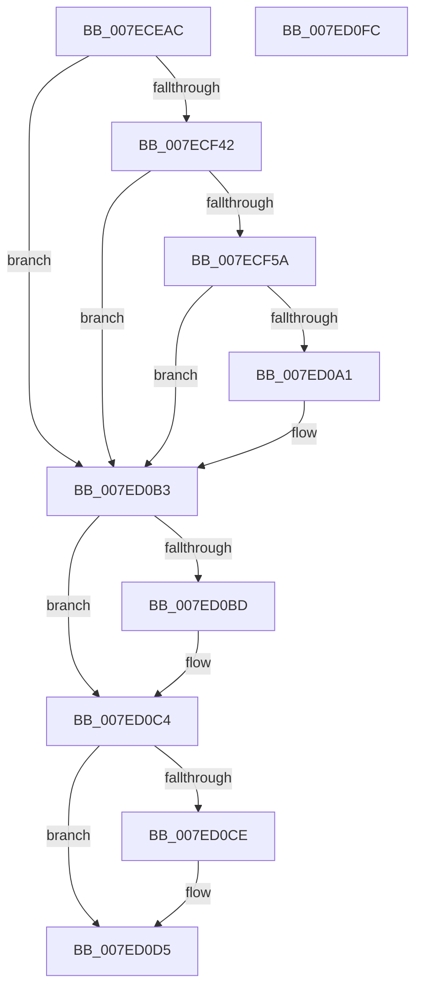

# CmpGenerateAppHiveSecurityDescriptor

- RVA: `0x007ECEAC`–`0x007ED0FD` (길이 `593` bytes)
- VA: `0x00000001407ECEAC`
- 실행 섹션: `PAGE`
- PDB 이름 있음: `예`; PDB Function 태그: `아니요`
- unwind 정보 RVA: `0x000D6F60`
- 디코드: `142`개 명령, `593/593` bytes 표시
- 미해석 바이트: `0` (있으면 어셈블리에 `.byte`로 보존)

> 이 문서는 커널 이미지의 기계어와 PDB 기호를 분석해 생성했습니다. 4번과 5번은 함수 원형과 자료형을 바이너리 사용 방식에서 추정한 C 해석이며 원본 소스 복구 결과는 아닙니다.

## 1. Dependencies

- 직접 호출 지점: **22**; 고유 호출 대상: **14**
- 직접 호출자로 확인된 함수: **1**
- RIP 상대 이미지 참조: **5**

### Outgoing calls
- `0x007ECEE7` → [memset](../../text/6C/memset_function_006C6C40.md) (function, `0x006C6C40`)
- `0x007ECF0B` → [memset](../../text/6C/memset_function_006C6C40.md) (function, `0x006C6C40`)
- `0x007ECF25` → [RtlCreateSecurityDescriptor](../9F/RtlCreateSecurityDescriptor_function_009F1DF0.md) (function, `0x009F1DF0`)
- `0x007ECF35` → [SeQueryInformationToken](../8B/SeQueryInformationToken_function_008B5090.md) (function, `0x008B5090`)
- `0x007ECF4D` → [SeQueryInformationToken](../8B/SeQueryInformationToken_function_008B5090.md) (function, `0x008B5090`)
- `0x007ECF6A` → [RtlCreateSecurityDescriptor](../9F/RtlCreateSecurityDescriptor_function_009F1DF0.md) (function, `0x009F1DF0`)
- `0x007ECF7F` → [RtlSetOwnerSecurityDescriptor](../91/RtlSetOwnerSecurityDescriptor_function_00916F90.md) (function, `0x00916F90`)
- `0x007ECF8F` → [RtlSetGroupSecurityDescriptor](../A2/RtlSetGroupSecurityDescriptor_function_00A2EB10.md) (function, `0x00A2EB10`)
- `0x007ECFA5` → [RtlCreateAcl](../91/RtlCreateAcl_function_00916F00.md) (function, `0x00916F00`)
- `0x007ECFCC` → [RtlpAddKnownAce](../92/RtlpAddKnownAce_function_00929A20.md) (function, `0x00929A20`)
- `0x007ECFEE` → [RtlpAddKnownAce](../92/RtlpAddKnownAce_function_00929A20.md) (function, `0x00929A20`)
- `0x007ED010` → [RtlpAddKnownAce](../92/RtlpAddKnownAce_function_00929A20.md) (function, `0x00929A20`)
- `0x007ED023` → [RtlSetDaclSecurityDescriptor](../9E/RtlSetDaclSecurityDescriptor_function_009EC210.md) (function, `0x009EC210`)
- `0x007ED033` → [RtlCreateAcl](../91/RtlCreateAcl_function_00916F00.md) (function, `0x00916F00`)
- `0x007ED056` → [RtlAddMandatoryAce](../92/RtlAddMandatoryAce_function_00929BA0.md) (function, `0x00929BA0`)
- `0x007ED06A` → [RtlSetSaclSecurityDescriptor](../A1/RtlSetSaclSecurityDescriptor_function_00A18B80.md) (function, `0x00A18B80`)
- `0x007ED080` → [RtlAbsoluteToSelfRelativeSD](../A1/RtlAbsoluteToSelfRelativeSD_function_00A119B0.md) (function, `0x00A119B0`)
- `0x007ED094` → [ExAllocatePool2](../../poolcode/B8/ExAllocatePool2_function_00B820F0.md) (function, `0x00B820F0`)
- `0x007ED0AE` → [RtlAbsoluteToSelfRelativeSD](../A1/RtlAbsoluteToSelfRelativeSD_function_00A119B0.md) (function, `0x00A119B0`)
- `0x007ED0BF` → [ExFreePoolWithTag](../../poolcode/B8/ExFreePoolWithTag_function_00B82870.md) (function, `0x00B82870`)
- `0x007ED0D0` → [ExFreePoolWithTag](../../poolcode/B8/ExFreePoolWithTag_function_00B82870.md) (function, `0x00B82870`)
- `0x007ED0E2` → [_security_check_cookie](../../text/6A/_security_check_cookie_function_006AC640.md) (function, `0x006AC640`)

### Direct callers
- [CmpCreateHiveRootCell](../AB/CmpCreateHiveRootCell_function_00ABF568.md) at `0x00ABF684`

### Static image references
- `0x007ECEC6` → RVA `0x00E0A740` (`.data`; read)
- `0x007ECFAA` → RVA `0x00E67D48` (`.data`; read)
- `0x007ECFD1` → RVA `0x00E67D60` (`.data`; read)
- `0x007ECFF3` → RVA `0x00FD9B10` (`PAGEDATA`; read)
- `0x007ED038` → RVA `0x00F05878` (`.data`; read)

## 2. Other-region calls and transfers

- 다른 실행 섹션으로 향하는 call: **6**
  - `0x007ECEE7` → [memset](../../text/6C/memset_function_006C6C40.md) (`PAGE` → `.text`)
  - `0x007ECF0B` → [memset](../../text/6C/memset_function_006C6C40.md) (`PAGE` → `.text`)
  - `0x007ED094` → [ExAllocatePool2](../../poolcode/B8/ExAllocatePool2_function_00B820F0.md) (`PAGE` → `POOLCODE`)
  - `0x007ED0BF` → [ExFreePoolWithTag](../../poolcode/B8/ExFreePoolWithTag_function_00B82870.md) (`PAGE` → `POOLCODE`)
  - `0x007ED0D0` → [ExFreePoolWithTag](../../poolcode/B8/ExFreePoolWithTag_function_00B82870.md) (`PAGE` → `POOLCODE`)
  - `0x007ED0E2` → [_security_check_cookie](../../text/6A/_security_check_cookie_function_006AC640.md) (`PAGE` → `.text`)
- 별도 외부 분기/꼬리 이동을 확인하지 못했습니다.

## 3. Assembly (complete function range)

```asm
007ECEAC  48 89 5C 24 10                  mov qword ptr [rsp + 0x10], rbx
007ECEB1  48 89 7C 24 18                  mov qword ptr [rsp + 0x18], rdi
007ECEB6  55                              push rbp
007ECEB7  48 8D AC 24 30 FF FF FF         lea rbp, [rsp - 0xd0]
007ECEBF  48 81 EC D0 01 00 00            sub rsp, 0x1d0
007ECEC6  48 8B 05 73 D8 61 00            mov rax, qword ptr [rip + 0x61d873]
007ECECD  48 33 C4                        xor rax, rsp
007ECED0  48 89 85 C0 00 00 00            mov qword ptr [rbp + 0xc0], rax
007ECED7  48 8B 59 10                     mov rbx, qword ptr [rcx + 0x10]
007ECEDB  33 D2                           xor edx, edx
007ECEDD  48 8D 4D D0                     lea rcx, [rbp - 0x30]
007ECEE1  41 B8 EC 00 00 00               mov r8d, 0xec
007ECEE7  E8 54 9D ED FF                  call 0x1406c6c40
007ECEEC  33 C0                           xor eax, eax
007ECEEE  48 8D 4C 24 70                  lea rcx, [rsp + 0x70]
007ECEF3  0F 57 C0                        xorps xmm0, xmm0
007ECEF6  48 89 44 24 68                  mov qword ptr [rsp + 0x68], rax
007ECEFB  33 D2                           xor edx, edx
007ECEFD  0F 11 44 24 48                  movups xmmword ptr [rsp + 0x48], xmm0
007ECF02  44 8D 40 54                     lea r8d, [rax + 0x54]
007ECF06  0F 11 44 24 58                  movups xmmword ptr [rsp + 0x58], xmm0
007ECF0B  E8 30 9D ED FF                  call 0x1406c6c40
007ECF10  48 83 64 24 38 00               and qword ptr [rsp + 0x38], 0
007ECF16  48 8D 4C 24 48                  lea rcx, [rsp + 0x48]
007ECF1B  33 FF                           xor edi, edi
007ECF1D  48 21 7C 24 40                  and qword ptr [rsp + 0x40], rdi
007ECF22  8D 57 01                        lea edx, [rdi + 1]
007ECF25  E8 C6 4E 20 00                  call 0x1409f1df0
007ECF2A  4C 8D 44 24 40                  lea r8, [rsp + 0x40]
007ECF2F  48 8B CB                        mov rcx, rbx
007ECF32  8D 57 04                        lea edx, [rdi + 4]
007ECF35  E8 56 81 0C 00                  call 0x1408b5090
007ECF3A  85 C0                           test eax, eax
007ECF3C  0F 88 71 01 00 00               js 0x1407ed0b3
007ECF42  4C 8D 44 24 38                  lea r8, [rsp + 0x38]
007ECF47  48 8B CB                        mov rcx, rbx
007ECF4A  8D 57 05                        lea edx, [rdi + 5]
007ECF4D  E8 3E 81 0C 00                  call 0x1408b5090
007ECF52  85 C0                           test eax, eax
007ECF54  0F 88 59 01 00 00               js 0x1407ed0b3
007ECF5A  48 8B 44 24 38                  mov rax, qword ptr [rsp + 0x38]
007ECF5F  8D 57 01                        lea edx, [rdi + 1]
007ECF62  48 8D 4C 24 48                  lea rcx, [rsp + 0x48]
007ECF67  48 8B 18                        mov rbx, qword ptr [rax]
007ECF6A  E8 81 4E 20 00                  call 0x1409f1df0
007ECF6F  48 8B 54 24 40                  mov rdx, qword ptr [rsp + 0x40]
007ECF74  48 8D 4C 24 48                  lea rcx, [rsp + 0x48]
007ECF79  45 33 C0                        xor r8d, r8d
007ECF7C  48 8B 12                        mov rdx, qword ptr [rdx]
007ECF7F  E8 0C A0 12 00                  call 0x140916f90
007ECF84  45 33 C0                        xor r8d, r8d
007ECF87  48 8D 4C 24 48                  lea rcx, [rsp + 0x48]
007ECF8C  48 8B D3                        mov rdx, rbx
007ECF8F  E8 7C 1B 24 00                  call 0x140a2eb10
007ECF94  BF 02 00 00 00                  mov edi, 2
007ECF99  48 8D 4D D0                     lea rcx, [rbp - 0x30]
007ECF9D  44 8B C7                        mov r8d, edi
007ECFA0  BA EC 00 00 00                  mov edx, 0xec
007ECFA5  E8 56 9F 12 00                  call 0x140916f00
007ECFAA  48 8B 05 97 AD 67 00            mov rax, qword ptr [rip + 0x67ad97]
007ECFB1  48 8D 4D D0                     lea rcx, [rbp - 0x30]
007ECFB5  BB 3F 00 0F 00                  mov ebx, 0xf003f
007ECFBA  C6 44 24 28 00                  mov byte ptr [rsp + 0x28], 0
007ECFBF  44 8B CB                        mov r9d, ebx
007ECFC2  48 89 44 24 20                  mov qword ptr [rsp + 0x20], rax
007ECFC7  44 8B C7                        mov r8d, edi
007ECFCA  8B D7                           mov edx, edi
007ECFCC  E8 4F CA 13 00                  call 0x140929a20
007ECFD1  48 8B 05 88 AD 67 00            mov rax, qword ptr [rip + 0x67ad88]
007ECFD8  48 8D 4D D0                     lea rcx, [rbp - 0x30]
007ECFDC  C6 44 24 28 00                  mov byte ptr [rsp + 0x28], 0
007ECFE1  44 8B CB                        mov r9d, ebx
007ECFE4  44 8B C7                        mov r8d, edi
007ECFE7  48 89 44 24 20                  mov qword ptr [rsp + 0x20], rax
007ECFEC  8B D7                           mov edx, edi
007ECFEE  E8 2D CA 13 00                  call 0x140929a20
007ECFF3  48 8B 05 16 CB 7E 00            mov rax, qword ptr [rip + 0x7ecb16]
007ECFFA  48 8D 4D D0                     lea rcx, [rbp - 0x30]
007ECFFE  C6 44 24 28 00                  mov byte ptr [rsp + 0x28], 0
007ED003  44 8B CB                        mov r9d, ebx
007ED006  44 8B C7                        mov r8d, edi
007ED009  48 89 44 24 20                  mov qword ptr [rsp + 0x20], rax
007ED00E  8B D7                           mov edx, edi
007ED010  E8 0B CA 13 00                  call 0x140929a20
007ED015  45 33 C9                        xor r9d, r9d
007ED018  4C 8D 45 D0                     lea r8, [rbp - 0x30]
007ED01C  B2 01                           mov dl, 1
007ED01E  48 8D 4C 24 48                  lea rcx, [rsp + 0x48]
007ED023  E8 E8 F1 1F 00                  call 0x1409ec210
007ED028  44 8B C7                        mov r8d, edi
007ED02B  8D 57 52                        lea edx, [rdi + 0x52]
007ED02E  48 8D 4C 24 70                  lea rcx, [rsp + 0x70]
007ED033  E8 C8 9E 12 00                  call 0x140916f00
007ED038  4C 8B 0D 39 88 71 00            mov r9, qword ptr [rip + 0x718839]
007ED03F  48 8D 4C 24 70                  lea rcx, [rsp + 0x70]
007ED044  45 33 C0                        xor r8d, r8d
007ED047  C7 44 24 28 01 00 00 00         mov dword ptr [rsp + 0x28], 1
007ED04F  8B D7                           mov edx, edi
007ED051  C6 44 24 20 11                  mov byte ptr [rsp + 0x20], 0x11
007ED056  E8 45 CB 13 00                  call 0x140929ba0
007ED05B  45 33 C9                        xor r9d, r9d
007ED05E  4C 8D 44 24 70                  lea r8, [rsp + 0x70]
007ED063  B2 01                           mov dl, 1
007ED065  48 8D 4C 24 48                  lea rcx, [rsp + 0x48]
007ED06A  E8 11 BB 22 00                  call 0x140a18b80
007ED06F  83 64 24 30 00                  and dword ptr [rsp + 0x30], 0
007ED074  4C 8D 44 24 30                  lea r8, [rsp + 0x30]
007ED079  33 D2                           xor edx, edx
007ED07B  48 8D 4C 24 48                  lea rcx, [rsp + 0x48]
007ED080  E8 2B 49 22 00                  call 0x140a119b0
007ED085  8B 54 24 30                     mov edx, dword ptr [rsp + 0x30]
007ED089  B9 00 01 00 00                  mov ecx, 0x100
007ED08E  41 B8 43 6D 53 65               mov r8d, 0x65536d43
007ED094  E8 57 50 39 00                  call 0x140b820f0
007ED099  48 8B F8                        mov rdi, rax
007ED09C  48 85 C0                        test rax, rax
007ED09F  74 12                           je 0x1407ed0b3
007ED0A1  4C 8D 44 24 30                  lea r8, [rsp + 0x30]
007ED0A6  48 8B D0                        mov rdx, rax
007ED0A9  48 8D 4C 24 48                  lea rcx, [rsp + 0x48]
007ED0AE  E8 FD 48 22 00                  call 0x140a119b0
007ED0B3  48 8B 4C 24 38                  mov rcx, qword ptr [rsp + 0x38]
007ED0B8  48 85 C9                        test rcx, rcx
007ED0BB  74 07                           je 0x1407ed0c4
007ED0BD  33 D2                           xor edx, edx
007ED0BF  E8 AC 57 39 00                  call 0x140b82870
007ED0C4  48 8B 4C 24 40                  mov rcx, qword ptr [rsp + 0x40]
007ED0C9  48 85 C9                        test rcx, rcx
007ED0CC  74 07                           je 0x1407ed0d5
007ED0CE  33 D2                           xor edx, edx
007ED0D0  E8 9B 57 39 00                  call 0x140b82870
007ED0D5  48 8B C7                        mov rax, rdi
007ED0D8  48 8B 8D C0 00 00 00            mov rcx, qword ptr [rbp + 0xc0]
007ED0DF  48 33 CC                        xor rcx, rsp
007ED0E2  E8 59 F5 EB FF                  call 0x1406ac640
007ED0E7  4C 8D 9C 24 D0 01 00 00         lea r11, [rsp + 0x1d0]
007ED0EF  49 8B 5B 18                     mov rbx, qword ptr [r11 + 0x18]
007ED0F3  49 8B 7B 20                     mov rdi, qword ptr [r11 + 0x20]
007ED0F7  49 8B E3                        mov rsp, r11
007ED0FA  5D                              pop rbp
007ED0FB  C3                              ret
007ED0FC  CC                              int3
```

## 4. C-style interpretation (structured pseudocode)

```c
__int64 __fastcall CmpGenerateAppHiveSecurityDescriptor(__int64 a1, int a2)
{
    __int64 result;
    __int64 v_rdi;
    __int64 v_rsp;
    unsigned __int64 v_stack_m108;
    unsigned __int64 v_stack_m168;
    unsigned __int64 v_stack_m170;
    unsigned __int64 v_stack_m18;
    unsigned __int64 v_stack_m180;
    unsigned __int64 v_stack_m190;
    unsigned __int64 v_stack_m198;
    unsigned __int64 v_stack_m1A0;
    unsigned int v_stack_m1A8;
    unsigned __int8 v_stack_m1B0;
    unsigned __int64 v_stack_m1B8;
    unsigned __int64 v_stack_m8;
    unsigned __int64 v_stack_mD8;
    unsigned __int64 v_stack_p10;
    unsigned __int64 v_stack_p18;

    v_stack_p10 = v_rbx;
    v_stack_p18 = v_rdi;
    v_rsp = (v_rsp) - (464);
    result = (*(unsigned __int64 *)(v_rip + 6412403)) ^ (v_rsp);
    v_stack_m18 = result;
    a2 = 0;
    result = memset(v_stack_m108, a2, 236, a4);
    result = 0;
    v_stack_m170 = 0;
    a2 = 0;
    v_stack_m190 = v_xmm0;
    v_stack_m180 = v_xmm0;
    result = memset(v_stack_m168, a2, result + 84, a4);
    v_rdi = 0;
    result = RtlCreateSecurityDescriptor(v_stack_m190, v_rdi + 1, result + 84, a4);
    result = SeQueryInformationToken(*(unsigned __int64 *)(a1 + 16), v_rdi + 4, v_stack_m198, a4);
    if (sign_flag) goto loc_007ED0B3;
    result = SeQueryInformationToken(*(unsigned __int64 *)(a1 + 16), v_rdi + 5, v_stack_m1A0, a4);
    if (sign_flag) goto loc_007ED0B3;
    result = RtlCreateSecurityDescriptor(v_stack_m190, v_rdi + 1, v_stack_m1A0, a4);
    a3 = 0;
    result = RtlSetOwnerSecurityDescriptor(v_stack_m190, *(unsigned __int64 *)(v_stack_m198), a3, a4);
    a3 = 0;
    result = RtlSetGroupSecurityDescriptor(v_stack_m190, *(unsigned __int64 *)(v_stack_m1A0), a3, a4);
    result = RtlCreateAcl(v_stack_m108, 236, 2, a4);
    v_stack_m1B0 = 0;
    v_stack_m1B8 = *(unsigned __int64 *)(v_rip + 6794647);
    result = RtlpAddKnownAce(v_stack_m108, 2, 2, (unsigned int)((unsigned int)((unsigned int)(0xF003FULL))));
    v_stack_m1B0 = 0;
    v_stack_m1B8 = *(unsigned __int64 *)(v_rip + 6794632);
    result = RtlpAddKnownAce(v_stack_m108, 2, 2, (unsigned int)((unsigned int)((unsigned int)(0xF003FULL))));
    v_stack_m1B0 = 0;
    v_stack_m1B8 = *(unsigned __int64 *)(v_rip + 8309526);
    result = RtlpAddKnownAce(v_stack_m108, 2, 2, (unsigned int)((unsigned int)((unsigned int)(0xF003FULL))));
    a4 = 0;
    result = RtlSetDaclSecurityDescriptor(v_stack_m190, 1, v_stack_m108, a4);
    result = RtlCreateAcl(v_stack_m168, 2 + 82, 2, a4);
    a3 = 0;
    v_stack_m1B0 = 1;
    v_stack_m1B8 = 17;
    result = RtlAddMandatoryAce(v_stack_m168, 2, a3, *(unsigned __int64 *)(v_rip + 7440441));
    a4 = 0;
    result = RtlSetSaclSecurityDescriptor(v_stack_m190, 1, v_stack_m168, a4);
    a2 = 0;
    result = RtlAbsoluteToSelfRelativeSD(v_stack_m190, a2, v_stack_m1A8, a4);
    result = ExAllocatePool2(256, (unsigned int)(v_stack_m1A8), (unsigned int)(0x65536D43ULL), a4);
    if (result != 0) {
        a3 = v_stack_m1A8;
        a2 = result;
        a1 = v_stack_m190;
        result = RtlAbsoluteToSelfRelativeSD(a1, a2, a3, a4);
    }
    if (v_stack_m1A0 != 0) {
        a2 = 0;
        result = ExFreePoolWithTag(v_stack_m1A0, a2, a3, a4);
    }
    if (v_stack_m198 != 0) {
        a2 = 0;
        result = ExFreePoolWithTag(v_stack_m198, a2, a3, a4);
    }
    a1 = (v_stack_m18) ^ (v_rsp);
    result = _security_check_cookie(a1, a2, a3, a4);
    return result;
}
```

## 5. (Beta) C Style

```c
int64_t CmpGenerateAppHiveSecurityDescriptor(void *Arg1, int32_t Arg2)
{
    uint8_t *arg1 = (uint8_t *)Arg1;

    int64_t result;
    int64_t local_rdi;
    int64_t local_rsp;
    uint64_t v_stack_m108;
    uint64_t v_stack_m168;
    uint64_t v_stack_m170;
    uint64_t v_stack_m18;
    uint64_t v_stack_m180;
    uint64_t v_stack_m190;
    uint64_t v_stack_m198;
    uint64_t v_stack_m1A0;
    uint32_t v_stack_m1A8;
    uint8_t v_stack_m1B0;
    uint64_t v_stack_m1B8;
    uint64_t v_stack_m8;
    uint64_t v_stack_mD8;
    uint64_t v_stack_p10;
    uint64_t v_stack_p18;

    v_stack_p10 = local_rbx;
    v_stack_p18 = local_rdi;
    local_rsp = (local_rsp) - (464);
    result = (*(uint64_t *)(v_rip + 0x61D873)) ^ (local_rsp);
    v_stack_m18 = result;
    Arg2 = 0;
    result = memset(v_stack_m108, Arg2, 236, a4);
    result = 0;
    v_stack_m170 = 0;
    Arg2 = 0;
    v_stack_m190 = v_xmm0;
    v_stack_m180 = v_xmm0;
    result = memset(v_stack_m168, Arg2, result + 84, a4);
    local_rdi = 0;
    result = RtlCreateSecurityDescriptor(v_stack_m190, local_rdi + 1, result + 84, a4);
    result = SeQueryInformationToken(*(uint64_t *)(arg1 + 0x10), local_rdi + 4, v_stack_m198, a4);
    if (sign_flag) goto loc_007ED0B3;
    result = SeQueryInformationToken(*(uint64_t *)(arg1 + 0x10), local_rdi + 5, v_stack_m1A0, a4);
    if (sign_flag) goto loc_007ED0B3;
    result = RtlCreateSecurityDescriptor(v_stack_m190, local_rdi + 1, v_stack_m1A0, a4);
    a3 = 0;
    result = RtlSetOwnerSecurityDescriptor(v_stack_m190, *(uint64_t *)(v_stack_m198), a3, a4);
    a3 = 0;
    result = RtlSetGroupSecurityDescriptor(v_stack_m190, *(uint64_t *)(v_stack_m1A0), a3, a4);
    result = RtlCreateAcl(v_stack_m108, 236, 2, a4);
    v_stack_m1B0 = 0;
    v_stack_m1B8 = *(uint64_t *)(v_rip + 0x67AD97);
    result = RtlpAddKnownAce(v_stack_m108, 2, 2, (uint32_t)((uint32_t)((uint32_t)(0xF003FULL))));
    v_stack_m1B0 = 0;
    v_stack_m1B8 = *(uint64_t *)(v_rip + 0x67AD88);
    result = RtlpAddKnownAce(v_stack_m108, 2, 2, (uint32_t)((uint32_t)((uint32_t)(0xF003FULL))));
    v_stack_m1B0 = 0;
    v_stack_m1B8 = *(uint64_t *)(v_rip + 0x7ECB16);
    result = RtlpAddKnownAce(v_stack_m108, 2, 2, (uint32_t)((uint32_t)((uint32_t)(0xF003FULL))));
    a4 = 0;
    result = RtlSetDaclSecurityDescriptor(v_stack_m190, 1, v_stack_m108, a4);
    result = RtlCreateAcl(v_stack_m168, 2 + 82, 2, a4);
    a3 = 0;
    v_stack_m1B0 = 1;
    v_stack_m1B8 = 17;
    result = RtlAddMandatoryAce(v_stack_m168, 2, a3, *(uint64_t *)(v_rip + 0x718839));
    a4 = 0;
    result = RtlSetSaclSecurityDescriptor(v_stack_m190, 1, v_stack_m168, a4);
    Arg2 = 0;
    result = RtlAbsoluteToSelfRelativeSD(v_stack_m190, Arg2, v_stack_m1A8, a4);
    result = ExAllocatePool2(256, (uint32_t)(v_stack_m1A8), (uint32_t)(0x65536D43ULL), a4);
    if (result != 0) {
        a3 = v_stack_m1A8;
        Arg2 = result;
        Arg1 = v_stack_m190;
        result = RtlAbsoluteToSelfRelativeSD(Arg1, Arg2, a3, a4);
    }
    if (v_stack_m1A0 != 0) {
        Arg2 = 0;
        result = ExFreePoolWithTag(v_stack_m1A0, Arg2, a3, a4);
    }
    if (v_stack_m198 != 0) {
        Arg2 = 0;
        result = ExFreePoolWithTag(v_stack_m198, Arg2, a3, a4);
    }
    Arg1 = (v_stack_m18) ^ (local_rsp);
    result = _security_check_cookie(Arg1, Arg2, a3, a4);
    return result;
}
```

### 관측된 메모리 오프셋

구조체 형식이 확인되지 않은 접근은 인자 기준의 오프셋으로만 기록했습니다.

| 기준 인자 | 오프셋 표현 | 폭 (bit) | 접근 |
|---|---:|---:|---|
| `Arg1` | `+ 0x10` | `64` | `R` |

## 6. Execution-region graph

[열기: 2D/3D 그래프와 함수 탐색 컨트롤 패널](../../../control-panel.html?section=page&rva=0x007ECEAC&view=graph)

- 2D 그래프는 위에서 아래로 흐르고, 3D 그래프는 빈 공간을 드래그해 회전합니다. Shift+드래그는 이동, 휠은 확대·축소, 함수 노드 선택은 대상 보고서 이동입니다.

### Static fallback


