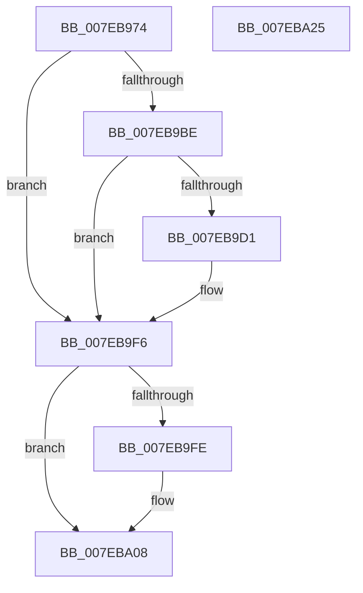

# CmpGetVirtualStoreRoot

- RVA: `0x007EB974`–`0x007EBA26` (길이 `178` bytes)
- VA: `0x00000001407EB974`
- 실행 섹션: `PAGE`
- PDB 이름 있음: `예`; PDB Function 태그: `아니요`
- unwind 정보 RVA: `0x000BDE90`
- 디코드: `52`개 명령, `178/178` bytes 표시
- 미해석 바이트: `0` (있으면 어셈블리에 `.byte`로 보존)

> 이 문서는 커널 이미지의 기계어와 PDB 기호를 분석해 생성했습니다. 4번과 5번은 함수 원형과 자료형을 바이너리 사용 방식에서 추정한 C 해석이며 원본 소스 복구 결과는 아닙니다.

## 1. Dependencies

- 직접 호출 지점: **6**; 고유 호출 대상: **6**
- 직접 호출자로 확인된 함수: **1**
- RIP 상대 이미지 참조: **0**

### Outgoing calls
- `0x007EB9A6` → [RtlInitUnicodeString](../../text/42/RtlInitUnicodeString_function_0042A780.md) (function, `0x0042A780`)
- `0x007EB9B3` → [CmpGetVirtualizationID](../99/CmpGetVirtualizationID_function_00990338.md) (function, `0x00990338`)
- `0x007EB9C6` → [CmpGetMappingHiveForString](../84/CmpGetMappingHiveForString_function_0084A5C8.md) (function, `0x0084A5C8`)
- `0x007EB9E0` → [CmpFindKcbInHashEntryByCellIndex](CmpFindKcbInHashEntryByCellIndex_function_007EAD94.md) (function, `0x007EAD94`)
- `0x007EB9EB` → [CmpReferenceKeyControlBlock](../85/CmpReferenceKeyControlBlock_function_0085D370.md) (function, `0x0085D370`)
- `0x007EBA03` → [RtlFreeAnsiString](../9C/RtlFreeAnsiString_function_009C0800.md) (function, `0x009C0800`)

### Direct callers
- [CmpReplicateKeyToVirtual](CmpReplicateKeyToVirtual_function_007EBAEC.md) at `0x007EBC36`

### Static image references
- 디코드된 RIP-relative 메모리 참조가 없습니다.

## 2. Other-region calls and transfers

- 다른 실행 섹션으로 향하는 call: **1**
  - `0x007EB9A6` → [RtlInitUnicodeString](../../text/42/RtlInitUnicodeString_function_0042A780.md) (`PAGE` → `.text`)
- 별도 외부 분기/꼬리 이동을 확인하지 못했습니다.

## 3. Assembly (complete function range)

```asm
007EB974  48 8B C4                        mov rax, rsp
007EB977  48 89 58 08                     mov qword ptr [rax + 8], rbx
007EB97B  48 89 70 10                     mov qword ptr [rax + 0x10], rsi
007EB97F  48 89 78 18                     mov qword ptr [rax + 0x18], rdi
007EB983  4C 89 70 20                     mov qword ptr [rax + 0x20], r14
007EB987  41 57                           push r15
007EB989  48 83 EC 30                     sub rsp, 0x30
007EB98D  48 8B FA                        mov rdi, rdx
007EB990  48 8B D9                        mov rbx, rcx
007EB993  0F 57 C0                        xorps xmm0, xmm0
007EB996  48 8D 48 E8                     lea rcx, [rax - 0x18]
007EB99A  33 D2                           xor edx, edx
007EB99C  4D 8B F1                        mov r14, r9
007EB99F  0F 11 40 E8                     movups xmmword ptr [rax - 0x18], xmm0
007EB9A3  4D 8B F8                        mov r15, r8
007EB9A6  E8 D5 ED C3 FF                  call 0x14042a780
007EB9AB  48 8B D3                        mov rdx, rbx
007EB9AE  48 8D 4C 24 20                  lea rcx, [rsp + 0x20]
007EB9B3  E8 80 49 1A 00                  call 0x140990338
007EB9B8  8B F0                           mov esi, eax
007EB9BA  85 C0                           test eax, eax
007EB9BC  78 38                           js 0x1407eb9f6
007EB9BE  48 8B D7                        mov rdx, rdi
007EB9C1  48 8D 4C 24 20                  lea rcx, [rsp + 0x20]
007EB9C6  E8 FD EB 05 00                  call 0x14084a5c8
007EB9CB  8B F0                           mov esi, eax
007EB9CD  85 C0                           test eax, eax
007EB9CF  78 25                           js 0x1407eb9f6
007EB9D1  48 8B 0F                        mov rcx, qword ptr [rdi]
007EB9D4  33 D2                           xor edx, edx
007EB9D6  48 8B 41 40                     mov rax, qword ptr [rcx + 0x40]
007EB9DA  8B 78 24                        mov edi, dword ptr [rax + 0x24]
007EB9DD  44 8B C7                        mov r8d, edi
007EB9E0  E8 AF F3 FF FF                  call 0x1407ead94
007EB9E5  48 8B C8                        mov rcx, rax
007EB9E8  48 8B D8                        mov rbx, rax
007EB9EB  E8 80 19 07 00                  call 0x14085d370
007EB9F0  41 89 3F                        mov dword ptr [r15], edi
007EB9F3  49 89 1E                        mov qword ptr [r14], rbx
007EB9F6  48 83 7C 24 28 00               cmp qword ptr [rsp + 0x28], 0
007EB9FC  74 0A                           je 0x1407eba08
007EB9FE  48 8D 4C 24 20                  lea rcx, [rsp + 0x20]
007EBA03  E8 F8 4D 1D 00                  call 0x1409c0800
007EBA08  48 8B 5C 24 40                  mov rbx, qword ptr [rsp + 0x40]
007EBA0D  8B C6                           mov eax, esi
007EBA0F  48 8B 74 24 48                  mov rsi, qword ptr [rsp + 0x48]
007EBA14  48 8B 7C 24 50                  mov rdi, qword ptr [rsp + 0x50]
007EBA19  4C 8B 74 24 58                  mov r14, qword ptr [rsp + 0x58]
007EBA1E  48 83 C4 30                     add rsp, 0x30
007EBA22  41 5F                           pop r15
007EBA24  C3                              ret
007EBA25  CC                              int3
```

## 4. C-style interpretation (structured pseudocode)

```c
__int64 __fastcall CmpGetVirtualStoreRoot(__int64 a1, __int64 a2, __int64 a3, __int64 a4)
{
    __int64 result;
    __int64 v_rbx;
    __int64 v_rdi;
    __int64 v_rsp;
    unsigned __int64 v_stack_m10;
    unsigned __int64 v_stack_m18;
    unsigned __int64 v_stack_p10;
    unsigned __int64 v_stack_p18;
    unsigned __int64 v_stack_p20;
    unsigned __int64 v_stack_p8;

    *(unsigned __int64 *)(v_rsp + 8) = v_rbx;
    *(unsigned __int64 *)(v_rsp + 16) = v_rsi;
    *(unsigned __int64 *)(v_rsp + 24) = v_rdi;
    *(unsigned __int64 *)(v_rsp + 32) = v_r14;
    v_rsp = (v_rsp) - (48);
    a2 = 0;
    *(unsigned __int64 *)(v_rsp - 24) = v_xmm0;
    result = RtlInitUnicodeString(v_rsp - 24, a2, a3, a4);
    result = CmpGetVirtualizationID(v_stack_m18, a1, a3, a4);
    if (sign_flag) goto loc_007EB9F6;
    result = CmpGetMappingHiveForString(v_stack_m18, 0, a3, a4);
    v_rbx = a1;
    v_rdi = a2;
    if (!(sign_flag)) {
        a1 = *(unsigned __int64 *)(a2);
        a2 = 0;
        result = *(unsigned __int64 *)(a1 + 64);
        v_rdi = *(unsigned int *)(result + 36);
        a3 = (unsigned int)(v_rdi);
        result = CmpFindKcbInHashEntryByCellIndex(a1, a2, a3, a4);
        a1 = result;
        v_rbx = result;
        result = CmpReferenceKeyControlBlock(a1, a2, a3, a4);
        *(unsigned int *)(a3) = (unsigned int)(v_rdi);
        *(unsigned __int64 *)(a4) = v_rbx;
    }
    if (v_stack_m10 != 0) {
        a1 = v_stack_m18;
        result = RtlFreeAnsiString(a1, a2, a3, a4);
    }
    v_rsp = (v_rsp) + (48);
    return (unsigned int)((unsigned int)((unsigned int)((unsigned int)(result))));
}
```

## 5. (Beta) C Style

```c
int64_t CmpGetVirtualStoreRoot(int64_t Arg1, void *Arg2, void *Arg3, void *Arg4)
{
    uint8_t *arg2 = (uint8_t *)Arg2;
    uint8_t *arg3 = (uint8_t *)Arg3;
    uint8_t *arg4 = (uint8_t *)Arg4;

    int64_t result;
    int64_t local_rbx;
    int64_t local_rdi;
    int64_t local_rsp;
    uint64_t v_stack_m10;
    uint64_t v_stack_m18;
    uint64_t v_stack_p10;
    uint64_t v_stack_p18;
    uint64_t v_stack_p20;
    uint64_t v_stack_p8;

    *(uint64_t *)(local_rsp + 0x8) = local_rbx;
    *(uint64_t *)(local_rsp + 0x10) = local_rsi;
    *(uint64_t *)(local_rsp + 0x18) = local_rdi;
    *(uint64_t *)(local_rsp + 0x20) = local_r14;
    local_rsp = (local_rsp) - (48);
    Arg2 = 0;
    *(uint64_t *)(local_rsp - 0x18) = v_xmm0;
    result = RtlInitUnicodeString(local_rsp - 24, Arg2, Arg3, Arg4);
    result = CmpGetVirtualizationID(v_stack_m18, Arg1, Arg3, Arg4);
    if (sign_flag) goto loc_007EB9F6;
    result = CmpGetMappingHiveForString(v_stack_m18, 0, Arg3, Arg4);
    local_rbx = Arg1;
    local_rdi = Arg2;
    if (!(sign_flag)) {
        Arg1 = *(uint64_t *)(arg2);
        Arg2 = 0;
        result = *(uint64_t *)(Arg1 + 0x40);
        local_rdi = *(uint32_t *)(result + 0x24);
        Arg3 = (uint32_t)(local_rdi);
        result = CmpFindKcbInHashEntryByCellIndex(Arg1, Arg2, Arg3, Arg4);
        Arg1 = result;
        local_rbx = result;
        result = CmpReferenceKeyControlBlock(Arg1, Arg2, Arg3, Arg4);
        *(uint32_t *)(arg3) = (uint32_t)(local_rdi);
        *(uint64_t *)(arg4) = local_rbx;
    }
    if (v_stack_m10 != 0) {
        Arg1 = v_stack_m18;
        result = RtlFreeAnsiString(Arg1, Arg2, Arg3, Arg4);
    }
    local_rsp = (local_rsp) + (48);
    return (uint32_t)((uint32_t)((uint32_t)((uint32_t)(result))));
}
```

### 관측된 메모리 오프셋

구조체 형식이 확인되지 않은 접근은 인자 기준의 오프셋으로만 기록했습니다.

| 기준 인자 | 오프셋 표현 | 폭 (bit) | 접근 |
|---|---:|---:|---|
| `Arg2` | `+ 0x0` | `64` | `R` |
| `Arg3` | `+ 0x0` | `32` | `W` |
| `Arg4` | `+ 0x0` | `64` | `W` |

## 6. Execution-region graph

[열기: 2D/3D 그래프와 함수 탐색 컨트롤 패널](../../../control-panel.html?section=page&rva=0x007EB974&view=graph)

- 2D 그래프는 위에서 아래로 흐르고, 3D 그래프는 빈 공간을 드래그해 회전합니다. Shift+드래그는 이동, 휠은 확대·축소, 함수 노드 선택은 대상 보고서 이동입니다.

### Static fallback


