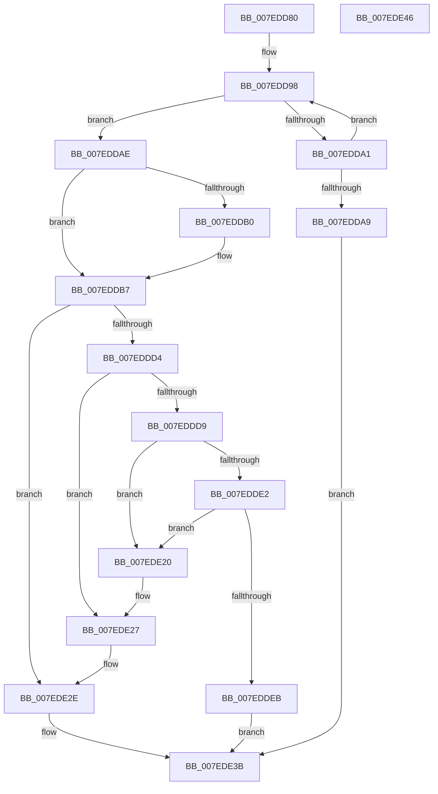

# CmpGlobalUnlockKeyForWrite

- RVA: `0x007EDD80`–`0x007EDE47` (길이 `199` bytes)
- VA: `0x00000001407EDD80`
- 실행 섹션: `PAGE`
- PDB 이름 있음: `예`; PDB Function 태그: `아니요`
- unwind 정보 RVA: `0x0005CAAC`
- 디코드: `56`개 명령, `199/199` bytes 표시
- 미해석 바이트: `0` (있으면 어셈블리에 `.byte`로 보존)

> 이 문서는 커널 이미지의 기계어와 PDB 기호를 분석해 생성했습니다. 4번과 5번은 함수 원형과 자료형을 바이너리 사용 방식에서 추정한 C 해석이며 원본 소스 복구 결과는 아닙니다.

## 1. Dependencies

- 직접 호출 지점: **8**; 고유 호출 대상: **6**
- 직접 호출자로 확인된 함수: **1**
- RIP 상대 이미지 참조: **0**

### Outgoing calls
- `0x007EDDBA` → [CmpLockKcbExclusive](../86/CmpLockKcbExclusive_function_00861EB0.md) (function, `0x00861EB0`)
- `0x007EDDBF` → [CmpLockGlobalKeyLockTrackerExclusive](CmpLockGlobalKeyLockTrackerExclusive_function_007EDE78.md) (function, `0x007EDE78`)
- `0x007EDDF2` → [CmpUnlockGlobalKeyLockTracker](CmpUnlockGlobalKeyLockTracker_function_007EDEDC.md) (function, `0x007EDEDC`)
- `0x007EDE03` → [CmpUnlockKcb](../../pagecmrc/BC/CmpUnlockKcb_function_00BC92C0.md) (function, `0x00BC92C0`)
- `0x007EDE0C` → [CmpDereferenceKeyControlBlock](../85/CmpDereferenceKeyControlBlock_function_00851310.md) (function, `0x00851310`)
- `0x007EDE19` → [CmpFreePoolWithTag](../../text/44/CmpFreePoolWithTag_function_004489E0.md) (function, `0x004489E0`)
- `0x007EDE2E` → [CmpUnlockGlobalKeyLockTracker](CmpUnlockGlobalKeyLockTracker_function_007EDEDC.md) (function, `0x007EDEDC`)
- `0x007EDE36` → [CmpUnlockKcb](../../pagecmrc/BC/CmpUnlockKcb_function_00BC92C0.md) (function, `0x00BC92C0`)

### Direct callers
- [CmpFreeSiloKeyLockEntry](CmpFreeSiloKeyLockEntry_function_007EDD38.md) at `0x007EDD52`

### Static image references
- 디코드된 RIP-relative 메모리 참조가 없습니다.

## 2. Other-region calls and transfers

- 다른 실행 섹션으로 향하는 call: **3**
  - `0x007EDE03` → [CmpUnlockKcb](../../pagecmrc/BC/CmpUnlockKcb_function_00BC92C0.md) (`PAGE` → `PAGECMRC`)
  - `0x007EDE19` → [CmpFreePoolWithTag](../../text/44/CmpFreePoolWithTag_function_004489E0.md) (`PAGE` → `.text`)
  - `0x007EDE36` → [CmpUnlockKcb](../../pagecmrc/BC/CmpUnlockKcb_function_00BC92C0.md) (`PAGE` → `PAGECMRC`)
- 별도 외부 분기/꼬리 이동을 확인하지 못했습니다.

## 3. Assembly (complete function range)

```asm
007EDD80  48 89 5C 24 08                  mov qword ptr [rsp + 8], rbx
007EDD85  57                              push rdi
007EDD86  48 83 EC 20                     sub rsp, 0x20
007EDD8A  48 8B DA                        mov rbx, rdx
007EDD8D  48 8B F9                        mov rdi, rcx
007EDD90  0F 0D 4A 10                     prefetchw byte ptr [rdx + 0x10]
007EDD94  48 8B 42 10                     mov rax, qword ptr [rdx + 0x10]
007EDD98  48 8D 48 FF                     lea rcx, [rax - 1]
007EDD9C  48 85 C9                        test rcx, rcx
007EDD9F  7E 0D                           jle 0x1407eddae
007EDDA1  F0 48 0F B1 4A 10               lock cmpxchg qword ptr [rdx + 0x10], rcx
007EDDA7  75 EF                           jne 0x1407edd98
007EDDA9  E9 8D 00 00 00                  jmp 0x1407ede3b
007EDDAE  74 07                           je 0x1407eddb7
007EDDB0  B9 0E 00 00 00                  mov ecx, 0xe
007EDDB5  CD 29                           int 0x29
007EDDB7  48 8B CF                        mov rcx, rdi
007EDDBA  E8 F1 40 07 00                  call 0x140861eb0
007EDDBF  E8 B4 00 00 00                  call 0x1407ede78
007EDDC4  48 83 C8 FF                     or rax, 0xffffffffffffffff
007EDDC8  F0 48 0F C1 43 10               lock xadd qword ptr [rbx + 0x10], rax
007EDDCE  48 83 E8 01                     sub rax, 1
007EDDD2  7F 5A                           jg 0x1407ede2e
007EDDD4  48 85 C0                        test rax, rax
007EDDD7  75 4E                           jne 0x1407ede27
007EDDD9  48 8B 0B                        mov rcx, qword ptr [rbx]
007EDDDC  48 39 59 08                     cmp qword ptr [rcx + 8], rbx
007EDDE0  75 3E                           jne 0x1407ede20
007EDDE2  48 8B 43 08                     mov rax, qword ptr [rbx + 8]
007EDDE6  48 39 18                        cmp qword ptr [rax], rbx
007EDDE9  75 35                           jne 0x1407ede20
007EDDEB  48 89 08                        mov qword ptr [rax], rcx
007EDDEE  48 89 41 08                     mov qword ptr [rcx + 8], rax
007EDDF2  E8 E5 00 00 00                  call 0x1407ededc
007EDDF7  B8 7F FF 00 00                  mov eax, 0xff7f
007EDDFC  48 8B CF                        mov rcx, rdi
007EDDFF  66 21 47 08                     and word ptr [rdi + 8], ax
007EDE03  E8 B8 B4 3D 00                  call 0x140bc92c0
007EDE08  48 8B 4B 18                     mov rcx, qword ptr [rbx + 0x18]
007EDE0C  E8 FF 34 06 00                  call 0x140851310
007EDE11  BA 43 4D 37 33                  mov edx, 0x33374d43
007EDE16  48 8B CB                        mov rcx, rbx
007EDE19  E8 C2 AB C5 FF                  call 0x1404489e0
007EDE1E  EB 1B                           jmp 0x1407ede3b
007EDE20  B9 03 00 00 00                  mov ecx, 3
007EDE25  CD 29                           int 0x29
007EDE27  B9 0E 00 00 00                  mov ecx, 0xe
007EDE2C  CD 29                           int 0x29
007EDE2E  E8 A9 00 00 00                  call 0x1407ededc
007EDE33  48 8B CF                        mov rcx, rdi
007EDE36  E8 85 B4 3D 00                  call 0x140bc92c0
007EDE3B  48 8B 5C 24 30                  mov rbx, qword ptr [rsp + 0x30]
007EDE40  48 83 C4 20                     add rsp, 0x20
007EDE44  5F                              pop rdi
007EDE45  C3                              ret
007EDE46  CC                              int3
```

## 4. C-style interpretation (structured pseudocode)

```c
__int64 __fastcall CmpGlobalUnlockKeyForWrite(__int64 a1, __int64 a2)
{
    __int64 result;
    __int64 v_rsp;
    unsigned __int64 v_stack_p8;

    v_stack_p8 = v_rbx;
    v_rsp = (v_rsp) - (32);
loc_007EDD98:
    if (condition_is_less_or_equal) goto loc_007EDDAE;
    if (*(unsigned __int64 *)(a2 + 16) - 1 != 0) goto loc_007EDD98;
    goto loc_007EDE3B;
loc_007EDDAE:
    if (*(unsigned __int64 *)(a2 + 16) - 1 != 0) {
        a1 = 14;
    }
    result = CmpLockKcbExclusive(a1, a2, a3, a4);
    result = CmpLockGlobalKeyLockTrackerExclusive(a1, a2, a3, a4);
    result = (result) | (-1);
    result = (result) - (1);
    if (condition_is_greater) goto loc_007EDE2E;
    if (result != 0) goto loc_007EDE27;
    if ((*(unsigned __int64 *)(*(unsigned __int64 *)(a2) + 8)) != a2) goto loc_007EDE20;
    if ((*(unsigned __int64 *)(*(unsigned __int64 *)(a2 + 8))) != a2) goto loc_007EDE20;
    *(unsigned __int64 *)(*(unsigned __int64 *)(a2 + 8)) = *(unsigned __int64 *)(a2);
    *(unsigned __int64 *)(*(unsigned __int64 *)(a2) + 8) = *(unsigned __int64 *)(a2 + 8);
    result = CmpUnlockGlobalKeyLockTracker(*(unsigned __int64 *)(a2), a2, a3, a4);
    result = CmpUnlockKcb(a1, a2, a3, a4);
    result = CmpDereferenceKeyControlBlock(*(unsigned __int64 *)(a2 + 24), a2, a3, a4);
    result = CmpFreePoolWithTag(a2, (unsigned int)(0x33374D43ULL), a3, a4);
    goto loc_007EDE3B;
loc_007EDE20:
loc_007EDE27:
loc_007EDE2E:
    result = CmpUnlockGlobalKeyLockTracker(14, (unsigned int)(0x33374D43ULL), a3, a4);
    result = CmpUnlockKcb(a1, (unsigned int)(0x33374D43ULL), a3, a4);
loc_007EDE3B:
    v_rsp = (v_rsp) + (32);
    return result;
}
```

## 5. (Beta) C Style

```c
int64_t CmpGlobalUnlockKeyForWrite(void *Arg1, void *Arg2)
{
    uint8_t *arg1 = (uint8_t *)Arg1;
    uint8_t *arg2 = (uint8_t *)Arg2;

    int64_t result;
    int64_t local_rsp;
    uint64_t v_stack_p8;

    v_stack_p8 = local_rbx;
    local_rsp = (local_rsp) - (32);
loc_007EDD98:
    if (condition_is_less_or_equal) goto loc_007EDDAE;
    if (*(uint64_t *)(arg2 + 0x10) - 1 != 0) goto loc_007EDD98;
    goto loc_007EDE3B;
loc_007EDDAE:
    if (*(uint64_t *)(arg2 + 0x10) - 1 != 0) {
        Arg1 = 14;
    }
    result = CmpLockKcbExclusive(Arg1, Arg2, a3, a4);
    result = CmpLockGlobalKeyLockTrackerExclusive(Arg1, Arg2, a3, a4);
    result = (result) | (-1);
    result = (result) - (1);
    if (condition_is_greater) goto loc_007EDE2E;
    if (result != 0) goto loc_007EDE27;
    if ((*(uint64_t *)(*(uint64_t *)(arg2) + 0x8)) != Arg2) goto loc_007EDE20;
    if ((*(uint64_t *)(*(uint64_t *)(arg2 + 0x8))) != Arg2) goto loc_007EDE20;
    *(uint64_t *)(*(uint64_t *)(arg2 + 0x8)) = *(uint64_t *)(arg2);
    *(uint64_t *)(*(uint64_t *)(arg2) + 0x8) = *(uint64_t *)(arg2 + 0x8);
    result = CmpUnlockGlobalKeyLockTracker(*(uint64_t *)(arg2), Arg2, a3, a4);
    result = CmpUnlockKcb(Arg1, Arg2, a3, a4);
    result = CmpDereferenceKeyControlBlock(*(uint64_t *)(arg2 + 0x18), Arg2, a3, a4);
    result = CmpFreePoolWithTag(Arg2, (uint32_t)(0x33374D43ULL), a3, a4);
    goto loc_007EDE3B;
loc_007EDE20:
loc_007EDE27:
loc_007EDE2E:
    result = CmpUnlockGlobalKeyLockTracker(14, (uint32_t)(0x33374D43ULL), a3, a4);
    result = CmpUnlockKcb(Arg1, (uint32_t)(0x33374D43ULL), a3, a4);
loc_007EDE3B:
    local_rsp = (local_rsp) + (32);
    return result;
}
```

### 관측된 메모리 오프셋

구조체 형식이 확인되지 않은 접근은 인자 기준의 오프셋으로만 기록했습니다.

| 기준 인자 | 오프셋 표현 | 폭 (bit) | 접근 |
|---|---:|---:|---|
| `Arg1` | `+ 0x8` | `16` | `R/W` |
| `Arg2` | `+ 0x0` | `64` | `R` |
| `Arg2` | `+ 0x8` | `64` | `R` |
| `Arg2` | `+ 0x10` | `8` | `R` |
| `Arg2` | `+ 0x10` | `64` | `R` |
| `Arg2` | `+ 0x10` | `64` | `R/W` |
| `Arg2` | `+ 0x18` | `64` | `R` |

## 6. Execution-region graph

[열기: 2D/3D 그래프와 함수 탐색 컨트롤 패널](../../../control-panel.html?section=page&rva=0x007EDD80&view=graph)

- 2D 그래프는 위에서 아래로 흐르고, 3D 그래프는 빈 공간을 드래그해 회전합니다. Shift+드래그는 이동, 휠은 확대·축소, 함수 노드 선택은 대상 보고서 이동입니다.

### Static fallback


