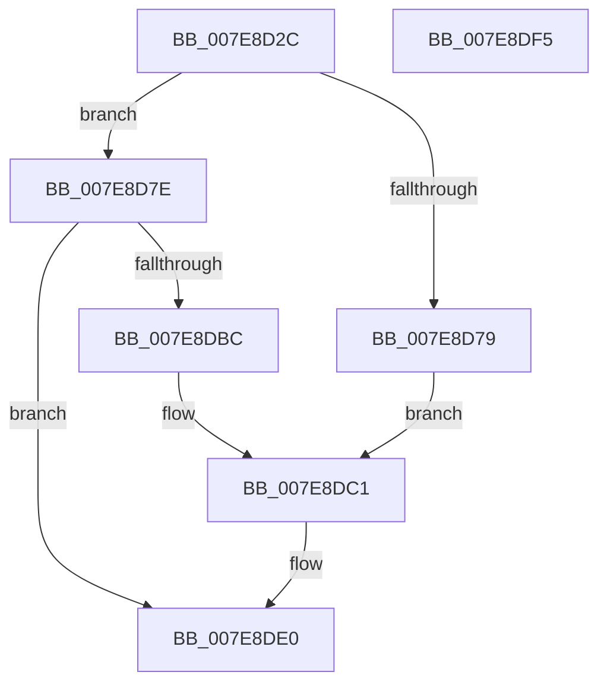

# CmpHiveCacheSubscribePnpNotifications

- RVA: `0x007E8D2C`–`0x007E8DF6` (길이 `202` bytes)
- VA: `0x00000001407E8D2C`
- 실행 섹션: `PAGE`
- PDB 이름 있음: `예`; PDB Function 태그: `아니요`
- unwind 정보 RVA: `0x000AB20C`
- 디코드: `58`개 명령, `202/202` bytes 표시
- 미해석 바이트: `0` (있으면 어셈블리에 `.byte`로 보존)

> 이 문서는 커널 이미지의 기계어와 PDB 기호를 분석해 생성했습니다. 4번과 5번은 함수 원형과 자료형을 바이너리 사용 방식에서 추정한 C 해석이며 원본 소스 복구 결과는 아닙니다.

## 1. Dependencies

- 직접 호출 지점: **4**; 고유 호출 대상: **4**
- 직접 호출자로 확인된 함수: **1**
- RIP 상대 이미지 참조: **3**

### Outgoing calls
- `0x007E8D69` → [ObReferenceObjectByHandle](../86/ObReferenceObjectByHandle_function_00868DB0.md) (function, `0x00868DB0`)
- `0x007E8DB1` → [IoRegisterPlugPlayNotification](../95/IoRegisterPlugPlayNotification_function_009535A0.md) (function, `0x009535A0`)
- `0x007E8DD3` → [SetFailureLocation](../../text/46/SetFailureLocation_function_0046EF54.md) (function, `0x0046EF54`)
- `0x007E8DDB` → [ObfDereferenceObject](../../text/2F/ObfDereferenceObject_function_002F9350.md) (function, `0x002F9350`)

### Direct callers
- [CmpHiveCachePopulateHiveEntryThread](../7F/CmpHiveCachePopulateHiveEntryThread_function_007F5FD0.md) at `0x007F611F`

### Static image references
- `0x007E8D3F` → RVA `0x00EF7C68` (`.data`; read)
- `0x007E8D7E` → RVA `0x00EEFC00` (`.data`; read)
- `0x007E8D93` → RVA `0x007F5D80` (`CmpHiveCachePnpNotificationCallback`; read)

## 2. Other-region calls and transfers

- 다른 실행 섹션으로 향하는 call: **2**
  - `0x007E8DD3` → [SetFailureLocation](../../text/46/SetFailureLocation_function_0046EF54.md) (`PAGE` → `.text`)
  - `0x007E8DDB` → [ObfDereferenceObject](../../text/2F/ObfDereferenceObject_function_002F9350.md) (`PAGE` → `.text`)
- 별도 외부 분기/꼬리 이동을 확인하지 못했습니다.

## 3. Assembly (complete function range)

```asm
007E8D2C  4C 8B DC                        mov r11, rsp
007E8D2F  49 89 5B 08                     mov qword ptr [r11 + 8], rbx
007E8D33  49 89 6B 10                     mov qword ptr [r11 + 0x10], rbp
007E8D37  56                              push rsi
007E8D38  57                              push rdi
007E8D39  41 56                           push r14
007E8D3B  48 83 EC 40                     sub rsp, 0x40
007E8D3F  48 8B 05 22 EF 70 00            mov rax, qword ptr [rip + 0x70ef22]
007E8D46  49 8B F0                        mov rsi, r8
007E8D49  48 8B 09                        mov rcx, qword ptr [rcx]
007E8D4C  33 DB                           xor ebx, ebx
007E8D4E  48 8B EA                        mov rbp, rdx
007E8D51  49 89 5B D0                     mov qword ptr [r11 - 0x30], rbx
007E8D55  45 33 C9                        xor r9d, r9d
007E8D58  49 89 5B 20                     mov qword ptr [r11 + 0x20], rbx
007E8D5C  4C 8B 00                        mov r8, qword ptr [rax]
007E8D5F  33 D2                           xor edx, edx
007E8D61  49 8D 43 20                     lea rax, [r11 + 0x20]
007E8D65  49 89 43 C8                     mov qword ptr [r11 - 0x38], rax
007E8D69  E8 42 00 08 00                  call 0x140868db0
007E8D6E  4C 8B 74 24 78                  mov r14, qword ptr [rsp + 0x78]
007E8D73  8B F8                           mov edi, eax
007E8D75  85 C0                           test eax, eax
007E8D77  79 05                           jns 0x1407e8d7e
007E8D79  8D 43 10                        lea eax, [rbx + 0x10]
007E8D7C  EB 43                           jmp 0x1407e8dc1
007E8D7E  4C 8B 0D 7B 6E 70 00            mov r9, qword ptr [rip + 0x706e7b]
007E8D85  48 8D 85 58 01 00 00            lea rax, [rbp + 0x158]
007E8D8C  48 89 44 24 30                  mov qword ptr [rsp + 0x30], rax
007E8D91  33 D2                           xor edx, edx
007E8D93  48 8D 05 E6 CF 00 00            lea rax, [rip + 0xcfe6]
007E8D9A  48 89 6C 24 28                  mov qword ptr [rsp + 0x28], rbp
007E8D9F  4D 8B C6                        mov r8, r14
007E8DA2  4C 89 B5 60 01 00 00            mov qword ptr [rbp + 0x160], r14
007E8DA9  48 89 44 24 20                  mov qword ptr [rsp + 0x20], rax
007E8DAE  8D 4A 03                        lea ecx, [rdx + 3]
007E8DB1  E8 EA A7 16 00                  call 0x1409535a0
007E8DB6  8B F8                           mov edi, eax
007E8DB8  85 C0                           test eax, eax
007E8DBA  79 24                           jns 0x1407e8de0
007E8DBC  B8 20 00 00 00                  mov eax, 0x20
007E8DC1  41 B8 27 00 00 00               mov r8d, 0x27
007E8DC7  44 8B CF                        mov r9d, edi
007E8DCA  89 44 24 20                     mov dword ptr [rsp + 0x20], eax
007E8DCE  8B D3                           mov edx, ebx
007E8DD0  48 8B CE                        mov rcx, rsi
007E8DD3  E8 7C 61 C8 FF                  call 0x14046ef54
007E8DD8  49 8B CE                        mov rcx, r14
007E8DDB  E8 70 05 B1 FF                  call 0x1402f9350
007E8DE0  48 8B 5C 24 60                  mov rbx, qword ptr [rsp + 0x60]
007E8DE5  8B C7                           mov eax, edi
007E8DE7  48 8B 6C 24 68                  mov rbp, qword ptr [rsp + 0x68]
007E8DEC  48 83 C4 40                     add rsp, 0x40
007E8DF0  41 5E                           pop r14
007E8DF2  5F                              pop rdi
007E8DF3  5E                              pop rsi
007E8DF4  C3                              ret
007E8DF5  CC                              int3
```

## 4. C-style interpretation (structured pseudocode)

```c
__int64 __fastcall CmpHiveCacheSubscribePnpNotifications(__int64 a1, __int64 a2, __int64 a3, int a4)
{
    __int64 result;
    __int64 v_rbx;
    __int64 v_rsp;
    unsigned __int64 v_stack_m28;
    unsigned __int64 v_stack_m30;
    unsigned __int64 v_stack_m38;
    unsigned __int64 v_stack_p10;
    unsigned __int64 v_stack_p20;
    unsigned __int64 v_stack_p8;

    *(unsigned __int64 *)(v_rsp + 8) = v_rbx;
    *(unsigned __int64 *)(v_rsp + 16) = v_rbp;
    v_rsp = (v_rsp) - (64);
    v_rbx = 0;
    *(unsigned __int64 *)(v_rsp - 48) = 0;
    a4 = 0;
    *(unsigned __int64 *)(v_rsp + 32) = 0;
    a2 = 0;
    *(unsigned __int64 *)(v_rsp - 56) = v_rsp + 32;
    result = ObReferenceObjectByHandle(*(unsigned __int64 *)(a1), a2, *(unsigned __int64 *)(*(unsigned __int64 *)(v_rip + 7401250)), a4);
    if (!sign_flag) goto loc_007E8D7E;
    goto loc_007E8DC1;
loc_007E8D7E:
    v_stack_m28 = a2 + 344;
    a2 = 0;
    v_stack_m30 = 0;
    *(unsigned __int64 *)(a2 + 352) = v_stack_p20;
    v_stack_m38 = v_rip + 53222;
    result = IoRegisterPlugPlayNotification(a2 + 3, a2, v_stack_p20, *(unsigned __int64 *)(v_rip + 7368315));
    if (!sign_flag) goto loc_007E8DE0;
loc_007E8DC1:
    v_stack_m38 = 32;
    result = SetFailureLocation(a3, 0, 39, (unsigned int)((unsigned int)((unsigned int)((unsigned int)(result)))));
    result = ObfDereferenceObject(v_stack_p20, 0, 39, (unsigned int)((unsigned int)((unsigned int)((unsigned int)(result)))));
loc_007E8DE0:
    v_rsp = (v_rsp) + (64);
    return (unsigned int)((unsigned int)((unsigned int)((unsigned int)(result))));
}
```

## 5. (Beta) C Style

```c
int64_t CmpHiveCacheSubscribePnpNotifications(void *Arg1, void *Arg2, int64_t Arg3, int32_t Arg4)
{
    uint8_t *arg1 = (uint8_t *)Arg1;
    uint8_t *arg2 = (uint8_t *)Arg2;

    int64_t result;
    int64_t local_rbx;
    int64_t local_rsp;
    uint64_t v_stack_m28;
    uint64_t v_stack_m30;
    uint64_t v_stack_m38;
    uint64_t v_stack_p10;
    uint64_t v_stack_p20;
    uint64_t v_stack_p8;

    *(uint64_t *)(local_rsp + 0x8) = local_rbx;
    *(uint64_t *)(local_rsp + 0x10) = local_rbp;
    local_rsp = (local_rsp) - (64);
    local_rbx = 0;
    *(uint64_t *)(local_rsp - 0x30) = 0;
    Arg4 = 0;
    *(uint64_t *)(local_rsp + 0x20) = 0;
    Arg2 = 0;
    *(uint64_t *)(local_rsp - 0x38) = local_rsp + 32;
    result = ObReferenceObjectByHandle(*(uint64_t *)(arg1), Arg2, *(uint64_t *)(*(uint64_t *)(v_rip + 0x70EF22)), Arg4);
    if (!sign_flag) goto loc_007E8D7E;
    goto loc_007E8DC1;
loc_007E8D7E:
    v_stack_m28 = Arg2 + 344;
    Arg2 = 0;
    v_stack_m30 = 0;
    *(uint64_t *)(arg2 + 0x160) = v_stack_p20;
    v_stack_m38 = v_rip + 53222;
    result = IoRegisterPlugPlayNotification(Arg2 + 3, Arg2, v_stack_p20, *(uint64_t *)(v_rip + 0x706E7B));
    if (!sign_flag) goto loc_007E8DE0;
loc_007E8DC1:
    v_stack_m38 = 32;
    result = SetFailureLocation(Arg3, 0, 39, (uint32_t)((uint32_t)((uint32_t)((uint32_t)(result)))));
    result = ObfDereferenceObject(v_stack_p20, 0, 39, (uint32_t)((uint32_t)((uint32_t)((uint32_t)(result)))));
loc_007E8DE0:
    local_rsp = (local_rsp) + (64);
    return (uint32_t)((uint32_t)((uint32_t)((uint32_t)(result))));
}
```

### 관측된 메모리 오프셋

구조체 형식이 확인되지 않은 접근은 인자 기준의 오프셋으로만 기록했습니다.

| 기준 인자 | 오프셋 표현 | 폭 (bit) | 접근 |
|---|---:|---:|---|
| `Arg1` | `+ 0x0` | `64` | `R` |
| `Arg2` | `+ 0x158` | `64` | `R` |
| `Arg2` | `+ 0x160` | `64` | `W` |

## 6. Execution-region graph

[열기: 2D/3D 그래프와 함수 탐색 컨트롤 패널](../../../control-panel.html?section=page&rva=0x007E8D2C&view=graph)

- 2D 그래프는 위에서 아래로 흐르고, 3D 그래프는 빈 공간을 드래그해 회전합니다. Shift+드래그는 이동, 휠은 확대·축소, 함수 노드 선택은 대상 보고서 이동입니다.

### Static fallback


