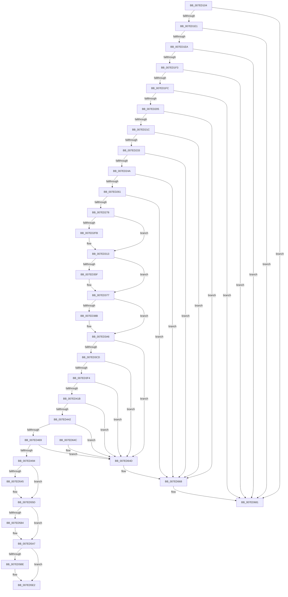

# CmpHiveRootSecurityDescriptor

- RVA: `0x007ED104`–`0x007ED69A` (길이 `1,430` bytes)
- VA: `0x00000001407ED104`
- 실행 섹션: `PAGE`
- PDB 이름 있음: `예`; PDB Function 태그: `아니요`
- unwind 정보 RVA: `0x000D6F80`
- 디코드: `378`개 명령, `1,430/1,430` bytes 표시
- 미해석 바이트: `0` (있으면 어셈블리에 `.byte`로 보존)

> 이 문서는 커널 이미지의 기계어와 PDB 기호를 분석해 생성했습니다. 4번과 5번은 함수 원형과 자료형을 바이너리 사용 방식에서 추정한 C 해석이며 원본 소스 복구 결과는 아닙니다.

## 1. Dependencies

- 직접 호출 지점: **56**; 고유 호출 대상: **14**
- 직접 호출자로 확인된 함수: **5**
- RIP 상대 이미지 참조: **2**

### Outgoing calls
- `0x007ED16C` → [RtlLengthRequiredSid](../9C/RtlLengthRequiredSid_function_009CA4D0.md) (function, `0x009CA4D0`)
- `0x007ED185` → [ExAllocatePool2](../../poolcode/B8/ExAllocatePool2_function_00B820F0.md) (function, `0x00B820F0`)
- `0x007ED194` → [ExAllocatePool2](../../poolcode/B8/ExAllocatePool2_function_00B820F0.md) (function, `0x00B820F0`)
- `0x007ED1A3` → [ExAllocatePool2](../../poolcode/B8/ExAllocatePool2_function_00B820F0.md) (function, `0x00B820F0`)
- `0x007ED1AE` → [RtlLengthRequiredSid](../9C/RtlLengthRequiredSid_function_009CA4D0.md) (function, `0x009CA4D0`)
- `0x007ED1BC` → [ExAllocatePool2](../../poolcode/B8/ExAllocatePool2_function_00B820F0.md) (function, `0x00B820F0`)
- `0x007ED1D0` → [ExAllocatePool2](../../poolcode/B8/ExAllocatePool2_function_00B820F0.md) (function, `0x00B820F0`)
- `0x007ED20F` → [RtlInitializeSid](../9E/RtlInitializeSid_function_009EB720.md) (function, `0x009EB720`)
- `0x007ED226` → [RtlInitializeSid](../9E/RtlInitializeSid_function_009EB720.md) (function, `0x009EB720`)
- `0x007ED23D` → [RtlInitializeSid](../9E/RtlInitializeSid_function_009EB720.md) (function, `0x009EB720`)
- `0x007ED254` → [RtlInitializeSid](../9E/RtlInitializeSid_function_009EB720.md) (function, `0x009EB720`)
- `0x007ED26B` → [RtlInitializeSid](../9E/RtlInitializeSid_function_009EB720.md) (function, `0x009EB720`)
- `0x007ED27D` → [RtlSubAuthoritySid](../../text/45/RtlSubAuthoritySid_function_00456D10.md) (function, `0x00456D10`)
- `0x007ED289` → [RtlSubAuthoritySid](../../text/45/RtlSubAuthoritySid_function_00456D10.md) (function, `0x00456D10`)
- `0x007ED299` → [RtlSubAuthoritySid](../../text/45/RtlSubAuthoritySid_function_00456D10.md) (function, `0x00456D10`)
- `0x007ED2A9` → [RtlSubAuthoritySid](../../text/45/RtlSubAuthoritySid_function_00456D10.md) (function, `0x00456D10`)
- `0x007ED2BA` → [RtlSubAuthoritySid](../../text/45/RtlSubAuthoritySid_function_00456D10.md) (function, `0x00456D10`)
- `0x007ED2CA` → [RtlSubAuthoritySid](../../text/45/RtlSubAuthoritySid_function_00456D10.md) (function, `0x00456D10`)
- `0x007ED2DB` → [RtlSubAuthoritySid](../../text/45/RtlSubAuthoritySid_function_00456D10.md) (function, `0x00456D10`)
- `0x007ED2F2` → [RtlDeriveCapabilitySidsFromName](../../text/47/RtlDeriveCapabilitySidsFromName_function_00474DC0.md) (function, `0x00474DC0`)
- `0x007ED30D` → [KeBugCheckEx](../../text/4F/KeBugCheckEx_function_004FD660.md) (function, `0x004FD660`)
- `0x007ED352` → [ExAllocatePool2](../../poolcode/B8/ExAllocatePool2_function_00B820F0.md) (function, `0x00B820F0`)
- `0x007ED371` → [KeBugCheckEx](../../text/4F/KeBugCheckEx_function_004FD660.md) (function, `0x004FD660`)
- `0x007ED382` → [RtlCreateAcl](../91/RtlCreateAcl_function_00916F00.md) (function, `0x00916F00`)
- `0x007ED3A0` → [KeBugCheckEx](../../text/4F/KeBugCheckEx_function_004FD660.md) (function, `0x004FD660`)
- `0x007ED3C0` → [RtlpAddKnownAce](../92/RtlpAddKnownAce_function_00929A20.md) (function, `0x00929A20`)
- `0x007ED3E7` → [RtlpAddKnownAce](../92/RtlpAddKnownAce_function_00929A20.md) (function, `0x00929A20`)
- `0x007ED40E` → [RtlpAddKnownAce](../92/RtlpAddKnownAce_function_00929A20.md) (function, `0x00929A20`)
- `0x007ED435` → [RtlpAddKnownAce](../92/RtlpAddKnownAce_function_00929A20.md) (function, `0x00929A20`)
- `0x007ED45C` → [RtlpAddKnownAce](../92/RtlpAddKnownAce_function_00929A20.md) (function, `0x00929A20`)
- `0x007ED487` → [RtlpAddKnownAce](../92/RtlpAddKnownAce_function_00929A20.md) (function, `0x00929A20`)
- `0x007ED49D` → [RtlGetAce](../../text/40/RtlGetAce_function_0040FAF0.md) (function, `0x0040FAF0`)
- `0x007ED4B6` → [RtlGetAce](../../text/40/RtlGetAce_function_0040FAF0.md) (function, `0x0040FAF0`)
- `0x007ED4CF` → [RtlGetAce](../../text/40/RtlGetAce_function_0040FAF0.md) (function, `0x0040FAF0`)
- `0x007ED4E8` → [RtlGetAce](../../text/40/RtlGetAce_function_0040FAF0.md) (function, `0x0040FAF0`)
- `0x007ED501` → [RtlGetAce](../../text/40/RtlGetAce_function_0040FAF0.md) (function, `0x0040FAF0`)
- `0x007ED51A` → [RtlGetAce](../../text/40/RtlGetAce_function_0040FAF0.md) (function, `0x0040FAF0`)
- `0x007ED538` → [ExAllocatePool2](../../poolcode/B8/ExAllocatePool2_function_00B820F0.md) (function, `0x00B820F0`)
- `0x007ED557` → [KeBugCheckEx](../../text/4F/KeBugCheckEx_function_004FD660.md) (function, `0x004FD660`)
- `0x007ED568` → [memcpy](../../text/6C/memcpy_function_006C6840.md) (function, `0x006C6840`)
- `0x007ED575` → [RtlCreateSecurityDescriptor](../9F/RtlCreateSecurityDescriptor_function_009F1DF0.md) (function, `0x009F1DF0`)
- `0x007ED586` → [ExFreePoolWithTag](../../poolcode/B8/ExFreePoolWithTag_function_00B82870.md) (function, `0x00B82870`)
- `0x007ED5A1` → [KeBugCheckEx](../../text/4F/KeBugCheckEx_function_004FD660.md) (function, `0x004FD660`)
- `0x007ED5B0` → [RtlSetDaclSecurityDescriptor](../9E/RtlSetDaclSecurityDescriptor_function_009EC210.md) (function, `0x009EC210`)
- `0x007ED5C1` → [ExFreePoolWithTag](../../poolcode/B8/ExFreePoolWithTag_function_00B82870.md) (function, `0x00B82870`)
- `0x007ED5DC` → [KeBugCheckEx](../../text/4F/KeBugCheckEx_function_004FD660.md) (function, `0x004FD660`)
- `0x007ED5E5` → [ExFreePoolWithTag](../../poolcode/B8/ExFreePoolWithTag_function_00B82870.md) (function, `0x00B82870`)
- `0x007ED5EF` → [ExFreePoolWithTag](../../poolcode/B8/ExFreePoolWithTag_function_00B82870.md) (function, `0x00B82870`)
- `0x007ED5F9` → [ExFreePoolWithTag](../../poolcode/B8/ExFreePoolWithTag_function_00B82870.md) (function, `0x00B82870`)
- `0x007ED603` → [ExFreePoolWithTag](../../poolcode/B8/ExFreePoolWithTag_function_00B82870.md) (function, `0x00B82870`)
- `0x007ED60D` → [ExFreePoolWithTag](../../poolcode/B8/ExFreePoolWithTag_function_00B82870.md) (function, `0x00B82870`)
- `0x007ED617` → [ExFreePoolWithTag](../../poolcode/B8/ExFreePoolWithTag_function_00B82870.md) (function, `0x00B82870`)
- `0x007ED626` → [_security_check_cookie](../../text/6A/_security_check_cookie_function_006AC640.md) (function, `0x006AC640`)
- `0x007ED662` → [KeBugCheckEx](../../text/4F/KeBugCheckEx_function_004FD660.md) (function, `0x004FD660`)
- `0x007ED67B` → [KeBugCheckEx](../../text/4F/KeBugCheckEx_function_004FD660.md) (function, `0x004FD660`)
- `0x007ED694` → [KeBugCheckEx](../../text/4F/KeBugCheckEx_function_004FD660.md) (function, `0x004FD660`)

### Direct callers
- [CmpFinishSystemHivesLoad](../7D/CmpFinishSystemHivesLoad_function_007DA210.md) at `0x007DA35E`
- [CmpSetVersionData](CmpSetVersionData_function_007E7854.md) at `0x007E78BF`
- [CmInitSystem1](../../init/C5/CmInitSystem1_function_00C559CC.md) at `0x00C55E04`
- [CmpCreateRegistryRoot](../../init/C5/CmpCreateRegistryRoot_function_00C57880.md) at `0x00C578C2`
- [CmpInitializePreloadedHives](../../init/C5/CmpInitializePreloadedHives_function_00C584D4.md) at `0x00C58548`

### Static image references
- `0x007ED127` → RVA `0x00E0A740` (`.data`; read)
- `0x007ED13F` → RVA `0x00B099A0` (` ?? ::NNGAKEGL::`string'`; read)

## 2. Other-region calls and transfers

- 다른 실행 섹션으로 향하는 call: **40**
  - `0x007ED185` → [ExAllocatePool2](../../poolcode/B8/ExAllocatePool2_function_00B820F0.md) (`PAGE` → `POOLCODE`)
  - `0x007ED194` → [ExAllocatePool2](../../poolcode/B8/ExAllocatePool2_function_00B820F0.md) (`PAGE` → `POOLCODE`)
  - `0x007ED1A3` → [ExAllocatePool2](../../poolcode/B8/ExAllocatePool2_function_00B820F0.md) (`PAGE` → `POOLCODE`)
  - `0x007ED1BC` → [ExAllocatePool2](../../poolcode/B8/ExAllocatePool2_function_00B820F0.md) (`PAGE` → `POOLCODE`)
  - `0x007ED1D0` → [ExAllocatePool2](../../poolcode/B8/ExAllocatePool2_function_00B820F0.md) (`PAGE` → `POOLCODE`)
  - `0x007ED27D` → [RtlSubAuthoritySid](../../text/45/RtlSubAuthoritySid_function_00456D10.md) (`PAGE` → `.text`)
  - `0x007ED289` → [RtlSubAuthoritySid](../../text/45/RtlSubAuthoritySid_function_00456D10.md) (`PAGE` → `.text`)
  - `0x007ED299` → [RtlSubAuthoritySid](../../text/45/RtlSubAuthoritySid_function_00456D10.md) (`PAGE` → `.text`)
  - `0x007ED2A9` → [RtlSubAuthoritySid](../../text/45/RtlSubAuthoritySid_function_00456D10.md) (`PAGE` → `.text`)
  - `0x007ED2BA` → [RtlSubAuthoritySid](../../text/45/RtlSubAuthoritySid_function_00456D10.md) (`PAGE` → `.text`)
  - `0x007ED2CA` → [RtlSubAuthoritySid](../../text/45/RtlSubAuthoritySid_function_00456D10.md) (`PAGE` → `.text`)
  - `0x007ED2DB` → [RtlSubAuthoritySid](../../text/45/RtlSubAuthoritySid_function_00456D10.md) (`PAGE` → `.text`)
  - `0x007ED2F2` → [RtlDeriveCapabilitySidsFromName](../../text/47/RtlDeriveCapabilitySidsFromName_function_00474DC0.md) (`PAGE` → `.text`)
  - `0x007ED30D` → [KeBugCheckEx](../../text/4F/KeBugCheckEx_function_004FD660.md) (`PAGE` → `.text`)
  - `0x007ED352` → [ExAllocatePool2](../../poolcode/B8/ExAllocatePool2_function_00B820F0.md) (`PAGE` → `POOLCODE`)
  - `0x007ED371` → [KeBugCheckEx](../../text/4F/KeBugCheckEx_function_004FD660.md) (`PAGE` → `.text`)
  - `0x007ED3A0` → [KeBugCheckEx](../../text/4F/KeBugCheckEx_function_004FD660.md) (`PAGE` → `.text`)
  - `0x007ED49D` → [RtlGetAce](../../text/40/RtlGetAce_function_0040FAF0.md) (`PAGE` → `.text`)
  - `0x007ED4B6` → [RtlGetAce](../../text/40/RtlGetAce_function_0040FAF0.md) (`PAGE` → `.text`)
  - `0x007ED4CF` → [RtlGetAce](../../text/40/RtlGetAce_function_0040FAF0.md) (`PAGE` → `.text`)
  - `0x007ED4E8` → [RtlGetAce](../../text/40/RtlGetAce_function_0040FAF0.md) (`PAGE` → `.text`)
  - `0x007ED501` → [RtlGetAce](../../text/40/RtlGetAce_function_0040FAF0.md) (`PAGE` → `.text`)
  - `0x007ED51A` → [RtlGetAce](../../text/40/RtlGetAce_function_0040FAF0.md) (`PAGE` → `.text`)
  - `0x007ED538` → [ExAllocatePool2](../../poolcode/B8/ExAllocatePool2_function_00B820F0.md) (`PAGE` → `POOLCODE`)
  - `0x007ED557` → [KeBugCheckEx](../../text/4F/KeBugCheckEx_function_004FD660.md) (`PAGE` → `.text`)
  - `0x007ED568` → [memcpy](../../text/6C/memcpy_function_006C6840.md) (`PAGE` → `.text`)
  - `0x007ED586` → [ExFreePoolWithTag](../../poolcode/B8/ExFreePoolWithTag_function_00B82870.md) (`PAGE` → `POOLCODE`)
  - `0x007ED5A1` → [KeBugCheckEx](../../text/4F/KeBugCheckEx_function_004FD660.md) (`PAGE` → `.text`)
  - `0x007ED5C1` → [ExFreePoolWithTag](../../poolcode/B8/ExFreePoolWithTag_function_00B82870.md) (`PAGE` → `POOLCODE`)
  - `0x007ED5DC` → [KeBugCheckEx](../../text/4F/KeBugCheckEx_function_004FD660.md) (`PAGE` → `.text`)
  - `0x007ED5E5` → [ExFreePoolWithTag](../../poolcode/B8/ExFreePoolWithTag_function_00B82870.md) (`PAGE` → `POOLCODE`)
  - `0x007ED5EF` → [ExFreePoolWithTag](../../poolcode/B8/ExFreePoolWithTag_function_00B82870.md) (`PAGE` → `POOLCODE`)
  - `0x007ED5F9` → [ExFreePoolWithTag](../../poolcode/B8/ExFreePoolWithTag_function_00B82870.md) (`PAGE` → `POOLCODE`)
  - `0x007ED603` → [ExFreePoolWithTag](../../poolcode/B8/ExFreePoolWithTag_function_00B82870.md) (`PAGE` → `POOLCODE`)
  - `0x007ED60D` → [ExFreePoolWithTag](../../poolcode/B8/ExFreePoolWithTag_function_00B82870.md) (`PAGE` → `POOLCODE`)
  - `0x007ED617` → [ExFreePoolWithTag](../../poolcode/B8/ExFreePoolWithTag_function_00B82870.md) (`PAGE` → `POOLCODE`)
  - `0x007ED626` → [_security_check_cookie](../../text/6A/_security_check_cookie_function_006AC640.md) (`PAGE` → `.text`)
  - `0x007ED662` → [KeBugCheckEx](../../text/4F/KeBugCheckEx_function_004FD660.md) (`PAGE` → `.text`)
  - `0x007ED67B` → [KeBugCheckEx](../../text/4F/KeBugCheckEx_function_004FD660.md) (`PAGE` → `.text`)
  - `0x007ED694` → [KeBugCheckEx](../../text/4F/KeBugCheckEx_function_004FD660.md) (`PAGE` → `.text`)
- 별도 외부 분기/꼬리 이동을 확인하지 못했습니다.

## 3. Assembly (complete function range)

```asm
007ED104  48 8B C4                        mov rax, rsp
007ED107  48 89 58 08                     mov qword ptr [rax + 8], rbx
007ED10B  48 89 70 10                     mov qword ptr [rax + 0x10], rsi
007ED10F  48 89 78 18                     mov qword ptr [rax + 0x18], rdi
007ED113  55                              push rbp
007ED114  41 54                           push r12
007ED116  41 55                           push r13
007ED118  41 56                           push r14
007ED11A  41 57                           push r15
007ED11C  48 8D 68 A1                     lea rbp, [rax - 0x5f]
007ED120  48 81 EC D0 00 00 00            sub rsp, 0xd0
007ED127  48 8B 05 12 D6 61 00            mov rax, qword ptr [rip + 0x61d612]
007ED12E  48 33 C4                        xor rax, rsp
007ED131  48 89 45 27                     mov qword ptr [rbp + 0x27], rax
007ED135  33 FF                           xor edi, edi
007ED137  48 C7 45 B7 18 00 1A 00         mov qword ptr [rbp - 0x49], 0x1a0018
007ED13F  48 8D 05 5A C8 31 00            lea rax, [rip + 0x31c85a]
007ED146  89 7D A7                        mov dword ptr [rbp - 0x59], edi
007ED149  48 89 45 BF                     mov qword ptr [rbp - 0x41], rax
007ED14D  66 C7 45 AB 00 01               mov word ptr [rbp - 0x55], 0x100
007ED153  8D 4F 01                        lea ecx, [rdi + 1]
007ED156  89 7D 97                        mov dword ptr [rbp - 0x69], edi
007ED159  66 C7 45 9B 00 05               mov word ptr [rbp - 0x65], 0x500
007ED15F  89 7D AF                        mov dword ptr [rbp - 0x51], edi
007ED162  66 C7 45 B3 00 0F               mov word ptr [rbp - 0x4d], 0xf00
007ED168  48 89 7D 9F                     mov qword ptr [rbp - 0x61], rdi
007ED16C  E8 5F D3 1D 00                  call 0x1409ca4d0
007ED171  41 BE 43 4D 20 20               mov r14d, 0x20204d43
007ED177  8B D0                           mov edx, eax
007ED179  BE 00 01 00 00                  mov esi, 0x100
007ED17E  8B D8                           mov ebx, eax
007ED180  45 8B C6                        mov r8d, r14d
007ED183  8B CE                           mov ecx, esi
007ED185  E8 66 4F 39 00                  call 0x140b820f0
007ED18A  45 8B C6                        mov r8d, r14d
007ED18D  8B D3                           mov edx, ebx
007ED18F  8B CE                           mov ecx, esi
007ED191  4C 8B E8                        mov r13, rax
007ED194  E8 57 4F 39 00                  call 0x140b820f0
007ED199  45 8B C6                        mov r8d, r14d
007ED19C  8B D3                           mov edx, ebx
007ED19E  8B CE                           mov ecx, esi
007ED1A0  4C 8B F8                        mov r15, rax
007ED1A3  E8 48 4F 39 00                  call 0x140b820f0
007ED1A8  8D 4F 02                        lea ecx, [rdi + 2]
007ED1AB  4C 8B E0                        mov r12, rax
007ED1AE  E8 1D D3 1D 00                  call 0x1409ca4d0
007ED1B3  45 8B C6                        mov r8d, r14d
007ED1B6  8B D0                           mov edx, eax
007ED1B8  8B CE                           mov ecx, esi
007ED1BA  8B D8                           mov ebx, eax
007ED1BC  E8 2F 4F 39 00                  call 0x140b820f0
007ED1C1  8B D3                           mov edx, ebx
007ED1C3  45 8B C6                        mov r8d, r14d
007ED1C6  BB 00 01 00 00                  mov ebx, 0x100
007ED1CB  48 8B F0                        mov rsi, rax
007ED1CE  8B CB                           mov ecx, ebx
007ED1D0  E8 1B 4F 39 00                  call 0x140b820f0
007ED1D5  4C 8B F0                        mov r14, rax
007ED1D8  4D 85 ED                        test r13, r13
007ED1DB  0F 84 A0 04 00 00               je 0x1407ed681
007ED1E1  4D 85 FF                        test r15, r15
007ED1E4  0F 84 97 04 00 00               je 0x1407ed681
007ED1EA  4D 85 E4                        test r12, r12
007ED1ED  0F 84 8E 04 00 00               je 0x1407ed681
007ED1F3  48 85 F6                        test rsi, rsi
007ED1F6  0F 84 85 04 00 00               je 0x1407ed681
007ED1FC  48 85 C0                        test rax, rax
007ED1FF  0F 84 7C 04 00 00               je 0x1407ed681
007ED205  41 B0 01                        mov r8b, 1
007ED208  48 8D 55 A7                     lea rdx, [rbp - 0x59]
007ED20C  49 8B CD                        mov rcx, r13
007ED20F  E8 0C E5 1F 00                  call 0x1409eb720
007ED214  85 C0                           test eax, eax
007ED216  0F 88 4C 04 00 00               js 0x1407ed668
007ED21C  41 B0 01                        mov r8b, 1
007ED21F  48 8D 55 97                     lea rdx, [rbp - 0x69]
007ED223  49 8B CF                        mov rcx, r15
007ED226  E8 F5 E4 1F 00                  call 0x1409eb720
007ED22B  85 C0                           test eax, eax
007ED22D  0F 88 35 04 00 00               js 0x1407ed668
007ED233  41 B0 01                        mov r8b, 1
007ED236  48 8D 55 97                     lea rdx, [rbp - 0x69]
007ED23A  49 8B CC                        mov rcx, r12
007ED23D  E8 DE E4 1F 00                  call 0x1409eb720
007ED242  85 C0                           test eax, eax
007ED244  0F 88 1E 04 00 00               js 0x1407ed668
007ED24A  41 B0 02                        mov r8b, 2
007ED24D  48 8D 55 97                     lea rdx, [rbp - 0x69]
007ED251  48 8B CE                        mov rcx, rsi
007ED254  E8 C7 E4 1F 00                  call 0x1409eb720
007ED259  85 C0                           test eax, eax
007ED25B  0F 88 07 04 00 00               js 0x1407ed668
007ED261  41 B0 02                        mov r8b, 2
007ED264  48 8D 55 AF                     lea rdx, [rbp - 0x51]
007ED268  49 8B CE                        mov rcx, r14
007ED26B  E8 B0 E4 1F 00                  call 0x1409eb720
007ED270  85 C0                           test eax, eax
007ED272  0F 88 F0 03 00 00               js 0x1407ed668
007ED278  33 D2                           xor edx, edx
007ED27A  49 8B CD                        mov rcx, r13
007ED27D  E8 8E 9A C6 FF                  call 0x140456d10
007ED282  33 D2                           xor edx, edx
007ED284  49 8B CF                        mov rcx, r15
007ED287  89 38                           mov dword ptr [rax], edi
007ED289  E8 82 9A C6 FF                  call 0x140456d10
007ED28E  33 D2                           xor edx, edx
007ED290  49 8B CC                        mov rcx, r12
007ED293  C7 00 0C 00 00 00               mov dword ptr [rax], 0xc
007ED299  E8 72 9A C6 FF                  call 0x140456d10
007ED29E  33 D2                           xor edx, edx
007ED2A0  48 8B CE                        mov rcx, rsi
007ED2A3  C7 00 12 00 00 00               mov dword ptr [rax], 0x12
007ED2A9  E8 62 9A C6 FF                  call 0x140456d10
007ED2AE  8D 57 01                        lea edx, [rdi + 1]
007ED2B1  48 8B CE                        mov rcx, rsi
007ED2B4  C7 00 20 00 00 00               mov dword ptr [rax], 0x20
007ED2BA  E8 51 9A C6 FF                  call 0x140456d10
007ED2BF  33 D2                           xor edx, edx
007ED2C1  49 8B CE                        mov rcx, r14
007ED2C4  C7 00 20 02 00 00               mov dword ptr [rax], 0x220
007ED2CA  E8 41 9A C6 FF                  call 0x140456d10
007ED2CF  8D 57 01                        lea edx, [rdi + 1]
007ED2D2  49 8B CE                        mov rcx, r14
007ED2D5  C7 00 02 00 00 00               mov dword ptr [rax], 2
007ED2DB  E8 30 9A C6 FF                  call 0x140456d10
007ED2E0  4C 8D 45 C7                     lea r8, [rbp - 0x39]
007ED2E4  48 8D 55 F7                     lea rdx, [rbp - 9]
007ED2E8  48 8D 4D B7                     lea rcx, [rbp - 0x49]
007ED2EC  C7 00 01 00 00 00               mov dword ptr [rax], 1
007ED2F2  E8 C9 7A C8 FF                  call 0x140474dc0
007ED2F7  85 C0                           test eax, eax
007ED2F9  79 18                           jns 0x1407ed313
007ED2FB  45 33 C9                        xor r9d, r9d
007ED2FE  48 89 7C 24 20                  mov qword ptr [rsp + 0x20], rdi
007ED303  8D 57 0B                        lea edx, [rdi + 0xb]
007ED306  8D 4F 51                        lea ecx, [rdi + 0x51]
007ED309  44 8D 47 03                     lea r8d, [rdi + 3]
007ED30D  E8 4E 03 D1 FF                  call 0x1404fd660
007ED312  CC                              int3
007ED313  0F B6 46 01                     movzx eax, byte ptr [rsi + 1]
007ED317  41 B8 43 4D 20 20               mov r8d, 0x20204d43
007ED31D  41 0F B6 4E 01                  movzx ecx, byte ptr [r14 + 1]
007ED322  03 C8                           add ecx, eax
007ED324  41 0F B6 44 24 01               movzx eax, byte ptr [r12 + 1]
007ED32A  03 C8                           add ecx, eax
007ED32C  41 0F B6 47 01                  movzx eax, byte ptr [r15 + 1]
007ED331  03 C8                           add ecx, eax
007ED333  41 0F B6 45 01                  movzx eax, byte ptr [r13 + 1]
007ED338  03 C8                           add ecx, eax
007ED33A  0F B6 45 C8                     movzx eax, byte ptr [rbp - 0x38]
007ED33E  03 C8                           add ecx, eax
007ED340  8D 3C 8D 68 00 00 00            lea edi, [rcx*4 + 0x68]
007ED347  48 8B CB                        mov rcx, rbx
007ED34A  8B C7                           mov eax, edi
007ED34C  8B D7                           mov edx, edi
007ED34E  48 89 45 AF                     mov qword ptr [rbp - 0x51], rax
007ED352  E8 99 4D 39 00                  call 0x140b820f0
007ED357  48 8B D8                        mov rbx, rax
007ED35A  48 85 C0                        test rax, rax
007ED35D  75 18                           jne 0x1407ed377
007ED35F  48 21 44 24 20                  and qword ptr [rsp + 0x20], rax
007ED364  8D 50 0B                        lea edx, [rax + 0xb]
007ED367  45 33 C9                        xor r9d, r9d
007ED36A  8D 48 51                        lea ecx, [rax + 0x51]
007ED36D  44 8D 40 04                     lea r8d, [rax + 4]
007ED371  E8 EA 02 D1 FF                  call 0x1404fd660
007ED376  CC                              int3
007ED377  41 B8 02 00 00 00               mov r8d, 2
007ED37D  8B D7                           mov edx, edi
007ED37F  48 8B CB                        mov rcx, rbx
007ED382  E8 79 9B 12 00                  call 0x140916f00
007ED387  85 C0                           test eax, eax
007ED389  79 1B                           jns 0x1407ed3a6
007ED38B  48 83 64 24 20 00               and qword ptr [rsp + 0x20], 0
007ED391  BA 0B 00 00 00                  mov edx, 0xb
007ED396  4C 63 C8                        movsxd r9, eax
007ED399  8D 4A 46                        lea ecx, [rdx + 0x46]
007ED39C  44 8D 42 FA                     lea r8d, [rdx - 6]
007ED3A0  E8 BB 02 D1 FF                  call 0x1404fd660
007ED3A5  CC                              int3
007ED3A6  45 33 C0                        xor r8d, r8d
007ED3A9  C6 44 24 28 00                  mov byte ptr [rsp + 0x28], 0
007ED3AE  41 B9 3F 00 0F 00               mov r9d, 0xf003f
007ED3B4  4C 89 64 24 20                  mov qword ptr [rsp + 0x20], r12
007ED3B9  48 8B CB                        mov rcx, rbx
007ED3BC  41 8D 50 02                     lea edx, [r8 + 2]
007ED3C0  E8 5B C6 13 00                  call 0x140929a20
007ED3C5  85 C0                           test eax, eax
007ED3C7  0F 88 80 02 00 00               js 0x1407ed64d
007ED3CD  45 33 C0                        xor r8d, r8d
007ED3D0  C6 44 24 28 00                  mov byte ptr [rsp + 0x28], 0
007ED3D5  41 B9 3F 00 0F 00               mov r9d, 0xf003f
007ED3DB  48 89 74 24 20                  mov qword ptr [rsp + 0x20], rsi
007ED3E0  48 8B CB                        mov rcx, rbx
007ED3E3  41 8D 50 02                     lea edx, [r8 + 2]
007ED3E7  E8 34 C6 13 00                  call 0x140929a20
007ED3EC  85 C0                           test eax, eax
007ED3EE  0F 88 59 02 00 00               js 0x1407ed64d
007ED3F4  45 33 C0                        xor r8d, r8d
007ED3F7  C6 44 24 28 00                  mov byte ptr [rsp + 0x28], 0
007ED3FC  41 B9 19 00 02 00               mov r9d, 0x20019
007ED402  4C 89 6C 24 20                  mov qword ptr [rsp + 0x20], r13
007ED407  48 8B CB                        mov rcx, rbx
007ED40A  41 8D 50 02                     lea edx, [r8 + 2]
007ED40E  E8 0D C6 13 00                  call 0x140929a20
007ED413  85 C0                           test eax, eax
007ED415  0F 88 32 02 00 00               js 0x1407ed64d
007ED41B  45 33 C0                        xor r8d, r8d
007ED41E  C6 44 24 28 00                  mov byte ptr [rsp + 0x28], 0
007ED423  41 B9 19 00 02 00               mov r9d, 0x20019
007ED429  4C 89 7C 24 20                  mov qword ptr [rsp + 0x20], r15
007ED42E  48 8B CB                        mov rcx, rbx
007ED431  41 8D 50 02                     lea edx, [r8 + 2]
007ED435  E8 E6 C5 13 00                  call 0x140929a20
007ED43A  85 C0                           test eax, eax
007ED43C  0F 88 0B 02 00 00               js 0x1407ed64d
007ED442  45 33 C0                        xor r8d, r8d
007ED445  C6 44 24 28 00                  mov byte ptr [rsp + 0x28], 0
007ED44A  41 B9 19 00 02 00               mov r9d, 0x20019
007ED450  4C 89 74 24 20                  mov qword ptr [rsp + 0x20], r14
007ED455  48 8B CB                        mov rcx, rbx
007ED458  41 8D 50 02                     lea edx, [r8 + 2]
007ED45C  E8 BF C5 13 00                  call 0x140929a20
007ED461  85 C0                           test eax, eax
007ED463  0F 88 E4 01 00 00               js 0x1407ed64d
007ED469  45 33 C0                        xor r8d, r8d
007ED46C  C6 44 24 28 00                  mov byte ptr [rsp + 0x28], 0
007ED471  48 8D 45 C7                     lea rax, [rbp - 0x39]
007ED475  41 B9 19 00 02 00               mov r9d, 0x20019
007ED47B  48 8B CB                        mov rcx, rbx
007ED47E  48 89 44 24 20                  mov qword ptr [rsp + 0x20], rax
007ED483  41 8D 50 02                     lea edx, [r8 + 2]
007ED487  E8 94 C5 13 00                  call 0x140929a20
007ED48C  85 C0                           test eax, eax
007ED48E  0F 88 B9 01 00 00               js 0x1407ed64d
007ED494  4C 8D 45 9F                     lea r8, [rbp - 0x61]
007ED498  33 D2                           xor edx, edx
007ED49A  48 8B CB                        mov rcx, rbx
007ED49D  E8 4E 26 C2 FF                  call 0x14040faf0
007ED4A2  48 8B 45 9F                     mov rax, qword ptr [rbp - 0x61]
007ED4A6  4C 8D 45 9F                     lea r8, [rbp - 0x61]
007ED4AA  BA 01 00 00 00                  mov edx, 1
007ED4AF  48 8B CB                        mov rcx, rbx
007ED4B2  80 48 01 02                     or byte ptr [rax + 1], 2
007ED4B6  E8 35 26 C2 FF                  call 0x14040faf0
007ED4BB  48 8B 45 9F                     mov rax, qword ptr [rbp - 0x61]
007ED4BF  4C 8D 45 9F                     lea r8, [rbp - 0x61]
007ED4C3  BA 02 00 00 00                  mov edx, 2
007ED4C8  48 8B CB                        mov rcx, rbx
007ED4CB  80 48 01 02                     or byte ptr [rax + 1], 2
007ED4CF  E8 1C 26 C2 FF                  call 0x14040faf0
007ED4D4  48 8B 45 9F                     mov rax, qword ptr [rbp - 0x61]
007ED4D8  4C 8D 45 9F                     lea r8, [rbp - 0x61]
007ED4DC  BA 03 00 00 00                  mov edx, 3
007ED4E1  48 8B CB                        mov rcx, rbx
007ED4E4  80 48 01 02                     or byte ptr [rax + 1], 2
007ED4E8  E8 03 26 C2 FF                  call 0x14040faf0
007ED4ED  48 8B 45 9F                     mov rax, qword ptr [rbp - 0x61]
007ED4F1  4C 8D 45 9F                     lea r8, [rbp - 0x61]
007ED4F5  BA 04 00 00 00                  mov edx, 4
007ED4FA  48 8B CB                        mov rcx, rbx
007ED4FD  80 48 01 02                     or byte ptr [rax + 1], 2
007ED501  E8 EA 25 C2 FF                  call 0x14040faf0
007ED506  48 8B 45 9F                     mov rax, qword ptr [rbp - 0x61]
007ED50A  4C 8D 45 9F                     lea r8, [rbp - 0x61]
007ED50E  BA 05 00 00 00                  mov edx, 5
007ED513  48 8B CB                        mov rcx, rbx
007ED516  80 48 01 02                     or byte ptr [rax + 1], 2
007ED51A  E8 D1 25 C2 FF                  call 0x14040faf0
007ED51F  48 8B 45 9F                     mov rax, qword ptr [rbp - 0x61]
007ED523  B9 00 01 00 00                  mov ecx, 0x100
007ED528  8B D7                           mov edx, edi
007ED52A  41 B8 43 4D 20 20               mov r8d, 0x20204d43
007ED530  48 83 C2 28                     add rdx, 0x28
007ED534  80 48 01 02                     or byte ptr [rax + 1], 2
007ED538  E8 B3 4B 39 00                  call 0x140b820f0
007ED53D  48 8B F8                        mov rdi, rax
007ED540  48 85 C0                        test rax, rax
007ED543  75 18                           jne 0x1407ed55d
007ED545  48 21 44 24 20                  and qword ptr [rsp + 0x20], rax
007ED54A  8D 50 0B                        lea edx, [rax + 0xb]
007ED54D  45 33 C9                        xor r9d, r9d
007ED550  8D 48 51                        lea ecx, [rax + 0x51]
007ED553  44 8D 40 07                     lea r8d, [rax + 7]
007ED557  E8 04 01 D1 FF                  call 0x1404fd660
007ED55C  CC                              int3
007ED55D  4C 8B 45 AF                     mov r8, qword ptr [rbp - 0x51]
007ED561  48 8D 48 28                     lea rcx, [rax + 0x28]
007ED565  48 8B D3                        mov rdx, rbx
007ED568  E8 D3 92 ED FF                  call 0x1406c6840
007ED56D  BA 01 00 00 00                  mov edx, 1
007ED572  48 8B CF                        mov rcx, rdi
007ED575  E8 76 48 20 00                  call 0x1409f1df0
007ED57A  89 45 97                        mov dword ptr [rbp - 0x69], eax
007ED57D  48 8B CF                        mov rcx, rdi
007ED580  85 C0                           test eax, eax
007ED582  79 23                           jns 0x1407ed5a7
007ED584  33 D2                           xor edx, edx
007ED586  E8 E5 52 39 00                  call 0x140b82870
007ED58B  4C 63 4D 97                     movsxd r9, dword ptr [rbp - 0x69]
007ED58F  BA 0B 00 00 00                  mov edx, 0xb
007ED594  48 83 64 24 20 00               and qword ptr [rsp + 0x20], 0
007ED59A  8D 4A 46                        lea ecx, [rdx + 0x46]
007ED59D  44 8D 42 FD                     lea r8d, [rdx - 3]
007ED5A1  E8 BA 00 D1 FF                  call 0x1404fd660
007ED5A6  CC                              int3
007ED5A7  45 33 C9                        xor r9d, r9d
007ED5AA  4C 8D 47 28                     lea r8, [rdi + 0x28]
007ED5AE  B2 01                           mov dl, 1
007ED5B0  E8 5B EC 1F 00                  call 0x1409ec210
007ED5B5  33 D2                           xor edx, edx
007ED5B7  89 45 97                        mov dword ptr [rbp - 0x69], eax
007ED5BA  85 C0                           test eax, eax
007ED5BC  79 24                           jns 0x1407ed5e2
007ED5BE  48 8B CF                        mov rcx, rdi
007ED5C1  E8 AA 52 39 00                  call 0x140b82870
007ED5C6  4C 63 4D 97                     movsxd r9, dword ptr [rbp - 0x69]
007ED5CA  BA 0B 00 00 00                  mov edx, 0xb
007ED5CF  48 83 64 24 20 00               and qword ptr [rsp + 0x20], 0
007ED5D5  8D 4A 46                        lea ecx, [rdx + 0x46]
007ED5D8  44 8D 42 FE                     lea r8d, [rdx - 2]
007ED5DC  E8 7F 00 D1 FF                  call 0x1404fd660
007ED5E1  CC                              int3
007ED5E2  49 8B CD                        mov rcx, r13
007ED5E5  E8 86 52 39 00                  call 0x140b82870
007ED5EA  33 D2                           xor edx, edx
007ED5EC  49 8B CF                        mov rcx, r15
007ED5EF  E8 7C 52 39 00                  call 0x140b82870
007ED5F4  33 D2                           xor edx, edx
007ED5F6  49 8B CC                        mov rcx, r12
007ED5F9  E8 72 52 39 00                  call 0x140b82870
007ED5FE  33 D2                           xor edx, edx
007ED600  48 8B CE                        mov rcx, rsi
007ED603  E8 68 52 39 00                  call 0x140b82870
007ED608  33 D2                           xor edx, edx
007ED60A  49 8B CE                        mov rcx, r14
007ED60D  E8 5E 52 39 00                  call 0x140b82870
007ED612  33 D2                           xor edx, edx
007ED614  48 8B CB                        mov rcx, rbx
007ED617  E8 54 52 39 00                  call 0x140b82870
007ED61C  48 8B C7                        mov rax, rdi
007ED61F  48 8B 4D 27                     mov rcx, qword ptr [rbp + 0x27]
007ED623  48 33 CC                        xor rcx, rsp
007ED626  E8 15 F0 EB FF                  call 0x1406ac640
007ED62B  4C 8D 9C 24 D0 00 00 00         lea r11, [rsp + 0xd0]
007ED633  49 8B 5B 30                     mov rbx, qword ptr [r11 + 0x30]
007ED637  49 8B 73 38                     mov rsi, qword ptr [r11 + 0x38]
007ED63B  49 8B 7B 40                     mov rdi, qword ptr [r11 + 0x40]
007ED63F  49 8B E3                        mov rsp, r11
007ED642  41 5F                           pop r15
007ED644  41 5E                           pop r14
007ED646  41 5D                           pop r13
007ED648  41 5C                           pop r12
007ED64A  5D                              pop rbp
007ED64B  C3                              ret
007ED64C  CC                              int3
007ED64D  48 83 64 24 20 00               and qword ptr [rsp + 0x20], 0
007ED653  BA 0B 00 00 00                  mov edx, 0xb
007ED658  4C 63 C8                        movsxd r9, eax
007ED65B  8D 4A 46                        lea ecx, [rdx + 0x46]
007ED65E  44 8D 42 FB                     lea r8d, [rdx - 5]
007ED662  E8 F9 FF D0 FF                  call 0x1404fd660
007ED667  CC                              int3
007ED668  45 33 C9                        xor r9d, r9d
007ED66B  48 89 7C 24 20                  mov qword ptr [rsp + 0x20], rdi
007ED670  41 8D 51 0B                     lea edx, [r9 + 0xb]
007ED674  8D 4A 46                        lea ecx, [rdx + 0x46]
007ED677  45 8D 41 02                     lea r8d, [r9 + 2]
007ED67B  E8 E0 FF D0 FF                  call 0x1404fd660
007ED680  CC                              int3
007ED681  45 33 C9                        xor r9d, r9d
007ED684  48 89 7C 24 20                  mov qword ptr [rsp + 0x20], rdi
007ED689  41 8D 51 0B                     lea edx, [r9 + 0xb]
007ED68D  8D 4A 46                        lea ecx, [rdx + 0x46]
007ED690  45 8D 41 01                     lea r8d, [r9 + 1]
007ED694  E8 C7 FF D0 FF                  call 0x1404fd660
007ED699  CC                              int3
```

## 4. C-style interpretation (structured pseudocode)

```c
__int64 __fastcall CmpHiveRootSecurityDescriptor(__int64 a1, __int64 a2, __int64 a3, int a4)
{
    __int64 result;
    __int64 v_rdi;
    __int64 v_rsp;
    unsigned __int64 v_stack_m28;
    unsigned __int64 v_stack_mB0;
    unsigned __int8 v_stack_mD0;
    unsigned __int64 v_stack_mD8;

    *(unsigned __int64 *)(v_rsp + 8) = v_rbx;
    *(unsigned __int64 *)(v_rsp + 16) = v_rsi;
    *(unsigned __int64 *)(v_rsp + 24) = v_rdi;
    v_rsp = (v_rsp) - (208);
    result = (*(unsigned __int64 *)(v_rip + 6411794)) ^ (v_rsp);
    *(unsigned __int64 *)(v_rsp - 95 + 39) = result;
    v_rdi = 0;
    *(unsigned __int64 *)(v_rsp - 95 - 73) = 0x1A0018ULL;
    *(unsigned int *)(v_rsp - 95 - 89) = 0;
    *(unsigned __int64 *)(v_rsp - 95 - 65) = v_rip + 3262554;
    *(unsigned __int16 *)(v_rsp - 95 - 85) = 256;
    *(unsigned int *)(v_rsp - 95 - 105) = 0;
    *(unsigned __int16 *)(v_rsp - 95 - 101) = 0x500ULL;
    *(unsigned int *)(v_rsp - 95 - 81) = 0;
    *(unsigned __int16 *)(v_rsp - 95 - 77) = 0xF00ULL;
    *(unsigned __int64 *)(v_rsp - 95 - 97) = 0;
    result = RtlLengthRequiredSid(v_rdi + 1, a2, a3, a4);
    result = ExAllocatePool2(256, (unsigned int)((unsigned int)(result)), (unsigned int)((unsigned int)((unsigned int)(0x20204D43ULL))), a4);
    result = ExAllocatePool2(256, (unsigned int)((unsigned int)((unsigned int)((unsigned int)(result)))), (unsigned int)((unsigned int)((unsigned int)(0x20204D43ULL))), a4);
    result = ExAllocatePool2(256, (unsigned int)((unsigned int)((unsigned int)((unsigned int)(result)))), (unsigned int)((unsigned int)((unsigned int)(0x20204D43ULL))), a4);
    result = RtlLengthRequiredSid(v_rdi + 2, (unsigned int)((unsigned int)((unsigned int)((unsigned int)(result)))), (unsigned int)((unsigned int)((unsigned int)(0x20204D43ULL))), a4);
    result = ExAllocatePool2(256, (unsigned int)((unsigned int)(result)), (unsigned int)((unsigned int)((unsigned int)(0x20204D43ULL))), a4);
    result = ExAllocatePool2(256, (unsigned int)((unsigned int)((unsigned int)((unsigned int)(result)))), (unsigned int)((unsigned int)((unsigned int)(0x20204D43ULL))), a4);
    if (result == 0) goto loc_007ED681;
    if (result == 0) goto loc_007ED681;
    if (result == 0) goto loc_007ED681;
    if (result == 0) goto loc_007ED681;
    if (result == 0) goto loc_007ED681;
    result = RtlInitializeSid(result, v_rsp - 95 - 89, 1, a4);
    if (sign_flag) goto loc_007ED668;
    result = RtlInitializeSid(result, v_rsp - 95 - 105, 1, a4);
    if (sign_flag) goto loc_007ED668;
    result = RtlInitializeSid(result, v_rsp - 95 - 105, 1, a4);
    if (sign_flag) goto loc_007ED668;
    result = RtlInitializeSid(result, v_rsp - 95 - 105, 2, a4);
    if (sign_flag) goto loc_007ED668;
    result = RtlInitializeSid(result, v_rsp - 95 - 81, 2, a4);
    if (sign_flag) goto loc_007ED668;
    a2 = 0;
    result = RtlSubAuthoritySid(result, a2, 2, a4);
    a2 = 0;
    *(unsigned int *)(result) = 0;
    result = RtlSubAuthoritySid(result, a2, 2, a4);
    a2 = 0;
    *(unsigned int *)(result) = 12;
    result = RtlSubAuthoritySid(result, a2, 2, a4);
    a2 = 0;
    *(unsigned int *)(result) = 18;
    result = RtlSubAuthoritySid(result, a2, 2, a4);
    *(unsigned int *)(result) = 32;
    result = RtlSubAuthoritySid(result, v_rdi + 1, 2, a4);
    a2 = 0;
    *(unsigned int *)(result) = 544;
    result = RtlSubAuthoritySid(result, a2, 2, a4);
    *(unsigned int *)(result) = 2;
    result = RtlSubAuthoritySid(result, v_rdi + 1, 2, a4);
    *(unsigned int *)(result) = 1;
    result = RtlDeriveCapabilitySidsFromName(v_rsp - 95 - 73, v_rsp - 95 - 9, v_rsp - 95 - 57, a4);
    if (sign_flag) {
        a4 = 0;
        v_stack_mD8 = 0;
        a2 = v_rdi + 11;
        a1 = v_rdi + 81;
        a3 = v_rdi + 3;
        result = KeBugCheckEx(a1, a2, a3, a4);
    }
    a1 = (unsigned int)((*(unsigned __int8 *)(result + 1)) + ((unsigned int)(*(unsigned __int8 *)(result + 1))));
    a1 = (unsigned int)((a1) + ((unsigned int)(*(unsigned __int8 *)(result + 1))));
    a1 = (unsigned int)((a1) + ((unsigned int)(*(unsigned __int8 *)(result + 1))));
    a1 = (unsigned int)((a1) + ((unsigned int)(*(unsigned __int8 *)(result + 1))));
    a1 = (unsigned int)((a1) + ((unsigned int)(*(unsigned __int8 *)(v_rsp - 95 - 56))));
    *(unsigned __int64 *)(v_rsp - 95 - 81) = (unsigned int)((unsigned int)(a1 * 4 + 104));
    result = ExAllocatePool2(256, (unsigned int)((unsigned int)(a1 * 4 + 104)), (unsigned int)(0x20204D43ULL), a4);
    if (result == 0) {
        a2 = result + 11;
        a4 = 0;
        a1 = result + 81;
        a3 = result + 4;
        result = KeBugCheckEx(a1, a2, a3, a4);
    }
    result = RtlCreateAcl(result, (unsigned int)((unsigned int)(a1 * 4 + 104)), 2, a4);
    if (sign_flag) {
        a2 = 11;
        a4 = (int)((unsigned int)(result));
        a1 = a2 + 70;
        a3 = a2 - 6;
        result = KeBugCheckEx(a1, a2, a3, a4);
    }
    a3 = 0;
    v_stack_mD0 = 0;
    v_stack_mD8 = result;
    result = RtlpAddKnownAce(result, a3 + 2, a3, (unsigned int)(0xF003FULL));
    if (sign_flag) goto loc_007ED64D;
    a3 = 0;
    v_stack_mD0 = 0;
    v_stack_mD8 = result;
    result = RtlpAddKnownAce(result, a3 + 2, a3, (unsigned int)(0xF003FULL));
    if (sign_flag) goto loc_007ED64D;
    a3 = 0;
    v_stack_mD0 = 0;
    v_stack_mD8 = result;
    result = RtlpAddKnownAce(result, a3 + 2, a3, (unsigned int)(0x20019ULL));
    if (sign_flag) goto loc_007ED64D;
    a3 = 0;
    v_stack_mD0 = 0;
    v_stack_mD8 = result;
    result = RtlpAddKnownAce(result, a3 + 2, a3, (unsigned int)(0x20019ULL));
    if (sign_flag) goto loc_007ED64D;
    a3 = 0;
    v_stack_mD0 = 0;
    v_stack_mD8 = result;
    result = RtlpAddKnownAce(result, a3 + 2, a3, (unsigned int)(0x20019ULL));
    if (sign_flag) goto loc_007ED64D;
    a3 = 0;
    v_stack_mD0 = 0;
    v_stack_mD8 = v_rsp - 95 - 57;
    result = RtlpAddKnownAce(result, a3 + 2, a3, (unsigned int)(0x20019ULL));
    if (sign_flag) goto loc_007ED64D;
    a2 = 0;
    result = RtlGetAce(result, a2, v_rsp - 95 - 97, (unsigned int)(0x20019ULL));
    result = RtlGetAce(result, 1, v_rsp - 95 - 97, (unsigned int)(0x20019ULL));
    result = RtlGetAce(result, 2, v_rsp - 95 - 97, (unsigned int)(0x20019ULL));
    result = RtlGetAce(result, 3, v_rsp - 95 - 97, (unsigned int)(0x20019ULL));
    result = RtlGetAce(result, 4, v_rsp - 95 - 97, (unsigned int)(0x20019ULL));
    result = RtlGetAce(result, 5, v_rsp - 95 - 97, (unsigned int)(0x20019ULL));
    a2 = ((unsigned int)((unsigned int)(a1 * 4 + 104))) + (40);
    result = ExAllocatePool2(256, a2, (unsigned int)(0x20204D43ULL), (unsigned int)(0x20019ULL));
    if (result == 0) {
        a2 = result + 11;
        a4 = 0;
        a1 = result + 81;
        a3 = result + 7;
        result = KeBugCheckEx(a1, a2, a3, a4);
    }
    result = memcpy(result + 40, result, *(unsigned __int64 *)(v_rsp - 95 - 81), a4);
    result = RtlCreateSecurityDescriptor(result, 1, *(unsigned __int64 *)(v_rsp - 95 - 81), a4);
    *(unsigned int *)(v_rsp - 95 - 105) = (unsigned int)(result);
    if (sign_flag) {
        a2 = 0;
        result = ExFreePoolWithTag(result, a2, *(unsigned __int64 *)(v_rsp - 95 - 81), a4);
        a4 = (int)(*(unsigned int *)(v_rsp - 95 - 105));
        a2 = 11;
        a1 = a2 + 70;
        a3 = a2 - 3;
        result = KeBugCheckEx(a1, a2, a3, a4);
    }
    a4 = 0;
    result = RtlSetDaclSecurityDescriptor(a1, 1, result + 40, a4);
    a2 = 0;
    *(unsigned int *)(v_rsp - 95 - 105) = (unsigned int)(result);
    if (sign_flag) {
        a1 = result;
        result = ExFreePoolWithTag(a1, a2, result + 40, a4);
        a4 = (int)(*(unsigned int *)(v_rsp - 95 - 105));
        a2 = 11;
        a1 = a2 + 70;
        a3 = a2 - 2;
        result = KeBugCheckEx(a1, a2, a3, a4);
    }
    result = ExFreePoolWithTag(result, a2, a3, a4);
    a2 = 0;
    result = ExFreePoolWithTag(result, a2, a3, a4);
    a2 = 0;
    result = ExFreePoolWithTag(result, a2, a3, a4);
    a2 = 0;
    result = ExFreePoolWithTag(result, a2, a3, a4);
    a2 = 0;
    result = ExFreePoolWithTag(result, a2, a3, a4);
    a2 = 0;
    result = ExFreePoolWithTag(result, a2, a3, a4);
    a1 = (*(unsigned __int64 *)(v_rsp - 95 + 39)) ^ (v_rsp);
    result = _security_check_cookie(a1, a2, a3, a4);
    return result;
loc_007ED64D:
    result = KeBugCheckEx(11 + 70, 11, 11 - 5, (int)((unsigned int)(result)));
loc_007ED668:
    a4 = 0;
    v_stack_mB0 = *(unsigned __int64 *)(v_stack_m28 + 64);
    result = KeBugCheckEx(a4 + 11 + 70, a4 + 11, a4 + 2, a4);
loc_007ED681:
    a4 = 0;
    v_stack_mB0 = *(unsigned __int64 *)(v_stack_m28 + 64);
    result = KeBugCheckEx(a4 + 11 + 70, a4 + 11, a4 + 1, a4);
    return result;
}
```

## 5. (Beta) C Style

```c
int64_t CmpHiveRootSecurityDescriptor(int64_t Arg1, int64_t Arg2, int64_t Arg3, int32_t Arg4)
{
    int64_t result;
    int64_t local_rdi;
    int64_t local_rsp;
    uint64_t v_stack_m28;
    uint64_t v_stack_mB0;
    uint8_t v_stack_mD0;
    uint64_t v_stack_mD8;

    *(uint64_t *)(local_rsp + 0x8) = local_rbx;
    *(uint64_t *)(local_rsp + 0x10) = local_rsi;
    *(uint64_t *)(local_rsp + 0x18) = local_rdi;
    local_rsp = (local_rsp) - (208);
    result = (*(uint64_t *)(v_rip + 0x61D612)) ^ (local_rsp);
    *(uint64_t *)(local_rsp - 0x5F + 0x27) = result;
    local_rdi = 0;
    *(uint64_t *)(local_rsp - 0x5F - 0x49) = 0x1A0018ULL;
    *(uint32_t *)(local_rsp - 0x5F - 0x59) = 0;
    *(uint64_t *)(local_rsp - 0x5F - 0x41) = v_rip + 3262554;
    *(uint16_t *)(local_rsp - 0x5F - 0x55) = 256;
    *(uint32_t *)(local_rsp - 0x5F - 0x69) = 0;
    *(uint16_t *)(local_rsp - 0x5F - 0x65) = 0x500ULL;
    *(uint32_t *)(local_rsp - 0x5F - 0x51) = 0;
    *(uint16_t *)(local_rsp - 0x5F - 0x4D) = 0xF00ULL;
    *(uint64_t *)(local_rsp - 0x5F - 0x61) = 0;
    result = RtlLengthRequiredSid(local_rdi + 1, Arg2, Arg3, Arg4);
    result = ExAllocatePool2(256, (uint32_t)((uint32_t)(result)), (uint32_t)((uint32_t)((uint32_t)(0x20204D43ULL))), Arg4);
    result = ExAllocatePool2(256, (uint32_t)((uint32_t)((uint32_t)((uint32_t)(result)))), (uint32_t)((uint32_t)((uint32_t)(0x20204D43ULL))), Arg4);
    result = ExAllocatePool2(256, (uint32_t)((uint32_t)((uint32_t)((uint32_t)(result)))), (uint32_t)((uint32_t)((uint32_t)(0x20204D43ULL))), Arg4);
    result = RtlLengthRequiredSid(local_rdi + 2, (uint32_t)((uint32_t)((uint32_t)((uint32_t)(result)))), (uint32_t)((uint32_t)((uint32_t)(0x20204D43ULL))), Arg4);
    result = ExAllocatePool2(256, (uint32_t)((uint32_t)(result)), (uint32_t)((uint32_t)((uint32_t)(0x20204D43ULL))), Arg4);
    result = ExAllocatePool2(256, (uint32_t)((uint32_t)((uint32_t)((uint32_t)(result)))), (uint32_t)((uint32_t)((uint32_t)(0x20204D43ULL))), Arg4);
    if (result == 0) goto loc_007ED681;
    if (result == 0) goto loc_007ED681;
    if (result == 0) goto loc_007ED681;
    if (result == 0) goto loc_007ED681;
    if (result == 0) goto loc_007ED681;
    result = RtlInitializeSid(result, local_rsp - 95 - 89, 1, Arg4);
    if (sign_flag) goto loc_007ED668;
    result = RtlInitializeSid(result, local_rsp - 95 - 105, 1, Arg4);
    if (sign_flag) goto loc_007ED668;
    result = RtlInitializeSid(result, local_rsp - 95 - 105, 1, Arg4);
    if (sign_flag) goto loc_007ED668;
    result = RtlInitializeSid(result, local_rsp - 95 - 105, 2, Arg4);
    if (sign_flag) goto loc_007ED668;
    result = RtlInitializeSid(result, local_rsp - 95 - 81, 2, Arg4);
    if (sign_flag) goto loc_007ED668;
    Arg2 = 0;
    result = RtlSubAuthoritySid(result, Arg2, 2, Arg4);
    Arg2 = 0;
    *(uint32_t *)(result) = 0;
    result = RtlSubAuthoritySid(result, Arg2, 2, Arg4);
    Arg2 = 0;
    *(uint32_t *)(result) = 12;
    result = RtlSubAuthoritySid(result, Arg2, 2, Arg4);
    Arg2 = 0;
    *(uint32_t *)(result) = 18;
    result = RtlSubAuthoritySid(result, Arg2, 2, Arg4);
    *(uint32_t *)(result) = 32;
    result = RtlSubAuthoritySid(result, local_rdi + 1, 2, Arg4);
    Arg2 = 0;
    *(uint32_t *)(result) = 544;
    result = RtlSubAuthoritySid(result, Arg2, 2, Arg4);
    *(uint32_t *)(result) = 2;
    result = RtlSubAuthoritySid(result, local_rdi + 1, 2, Arg4);
    *(uint32_t *)(result) = 1;
    result = RtlDeriveCapabilitySidsFromName(local_rsp - 95 - 73, local_rsp - 95 - 9, local_rsp - 95 - 57, Arg4);
    if (sign_flag) {
        Arg4 = 0;
        v_stack_mD8 = 0;
        Arg2 = local_rdi + 11;
        Arg1 = local_rdi + 81;
        Arg3 = local_rdi + 3;
        result = KeBugCheckEx(Arg1, Arg2, Arg3, Arg4);
    }
    Arg1 = (uint32_t)((*(uint8_t *)(result + 0x1)) + ((uint32_t)(*(uint8_t *)(result + 0x1))));
    Arg1 = (uint32_t)((Arg1) + ((uint32_t)(*(uint8_t *)(result + 0x1))));
    Arg1 = (uint32_t)((Arg1) + ((uint32_t)(*(uint8_t *)(result + 0x1))));
    Arg1 = (uint32_t)((Arg1) + ((uint32_t)(*(uint8_t *)(result + 0x1))));
    Arg1 = (uint32_t)((Arg1) + ((uint32_t)(*(uint8_t *)(local_rsp - 0x5F - 0x38))));
    *(uint64_t *)(local_rsp - 0x5F - 0x51) = (uint32_t)((uint32_t)(Arg1 * 4 + 104));
    result = ExAllocatePool2(256, (uint32_t)((uint32_t)(Arg1 * 4 + 104)), (uint32_t)(0x20204D43ULL), Arg4);
    if (result == 0) {
        Arg2 = result + 11;
        Arg4 = 0;
        Arg1 = result + 81;
        Arg3 = result + 4;
        result = KeBugCheckEx(Arg1, Arg2, Arg3, Arg4);
    }
    result = RtlCreateAcl(result, (uint32_t)((uint32_t)(Arg1 * 4 + 104)), 2, Arg4);
    if (sign_flag) {
        Arg2 = 11;
        Arg4 = (int32_t)((uint32_t)(result));
        Arg1 = Arg2 + 70;
        Arg3 = Arg2 - 6;
        result = KeBugCheckEx(Arg1, Arg2, Arg3, Arg4);
    }
    Arg3 = 0;
    v_stack_mD0 = 0;
    v_stack_mD8 = result;
    result = RtlpAddKnownAce(result, Arg3 + 2, Arg3, (uint32_t)(0xF003FULL));
    if (sign_flag) goto loc_007ED64D;
    Arg3 = 0;
    v_stack_mD0 = 0;
    v_stack_mD8 = result;
    result = RtlpAddKnownAce(result, Arg3 + 2, Arg3, (uint32_t)(0xF003FULL));
    if (sign_flag) goto loc_007ED64D;
    Arg3 = 0;
    v_stack_mD0 = 0;
    v_stack_mD8 = result;
    result = RtlpAddKnownAce(result, Arg3 + 2, Arg3, (uint32_t)(0x20019ULL));
    if (sign_flag) goto loc_007ED64D;
    Arg3 = 0;
    v_stack_mD0 = 0;
    v_stack_mD8 = result;
    result = RtlpAddKnownAce(result, Arg3 + 2, Arg3, (uint32_t)(0x20019ULL));
    if (sign_flag) goto loc_007ED64D;
    Arg3 = 0;
    v_stack_mD0 = 0;
    v_stack_mD8 = result;
    result = RtlpAddKnownAce(result, Arg3 + 2, Arg3, (uint32_t)(0x20019ULL));
    if (sign_flag) goto loc_007ED64D;
    Arg3 = 0;
    v_stack_mD0 = 0;
    v_stack_mD8 = local_rsp - 95 - 57;
    result = RtlpAddKnownAce(result, Arg3 + 2, Arg3, (uint32_t)(0x20019ULL));
    if (sign_flag) goto loc_007ED64D;
    Arg2 = 0;
    result = RtlGetAce(result, Arg2, local_rsp - 95 - 97, (uint32_t)(0x20019ULL));
    result = RtlGetAce(result, 1, local_rsp - 95 - 97, (uint32_t)(0x20019ULL));
    result = RtlGetAce(result, 2, local_rsp - 95 - 97, (uint32_t)(0x20019ULL));
    result = RtlGetAce(result, 3, local_rsp - 95 - 97, (uint32_t)(0x20019ULL));
    result = RtlGetAce(result, 4, local_rsp - 95 - 97, (uint32_t)(0x20019ULL));
    result = RtlGetAce(result, 5, local_rsp - 95 - 97, (uint32_t)(0x20019ULL));
    Arg2 = ((uint32_t)((uint32_t)(Arg1 * 4 + 104))) + (40);
    result = ExAllocatePool2(256, Arg2, (uint32_t)(0x20204D43ULL), (uint32_t)(0x20019ULL));
    if (result == 0) {
        Arg2 = result + 11;
        Arg4 = 0;
        Arg1 = result + 81;
        Arg3 = result + 7;
        result = KeBugCheckEx(Arg1, Arg2, Arg3, Arg4);
    }
    result = memcpy(result + 40, result, *(uint64_t *)(local_rsp - 0x5F - 0x51), Arg4);
    result = RtlCreateSecurityDescriptor(result, 1, *(uint64_t *)(local_rsp - 0x5F - 0x51), Arg4);
    *(uint32_t *)(local_rsp - 0x5F - 0x69) = (uint32_t)(result);
    if (sign_flag) {
        Arg2 = 0;
        result = ExFreePoolWithTag(result, Arg2, *(uint64_t *)(local_rsp - 0x5F - 0x51), Arg4);
        Arg4 = (int32_t)(*(uint32_t *)(local_rsp - 0x5F - 0x69));
        Arg2 = 11;
        Arg1 = Arg2 + 70;
        Arg3 = Arg2 - 3;
        result = KeBugCheckEx(Arg1, Arg2, Arg3, Arg4);
    }
    Arg4 = 0;
    result = RtlSetDaclSecurityDescriptor(Arg1, 1, result + 40, Arg4);
    Arg2 = 0;
    *(uint32_t *)(local_rsp - 0x5F - 0x69) = (uint32_t)(result);
    if (sign_flag) {
        Arg1 = result;
        result = ExFreePoolWithTag(Arg1, Arg2, result + 40, Arg4);
        Arg4 = (int32_t)(*(uint32_t *)(local_rsp - 0x5F - 0x69));
        Arg2 = 11;
        Arg1 = Arg2 + 70;
        Arg3 = Arg2 - 2;
        result = KeBugCheckEx(Arg1, Arg2, Arg3, Arg4);
    }
    result = ExFreePoolWithTag(result, Arg2, Arg3, Arg4);
    Arg2 = 0;
    result = ExFreePoolWithTag(result, Arg2, Arg3, Arg4);
    Arg2 = 0;
    result = ExFreePoolWithTag(result, Arg2, Arg3, Arg4);
    Arg2 = 0;
    result = ExFreePoolWithTag(result, Arg2, Arg3, Arg4);
    Arg2 = 0;
    result = ExFreePoolWithTag(result, Arg2, Arg3, Arg4);
    Arg2 = 0;
    result = ExFreePoolWithTag(result, Arg2, Arg3, Arg4);
    Arg1 = (*(uint64_t *)(local_rsp - 0x5F + 0x27)) ^ (local_rsp);
    result = _security_check_cookie(Arg1, Arg2, Arg3, Arg4);
    return result;
loc_007ED64D:
    result = KeBugCheckEx(11 + 70, 11, 11 - 5, (int32_t)((uint32_t)(result)));
loc_007ED668:
    Arg4 = 0;
    v_stack_mB0 = *(uint64_t *)(v_stack_m28 + 0x40);
    result = KeBugCheckEx(Arg4 + 11 + 70, Arg4 + 11, Arg4 + 2, Arg4);
loc_007ED681:
    Arg4 = 0;
    v_stack_mB0 = *(uint64_t *)(v_stack_m28 + 0x40);
    result = KeBugCheckEx(Arg4 + 11 + 70, Arg4 + 11, Arg4 + 1, Arg4);
    return result;
}
```

## 6. Execution-region graph

[열기: 2D/3D 그래프와 함수 탐색 컨트롤 패널](../../../control-panel.html?section=page&rva=0x007ED104&view=graph)

- 2D 그래프는 위에서 아래로 흐르고, 3D 그래프는 빈 공간을 드래그해 회전합니다. Shift+드래그는 이동, 휠은 확대·축소, 함수 노드 선택은 대상 보고서 이동입니다.

### Static fallback


