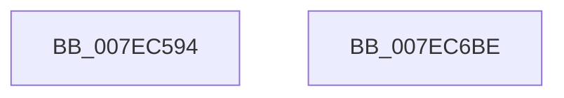

# CmpInitBackupHive

- RVA: `0x007EC594`–`0x007EC6BF` (길이 `299` bytes)
- VA: `0x00000001407EC594`
- 실행 섹션: `PAGE`
- PDB 이름 있음: `예`; PDB Function 태그: `아니요`
- unwind 정보 RVA: `0x000D6EE0`
- 디코드: `67`개 명령, `299/299` bytes 표시
- 미해석 바이트: `0` (있으면 어셈블리에 `.byte`로 보존)

> 이 문서는 커널 이미지의 기계어와 PDB 기호를 분석해 생성했습니다. 4번과 5번은 함수 원형과 자료형을 바이너리 사용 방식에서 추정한 C 해석이며 원본 소스 복구 결과는 아닙니다.

## 1. Dependencies

- 직접 호출 지점: **6**; 고유 호출 대상: **4**
- 직접 호출자로 확인된 함수: **2**
- RIP 상대 이미지 참조: **3**

### Outgoing calls
- `0x007EC5FF` → [RtlInitUnicodeString](../../text/42/RtlInitUnicodeString_function_0042A780.md) (function, `0x0042A780`)
- `0x007EC60E` → [RtlAppendStringToString](../A9/RtlAppendStringToString_function_00A97740.md) (function, `0x00A97740`)
- `0x007EC61B` → [RtlInitUnicodeString](../../text/42/RtlInitUnicodeString_function_0042A780.md) (function, `0x0042A780`)
- `0x007EC62A` → [RtlAppendStringToString](../A9/RtlAppendStringToString_function_00A97740.md) (function, `0x00A97740`)
- `0x007EC695` → [ZwCreateFile](../../text/6A/ZwCreateFile_function_006ADB70.md) (function, `0x006ADB70`)
- `0x007EC6A1` → [_security_check_cookie](../../text/6A/_security_check_cookie_function_006AC640.md) (function, `0x006AC640`)

### Direct callers
- [CmpLoadHiveThread](../7D/CmpLoadHiveThread_function_007DB040.md) at `0x007DB544`
- [CmpLoadHiveThread](../7D/CmpLoadHiveThread_function_007DB040.md) at `0x007DBA6A`
- [CmpFlushBackupHive](CmpFlushBackupHive_function_007EC1A8.md) at `0x007EC305`

### Static image references
- `0x007EC5AE` → RVA `0x00E0A740` (`.data`; read)
- `0x007EC5E5` → RVA `0x00B09940` (` ?? ::NNGAKEGL::`string'`; read)
- `0x007EC666` → RVA `0x00EEFC28` (`.data`; read)

## 2. Other-region calls and transfers

- 다른 실행 섹션으로 향하는 call: **4**
  - `0x007EC5FF` → [RtlInitUnicodeString](../../text/42/RtlInitUnicodeString_function_0042A780.md) (`PAGE` → `.text`)
  - `0x007EC61B` → [RtlInitUnicodeString](../../text/42/RtlInitUnicodeString_function_0042A780.md) (`PAGE` → `.text`)
  - `0x007EC695` → [ZwCreateFile](../../text/6A/ZwCreateFile_function_006ADB70.md) (`PAGE` → `.text`)
  - `0x007EC6A1` → [_security_check_cookie](../../text/6A/_security_check_cookie_function_006AC640.md) (`PAGE` → `.text`)
- 별도 외부 분기/꼬리 이동을 확인하지 못했습니다.

## 3. Assembly (complete function range)

```asm
007EC594  48 89 5C 24 18                  mov qword ptr [rsp + 0x18], rbx
007EC599  48 89 74 24 20                  mov qword ptr [rsp + 0x20], rsi
007EC59E  55                              push rbp
007EC59F  57                              push rdi
007EC5A0  41 56                           push r14
007EC5A2  48 8D 6C 24 B0                  lea rbp, [rsp - 0x50]
007EC5A7  48 81 EC 50 01 00 00            sub rsp, 0x150
007EC5AE  48 8B 05 8B E1 61 00            mov rax, qword ptr [rip + 0x61e18b]
007EC5B5  48 33 C4                        xor rax, rsp
007EC5B8  48 89 45 40                     mov qword ptr [rbp + 0x40], rax
007EC5BC  48 8B DA                        mov rbx, rdx
007EC5BF  48 C7 44 24 60 00 00 80 00      mov qword ptr [rsp + 0x60], 0x800000
007EC5C8  48 8B F9                        mov rdi, rcx
007EC5CB  48 8D 45 C0                     lea rax, [rbp - 0x40]
007EC5CF  45 33 F6                        xor r14d, r14d
007EC5D2  48 89 44 24 68                  mov qword ptr [rsp + 0x68], rax
007EC5D7  0F 57 C0                        xorps xmm0, xmm0
007EC5DA  44 89 75 84                     mov dword ptr [rbp - 0x7c], r14d
007EC5DE  0F 57 C9                        xorps xmm1, xmm1
007EC5E1  44 89 75 9C                     mov dword ptr [rbp - 0x64], r14d
007EC5E5  48 8D 15 54 D3 31 00            lea rdx, [rip + 0x31d354]
007EC5EC  BE 80 00 00 00                  mov esi, 0x80
007EC5F1  48 8D 4C 24 70                  lea rcx, [rsp + 0x70]
007EC5F6  0F 11 45 B0                     movups xmmword ptr [rbp - 0x50], xmm0
007EC5FA  0F 11 4C 24 70                  movups xmmword ptr [rsp + 0x70], xmm1
007EC5FF  E8 7C E1 C3 FF                  call 0x14042a780
007EC604  48 8D 54 24 70                  lea rdx, [rsp + 0x70]
007EC609  48 8D 4C 24 60                  lea rcx, [rsp + 0x60]
007EC60E  E8 2D B1 2A 00                  call 0x140a97740
007EC613  48 8B D3                        mov rdx, rbx
007EC616  48 8D 4C 24 70                  lea rcx, [rsp + 0x70]
007EC61B  E8 60 E1 C3 FF                  call 0x14042a780
007EC620  48 8D 54 24 70                  lea rdx, [rsp + 0x70]
007EC625  48 8D 4C 24 60                  lea rcx, [rsp + 0x60]
007EC62A  E8 11 B1 2A 00                  call 0x140a97740
007EC62F  44 89 74 24 50                  mov dword ptr [rsp + 0x50], r14d
007EC634  48 8D 44 24 60                  lea rax, [rsp + 0x60]
007EC639  4C 89 74 24 48                  mov qword ptr [rsp + 0x48], r14
007EC63E  48 8D 8F 20 06 00 00            lea rcx, [rdi + 0x620]
007EC645  C7 44 24 40 08 C8 00 00         mov dword ptr [rsp + 0x40], 0xc808
007EC64D  4C 8D 4D B0                     lea r9, [rbp - 0x50]
007EC651  C7 44 24 38 03 00 00 00         mov dword ptr [rsp + 0x38], 3
007EC659  4C 8D 45 80                     lea r8, [rbp - 0x80]
007EC65D  48 89 45 90                     mov qword ptr [rbp - 0x70], rax
007EC661  BA 03 00 01 00                  mov edx, 0x10003
007EC666  48 8B 05 BB 35 70 00            mov rax, qword ptr [rip + 0x7035bb]
007EC66D  44 89 74 24 30                  mov dword ptr [rsp + 0x30], r14d
007EC672  89 74 24 28                     mov dword ptr [rsp + 0x28], esi
007EC676  48 89 45 A0                     mov qword ptr [rbp - 0x60], rax
007EC67A  4C 89 74 24 20                  mov qword ptr [rsp + 0x20], r14
007EC67F  C7 45 80 30 00 00 00            mov dword ptr [rbp - 0x80], 0x30
007EC686  4C 89 75 88                     mov qword ptr [rbp - 0x78], r14
007EC68A  C7 45 98 40 02 00 00            mov dword ptr [rbp - 0x68], 0x240
007EC691  4C 89 75 A8                     mov qword ptr [rbp - 0x58], r14
007EC695  E8 D6 14 EC FF                  call 0x1406adb70
007EC69A  48 8B 4D 40                     mov rcx, qword ptr [rbp + 0x40]
007EC69E  48 33 CC                        xor rcx, rsp
007EC6A1  E8 9A FF EB FF                  call 0x1406ac640
007EC6A6  4C 8D 9C 24 50 01 00 00         lea r11, [rsp + 0x150]
007EC6AE  49 8B 5B 30                     mov rbx, qword ptr [r11 + 0x30]
007EC6B2  49 8B 73 38                     mov rsi, qword ptr [r11 + 0x38]
007EC6B6  49 8B E3                        mov rsp, r11
007EC6B9  41 5E                           pop r14
007EC6BB  5F                              pop rdi
007EC6BC  5D                              pop rbp
007EC6BD  C3                              ret
007EC6BE  CC                              int3
```

## 4. C-style interpretation (structured pseudocode)

```c
__int64 __fastcall CmpInitBackupHive(__int64 a1, __int64 a2)
{
    __int64 result;
    __int64 v_r14;
    __int64 v_rsp;
    unsigned __int64 v_stack_m100;
    unsigned __int64 v_stack_m108;
    unsigned int v_stack_m118;
    unsigned __int64 v_stack_m120;
    unsigned int v_stack_m128;
    unsigned int v_stack_m130;
    unsigned int v_stack_m138;
    unsigned int v_stack_m140;
    unsigned __int64 v_stack_m148;
    unsigned __int64 v_stack_m18;
    unsigned __int64 v_stack_m28;
    unsigned __int64 v_stack_m68;
    unsigned __int64 v_stack_mA8;
    unsigned __int64 v_stack_mB8;
    unsigned __int64 v_stack_mC0;
    unsigned __int64 v_stack_mC8;
    unsigned int v_stack_mCC;
    unsigned int v_stack_mD0;
    unsigned __int64 v_stack_mD8;
    unsigned __int64 v_stack_mE0;
    unsigned int v_stack_mE4;
    unsigned __int64 v_stack_mE8;
    unsigned __int64 v_stack_mF8;
    unsigned __int64 v_stack_p18;
    unsigned __int64 v_stack_p20;

    v_stack_p18 = v_rbx;
    v_stack_p20 = v_rsi;
    v_rsp = (v_rsp) - (336);
    result = (*(unsigned __int64 *)(v_rip + 6414731)) ^ (v_rsp);
    v_stack_m28 = result;
    v_stack_m108 = 0x800000ULL;
    v_r14 = 0;
    v_stack_m100 = v_stack_mA8;
    v_stack_mE4 = 0;
    v_stack_mCC = 0;
    v_stack_mB8 = v_xmm0;
    v_stack_mF8 = v_xmm1;
    result = RtlInitUnicodeString(v_stack_mF8, v_rip + 3265364, a3, a4);
    result = RtlAppendStringToString(v_stack_m108, v_stack_mF8, a3, a4);
    result = RtlInitUnicodeString(v_stack_mF8, a2, a3, a4);
    result = RtlAppendStringToString(v_stack_m108, v_stack_mF8, a3, a4);
    v_stack_m118 = 0;
    v_stack_m120 = 0;
    v_stack_m128 = 0xC808ULL;
    v_stack_m130 = 3;
    v_stack_mD8 = v_stack_m108;
    v_stack_m138 = 0;
    v_stack_m140 = 128;
    v_stack_mC8 = *(unsigned __int64 *)(v_rip + 7353787);
    v_stack_m148 = 0;
    v_stack_mE8 = 48;
    v_stack_mE0 = 0;
    v_stack_mD0 = 576;
    v_stack_mC0 = 0;
    result = ZwCreateFile(a1 + 1568, (unsigned int)(0x10003ULL), v_stack_mE8, v_stack_mB8);
    a1 = (v_stack_m28) ^ (v_rsp);
    result = _security_check_cookie(a1, (unsigned int)(0x10003ULL), v_stack_mE8, v_stack_mB8);
    return result;
}
```

## 5. (Beta) C Style

```c
int64_t CmpInitBackupHive(void *Arg1, int64_t Arg2)
{
    uint8_t *arg1 = (uint8_t *)Arg1;

    int64_t result;
    int64_t local_r14;
    int64_t local_rsp;
    uint64_t v_stack_m100;
    uint64_t v_stack_m108;
    uint32_t v_stack_m118;
    uint64_t v_stack_m120;
    uint32_t v_stack_m128;
    uint32_t v_stack_m130;
    uint32_t v_stack_m138;
    uint32_t v_stack_m140;
    uint64_t v_stack_m148;
    uint64_t v_stack_m18;
    uint64_t v_stack_m28;
    uint64_t v_stack_m68;
    uint64_t v_stack_mA8;
    uint64_t v_stack_mB8;
    uint64_t v_stack_mC0;
    uint64_t v_stack_mC8;
    uint32_t v_stack_mCC;
    uint32_t v_stack_mD0;
    uint64_t v_stack_mD8;
    uint64_t v_stack_mE0;
    uint32_t v_stack_mE4;
    uint64_t v_stack_mE8;
    uint64_t v_stack_mF8;
    uint64_t v_stack_p18;
    uint64_t v_stack_p20;

    v_stack_p18 = local_rbx;
    v_stack_p20 = local_rsi;
    local_rsp = (local_rsp) - (336);
    result = (*(uint64_t *)(v_rip + 0x61E18B)) ^ (local_rsp);
    v_stack_m28 = result;
    v_stack_m108 = 0x800000ULL;
    local_r14 = 0;
    v_stack_m100 = v_stack_mA8;
    v_stack_mE4 = 0;
    v_stack_mCC = 0;
    v_stack_mB8 = v_xmm0;
    v_stack_mF8 = v_xmm1;
    result = RtlInitUnicodeString(v_stack_mF8, v_rip + 3265364, a3, a4);
    result = RtlAppendStringToString(v_stack_m108, v_stack_mF8, a3, a4);
    result = RtlInitUnicodeString(v_stack_mF8, Arg2, a3, a4);
    result = RtlAppendStringToString(v_stack_m108, v_stack_mF8, a3, a4);
    v_stack_m118 = 0;
    v_stack_m120 = 0;
    v_stack_m128 = 0xC808ULL;
    v_stack_m130 = 3;
    v_stack_mD8 = v_stack_m108;
    v_stack_m138 = 0;
    v_stack_m140 = 128;
    v_stack_mC8 = *(uint64_t *)(v_rip + 0x7035BB);
    v_stack_m148 = 0;
    v_stack_mE8 = 48;
    v_stack_mE0 = 0;
    v_stack_mD0 = 576;
    v_stack_mC0 = 0;
    result = ZwCreateFile(Arg1 + 1568, (uint32_t)(0x10003ULL), v_stack_mE8, v_stack_mB8);
    Arg1 = (v_stack_m28) ^ (local_rsp);
    result = _security_check_cookie(Arg1, (uint32_t)(0x10003ULL), v_stack_mE8, v_stack_mB8);
    return result;
}
```

### 관측된 메모리 오프셋

구조체 형식이 확인되지 않은 접근은 인자 기준의 오프셋으로만 기록했습니다.

| 기준 인자 | 오프셋 표현 | 폭 (bit) | 접근 |
|---|---:|---:|---|
| `Arg1` | `+ 0x620` | `64` | `R` |

## 6. Execution-region graph

[열기: 2D/3D 그래프와 함수 탐색 컨트롤 패널](../../../control-panel.html?section=page&rva=0x007EC594&view=graph)

- 2D 그래프는 위에서 아래로 흐르고, 3D 그래프는 빈 공간을 드래그해 회전합니다. Shift+드래그는 이동, 휠은 확대·축소, 함수 노드 선택은 대상 보고서 이동입니다.

### Static fallback


