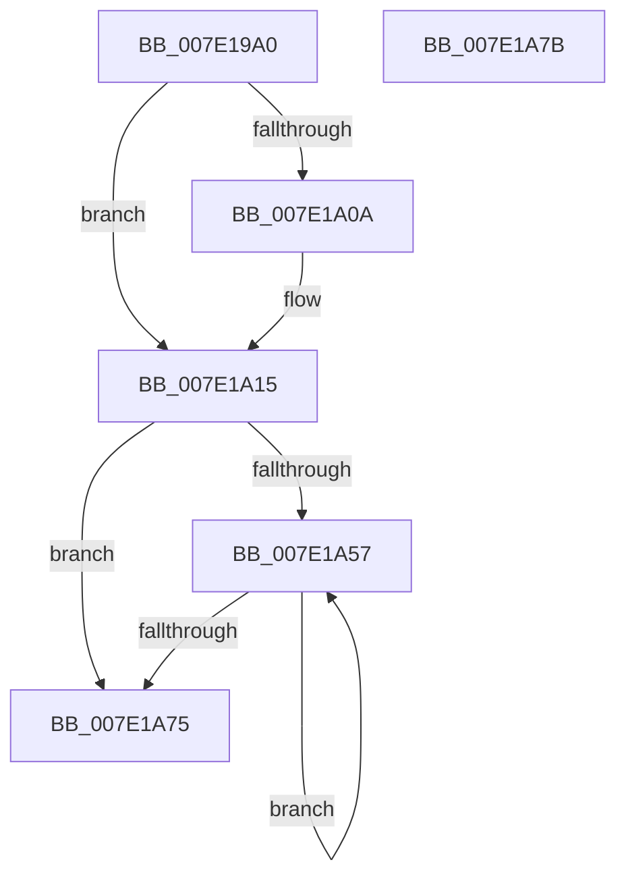

# CmpInitCallbacks

- RVA: `0x007E19A0`–`0x007E1A7C` (길이 `220` bytes)
- VA: `0x00000001407E19A0`
- 실행 섹션: `PAGE`
- PDB 이름 있음: `예`; PDB Function 태그: `아니요`
- unwind 정보 RVA: `0x00064C80`
- 디코드: `47`개 명령, `220/220` bytes 표시
- 미해석 바이트: `0` (있으면 어셈블리에 `.byte`로 보존)

> 이 문서는 커널 이미지의 기계어와 PDB 기호를 분석해 생성했습니다. 4번과 5번은 함수 원형과 자료형을 바이너리 사용 방식에서 추정한 C 해석이며 원본 소스 복구 결과는 아닙니다.

## 1. Dependencies

- 직접 호출 지점: **4**; 고유 호출 대상: **4**
- 직접 호출자로 확인된 함수: **1**
- RIP 상대 이미지 참조: **16**

### Outgoing calls
- `0x007E19E6` → [RtlInitUnicodeString](../../text/42/RtlInitUnicodeString_function_0042A780.md) (function, `0x0042A780`)
- `0x007E1A0F` → [RtlRaiseStatus](../../text/2F/RtlRaiseStatus_function_002F6A50.md) (function, `0x002F6A50`)
- `0x007E1A48` → [ExInitializeSystemLookasideList](../../pagelk/B7/ExInitializeSystemLookasideList_function_00B7E57C.md) (function, `0x00B7E57C`)
- `0x007E1A64` → [CmInitializeProcessorCallbacks](CmInitializeProcessorCallbacks_function_007E143C.md) (function, `0x007E143C`)

### Direct callers
- [CmInitSystem1](../../init/C5/CmInitSystem1_function_00C559CC.md) at `0x00C55C4A`

### Static image references
- `0x007E19A8` → RVA `0x00EF7BE0` (`.data`; read)
- `0x007E19AF` → RVA `0x0003A6F0` (`.rdata`; read)
- `0x007E19B6` → RVA `0x00EEFB88` (`.data`; write)
- `0x007E19BC` → RVA `0x00EEFB90` (`.data`; read)
- `0x007E19C3` → RVA `0x00EF7BE8` (`.data`; write)
- `0x007E19CA` → RVA `0x00EF7BE0` (`.data`; write)
- `0x007E19D1` → RVA `0x00EF7BD0` (`.data`; write)
- `0x007E19D8` → RVA `0x00EF7BC8` (`.data`; write)
- `0x007E19DF` → RVA `0x00EF7BB8` (`.data`; write)
- `0x007E19F8` → RVA `0x00EF7BC0` (`.data`; write)
- `0x007E19FF` → RVA `0x00E2C980` (`.data`; read)
- `0x007E1A1A` → RVA `0x00EFAC00` (`.data`; read)
- `0x007E1A2F` → RVA `0x00E2C980` (`.data`; write)
- `0x007E1A36` → RVA `0x00E2C9C0` (`.data`; read)
- `0x007E1A4D` → RVA `0x00FC6A80` (`ALMOSTRO`; read)
- `0x007E1A57` → RVA `0x00FC8C40` (`ALMOSTRO`; read)

## 2. Other-region calls and transfers

- 다른 실행 섹션으로 향하는 call: **3**
  - `0x007E19E6` → [RtlInitUnicodeString](../../text/42/RtlInitUnicodeString_function_0042A780.md) (`PAGE` → `.text`)
  - `0x007E1A0F` → [RtlRaiseStatus](../../text/2F/RtlRaiseStatus_function_002F6A50.md) (`PAGE` → `.text`)
  - `0x007E1A48` → [ExInitializeSystemLookasideList](../../pagelk/B7/ExInitializeSystemLookasideList_function_00B7E57C.md) (`PAGE` → `PAGELK`)
- 별도 외부 분기/꼬리 이동을 확인하지 못했습니다.

## 3. Assembly (complete function range)

```asm
007E19A0  40 53                           push rbx
007E19A2  48 83 EC 30                     sub rsp, 0x30
007E19A6  33 DB                           xor ebx, ebx
007E19A8  48 8D 05 31 62 71 00            lea rax, [rip + 0x716231]
007E19AF  48 8D 15 3A 8D 85 FF            lea rdx, [rip - 0x7a72c6]
007E19B6  89 1D CC E1 70 00               mov dword ptr [rip + 0x70e1cc], ebx
007E19BC  48 8D 0D CD E1 70 00            lea rcx, [rip + 0x70e1cd]
007E19C3  48 89 05 1E 62 71 00            mov qword ptr [rip + 0x71621e], rax
007E19CA  48 89 05 0F 62 71 00            mov qword ptr [rip + 0x71620f], rax
007E19D1  48 89 1D F8 61 71 00            mov qword ptr [rip + 0x7161f8], rbx
007E19D8  48 89 1D E9 61 71 00            mov qword ptr [rip + 0x7161e9], rbx
007E19DF  48 89 1D D2 61 71 00            mov qword ptr [rip + 0x7161d2], rbx
007E19E6  E8 95 8D C4 FF                  call 0x14042a780
007E19EB  48 B8 14 00 00 00 80 F7 FF FF   movabs rax, 0xfffff78000000014
007E19F5  48 8B 00                        mov rax, qword ptr [rax]
007E19F8  48 89 05 C1 61 71 00            mov qword ptr [rip + 0x7161c1], rax
007E19FF  48 8D 05 7A AF 64 00            lea rax, [rip + 0x64af7a]
007E1A06  A8 0F                           test al, 0xf
007E1A08  74 0B                           je 0x1407e1a15
007E1A0A  B9 02 00 00 80                  mov ecx, 0x80000002
007E1A0F  E8 3C 50 B1 FF                  call 0x1402f6a50
007E1A14  CC                              int3
007E1A15  BA 01 00 00 00                  mov edx, 1
007E1A1A  48 8D 05 DF 91 71 00            lea rax, [rip + 0x7191df]
007E1A21  0F 57 C0                        xorps xmm0, xmm0
007E1A24  48 89 44 24 28                  mov qword ptr [rsp + 0x28], rax
007E1A29  41 B9 43 4D 63 69               mov r9d, 0x69634d43
007E1A2F  0F 29 05 4A AF 64 00            movaps xmmword ptr [rip + 0x64af4a], xmm0
007E1A36  48 8D 0D 83 AF 64 00            lea rcx, [rip + 0x64af83]
007E1A3D  66 C7 44 24 20 40 00            mov word ptr [rsp + 0x20], 0x40
007E1A44  44 8D 42 2F                     lea r8d, [rdx + 0x2f]
007E1A48  E8 2F CB 39 00                  call 0x140b7e57c
007E1A4D  8B 05 2D 50 7E 00               mov eax, dword ptr [rip + 0x7e502d]
007E1A53  85 C0                           test eax, eax
007E1A55  74 1E                           je 0x1407e1a75
007E1A57  48 8D 05 E2 71 7E 00            lea rax, [rip + 0x7e71e2]
007E1A5E  8B CB                           mov ecx, ebx
007E1A60  48 8B 0C C8                     mov rcx, qword ptr [rax + rcx*8]
007E1A64  E8 D3 F9 FF FF                  call 0x1407e143c
007E1A69  8B 05 11 50 7E 00               mov eax, dword ptr [rip + 0x7e5011]
007E1A6F  FF C3                           inc ebx
007E1A71  3B D8                           cmp ebx, eax
007E1A73  72 E2                           jb 0x1407e1a57
007E1A75  48 83 C4 30                     add rsp, 0x30
007E1A79  5B                              pop rbx
007E1A7A  C3                              ret
007E1A7B  CC                              int3
```

## 4. C-style interpretation (structured pseudocode)

```c
__int64 __fastcall CmpInitCallbacks(void)
{
    __int64 result;
    __int64 v_rbx;
    __int64 v_rsp;
    unsigned __int64 v_stack_m10;
    unsigned __int16 v_stack_m18;

    v_rsp = (v_rsp) - (48);
    v_rbx = 0;
    *(unsigned int *)(v_rip + 7397836) = 0;
    *(unsigned __int64 *)(v_rip + 7430686) = v_rip + 7430705;
    *(unsigned __int64 *)(v_rip + 7430671) = v_rip + 7430705;
    *(unsigned __int64 *)(v_rip + 7430648) = 0;
    *(unsigned __int64 *)(v_rip + 7430633) = 0;
    *(unsigned __int64 *)(v_rip + 7430610) = 0;
    result = RtlInitUnicodeString(v_rip + 7397837, v_rip - 8024774, a3, a4);
    *(unsigned __int64 *)(v_rip + 7430593) = *(unsigned __int64 *)(result);
    result = v_rip + 6598522;
    if ((((unsigned __int8)(v_rip + 6598522)) & (15)) != 0) {
        a1 = 0x80000002ULL;
        result = RtlRaiseStatus(a1, v_rip - 8024774, a3, a4);
    }
    v_stack_m10 = v_rip + 7442911;
    *(unsigned __int64 *)(v_rip + 6598474) = v_xmm0;
    v_stack_m18 = 64;
    result = ExInitializeSystemLookasideList(v_rip + 6598531, 1, 1 + 47, (unsigned int)(0x69634D43ULL));
    if ((unsigned int)((unsigned int)(*(unsigned int *)(v_rip + 8278061))) == 0) goto loc_007E1A75;
loc_007E1A57:
    result = CmInitializeProcessorCallbacks(*(unsigned __int64 *)(v_rip + 8286690 + 0 * 8), 1, 1 + 47, (unsigned int)(0x69634D43ULL));
    v_rbx = (unsigned int)((v_rbx) + 1);
    if (((unsigned int)(v_rbx)) < ((unsigned int)((unsigned int)(*(unsigned int *)(v_rip + 8278033))))) goto loc_007E1A57;
loc_007E1A75:
    v_rsp = (v_rsp) + (48);
    return (unsigned int)(*(unsigned int *)(v_rip + 8278033));
}
```

## 5. (Beta) C Style

```c
void CmpInitCallbacks(void)
{
    int64_t result;
    int64_t local_rbx;
    int64_t local_rsp;
    uint64_t v_stack_m10;
    uint16_t v_stack_m18;

    local_rsp = (local_rsp) - (48);
    local_rbx = 0;
    *(uint32_t *)(v_rip + 0x70E1CC) = 0;
    *(uint64_t *)(v_rip + 0x71621E) = v_rip + 7430705;
    *(uint64_t *)(v_rip + 0x71620F) = v_rip + 7430705;
    *(uint64_t *)(v_rip + 0x7161F8) = 0;
    *(uint64_t *)(v_rip + 0x7161E9) = 0;
    *(uint64_t *)(v_rip + 0x7161D2) = 0;
    result = RtlInitUnicodeString(v_rip + 7397837, v_rip - 8024774, a3, a4);
    *(uint64_t *)(v_rip + 0x7161C1) = *(uint64_t *)(result);
    result = v_rip + 6598522;
    if ((((uint8_t)(v_rip + 6598522)) & (15)) != 0) {
        a1 = 0x80000002ULL;
        result = RtlRaiseStatus(a1, v_rip - 8024774, a3, a4);
    }
    v_stack_m10 = v_rip + 7442911;
    *(uint64_t *)(v_rip + 0x64AF4A) = v_xmm0;
    v_stack_m18 = 64;
    result = ExInitializeSystemLookasideList(v_rip + 6598531, 1, 1 + 47, (uint32_t)(0x69634D43ULL));
    if ((uint32_t)((uint32_t)(*(uint32_t *)(v_rip + 0x7E502D))) == 0) goto loc_007E1A75;
loc_007E1A57:
    result = CmInitializeProcessorCallbacks(*(uint64_t *)(v_rip + 0x7E71E2 + 0x0 * 8), 1, 1 + 47, (uint32_t)(0x69634D43ULL));
    local_rbx = (uint32_t)((local_rbx) + 1);
    if (((uint32_t)(local_rbx)) < ((uint32_t)((uint32_t)(*(uint32_t *)(v_rip + 0x7E5011))))) goto loc_007E1A57;
loc_007E1A75:
    local_rsp = (local_rsp) + (48);
    return (uint32_t)(*(uint32_t *)(v_rip + 0x7E5011));
}
```

## 6. Execution-region graph

[열기: 2D/3D 그래프와 함수 탐색 컨트롤 패널](../../../control-panel.html?section=page&rva=0x007E19A0&view=graph)

- 2D 그래프는 위에서 아래로 흐르고, 3D 그래프는 빈 공간을 드래그해 회전합니다. Shift+드래그는 이동, 휠은 확대·축소, 함수 노드 선택은 대상 보고서 이동입니다.

### Static fallback


