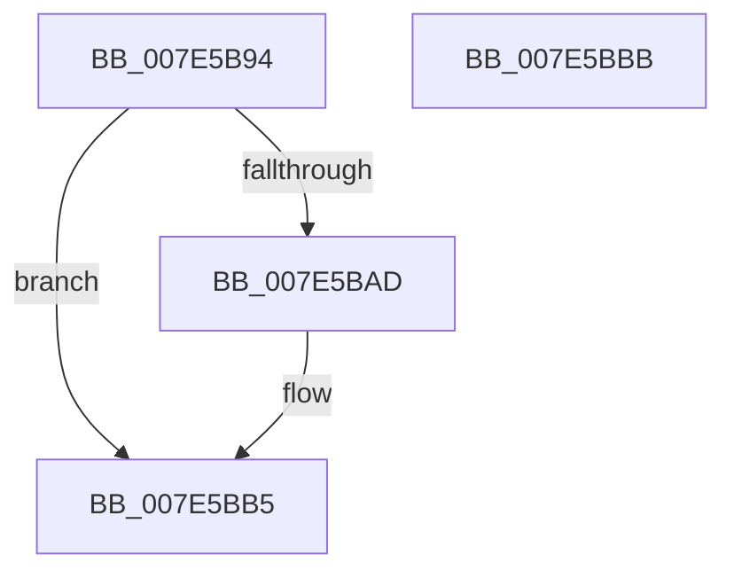

# CmpInitSiloSupport

- RVA: `0x007E5B94`–`0x007E5BBC` (길이 `40` bytes)
- VA: `0x00000001407E5B94`
- 실행 섹션: `PAGE`
- PDB 이름 있음: `예`; PDB Function 태그: `아니요`
- unwind 정보 RVA: `0x0005CF00`
- 디코드: `13`개 명령, `40/40` bytes 표시
- 미해석 바이트: `0` (있으면 어셈블리에 `.byte`로 보존)

> 이 문서는 커널 이미지의 기계어와 PDB 기호를 분석해 생성했습니다. 4번과 5번은 함수 원형과 자료형을 바이너리 사용 방식에서 추정한 C 해석이며 원본 소스 복구 결과는 아닙니다.

## 1. Dependencies

- 직접 호출 지점: **2**; 고유 호출 대상: **2**
- 직접 호출자로 확인된 함수: **1**
- RIP 상대 이미지 참조: **1**

### Outgoing calls
- `0x007E5BA4` → [PspStorageAllocSlot](../78/PspStorageAllocSlot_function_00789B68.md) (function, `0x00789B68`)
- `0x007E5BB0` → [CmInitServerSiloState](CmInitServerSiloState_function_007E5B14.md) (function, `0x007E5B14`)

### Direct callers
- [CmInitSystem1](../../init/C5/CmInitSystem1_function_00C559CC.md) at `0x00C55DE0`

### Static image references
- `0x007E5B9D` → RVA `0x00EF7A50` (`.data`; read)

## 2. Other-region calls and transfers

- 다른 실행 섹션으로 향하는 call: **0**
- 별도 외부 분기/꼬리 이동을 확인하지 못했습니다.

## 3. Assembly (complete function range)

```asm
007E5B94  40 53                           push rbx
007E5B96  48 83 EC 20                     sub rsp, 0x20
007E5B9A  48 8B D9                        mov rbx, rcx
007E5B9D  48 8D 0D AC 1E 71 00            lea rcx, [rip + 0x711eac]
007E5BA4  E8 BF 3F FA FF                  call 0x140789b68
007E5BA9  85 C0                           test eax, eax
007E5BAB  78 08                           js 0x1407e5bb5
007E5BAD  48 8B CB                        mov rcx, rbx
007E5BB0  E8 5F FF FF FF                  call 0x1407e5b14
007E5BB5  48 83 C4 20                     add rsp, 0x20
007E5BB9  5B                              pop rbx
007E5BBA  C3                              ret
007E5BBB  CC                              int3
```

## 4. C-style interpretation (structured pseudocode)

```c
__int64 __fastcall CmpInitSiloSupport(__int64 a1)
{
    __int64 result;
    __int64 v_rsp;

    v_rsp = (v_rsp) - (32);
    result = PspStorageAllocSlot(v_rip + 7413420, a2, a3, a4);
    if (!(sign_flag)) {
        a1 = a1;
        result = CmInitServerSiloState(a1, a2, a3, a4);
    }
    v_rsp = (v_rsp) + (32);
    return result;
}
```

## 5. (Beta) C Style

```c
int64_t CmpInitSiloSupport(int64_t Arg1)
{
    int64_t result;
    int64_t local_rsp;

    local_rsp = (local_rsp) - (32);
    result = PspStorageAllocSlot(v_rip + 7413420, a2, a3, a4);
    if (!(sign_flag)) {
        Arg1 = Arg1;
        result = CmInitServerSiloState(Arg1, a2, a3, a4);
    }
    local_rsp = (local_rsp) + (32);
    return result;
}
```

## 6. Execution-region graph

[열기: 2D/3D 그래프와 함수 탐색 컨트롤 패널](../../../control-panel.html?section=page&rva=0x007E5B94&view=graph)

- 2D 그래프는 위에서 아래로 흐르고, 3D 그래프는 빈 공간을 드래그해 회전합니다. Shift+드래그는 이동, 휠은 확대·축소, 함수 노드 선택은 대상 보고서 이동입니다.

### Static fallback


