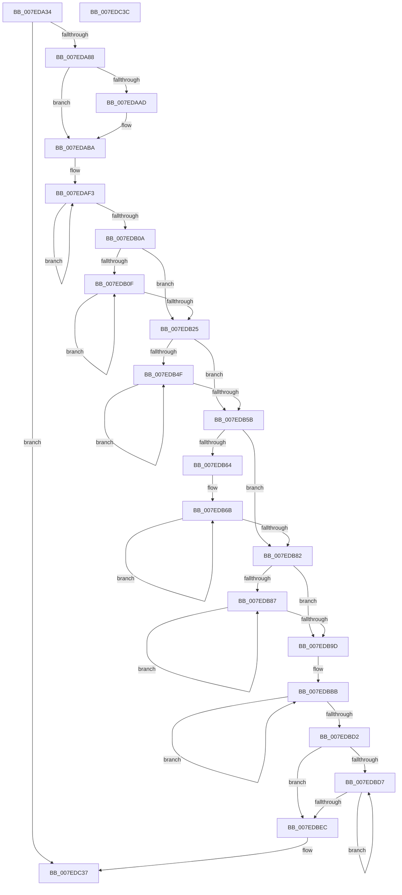

# CmpInitializeDelayedCloseTable

- RVA: `0x007EDA34`–`0x007EDC3D` (길이 `521` bytes)
- VA: `0x00000001407EDA34`
- 실행 섹션: `PAGE`
- PDB 이름 있음: `예`; PDB Function 태그: `아니요`
- unwind 정보 RVA: `0x0005C788`
- 디코드: `126`개 명령, `521/521` bytes 표시
- 미해석 바이트: `0` (있으면 어셈블리에 `.byte`로 보존)

> 이 문서는 커널 이미지의 기계어와 PDB 기호를 분석해 생성했습니다. 4번과 5번은 함수 원형과 자료형을 바이너리 사용 방식에서 추정한 C 해석이며 원본 소스 복구 결과는 아닙니다.

## 1. Dependencies

- 직접 호출 지점: **2**; 고유 호출 대상: **2**
- 직접 호출자로 확인된 함수: **1**
- RIP 상대 이미지 참조: **18**

### Outgoing calls
- `0x007EDA5D` → [KeInitializeGuardedMutex](../../text/46/KeInitializeGuardedMutex_function_00466E90.md) (function, `0x00466E90`)
- `0x007EDBF5` → [KiQueryUnbiasedInterruptTime](../../text/42/KiQueryUnbiasedInterruptTime_function_0042D180.md) (function, `0x0042D180`)

### Direct callers
- [CmInitSystem1](../../init/C5/CmInitSystem1_function_00C559CC.md) at `0x00C55C45`

### Static image references
- `0x007EDA38` → RVA `0x00EF58D8` (`.data`; read/write)
- `0x007EDA40` → RVA `0x009DB8E0` (`CmpDelayCloseWorker`; read)
- `0x007EDA47` → RVA `0x00EF58C0` (`.data`; read/write)
- `0x007EDA4F` → RVA `0x00EF5880` (`.data`; read)
- `0x007EDA56` → RVA `0x00EF58D0` (`.data`; write)
- `0x007EDA62` → RVA `0x00EF58E0` (`.data`; read)
- `0x007EDA69` → RVA `0x00EF58E8` (`.data`; write)
- `0x007EDA70` → RVA `0x00EF58E0` (`.data`; write)
- `0x007EDA7A` → RVA `0x00E62640` (`.data`; read)
- `0x007EDAA4` → RVA `0x00E62640` (`.data`; write)
- `0x007EDAC0` → RVA `0x012018C0` (`CFGRO`; read)
- `0x007EDAD8` → RVA `0x00E62648` (`.data`; write)
- `0x007EDB2C` → RVA `0x012018D0` (`CFGRO`; read)
- `0x007EDB35` → RVA `0x00E62658` (`.data`; write)
- `0x007EDB9D` → RVA `0x00E62660` (`.data`; write)
- `0x007EDBA4` → RVA `0x00FC7280` (`ALMOSTRO`; read)
- `0x007EDBEE` → RVA `0x00E62668` (`.data`; write)
- `0x007EDC30` → RVA `0x00E62650` (`.data`; write)

## 2. Other-region calls and transfers

- 다른 실행 섹션으로 향하는 call: **2**
  - `0x007EDA5D` → [KeInitializeGuardedMutex](../../text/46/KeInitializeGuardedMutex_function_00466E90.md) (`PAGE` → `.text`)
  - `0x007EDBF5` → [KiQueryUnbiasedInterruptTime](../../text/42/KiQueryUnbiasedInterruptTime_function_0042D180.md) (`PAGE` → `.text`)
- 별도 외부 분기/꼬리 이동을 확인하지 못했습니다.

## 3. Assembly (complete function range)

```asm
007EDA34  48 83 EC 28                     sub rsp, 0x28
007EDA38  48 83 25 98 7E 70 00 00         and qword ptr [rip + 0x707e98], 0
007EDA40  48 8D 05 99 DE 1E 00            lea rax, [rip + 0x1ede99]
007EDA47  48 83 25 71 7E 70 00 00         and qword ptr [rip + 0x707e71], 0
007EDA4F  48 8D 0D 2A 7E 70 00            lea rcx, [rip + 0x707e2a]
007EDA56  48 89 05 73 7E 70 00            mov qword ptr [rip + 0x707e73], rax
007EDA5D  E8 2E 94 C7 FF                  call 0x140466e90
007EDA62  48 8D 05 77 7E 70 00            lea rax, [rip + 0x707e77]
007EDA69  48 89 05 78 7E 70 00            mov qword ptr [rip + 0x707e78], rax
007EDA70  48 89 05 69 7E 70 00            mov qword ptr [rip + 0x707e69], rax
007EDA77  0F AE E8                        lfence
007EDA7A  48 83 3D BE 4B 67 00 00         cmp qword ptr [rip + 0x674bbe], 0
007EDA82  0F 85 AF 01 00 00               jne 0x1407edc37
007EDA88  0F 31                           rdtsc
007EDA8A  48 C1 E2 20                     shl rdx, 0x20
007EDA8E  B9 84 05 00 00                  mov ecx, 0x584
007EDA93  48 0B C2                        or rax, rdx
007EDA96  48 C1 E8 04                     shr rax, 4
007EDA9A  44 69 C0 BF CB 7F 02            imul r8d, eax, 0x27fcbbf
007EDAA1  4C 33 C1                        xor r8, rcx
007EDAA4  4C 89 05 95 4B 67 00            mov qword ptr [rip + 0x674b95], r8
007EDAAB  75 0D                           jne 0x1407edaba
007EDAAD  41 B8 01 00 00 00               mov r8d, 1
007EDAB3  4C 89 05 86 4B 67 00            mov qword ptr [rip + 0x674b86], r8
007EDABA  0F 31                           rdtsc
007EDABC  48 C1 E2 20                     shl rdx, 0x20
007EDAC0  4C 8D 15 F9 3D A1 00            lea r10, [rip + 0xa13df9]
007EDAC7  48 0B C2                        or rax, rdx
007EDACA  48 C1 E8 04                     shr rax, 4
007EDACE  44 69 D8 BF CB 7F 02            imul r11d, eax, 0x27fcbbf
007EDAD5  4C 33 D9                        xor r11, rcx
007EDAD8  4C 89 1D 69 4B 67 00            mov qword ptr [rip + 0x674b69], r11
007EDADF  0F 18 05 DA 3D A1 00            prefetchnta byte ptr [rip + 0xa13dda]
007EDAE6  41 B9 40 00 00 00               mov r9d, 0x40
007EDAEC  49 8B D0                        mov rdx, r8
007EDAEF  41 8D 41 C8                     lea eax, [r9 - 0x38]
007EDAF3  49 2B 12                        sub rdx, qword ptr [r10]
007EDAF6  41 8B CB                        mov ecx, r11d
007EDAF9  48 D3 CA                        ror rdx, cl
007EDAFC  49 83 C2 08                     add r10, 8
007EDB00  41 83 C1 F8                     add r9d, -8
007EDB04  48 83 E8 01                     sub rax, 1
007EDB08  75 E9                           jne 0x1407edaf3
007EDB0A  45 85 C9                        test r9d, r9d
007EDB0D  74 16                           je 0x1407edb25
007EDB0F  41 0F B6 02                     movzx eax, byte ptr [r10]
007EDB13  41 8B CB                        mov ecx, r11d
007EDB16  48 2B D0                        sub rdx, rax
007EDB19  49 FF C2                        inc r10
007EDB1C  48 D3 CA                        ror rdx, cl
007EDB1F  41 83 C1 FF                     add r9d, -1
007EDB23  75 EA                           jne 0x1407edb0f
007EDB25  4C 8B 15 94 3D A1 00            mov r10, qword ptr [rip + 0xa13d94]
007EDB2C  8B 05 9E 3D A1 00               mov eax, dword ptr [rip + 0xa13d9e]
007EDB32  49 8B CA                        mov rcx, r10
007EDB35  48 89 15 1C 4B 67 00            mov qword ptr [rip + 0x674b1c], rdx
007EDB3C  44 8D 0C 85 00 00 00 00         lea r9d, [rax*4]
007EDB44  41 8B C1                        mov eax, r9d
007EDB47  49 03 C2                        add rax, r10
007EDB4A  4C 3B D0                        cmp r10, rax
007EDB4D  73 0C                           jae 0x1407edb5b
007EDB4F  0F 18 01                        prefetchnta byte ptr [rcx]
007EDB52  48 83 C1 40                     add rcx, 0x40
007EDB56  48 3B C8                        cmp rcx, rax
007EDB59  72 F4                           jb 0x1407edb4f
007EDB5B  49 8B D0                        mov rdx, r8
007EDB5E  41 83 F9 08                     cmp r9d, 8
007EDB62  72 1E                           jb 0x1407edb82
007EDB64  41 8B C1                        mov eax, r9d
007EDB67  48 C1 E8 03                     shr rax, 3
007EDB6B  49 2B 12                        sub rdx, qword ptr [r10]
007EDB6E  41 8B CB                        mov ecx, r11d
007EDB71  48 D3 CA                        ror rdx, cl
007EDB74  49 83 C2 08                     add r10, 8
007EDB78  41 83 C1 F8                     add r9d, -8
007EDB7C  48 83 E8 01                     sub rax, 1
007EDB80  75 E9                           jne 0x1407edb6b
007EDB82  45 85 C9                        test r9d, r9d
007EDB85  74 16                           je 0x1407edb9d
007EDB87  41 0F B6 02                     movzx eax, byte ptr [r10]
007EDB8B  41 8B CB                        mov ecx, r11d
007EDB8E  48 2B D0                        sub rdx, rax
007EDB91  49 FF C2                        inc r10
007EDB94  48 D3 CA                        ror rdx, cl
007EDB97  41 83 C1 FF                     add r9d, -1
007EDB9B  75 EA                           jne 0x1407edb87
007EDB9D  48 89 15 BC 4A 67 00            mov qword ptr [rip + 0x674abc], rdx
007EDBA4  48 8D 15 D5 96 7D 00            lea rdx, [rip + 0x7d96d5]
007EDBAB  0F 18 05 CE 96 7D 00            prefetchnta byte ptr [rip + 0x7d96ce]
007EDBB2  B8 04 00 00 00                  mov eax, 4
007EDBB7  44 8D 48 1C                     lea r9d, [rax + 0x1c]
007EDBBB  4C 2B 02                        sub r8, qword ptr [rdx]
007EDBBE  41 8B CB                        mov ecx, r11d
007EDBC1  49 D3 C8                        ror r8, cl
007EDBC4  48 83 C2 08                     add rdx, 8
007EDBC8  41 83 C1 F8                     add r9d, -8
007EDBCC  48 83 E8 01                     sub rax, 1
007EDBD0  75 E9                           jne 0x1407edbbb
007EDBD2  45 85 C9                        test r9d, r9d
007EDBD5  74 15                           je 0x1407edbec
007EDBD7  0F B6 02                        movzx eax, byte ptr [rdx]
007EDBDA  41 8B CB                        mov ecx, r11d
007EDBDD  4C 2B C0                        sub r8, rax
007EDBE0  48 FF C2                        inc rdx
007EDBE3  49 D3 C8                        ror r8, cl
007EDBE6  41 83 C1 FF                     add r9d, -1
007EDBEA  75 EB                           jne 0x1407edbd7
007EDBEC  B1 01                           mov cl, 1
007EDBEE  4C 89 05 73 4A 67 00            mov qword ptr [rip + 0x674a73], r8
007EDBF5  E8 86 F5 C3 FF                  call 0x14042d180
007EDBFA  4C 8B D8                        mov r11, rax
007EDBFD  0F 31                           rdtsc
007EDBFF  48 C1 E2 20                     shl rdx, 0x20
007EDC03  48 B9 00 20 5F A0 12 00 00 00   movabs rcx, 0x12a05f2000
007EDC0D  48 0B C2                        or rax, rdx
007EDC10  33 D2                           xor edx, edx
007EDC12  48 C1 E8 04                     shr rax, 4
007EDC16  48 69 C0 BF CB 7F 02            imul rax, rax, 0x27fcbbf
007EDC1D  48 F7 F1                        div rcx
007EDC20  48 B8 00 40 23 0E 43 00 00 00   movabs rax, 0x430e234000
007EDC2A  48 03 C2                        add rax, rdx
007EDC2D  49 03 C3                        add rax, r11
007EDC30  48 89 05 19 4A 67 00            mov qword ptr [rip + 0x674a19], rax
007EDC37  48 83 C4 28                     add rsp, 0x28
007EDC3B  C3                              ret
007EDC3C  CC                              int3
```

## 4. C-style interpretation (structured pseudocode)

```c
__int64 __fastcall CmpInitializeDelayedCloseTable(__int64 a1, __int64 a2)
{
    __int64 result;
    __int64 v_r10;
    __int64 v_r11;
    __int64 v_rsp;

    v_rsp = (v_rsp) - (40);
    *(unsigned __int64 *)(v_rip + 7372403) = v_rip + 2023065;
    result = KeInitializeGuardedMutex(v_rip + 7372330, a2, a3, a4);
    *(unsigned __int64 *)(v_rip + 7372408) = v_rip + 7372407;
    *(unsigned __int64 *)(v_rip + 7372393) = v_rip + 7372407;
    if ((*(unsigned __int64 *)(v_rip + 6769598)) != 0) goto loc_007EDC37;
    a2 = (a2) << (32);
    result = (v_rip + 7372407) | (a2);
    result = (result) >> (4);
    a3 = (unsigned int)((a3) * ((unsigned int)(result)));
    a3 = (a3) ^ ((unsigned int)(0x584ULL));
    *(unsigned __int64 *)(v_rip + 6769557) = a3;
    if (!(condition_is_not_equal)) {
        a3 = 1;
        *(unsigned __int64 *)(v_rip + 6769542) = a3;
    }
    a2 = (a2) << (32);
    result = (result) | (a2);
    result = (result) >> (4);
    v_r11 = (unsigned int)((v_r11) * ((unsigned int)(result)));
    v_r11 = (v_r11) ^ ((unsigned int)(0x584ULL));
    *(unsigned __int64 *)(v_rip + 6769513) = v_r11;
loc_007EDAF3:
    a2 = (a3) - (*(unsigned __int64 *)(v_rip + 10567161));
    v_r10 = (v_rip + 10567161) + (8);
    a4 = (unsigned int)((64) + (-8));
    result = (64 - 56) - (1);
    if (condition_is_not_equal) goto loc_007EDAF3;
    if ((unsigned int)(a4) == 0) goto loc_007EDB25;
loc_007EDB0F:
    a2 = (a2) - (*(unsigned __int8 *)(v_r10));
    v_r10 = (v_r10) + 1;
    a4 = (unsigned int)((a4) + (-1));
    if (condition_is_not_equal) goto loc_007EDB0F;
loc_007EDB25:
    *(unsigned __int64 *)(v_rip + 6769436) = a2;
    result = ((unsigned int)((unsigned int)((unsigned int)(*(unsigned int *)(v_rip + 10567070)) * 4))) + (*(unsigned __int64 *)(v_rip + 10567060));
    if ((*(unsigned __int64 *)(v_rip + 10567060)) >= result) goto loc_007EDB5B;
loc_007EDB4F:
    a1 = (*(unsigned __int64 *)(v_rip + 10567060)) + (64);
    if (a1 < result) goto loc_007EDB4F;
loc_007EDB5B:
    if (((unsigned int)((unsigned int)(*(unsigned int *)(v_rip + 10567070)) * 4)) < 8) goto loc_007EDB82;
    result = ((unsigned int)((unsigned int)((unsigned int)(*(unsigned int *)(v_rip + 10567070)) * 4))) >> (3);
loc_007EDB6B:
    a2 = (a3) - (*(unsigned __int64 *)(*(unsigned __int64 *)(v_rip + 10567060)));
    v_r10 = (*(unsigned __int64 *)(v_rip + 10567060)) + (8);
    a4 = (unsigned int)(((unsigned int)(*(unsigned int *)(v_rip + 10567070)) * 4) + (-8));
    result = (result) - (1);
    if (condition_is_not_equal) goto loc_007EDB6B;
loc_007EDB82:
    if ((unsigned int)(a4) == 0) goto loc_007EDB9D;
loc_007EDB87:
    a2 = (a2) - (*(unsigned __int8 *)(v_r10));
    v_r10 = (v_r10) + 1;
    a4 = (unsigned int)((a4) + (-1));
    if (condition_is_not_equal) goto loc_007EDB87;
loc_007EDB9D:
    *(unsigned __int64 *)(v_rip + 6769340) = a2;
loc_007EDBBB:
    a3 = (a3) - (*(unsigned __int64 *)(v_rip + 8230613));
    a2 = (v_rip + 8230613) + (8);
    a4 = (unsigned int)((4 + 28) + (-8));
    result = (4) - (1);
    if (condition_is_not_equal) goto loc_007EDBBB;
    if ((unsigned int)(a4) == 0) goto loc_007EDBEC;
loc_007EDBD7:
    a3 = (a3) - (*(unsigned __int8 *)(a2));
    a2 = (a2) + 1;
    a4 = (unsigned int)((a4) + (-1));
    if (condition_is_not_equal) goto loc_007EDBD7;
loc_007EDBEC:
    *(unsigned __int64 *)(v_rip + 6769267) = a3;
    result = KiQueryUnbiasedInterruptTime(1, a2, a3, a4);
    a2 = (a2) << (32);
    result = (result) | (a2);
    a2 = 0;
    result = (result) >> (4);
    result = (result) * (result);
    result = (result) + (0);
    result = (result) + (result);
    *(unsigned __int64 *)(v_rip + 6769177) = result;
loc_007EDC37:
    v_rsp = (v_rsp) + (40);
    return result;
}
```

## 5. (Beta) C Style

```c
int64_t CmpInitializeDelayedCloseTable(int64_t Arg1, int64_t Arg2)
{
    int64_t result;
    int64_t local_r10;
    int64_t local_r11;
    int64_t local_rsp;

    local_rsp = (local_rsp) - (40);
    *(uint64_t *)(v_rip + 0x707E73) = v_rip + 2023065;
    result = KeInitializeGuardedMutex(v_rip + 7372330, Arg2, a3, a4);
    *(uint64_t *)(v_rip + 0x707E78) = v_rip + 7372407;
    *(uint64_t *)(v_rip + 0x707E69) = v_rip + 7372407;
    if ((*(uint64_t *)(v_rip + 0x674BBE)) != 0) goto loc_007EDC37;
    Arg2 = (Arg2) << (32);
    result = (v_rip + 7372407) | (Arg2);
    result = (result) >> (4);
    a3 = (uint32_t)((a3) * ((uint32_t)(result)));
    a3 = (a3) ^ ((uint32_t)(0x584ULL));
    *(uint64_t *)(v_rip + 0x674B95) = a3;
    if (!(condition_is_not_equal)) {
        a3 = 1;
        *(uint64_t *)(v_rip + 0x674B86) = a3;
    }
    Arg2 = (Arg2) << (32);
    result = (result) | (Arg2);
    result = (result) >> (4);
    local_r11 = (uint32_t)((local_r11) * ((uint32_t)(result)));
    local_r11 = (local_r11) ^ ((uint32_t)(0x584ULL));
    *(uint64_t *)(v_rip + 0x674B69) = local_r11;
loc_007EDAF3:
    Arg2 = (a3) - (*(uint64_t *)(v_rip + 0xA13DF9));
    local_r10 = (v_rip + 10567161) + (8);
    a4 = (uint32_t)((64) + (-8));
    result = (64 - 56) - (1);
    if (condition_is_not_equal) goto loc_007EDAF3;
    if ((uint32_t)(a4) == 0) goto loc_007EDB25;
loc_007EDB0F:
    Arg2 = (Arg2) - (*(uint8_t *)(local_r10));
    local_r10 = (local_r10) + 1;
    a4 = (uint32_t)((a4) + (-1));
    if (condition_is_not_equal) goto loc_007EDB0F;
loc_007EDB25:
    *(uint64_t *)(v_rip + 0x674B1C) = Arg2;
    result = ((uint32_t)((uint32_t)((uint32_t)(*(uint32_t *)(v_rip + 0xA13D9E)) * 4))) + (*(uint64_t *)(v_rip + 0xA13D94));
    if ((*(uint64_t *)(v_rip + 0xA13D94)) >= result) goto loc_007EDB5B;
loc_007EDB4F:
    Arg1 = (*(uint64_t *)(v_rip + 0xA13D94)) + (64);
    if (Arg1 < result) goto loc_007EDB4F;
loc_007EDB5B:
    if (((uint32_t)((uint32_t)(*(uint32_t *)(v_rip + 0xA13D9E)) * 4)) < 8) goto loc_007EDB82;
    result = ((uint32_t)((uint32_t)((uint32_t)(*(uint32_t *)(v_rip + 0xA13D9E)) * 4))) >> (3);
loc_007EDB6B:
    Arg2 = (a3) - (*(uint64_t *)(*(uint64_t *)(v_rip + 0xA13D94)));
    local_r10 = (*(uint64_t *)(v_rip + 0xA13D94)) + (8);
    a4 = (uint32_t)(((uint32_t)(*(uint32_t *)(v_rip + 0xA13D9E)) * 4) + (-8));
    result = (result) - (1);
    if (condition_is_not_equal) goto loc_007EDB6B;
loc_007EDB82:
    if ((uint32_t)(a4) == 0) goto loc_007EDB9D;
loc_007EDB87:
    Arg2 = (Arg2) - (*(uint8_t *)(local_r10));
    local_r10 = (local_r10) + 1;
    a4 = (uint32_t)((a4) + (-1));
    if (condition_is_not_equal) goto loc_007EDB87;
loc_007EDB9D:
    *(uint64_t *)(v_rip + 0x674ABC) = Arg2;
loc_007EDBBB:
    a3 = (a3) - (*(uint64_t *)(v_rip + 0x7D96D5));
    Arg2 = (v_rip + 8230613) + (8);
    a4 = (uint32_t)((4 + 28) + (-8));
    result = (4) - (1);
    if (condition_is_not_equal) goto loc_007EDBBB;
    if ((uint32_t)(a4) == 0) goto loc_007EDBEC;
loc_007EDBD7:
    a3 = (a3) - (*(uint8_t *)(Arg2));
    Arg2 = (Arg2) + 1;
    a4 = (uint32_t)((a4) + (-1));
    if (condition_is_not_equal) goto loc_007EDBD7;
loc_007EDBEC:
    *(uint64_t *)(v_rip + 0x674A73) = a3;
    result = KiQueryUnbiasedInterruptTime(1, Arg2, a3, a4);
    Arg2 = (Arg2) << (32);
    result = (result) | (Arg2);
    Arg2 = 0;
    result = (result) >> (4);
    result = (result) * (result);
    result = (result) + (0);
    result = (result) + (result);
    *(uint64_t *)(v_rip + 0x674A19) = result;
loc_007EDC37:
    local_rsp = (local_rsp) + (40);
    return result;
}
```

## 6. Execution-region graph

[열기: 2D/3D 그래프와 함수 탐색 컨트롤 패널](../../../control-panel.html?section=page&rva=0x007EDA34&view=graph)

- 2D 그래프는 위에서 아래로 흐르고, 3D 그래프는 빈 공간을 드래그해 회전합니다. Shift+드래그는 이동, 휠은 확대·축소, 함수 노드 선택은 대상 보고서 이동입니다.

### Static fallback


