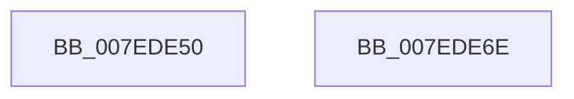

# CmpInitializeGlobalKeyLockTracker

- RVA: `0x007EDE50`–`0x007EDE6F` (길이 `31` bytes)
- VA: `0x00000001407EDE50`
- 실행 섹션: `PAGE`
- PDB 이름 있음: `예`; PDB Function 태그: `아니요`
- unwind 정보 RVA: `0x000DB714`
- 디코드: `6`개 명령, `31/31` bytes 표시
- 미해석 바이트: `0` (있으면 어셈블리에 `.byte`로 보존)

> 이 문서는 커널 이미지의 기계어와 PDB 기호를 분석해 생성했습니다. 4번과 5번은 함수 원형과 자료형을 바이너리 사용 방식에서 추정한 C 해석이며 원본 소스 복구 결과는 아닙니다.

## 1. Dependencies

- 직접 호출 지점: **0**; 고유 호출 대상: **0**
- 직접 호출자로 확인된 함수: **1**
- RIP 상대 이미지 참조: **4**

### Outgoing calls
- 직접 디코드된 call 명령이 없습니다.

### Direct callers
- [CmInitSystem1](../../init/C5/CmInitSystem1_function_00C559CC.md) at `0x00C55C63`

### Static image references
- `0x007EDE50` → RVA `0x00EF5860` (`.data`; read/write)
- `0x007EDE58` → RVA `0x00EF5868` (`.data`; read)
- `0x007EDE5F` → RVA `0x00EF5870` (`.data`; write)
- `0x007EDE66` → RVA `0x00EF5868` (`.data`; write)

## 2. Other-region calls and transfers

- 다른 실행 섹션으로 향하는 call: **0**
- 별도 외부 분기/꼬리 이동을 확인하지 못했습니다.

## 3. Assembly (complete function range)

```asm
007EDE50  48 83 25 08 7A 70 00 00         and qword ptr [rip + 0x707a08], 0
007EDE58  48 8D 05 09 7A 70 00            lea rax, [rip + 0x707a09]
007EDE5F  48 89 05 0A 7A 70 00            mov qword ptr [rip + 0x707a0a], rax
007EDE66  48 89 05 FB 79 70 00            mov qword ptr [rip + 0x7079fb], rax
007EDE6D  C3                              ret
007EDE6E  CC                              int3
```

## 4. C-style interpretation (structured pseudocode)

```c
__int64 __fastcall CmpInitializeGlobalKeyLockTracker(void)
{
    *(unsigned __int64 *)(v_rip + 7371274) = v_rip + 7371273;
    *(unsigned __int64 *)(v_rip + 7371259) = v_rip + 7371273;
    return v_rip + 7371273;
}
```

## 5. (Beta) C Style

```c
void CmpInitializeGlobalKeyLockTracker(void)
{
    *(uint64_t *)(v_rip + 0x707A0A) = v_rip + 7371273;
    *(uint64_t *)(v_rip + 0x7079FB) = v_rip + 7371273;
    return v_rip + 7371273;
}
```

## 6. Execution-region graph

[열기: 2D/3D 그래프와 함수 탐색 컨트롤 패널](../../../control-panel.html?section=page&rva=0x007EDE50&view=graph)

- 2D 그래프는 위에서 아래로 흐르고, 3D 그래프는 빈 공간을 드래그해 회전합니다. Shift+드래그는 이동, 휠은 확대·축소, 함수 노드 선택은 대상 보고서 이동입니다.

### Static fallback


