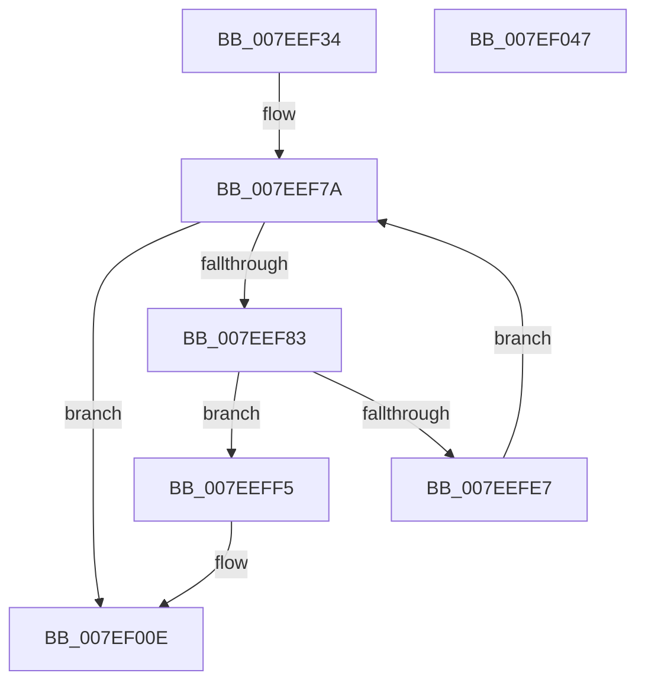

# CmpInitializeLazyWriters

- RVA: `0x007EEF34`–`0x007EF048` (길이 `276` bytes)
- VA: `0x00000001407EEF34`
- 실행 섹션: `PAGE`
- PDB 이름 있음: `예`; PDB Function 태그: `아니요`
- unwind 정보 RVA: `0x000D7088`
- 디코드: `66`개 명령, `276/276` bytes 표시
- 미해석 바이트: `0` (있으면 어셈블리에 `.byte`로 보존)

> 이 문서는 커널 이미지의 기계어와 PDB 기호를 분석해 생성했습니다. 4번과 5번은 함수 원형과 자료형을 바이너리 사용 방식에서 추정한 C 해석이며 원본 소스 복구 결과는 아닙니다.

## 1. Dependencies

- 직접 호출 지점: **7**; 고유 호출 대상: **7**
- 직접 호출자로 확인된 함수: **1**
- RIP 상대 이미지 참조: **12**

### Outgoing calls
- `0x007EEF95` → [KeInitializeTimer](../../text/45/KeInitializeTimer_function_0045B590.md) (function, `0x0045B590`)
- `0x007EEFAB` → [KeInitializeEvent](../../text/40/KeInitializeEvent_function_0040DD10.md) (function, `0x0040DD10`)
- `0x007EEFC1` → [KeInitializeDpc](../../text/45/KeInitializeDpc_function_0045BBD0.md) (function, `0x0045BBD0`)
- `0x007EEFDE` → [CmpCreateRegistryThread](CmpCreateRegistryThread_function_007E80D0.md) (function, `0x007E80D0`)
- `0x007EEFEC` → [NtClose](../86/NtClose_function_00868870.md) (function, `0x00868870`)
- `0x007EF008` → [KeBugCheckEx](../../text/4F/KeBugCheckEx_function_004FD660.md) (function, `0x004FD660`)
- `0x007EF02E` → [PoRegisterPowerSettingCallback](../A8/PoRegisterPowerSettingCallback_function_00A82150.md) (function, `0x00A82150`)

### Direct callers
- [CmpCmdInit](CmpCmdInit_function_007E5768.md) at `0x007E577F`

### Static image references
- `0x007EEF47` → RVA `0x00E0ECB4` (`.data`; read)
- `0x007EEF4D` → RVA `0x00E03710` (`.data`; read)
- `0x007EEF5A` → RVA `0x00E037C0` (`.data`; write)
- `0x007EEF62` → RVA `0x00E0ECBC` (`.data`; read)
- `0x007EEF68` → RVA `0x00E03880` (`.data`; write)
- `0x007EEF6E` → RVA `0x00E0ECB8` (`.data`; read)
- `0x007EEF74` → RVA `0x00E03940` (`.data`; write)
- `0x007EEFBA` → RVA `0x004A8900` (`CmpLazyFlushDpcRoutine`; read)
- `0x007EEFCF` → RVA `0x0066ADF0` (`CmpLazyWriteWorker`; read)
- `0x007EF014` → RVA `0x0066AEE0` (`CmpUserPresenceCallback`; read)
- `0x007EF01E` → RVA `0x00EF5718` (`.data`; write)
- `0x007EF025` → RVA `0x0001ED50` (`.rdata`; read)

## 2. Other-region calls and transfers

- 다른 실행 섹션으로 향하는 call: **4**
  - `0x007EEF95` → [KeInitializeTimer](../../text/45/KeInitializeTimer_function_0045B590.md) (`PAGE` → `.text`)
  - `0x007EEFAB` → [KeInitializeEvent](../../text/40/KeInitializeEvent_function_0040DD10.md) (`PAGE` → `.text`)
  - `0x007EEFC1` → [KeInitializeDpc](../../text/45/KeInitializeDpc_function_0045BBD0.md) (`PAGE` → `.text`)
  - `0x007EF008` → [KeBugCheckEx](../../text/4F/KeBugCheckEx_function_004FD660.md) (`PAGE` → `.text`)
- 별도 외부 분기/꼬리 이동을 확인하지 못했습니다.

## 3. Assembly (complete function range)

```asm
007EEF34  48 89 5C 24 10                  mov qword ptr [rsp + 0x10], rbx
007EEF39  48 89 74 24 18                  mov qword ptr [rsp + 0x18], rsi
007EEF3E  57                              push rdi
007EEF3F  41 56                           push r14
007EEF41  41 57                           push r15
007EEF43  48 83 EC 30                     sub rsp, 0x30
007EEF47  8B 05 67 FD 61 00               mov eax, dword ptr [rip + 0x61fd67]
007EEF4D  4C 8D 3D BC 47 61 00            lea r15, [rip + 0x6147bc]
007EEF54  48 83 64 24 50 00               and qword ptr [rsp + 0x50], 0
007EEF5A  89 05 60 48 61 00               mov dword ptr [rip + 0x614860], eax
007EEF60  33 F6                           xor esi, esi
007EEF62  8B 05 54 FD 61 00               mov eax, dword ptr [rip + 0x61fd54]
007EEF68  89 05 12 49 61 00               mov dword ptr [rip + 0x614912], eax
007EEF6E  8B 05 44 FD 61 00               mov eax, dword ptr [rip + 0x61fd44]
007EEF74  89 05 C6 49 61 00               mov dword ptr [rip + 0x6149c6], eax
007EEF7A  83 FE 03                        cmp esi, 3
007EEF7D  0F 83 8B 00 00 00               jae 0x1407ef00e
007EEF83  48 8D 3C 76                     lea rdi, [rsi + rsi*2]
007EEF87  44 8B F6                        mov r14d, esi
007EEF8A  48 C1 E7 06                     shl rdi, 6
007EEF8E  4A 8D 1C 3F                     lea rbx, [rdi + r15]
007EEF92  48 8B CB                        mov rcx, rbx
007EEF95  E8 F6 C5 C6 FF                  call 0x14045b590
007EEF9A  45 33 C0                        xor r8d, r8d
007EEF9D  49 8D 8F 80 00 00 00            lea rcx, [r15 + 0x80]
007EEFA4  48 03 CF                        add rcx, rdi
007EEFA7  41 8D 50 01                     lea edx, [r8 + 1]
007EEFAB  E8 60 ED C1 FF                  call 0x14040dd10
007EEFB0  49 8D 4F 40                     lea rcx, [r15 + 0x40]
007EEFB4  4C 8B C3                        mov r8, rbx
007EEFB7  48 03 CF                        add rcx, rdi
007EEFBA  48 8D 15 3F 99 CB FF            lea rdx, [rip - 0x3466c1]
007EEFC1  E8 0A CC C6 FF                  call 0x14045bbd0
007EEFC6  4A 83 A4 3F 98 00 00 00 00      and qword ptr [rdi + r15 + 0x98], 0
007EEFCF  4C 8D 05 1A BE E7 FF            lea r8, [rip - 0x1841e6]
007EEFD6  4C 8B CB                        mov r9, rbx
007EEFD9  48 8D 4C 24 50                  lea rcx, [rsp + 0x50]
007EEFDE  E8 ED 90 FF FF                  call 0x1407e80d0
007EEFE3  85 C0                           test eax, eax
007EEFE5  78 0E                           js 0x1407eeff5
007EEFE7  48 8B 4C 24 50                  mov rcx, qword ptr [rsp + 0x50]
007EEFEC  E8 7F 98 07 00                  call 0x140868870
007EEFF1  FF C6                           inc esi
007EEFF3  EB 85                           jmp 0x1407eef7a
007EEFF5  48 83 64 24 20 00               and qword ptr [rsp + 0x20], 0
007EEFFB  45 33 C9                        xor r9d, r9d
007EEFFE  4D 8B C6                        mov r8, r14
007EF001  41 8D 51 18                     lea edx, [r9 + 0x18]
007EF005  8D 4A 39                        lea ecx, [rdx + 0x39]
007EF008  E8 53 E6 D0 FF                  call 0x1404fd660
007EF00D  CC                              int3
007EF00E  48 83 64 24 20 00               and qword ptr [rsp + 0x20], 0
007EF014  4C 8D 05 C5 BE E7 FF            lea r8, [rip - 0x18413b]
007EF01B  45 33 C9                        xor r9d, r9d
007EF01E  C6 05 F3 66 70 00 01            mov byte ptr [rip + 0x7066f3], 1
007EF025  48 8D 15 24 FD 82 FF            lea rdx, [rip - 0x7d02dc]
007EF02C  33 C9                           xor ecx, ecx
007EF02E  E8 1D 31 29 00                  call 0x140a82150
007EF033  48 8B 5C 24 58                  mov rbx, qword ptr [rsp + 0x58]
007EF038  48 8B 74 24 60                  mov rsi, qword ptr [rsp + 0x60]
007EF03D  48 83 C4 30                     add rsp, 0x30
007EF041  41 5F                           pop r15
007EF043  41 5E                           pop r14
007EF045  5F                              pop rdi
007EF046  C3                              ret
007EF047  CC                              int3
```

## 4. C-style interpretation (structured pseudocode)

```c
__int64 __fastcall CmpInitializeLazyWriters(__int64 a1, __int64 a2, int a3)
{
    __int64 result;
    __int64 v_rdi;
    __int64 v_rsi;
    __int64 v_rsp;
    unsigned __int64 v_stack_m28;
    unsigned __int64 v_stack_p10;
    unsigned __int64 v_stack_p18;
    unsigned __int64 v_stack_p8;

    v_stack_p10 = v_rbx;
    v_stack_p18 = v_rsi;
    v_rsp = (v_rsp) - (48);
    *(unsigned int *)(v_rip + 6375520) = (unsigned int)((unsigned int)(*(unsigned int *)(v_rip + 6421863)));
    v_rsi = 0;
    *(unsigned int *)(v_rip + 6375698) = (unsigned int)((unsigned int)(*(unsigned int *)(v_rip + 6421844)));
    *(unsigned int *)(v_rip + 6375878) = (unsigned int)((unsigned int)(*(unsigned int *)(v_rip + 6421828)));
loc_007EEF7A:
    if (0 >= 3) goto loc_007EF00E;
    v_rdi = (v_rsi + v_rsi * 2) << (6);
    result = KeInitializeTimer(v_rdi + v_rip + 6375356 * 1, a2, a3, a4);
    a3 = 0;
    a1 = (v_rip + 6375356 + 128) + (v_rdi);
    result = KeInitializeEvent(a1, a3 + 1, a3, a4);
    a1 = (v_rip + 6375356 + 64) + (v_rdi);
    result = KeInitializeDpc(a1, v_rip - 3434177, v_rdi + v_rip + 6375356 * 1, a4);
    result = CmpCreateRegistryThread(v_stack_p8, v_rip - 3434177, v_rip - 1589734, v_rdi + v_rip + 6375356 * 1);
    if (sign_flag) goto loc_007EEFF5;
    result = NtClose(v_stack_p8, v_rip - 3434177, v_rip - 1589734, v_rdi + v_rip + 6375356 * 1);
    v_rsi = (unsigned int)((v_rsi) + 1);
    goto loc_007EEF7A;
loc_007EEFF5:
    a4 = 0;
    result = KeBugCheckEx(a4 + 24 + 57, a4 + 24, 0, a4);
loc_007EF00E:
    a4 = 0;
    *(unsigned __int8 *)(v_rip + 7366387) = 1;
    a1 = 0;
    result = PoRegisterPowerSettingCallback(a1, v_rip - 8192732, v_rip - 1589563, a4);
    v_rsp = (v_rsp) + (48);
    return result;
}
```

## 5. (Beta) C Style

```c
int64_t CmpInitializeLazyWriters(int64_t Arg1, int64_t Arg2, int32_t Arg3)
{
    int64_t result;
    int64_t local_rdi;
    int64_t local_rsi;
    int64_t local_rsp;
    uint64_t v_stack_m28;
    uint64_t v_stack_p10;
    uint64_t v_stack_p18;
    uint64_t v_stack_p8;

    v_stack_p10 = local_rbx;
    v_stack_p18 = local_rsi;
    local_rsp = (local_rsp) - (48);
    *(uint32_t *)(v_rip + 0x614860) = (uint32_t)((uint32_t)(*(uint32_t *)(v_rip + 0x61FD67)));
    local_rsi = 0;
    *(uint32_t *)(v_rip + 0x614912) = (uint32_t)((uint32_t)(*(uint32_t *)(v_rip + 0x61FD54)));
    *(uint32_t *)(v_rip + 0x6149C6) = (uint32_t)((uint32_t)(*(uint32_t *)(v_rip + 0x61FD44)));
loc_007EEF7A:
    if (0 >= 3) goto loc_007EF00E;
    local_rdi = (local_rsi + local_rsi * 2) << (6);
    result = KeInitializeTimer(local_rdi + v_rip + 6375356 * 1, Arg2, Arg3, a4);
    Arg3 = 0;
    Arg1 = (v_rip + 6375356 + 128) + (local_rdi);
    result = KeInitializeEvent(Arg1, Arg3 + 1, Arg3, a4);
    Arg1 = (v_rip + 6375356 + 64) + (local_rdi);
    result = KeInitializeDpc(Arg1, v_rip - 3434177, local_rdi + v_rip + 6375356 * 1, a4);
    result = CmpCreateRegistryThread(v_stack_p8, v_rip - 3434177, v_rip - 1589734, local_rdi + v_rip + 6375356 * 1);
    if (sign_flag) goto loc_007EEFF5;
    result = NtClose(v_stack_p8, v_rip - 3434177, v_rip - 1589734, local_rdi + v_rip + 6375356 * 1);
    local_rsi = (uint32_t)((local_rsi) + 1);
    goto loc_007EEF7A;
loc_007EEFF5:
    a4 = 0;
    result = KeBugCheckEx(a4 + 24 + 57, a4 + 24, 0, a4);
loc_007EF00E:
    a4 = 0;
    *(uint8_t *)(v_rip + 0x7066F3) = 1;
    Arg1 = 0;
    result = PoRegisterPowerSettingCallback(Arg1, v_rip - 8192732, v_rip - 1589563, a4);
    local_rsp = (local_rsp) + (48);
    return result;
}
```

## 6. Execution-region graph

[열기: 2D/3D 그래프와 함수 탐색 컨트롤 패널](../../../control-panel.html?section=page&rva=0x007EEF34&view=graph)

- 2D 그래프는 위에서 아래로 흐르고, 3D 그래프는 빈 공간을 드래그해 회전합니다. Shift+드래그는 이동, 휠은 확대·축소, 함수 노드 선택은 대상 보고서 이동입니다.

### Static fallback


