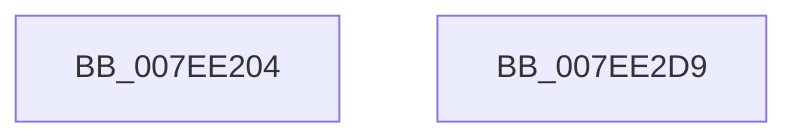

# CmpInitializeLightWeightTransactionType

- RVA: `0x007EE204`–`0x007EE2DA` (길이 `214` bytes)
- VA: `0x00000001407EE204`
- 실행 섹션: `PAGE`
- PDB 이름 있음: `예`; PDB Function 태그: `아니요`
- unwind 정보 RVA: `0x000C43B4`
- 디코드: `47`개 명령, `214/214` bytes 표시
- 미해석 바이트: `0` (있으면 어셈블리에 `.byte`로 보존)

> 이 문서는 커널 이미지의 기계어와 PDB 기호를 분석해 생성했습니다. 4번과 5번은 함수 원형과 자료형을 바이너리 사용 방식에서 추정한 C 해석이며 원본 소스 복구 결과는 아닙니다.

## 1. Dependencies

- 직접 호출 지점: **3**; 고유 호출 대상: **3**
- 직접 호출자로 확인된 함수: **1**
- RIP 상대 이미지 참조: **5**

### Outgoing calls
- `0x007EE232` → [memset](../../text/6C/memset_function_006C6C40.md) (function, `0x006C6C40`)
- `0x007EE2B7` → [ObCreateObjectTypeEx](../AB/ObCreateObjectTypeEx_function_00AB46D0.md) (function, `0x00AB46D0`)
- `0x007EE2C3` → [_security_check_cookie](../../text/6A/_security_check_cookie_function_006AC640.md) (function, `0x006AC640`)

### Direct callers
- [CmInitSystem1](../../init/C5/CmInitSystem1_function_00C559CC.md) at `0x00C55CC1`

### Static image references
- `0x007EE216` → RVA `0x00E0A740` (`.data`; read)
- `0x007EE261` → RVA `0x009B1100` (`CmpCloseLightWeightTransaction`; read)
- `0x007EE26C` → RVA `0x00A802A0` (`CmpDeleteLightWeightTransaction`; read)
- `0x007EE29A` → RVA `0x00EF5720` (`.data`; read)
- `0x007EE2B0` → RVA `0x0000BE70` (`.rdata`; read)

## 2. Other-region calls and transfers

- 다른 실행 섹션으로 향하는 call: **2**
  - `0x007EE232` → [memset](../../text/6C/memset_function_006C6C40.md) (`PAGE` → `.text`)
  - `0x007EE2C3` → [_security_check_cookie](../../text/6A/_security_check_cookie_function_006AC640.md) (`PAGE` → `.text`)
- 별도 외부 분기/꼬리 이동을 확인하지 못했습니다.

## 3. Assembly (complete function range)

```asm
007EE204  48 89 5C 24 08                  mov qword ptr [rsp + 8], rbx
007EE209  55                              push rbp
007EE20A  48 8D 6C 24 A9                  lea rbp, [rsp - 0x57]
007EE20F  48 81 EC C0 00 00 00            sub rsp, 0xc0
007EE216  48 8B 05 23 C5 61 00            mov rax, qword ptr [rip + 0x61c523]
007EE21D  48 33 C4                        xor rax, rsp
007EE220  48 89 45 47                     mov qword ptr [rbp + 0x47], rax
007EE224  BB 78 00 00 00                  mov ebx, 0x78
007EE229  48 8D 4D C7                     lea rcx, [rbp - 0x39]
007EE22D  44 8B C3                        mov r8d, ebx
007EE230  33 D2                           xor edx, edx
007EE232  E8 09 8A ED FF                  call 0x1406c6c40
007EE237  48 83 65 F7 00                  and qword ptr [rbp - 9], 0
007EE23C  B8 3F 00 1F 00                  mov eax, 0x1f003f
007EE241  89 45 DF                        mov dword ptr [rbp - 0x21], eax
007EE244  89 45 E3                        mov dword ptr [rbp - 0x1d], eax
007EE247  8A 45 C9                        mov al, byte ptr [rbp - 0x37]
007EE24A  24 EF                           and al, 0xef
007EE24C  66 89 5D C7                     mov word ptr [rbp - 0x39], bx
007EE250  0C 0C                           or al, 0xc
007EE252  C7 45 CF 30 00 00 00            mov dword ptr [rbp - 0x31], 0x30
007EE259  48 83 65 FF 00                  and qword ptr [rbp - 1], 0
007EE25E  88 45 C9                        mov byte ptr [rbp - 0x37], al
007EE261  48 8D 05 98 2E 1C 00            lea rax, [rip + 0x1c2e98]
007EE268  48 89 45 07                     mov qword ptr [rbp + 7], rax
007EE26C  48 8D 05 2D 20 29 00            lea rax, [rip + 0x29202d]
007EE273  48 89 45 0F                     mov qword ptr [rbp + 0xf], rax
007EE277  C7 45 D3 01 00 12 00            mov dword ptr [rbp - 0x2d], 0x120001
007EE27E  C7 45 D7 3E 00 12 00            mov dword ptr [rbp - 0x29], 0x12003e
007EE285  C7 45 DB 18 00 12 00            mov dword ptr [rbp - 0x25], 0x120018
007EE28C  C7 45 EF 20 00 00 00            mov dword ptr [rbp - 0x11], 0x20
007EE293  C7 45 EB 01 00 00 00            mov dword ptr [rbp - 0x15], 1
007EE29A  48 8D 05 7F 74 70 00            lea rax, [rip + 0x70747f]
007EE2A1  45 33 C9                        xor r9d, r9d
007EE2A4  45 33 C0                        xor r8d, r8d
007EE2A7  48 89 44 24 20                  mov qword ptr [rsp + 0x20], rax
007EE2AC  48 8D 55 C7                     lea rdx, [rbp - 0x39]
007EE2B0  48 8D 0D B9 DB 81 FF            lea rcx, [rip - 0x7e2447]
007EE2B7  E8 14 64 2C 00                  call 0x140ab46d0
007EE2BC  48 8B 4D 47                     mov rcx, qword ptr [rbp + 0x47]
007EE2C0  48 33 CC                        xor rcx, rsp
007EE2C3  E8 78 E3 EB FF                  call 0x1406ac640
007EE2C8  48 8B 9C 24 D0 00 00 00         mov rbx, qword ptr [rsp + 0xd0]
007EE2D0  48 81 C4 C0 00 00 00            add rsp, 0xc0
007EE2D7  5D                              pop rbp
007EE2D8  C3                              ret
007EE2D9  CC                              int3
```

## 4. C-style interpretation (structured pseudocode)

```c
__int64 __fastcall CmpInitializeLightWeightTransactionType(__int64 a1, int a2, __int64 a3, int a4)
{
    __int64 result;
    __int64 v_rsp;
    unsigned __int64 v_stack_m18;
    unsigned __int64 v_stack_m50;
    unsigned __int64 v_stack_m58;
    unsigned __int64 v_stack_m5F;
    unsigned __int64 v_stack_m60;
    unsigned __int64 v_stack_m68;
    unsigned int v_stack_m70;
    unsigned int v_stack_m74;
    unsigned int v_stack_m7C;
    unsigned int v_stack_m80;
    unsigned int v_stack_m84;
    unsigned int v_stack_m88;
    unsigned int v_stack_m8C;
    unsigned int v_stack_m90;
    unsigned __int8 v_stack_m96;
    unsigned __int64 v_stack_m98;
    unsigned __int64 v_stack_mA8;
    unsigned __int64 v_stack_p8;

    v_stack_p8 = v_rbx;
    v_rsp = (v_rsp) - (192);
    result = (*(unsigned __int64 *)(v_rip + 6407459)) ^ (v_rsp);
    v_stack_m18 = result;
    a2 = 0;
    result = memset(v_stack_m98, a2, 120, a4);
    v_stack_m80 = (unsigned int)((unsigned int)(0x1F003FULL));
    v_stack_m7C = (unsigned int)((unsigned int)(0x1F003FULL));
    result = (unsigned __int8)((v_stack_m96) & (239));
    v_stack_m98 = 120;
    result = (unsigned __int8)((result) | (12));
    v_stack_m90 = 48;
    v_stack_m96 = (unsigned __int8)(result);
    v_stack_m58 = v_rip + 1846936;
    v_stack_m50 = v_rip + 2695213;
    v_stack_m8C = 0x120001ULL;
    v_stack_m88 = 0x12003EULL;
    v_stack_m84 = 0x120018ULL;
    v_stack_m70 = 32;
    v_stack_m74 = 1;
    a4 = 0;
    a3 = 0;
    v_stack_mA8 = v_rip + 7369855;
    result = ObCreateObjectTypeEx(v_rip - 8266823, v_stack_m98, a3, a4);
    a1 = (v_stack_m18) ^ (v_rsp);
    result = _security_check_cookie(a1, v_stack_m98, a3, a4);
    v_rsp = (v_rsp) + (192);
    return result;
}
```

## 5. (Beta) C Style

```c
int64_t CmpInitializeLightWeightTransactionType(int64_t Arg1, int32_t Arg2, int64_t Arg3, int32_t Arg4)
{
    int64_t result;
    int64_t local_rsp;
    uint64_t v_stack_m18;
    uint64_t v_stack_m50;
    uint64_t v_stack_m58;
    uint64_t v_stack_m5F;
    uint64_t v_stack_m60;
    uint64_t v_stack_m68;
    uint32_t v_stack_m70;
    uint32_t v_stack_m74;
    uint32_t v_stack_m7C;
    uint32_t v_stack_m80;
    uint32_t v_stack_m84;
    uint32_t v_stack_m88;
    uint32_t v_stack_m8C;
    uint32_t v_stack_m90;
    uint8_t v_stack_m96;
    uint64_t v_stack_m98;
    uint64_t v_stack_mA8;
    uint64_t v_stack_p8;

    v_stack_p8 = local_rbx;
    local_rsp = (local_rsp) - (192);
    result = (*(uint64_t *)(v_rip + 0x61C523)) ^ (local_rsp);
    v_stack_m18 = result;
    Arg2 = 0;
    result = memset(v_stack_m98, Arg2, 120, Arg4);
    v_stack_m80 = (uint32_t)((uint32_t)(0x1F003FULL));
    v_stack_m7C = (uint32_t)((uint32_t)(0x1F003FULL));
    result = (uint8_t)((v_stack_m96) & (239));
    v_stack_m98 = 120;
    result = (uint8_t)((result) | (12));
    v_stack_m90 = 48;
    v_stack_m96 = (uint8_t)(result);
    v_stack_m58 = v_rip + 1846936;
    v_stack_m50 = v_rip + 2695213;
    v_stack_m8C = 0x120001ULL;
    v_stack_m88 = 0x12003EULL;
    v_stack_m84 = 0x120018ULL;
    v_stack_m70 = 32;
    v_stack_m74 = 1;
    Arg4 = 0;
    Arg3 = 0;
    v_stack_mA8 = v_rip + 7369855;
    result = ObCreateObjectTypeEx(v_rip - 8266823, v_stack_m98, Arg3, Arg4);
    Arg1 = (v_stack_m18) ^ (local_rsp);
    result = _security_check_cookie(Arg1, v_stack_m98, Arg3, Arg4);
    local_rsp = (local_rsp) + (192);
    return result;
}
```

## 6. Execution-region graph

[열기: 2D/3D 그래프와 함수 탐색 컨트롤 패널](../../../control-panel.html?section=page&rva=0x007EE204&view=graph)

- 2D 그래프는 위에서 아래로 흐르고, 3D 그래프는 빈 공간을 드래그해 회전합니다. Shift+드래그는 이동, 휠은 확대·축소, 함수 노드 선택은 대상 보고서 이동입니다.

### Static fallback


