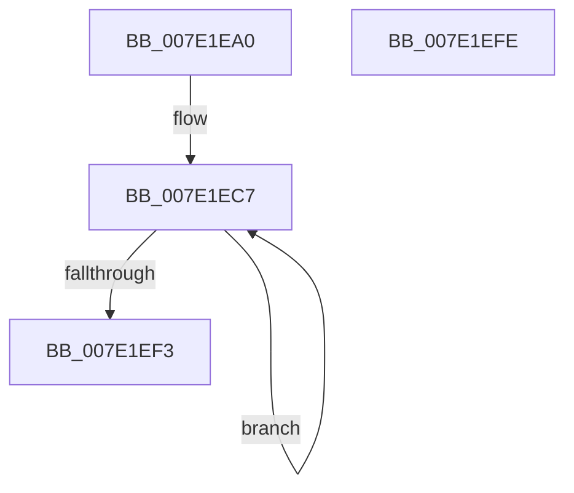

# CmpInitializeMachineHiveLoadedCallbacks

- RVA: `0x007E1EA0`–`0x007E1EFF` (길이 `95` bytes)
- VA: `0x00000001407E1EA0`
- 실행 섹션: `PAGE`
- PDB 이름 있음: `예`; PDB Function 태그: `아니요`
- unwind 정보 RVA: `0x0005CAAC`
- 디코드: `25`개 명령, `95/95` bytes 표시
- 미해석 바이트: `0` (있으면 어셈블리에 `.byte`로 보존)

> 이 문서는 커널 이미지의 기계어와 PDB 기호를 분석해 생성했습니다. 4번과 5번은 함수 원형과 자료형을 바이너리 사용 방식에서 추정한 C 해석이며 원본 소스 복구 결과는 아닙니다.

## 1. Dependencies

- 직접 호출 지점: **2**; 고유 호출 대상: **1**
- 직접 호출자로 확인된 함수: **1**
- RIP 상대 이미지 참조: **2**

### Outgoing calls
- `0x007E1EB6` → [KeInitializeEvent](../../text/40/KeInitializeEvent_function_0040DD10.md) (function, `0x0040DD10`)
- `0x007E1EE1` → [KeInitializeEvent](../../text/40/KeInitializeEvent_function_0040DD10.md) (function, `0x0040DD10`)

### Direct callers
- [CmInitSystem1](../../init/C5/CmInitSystem1_function_00C559CC.md) at `0x00C55C4F`

### Static image references
- `0x007E1EAD` → RVA `0x00EF7BA0` (`.data`; read)
- `0x007E1EBB` → RVA `0x00E09938` (`.data`; read)

## 2. Other-region calls and transfers

- 다른 실행 섹션으로 향하는 call: **2**
  - `0x007E1EB6` → [KeInitializeEvent](../../text/40/KeInitializeEvent_function_0040DD10.md) (`PAGE` → `.text`)
  - `0x007E1EE1` → [KeInitializeEvent](../../text/40/KeInitializeEvent_function_0040DD10.md) (`PAGE` → `.text`)
- 별도 외부 분기/꼬리 이동을 확인하지 못했습니다.

## 3. Assembly (complete function range)

```asm
007E1EA0  48 89 5C 24 08                  mov qword ptr [rsp + 8], rbx
007E1EA5  57                              push rdi
007E1EA6  48 83 EC 20                     sub rsp, 0x20
007E1EAA  45 33 C0                        xor r8d, r8d
007E1EAD  48 8D 0D EC 5C 71 00            lea rcx, [rip + 0x715cec]
007E1EB4  33 D2                           xor edx, edx
007E1EB6  E8 55 BE C2 FF                  call 0x14040dd10
007E1EBB  48 8D 1D 76 7A 62 00            lea rbx, [rip + 0x627a76]
007E1EC2  BF 07 00 00 00                  mov edi, 7
007E1EC7  48 83 63 F0 00                  and qword ptr [rbx - 0x10], 0
007E1ECC  48 8D 4B D8                     lea rcx, [rbx - 0x28]
007E1ED0  48 83 63 F8 00                  and qword ptr [rbx - 8], 0
007E1ED5  45 33 C0                        xor r8d, r8d
007E1ED8  33 D2                           xor edx, edx
007E1EDA  48 89 5B 08                     mov qword ptr [rbx + 8], rbx
007E1EDE  48 89 1B                        mov qword ptr [rbx], rbx
007E1EE1  E8 2A BE C2 FF                  call 0x14040dd10
007E1EE6  48 81 C3 B8 00 00 00            add rbx, 0xb8
007E1EED  48 83 EF 01                     sub rdi, 1
007E1EF1  75 D4                           jne 0x1407e1ec7
007E1EF3  48 8B 5C 24 30                  mov rbx, qword ptr [rsp + 0x30]
007E1EF8  48 83 C4 20                     add rsp, 0x20
007E1EFC  5F                              pop rdi
007E1EFD  C3                              ret
007E1EFE  CC                              int3
```

## 4. C-style interpretation (structured pseudocode)

```c
__int64 __fastcall CmpInitializeMachineHiveLoadedCallbacks(__int64 a1, int a2, int a3)
{
    __int64 result;
    __int64 v_rbx;
    __int64 v_rdi;
    __int64 v_rsp;
    unsigned __int64 v_stack_p8;

    v_stack_p8 = v_rbx;
    v_rsp = (v_rsp) - (32);
    a3 = 0;
    a2 = 0;
    result = KeInitializeEvent(v_rip + 7429356, a2, a3, a4);
loc_007E1EC7:
    a3 = 0;
    a2 = 0;
    *(unsigned __int64 *)(v_rip + 6453878 + 8) = v_rip + 6453878;
    *(unsigned __int64 *)(v_rip + 6453878) = v_rip + 6453878;
    result = KeInitializeEvent(v_rip + 6453878 - 40, a2, a3, a4);
    v_rbx = (v_rip + 6453878) + (184);
    v_rdi = (7) - (1);
    if (condition_is_not_equal) goto loc_007E1EC7;
    v_rsp = (v_rsp) + (32);
    return result;
}
```

## 5. (Beta) C Style

```c
int64_t CmpInitializeMachineHiveLoadedCallbacks(int64_t Arg1, int32_t Arg2, int32_t Arg3)
{
    int64_t result;
    int64_t local_rbx;
    int64_t local_rdi;
    int64_t local_rsp;
    uint64_t v_stack_p8;

    v_stack_p8 = local_rbx;
    local_rsp = (local_rsp) - (32);
    Arg3 = 0;
    Arg2 = 0;
    result = KeInitializeEvent(v_rip + 7429356, Arg2, Arg3, a4);
loc_007E1EC7:
    Arg3 = 0;
    Arg2 = 0;
    *(uint64_t *)(v_rip + 0x627A76 + 0x8) = v_rip + 6453878;
    *(uint64_t *)(v_rip + 0x627A76) = v_rip + 6453878;
    result = KeInitializeEvent(v_rip + 6453878 - 40, Arg2, Arg3, a4);
    local_rbx = (v_rip + 6453878) + (184);
    local_rdi = (7) - (1);
    if (condition_is_not_equal) goto loc_007E1EC7;
    local_rsp = (local_rsp) + (32);
    return result;
}
```

## 6. Execution-region graph

[열기: 2D/3D 그래프와 함수 탐색 컨트롤 패널](../../../control-panel.html?section=page&rva=0x007E1EA0&view=graph)

- 2D 그래프는 위에서 아래로 흐르고, 3D 그래프는 빈 공간을 드래그해 회전합니다. Shift+드래그는 이동, 휠은 확대·축소, 함수 노드 선택은 대상 보고서 이동입니다.

### Static fallback


