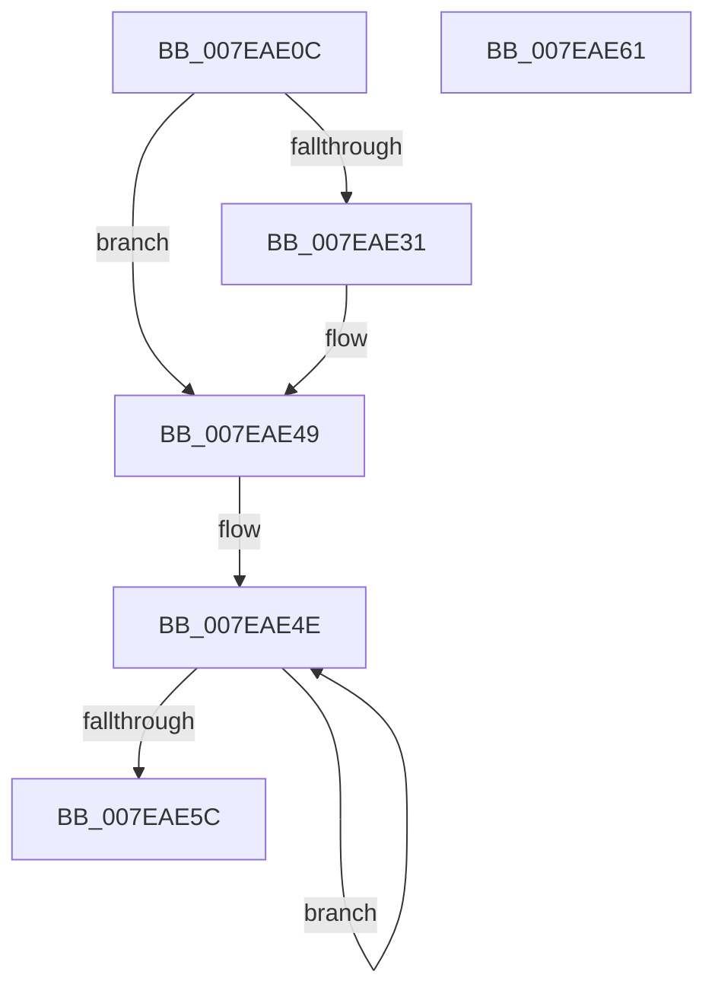

# CmpInitializeNameCache

- RVA: `0x007EAE0C`–`0x007EAE62` (길이 `86` bytes)
- VA: `0x00000001407EAE0C`
- 실행 섹션: `PAGE`
- PDB 이름 있음: `예`; PDB Function 태그: `아니요`
- unwind 정보 RVA: `0x0005D2F4`
- 디코드: `23`개 명령, `86/86` bytes 표시
- 미해석 바이트: `0` (있으면 어셈블리에 `.byte`로 보존)

> 이 문서는 커널 이미지의 기계어와 PDB 기호를 분석해 생성했습니다. 4번과 5번은 함수 원형과 자료형을 바이너리 사용 방식에서 추정한 C 해석이며 원본 소스 복구 결과는 아닙니다.

## 1. Dependencies

- 직접 호출 지점: **2**; 고유 호출 대상: **2**
- 직접 호출자로 확인된 함수: **1**
- RIP 상대 이미지 참조: **1**

### Outgoing calls
- `0x007EAE20` → [ExAllocatePool2](../../poolcode/B8/ExAllocatePool2_function_00B820F0.md) (function, `0x00B820F0`)
- `0x007EAE43` → [KeBugCheckEx](../../text/4F/KeBugCheckEx_function_004FD660.md) (function, `0x004FD660`)

### Direct callers
- [CmInitSystem1](../../init/C5/CmInitSystem1_function_00C559CC.md) at `0x00C55BEC`

### Static image references
- `0x007EAE25` → RVA `0x00EF5978` (`.data`; write)

## 2. Other-region calls and transfers

- 다른 실행 섹션으로 향하는 call: **2**
  - `0x007EAE20` → [ExAllocatePool2](../../poolcode/B8/ExAllocatePool2_function_00B820F0.md) (`PAGE` → `POOLCODE`)
  - `0x007EAE43` → [KeBugCheckEx](../../text/4F/KeBugCheckEx_function_004FD660.md) (`PAGE` → `.text`)
- 별도 외부 분기/꼬리 이동을 확인하지 못했습니다.

## 3. Assembly (complete function range)

```asm
007EAE0C  48 83 EC 38                     sub rsp, 0x38
007EAE10  BA 00 80 00 00                  mov edx, 0x8000
007EAE15  B9 00 01 00 00                  mov ecx, 0x100
007EAE1A  41 B8 43 4D 43 61               mov r8d, 0x61434d43
007EAE20  E8 CB 72 39 00                  call 0x140b820f0
007EAE25  48 89 05 4C AB 70 00            mov qword ptr [rip + 0x70ab4c], rax
007EAE2C  48 85 C0                        test rax, rax
007EAE2F  75 18                           jne 0x1407eae49
007EAE31  48 21 44 24 20                  and qword ptr [rsp + 0x20], rax
007EAE36  8D 50 03                        lea edx, [rax + 3]
007EAE39  45 33 C9                        xor r9d, r9d
007EAE3C  8D 48 67                        lea ecx, [rax + 0x67]
007EAE3F  44 8D 40 02                     lea r8d, [rax + 2]
007EAE43  E8 18 28 D1 FF                  call 0x1404fd660
007EAE48  CC                              int3
007EAE49  B9 00 08 00 00                  mov ecx, 0x800
007EAE4E  48 83 20 00                     and qword ptr [rax], 0
007EAE52  48 8D 40 10                     lea rax, [rax + 0x10]
007EAE56  48 83 E9 01                     sub rcx, 1
007EAE5A  75 F2                           jne 0x1407eae4e
007EAE5C  48 83 C4 38                     add rsp, 0x38
007EAE60  C3                              ret
007EAE61  CC                              int3
```

## 4. C-style interpretation (structured pseudocode)

```c
__int64 __fastcall CmpInitializeNameCache(__int64 a1, __int64 a2, __int64 a3, int a4)
{
    __int64 result;
    __int64 v_rsp;
    unsigned __int64 v_stack_m18;

    v_rsp = (v_rsp) - (56);
    result = ExAllocatePool2(256, (unsigned int)(0x8000ULL), (unsigned int)(0x61434D43ULL), a4);
    *(unsigned __int64 *)(v_rip + 7383884) = result;
    if (result == 0) {
        a2 = result + 3;
        a4 = 0;
        a1 = result + 103;
        a3 = result + 2;
        result = KeBugCheckEx(a1, a2, a3, a4);
    }
loc_007EAE4E:
    a1 = ((unsigned int)(0x800ULL)) - (1);
    if (condition_is_not_equal) goto loc_007EAE4E;
    v_rsp = (v_rsp) + (56);
    return result + 16;
}
```

## 5. (Beta) C Style

```c
int64_t CmpInitializeNameCache(int64_t Arg1, int64_t Arg2, int64_t Arg3, int32_t Arg4)
{
    int64_t result;
    int64_t local_rsp;
    uint64_t v_stack_m18;

    local_rsp = (local_rsp) - (56);
    result = ExAllocatePool2(256, (uint32_t)(0x8000ULL), (uint32_t)(0x61434D43ULL), Arg4);
    *(uint64_t *)(v_rip + 0x70AB4C) = result;
    if (result == 0) {
        Arg2 = result + 3;
        Arg4 = 0;
        Arg1 = result + 103;
        Arg3 = result + 2;
        result = KeBugCheckEx(Arg1, Arg2, Arg3, Arg4);
    }
loc_007EAE4E:
    Arg1 = ((uint32_t)(0x800ULL)) - (1);
    if (condition_is_not_equal) goto loc_007EAE4E;
    local_rsp = (local_rsp) + (56);
    return result + 16;
}
```

## 6. Execution-region graph

[열기: 2D/3D 그래프와 함수 탐색 컨트롤 패널](../../../control-panel.html?section=page&rva=0x007EAE0C&view=graph)

- 2D 그래프는 위에서 아래로 흐르고, 3D 그래프는 빈 공간을 드래그해 회전합니다. Shift+드래그는 이동, 휠은 확대·축소, 함수 노드 선택은 대상 보고서 이동입니다.

### Static fallback


