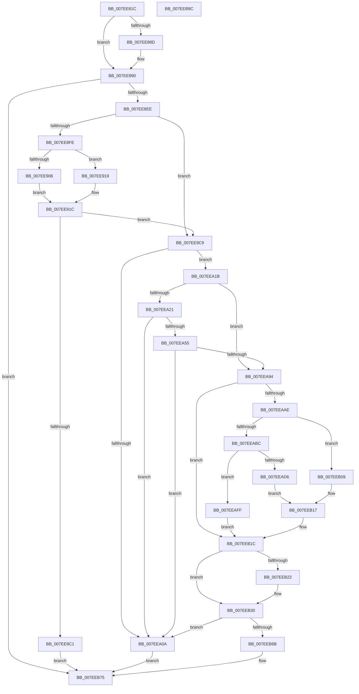

# CmpInitializeRegistryNode

- RVA: `0x007EE81C`–`0x007EEB9D` (길이 `897` bytes)
- VA: `0x00000001407EE81C`
- 실행 섹션: `PAGE`
- PDB 이름 있음: `예`; PDB Function 태그: `아니요`
- unwind 정보 RVA: `0x000D7004`
- 디코드: `222`개 명령, `897/897` bytes 표시
- 미해석 바이트: `0` (있으면 어셈블리에 `.byte`로 보존)

> 이 문서는 커널 이미지의 기계어와 PDB 기호를 분석해 생성했습니다. 4번과 5번은 함수 원형과 자료형을 바이너리 사용 방식에서 추정한 C 해석이며 원본 소스 복구 결과는 아닙니다.

## 1. Dependencies

- 직접 호출 지점: **20**; 고유 호출 대상: **12**
- 직접 호출자로 확인된 함수: **2**
- RIP 상대 이미지 참조: **9**

### Outgoing calls
- `0x007EE8E1` → [ZwCreateKey](../../text/6A/ZwCreateKey_function_006AD470.md) (function, `0x006AD470`)
- `0x007EE92C` → [RtlIntegerToChar](../91/RtlIntegerToChar_function_0091D470.md) (function, `0x0091D470`)
- `0x007EE939` → [RtlInitAnsiString](../../text/47/RtlInitAnsiString_function_00470F40.md) (function, `0x00470F40`)
- `0x007EE95A` → [RtlAnsiStringToUnicodeString](../90/RtlAnsiStringToUnicodeString_function_0090BEA0.md) (function, `0x0090BEA0`)
- `0x007EE9AC` → [ZwCreateKey](../../text/6A/ZwCreateKey_function_006AD470.md) (function, `0x006AD470`)
- `0x007EE9B7` → [ZwClose](../../text/6A/ZwClose_function_006AD2B0.md) (function, `0x006AD2B0`)
- `0x007EE9D5` → [RtlInitUnicodeString](../../text/42/RtlInitUnicodeString_function_0042A780.md) (function, `0x0042A780`)
- `0x007EE9FF` → [ZwSetValueKey](../../text/6A/ZwSetValueKey_function_006ADCD0.md) (function, `0x006ADCD0`)
- `0x007EEA0F` → [ZwClose](../../text/6A/ZwClose_function_006AD2B0.md) (function, `0x006AD2B0`)
- `0x007EEA2D` → [RtlInitUnicodeString](../../text/42/RtlInitUnicodeString_function_0042A780.md) (function, `0x0042A780`)
- `0x007EEA3A` → [RtlInitAnsiString](../../text/47/RtlInitAnsiString_function_00470F40.md) (function, `0x00470F40`)
- `0x007EEA4A` → [RtlAnsiStringToUnicodeString](../90/RtlAnsiStringToUnicodeString_function_0090BEA0.md) (function, `0x0090BEA0`)
- `0x007EEA7C` → [ZwSetValueKey](../../text/6A/ZwSetValueKey_function_006ADCD0.md) (function, `0x006ADCD0`)
- `0x007EEA87` → [RtlFreeAnsiString](../9C/RtlFreeAnsiString_function_009C0800.md) (function, `0x009C0800`)
- `0x007EEAA0` → [RtlInitUnicodeString](../../text/42/RtlInitUnicodeString_function_0042A780.md) (function, `0x0042A780`)
- `0x007EEAC9` → [ExAllocatePool2](../../poolcode/B8/ExAllocatePool2_function_00B820F0.md) (function, `0x00B820F0`)
- `0x007EEAE5` → [ExFreePoolWithTag](../../poolcode/B8/ExFreePoolWithTag_function_00B82870.md) (function, `0x00B82870`)
- `0x007EEB17` → [memcpy](../../text/6C/memcpy_function_006C6840.md) (function, `0x006C6840`)
- `0x007EEB5C` → [ZwSetValueKey](../../text/6A/ZwSetValueKey_function_006ADCD0.md) (function, `0x006ADCD0`)
- `0x007EEB7C` → [_security_check_cookie](../../text/6A/_security_check_cookie_function_006AC640.md) (function, `0x006AC640`)

### Direct callers
- [CmpAddProcessorConfigurationEntry](CmpAddProcessorConfigurationEntry_function_007E4CF8.md) at `0x007E4E33`
- [CmpAddProcessorConfigurationEntry](CmpAddProcessorConfigurationEntry_function_007E4CF8.md) at `0x007E4ECC`
- [CmpSetupConfigurationTree](../../init/C5/CmpSetupConfigurationTree_function_00C5B624.md) at `0x00C5B6E1`

### Static image references
- `0x007EE838` → RVA `0x00E0A740` (`.data`; read)
- `0x007EE893` → RVA `0x00FDAC20` (`PAGEDATA`; read)
- `0x007EE9C9` → RVA `0x00AFC780` (` ?? ::NNGAKEGL::`string'`; read)
- `0x007EEA21` → RVA `0x00AFC7E0` (` ?? ::NNGAKEGL::`string'`; read)
- `0x007EEA94` → RVA `0x00AFC7B0` (` ?? ::NNGAKEGL::`string'`; read)
- `0x007EEAB4` → RVA `0x00FD80A8` (`PAGEDATA`; read)
- `0x007EEAD6` → RVA `0x00FD9AB0` (`PAGEDATA`; read)
- `0x007EEADF` → RVA `0x00FD80A8` (`PAGEDATA`; write)
- `0x007EEAF6` → RVA `0x00FD9AB0` (`PAGEDATA`; write)

## 2. Other-region calls and transfers

- 다른 실행 섹션으로 향하는 call: **16**
  - `0x007EE8E1` → [ZwCreateKey](../../text/6A/ZwCreateKey_function_006AD470.md) (`PAGE` → `.text`)
  - `0x007EE939` → [RtlInitAnsiString](../../text/47/RtlInitAnsiString_function_00470F40.md) (`PAGE` → `.text`)
  - `0x007EE9AC` → [ZwCreateKey](../../text/6A/ZwCreateKey_function_006AD470.md) (`PAGE` → `.text`)
  - `0x007EE9B7` → [ZwClose](../../text/6A/ZwClose_function_006AD2B0.md) (`PAGE` → `.text`)
  - `0x007EE9D5` → [RtlInitUnicodeString](../../text/42/RtlInitUnicodeString_function_0042A780.md) (`PAGE` → `.text`)
  - `0x007EE9FF` → [ZwSetValueKey](../../text/6A/ZwSetValueKey_function_006ADCD0.md) (`PAGE` → `.text`)
  - `0x007EEA0F` → [ZwClose](../../text/6A/ZwClose_function_006AD2B0.md) (`PAGE` → `.text`)
  - `0x007EEA2D` → [RtlInitUnicodeString](../../text/42/RtlInitUnicodeString_function_0042A780.md) (`PAGE` → `.text`)
  - `0x007EEA3A` → [RtlInitAnsiString](../../text/47/RtlInitAnsiString_function_00470F40.md) (`PAGE` → `.text`)
  - `0x007EEA7C` → [ZwSetValueKey](../../text/6A/ZwSetValueKey_function_006ADCD0.md) (`PAGE` → `.text`)
  - `0x007EEAA0` → [RtlInitUnicodeString](../../text/42/RtlInitUnicodeString_function_0042A780.md) (`PAGE` → `.text`)
  - `0x007EEAC9` → [ExAllocatePool2](../../poolcode/B8/ExAllocatePool2_function_00B820F0.md) (`PAGE` → `POOLCODE`)
  - `0x007EEAE5` → [ExFreePoolWithTag](../../poolcode/B8/ExFreePoolWithTag_function_00B82870.md) (`PAGE` → `POOLCODE`)
  - `0x007EEB17` → [memcpy](../../text/6C/memcpy_function_006C6840.md) (`PAGE` → `.text`)
  - `0x007EEB5C` → [ZwSetValueKey](../../text/6A/ZwSetValueKey_function_006ADCD0.md) (`PAGE` → `.text`)
  - `0x007EEB7C` → [_security_check_cookie](../../text/6A/_security_check_cookie_function_006AC640.md) (`PAGE` → `.text`)
- 별도 외부 분기/꼬리 이동을 확인하지 못했습니다.

## 3. Assembly (complete function range)

```asm
007EE81C  48 89 5C 24 20                  mov qword ptr [rsp + 0x20], rbx
007EE821  55                              push rbp
007EE822  56                              push rsi
007EE823  57                              push rdi
007EE824  41 54                           push r12
007EE826  41 55                           push r13
007EE828  41 56                           push r14
007EE82A  41 57                           push r15
007EE82C  48 8D 6C 24 F1                  lea rbp, [rsp - 0xf]
007EE831  48 81 EC F0 00 00 00            sub rsp, 0xf0
007EE838  48 8B 05 01 BF 61 00            mov rax, qword ptr [rip + 0x61bf01]
007EE83F  48 33 C4                        xor rax, rsp
007EE842  48 89 45 07                     mov qword ptr [rbp + 7], rax
007EE846  4C 8B 75 77                     mov r14, qword ptr [rbp + 0x77]
007EE84A  48 8D 59 1C                     lea rbx, [rcx + 0x1c]
007EE84E  45 33 ED                        xor r13d, r13d
007EE851  0F 57 C0                        xorps xmm0, xmm0
007EE854  0F 57 C9                        xorps xmm1, xmm1
007EE857  45 8B E1                        mov r12d, r9d
007EE85A  4D 8B F8                        mov r15, r8
007EE85D  48 8B F9                        mov rdi, rcx
007EE860  41 8B F5                        mov esi, r13d
007EE863  44 89 6D B3                     mov dword ptr [rbp - 0x4d], r13d
007EE867  44 89 6D CB                     mov dword ptr [rbp - 0x35], r13d
007EE86B  0F 11 44 24 60                  movups xmmword ptr [rsp + 0x60], xmm0
007EE870  4C 89 6C 24 40                  mov qword ptr [rsp + 0x40], r13
007EE875  0F 11 4C 24 50                  movups xmmword ptr [rsp + 0x50], xmm1
007EE87A  44 89 6C 24 48                  mov dword ptr [rsp + 0x48], r13d
007EE87F  0F 11 45 9F                     movups xmmword ptr [rbp - 0x61], xmm0
007EE883  0F 11 4D 8F                     movups xmmword ptr [rbp - 0x71], xmm1
007EE887  44 39 69 18                     cmp dword ptr [rcx + 0x18], r13d
007EE88B  75 03                           jne 0x1407ee890
007EE88D  44 89 2B                        mov dword ptr [rbx], r13d
007EE890  48 63 03                        movsxd rax, dword ptr [rbx]
007EE893  48 8D 0D 86 C3 7E 00            lea rcx, [rip + 0x7ec386]
007EE89A  48 C1 E0 04                     shl rax, 4
007EE89E  4C 8D 45 AF                     lea r8, [rbp - 0x51]
007EE8A2  48 03 C1                        add rax, rcx
007EE8A5  48 89 55 B7                     mov qword ptr [rbp - 0x49], rdx
007EE8A9  48 89 45 BF                     mov qword ptr [rbp - 0x41], rax
007EE8AD  48 8D 4C 24 40                  lea rcx, [rsp + 0x40]
007EE8B2  48 8D 44 24 48                  lea rax, [rsp + 0x48]
007EE8B7  C7 45 AF 30 00 00 00            mov dword ptr [rbp - 0x51], 0x30
007EE8BE  48 89 44 24 30                  mov qword ptr [rsp + 0x30], rax
007EE8C3  45 33 C9                        xor r9d, r9d
007EE8C6  44 89 6C 24 28                  mov dword ptr [rsp + 0x28], r13d
007EE8CB  BA 1F 00 02 00                  mov edx, 0x2001f
007EE8D0  4C 89 6C 24 20                  mov qword ptr [rsp + 0x20], r13
007EE8D5  C7 45 C7 40 02 00 00            mov dword ptr [rbp - 0x39], 0x240
007EE8DC  F3 0F 7F 45 CF                  movdqu xmmword ptr [rbp - 0x31], xmm0
007EE8E1  E8 8A EB EB FF                  call 0x1406ad470
007EE8E6  85 C0                           test eax, eax
007EE8E8  0F 88 87 02 00 00               js 0x1407eeb75
007EE8EE  41 B8 01 00 00 00               mov r8d, 1
007EE8F4  44 39 6F 18                     cmp dword ptr [rdi + 0x18], r13d
007EE8F8  0F 84 CB 00 00 00               je 0x1407ee9c9
007EE8FE  48 63 03                        movsxd rax, dword ptr [rbx]
007EE901  83 F8 2A                        cmp eax, 0x2a
007EE904  73 13                           jae 0x1407ee919
007EE906  41 0F B7 14 46                  movzx edx, word ptr [r14 + rax*2]
007EE90B  48 8B C8                        mov rcx, rax
007EE90E  41 8D 04 10                     lea eax, [r8 + rdx]
007EE912  66 41 89 04 4E                  mov word ptr [r14 + rcx*2], ax
007EE917  EB 03                           jmp 0x1407ee91c
007EE919  41 8B D5                        mov edx, r13d
007EE91C  0F B7 CA                        movzx ecx, dx
007EE91F  4C 8D 4D DF                     lea r9, [rbp - 0x21]
007EE923  BA 0A 00 00 00                  mov edx, 0xa
007EE928  44 8D 42 02                     lea r8d, [rdx + 2]
007EE92C  E8 3F EB 12 00                  call 0x14091d470
007EE931  48 8D 55 DF                     lea rdx, [rbp - 0x21]
007EE935  48 8D 4D 8F                     lea rcx, [rbp - 0x71]
007EE939  E8 02 26 C8 FF                  call 0x140470f40
007EE93E  48 8D 45 EF                     lea rax, [rbp - 0x11]
007EE942  C7 44 24 60 00 00 18 00         mov dword ptr [rsp + 0x60], 0x180000
007EE94A  45 33 C0                        xor r8d, r8d
007EE94D  48 89 45 87                     mov qword ptr [rbp - 0x79], rax
007EE951  48 8D 55 8F                     lea rdx, [rbp - 0x71]
007EE955  48 8D 4C 24 60                  lea rcx, [rsp + 0x60]
007EE95A  E8 41 D5 11 00                  call 0x14090bea0
007EE95F  48 8B 5C 24 40                  mov rbx, qword ptr [rsp + 0x40]
007EE964  48 8D 44 24 60                  lea rax, [rsp + 0x60]
007EE969  48 89 45 BF                     mov qword ptr [rbp - 0x41], rax
007EE96D  4C 8D 45 AF                     lea r8, [rbp - 0x51]
007EE971  48 8D 44 24 48                  lea rax, [rsp + 0x48]
007EE976  C7 45 AF 30 00 00 00            mov dword ptr [rbp - 0x51], 0x30
007EE97D  48 89 44 24 30                  mov qword ptr [rsp + 0x30], rax
007EE982  48 8D 4C 24 40                  lea rcx, [rsp + 0x40]
007EE987  0F 57 C0                        xorps xmm0, xmm0
007EE98A  44 89 6C 24 28                  mov dword ptr [rsp + 0x28], r13d
007EE98F  45 33 C9                        xor r9d, r9d
007EE992  4C 89 6C 24 20                  mov qword ptr [rsp + 0x20], r13
007EE997  BA 1F 00 02 00                  mov edx, 0x2001f
007EE99C  48 89 5D B7                     mov qword ptr [rbp - 0x49], rbx
007EE9A0  C7 45 C7 40 02 00 00            mov dword ptr [rbp - 0x39], 0x240
007EE9A7  F3 0F 7F 45 CF                  movdqu xmmword ptr [rbp - 0x31], xmm0
007EE9AC  E8 BF EA EB FF                  call 0x1406ad470
007EE9B1  48 8B CB                        mov rcx, rbx
007EE9B4  44 8B F0                        mov r14d, eax
007EE9B7  E8 F4 E8 EB FF                  call 0x1406ad2b0
007EE9BC  45 85 F6                        test r14d, r14d
007EE9BF  79 08                           jns 0x1407ee9c9
007EE9C1  41 8B C6                        mov eax, r14d
007EE9C4  E9 AC 01 00 00                  jmp 0x1407eeb75
007EE9C9  48 8D 15 B0 DD 30 00            lea rdx, [rip + 0x30ddb0]
007EE9D0  48 8D 4C 24 50                  lea rcx, [rsp + 0x50]
007EE9D5  E8 A6 BD C3 FF                  call 0x14042a780
007EE9DA  48 8B 4C 24 40                  mov rcx, qword ptr [rsp + 0x40]
007EE9DF  48 8D 47 20                     lea rax, [rdi + 0x20]
007EE9E3  41 BE 10 00 00 00               mov r14d, 0x10
007EE9E9  48 8D 54 24 50                  lea rdx, [rsp + 0x50]
007EE9EE  44 89 74 24 28                  mov dword ptr [rsp + 0x28], r14d
007EE9F3  45 33 C0                        xor r8d, r8d
007EE9F6  48 89 44 24 20                  mov qword ptr [rsp + 0x20], rax
007EE9FB  45 8D 4E F3                     lea r9d, [r14 - 0xd]
007EE9FF  E8 CC F2 EB FF                  call 0x1406adcd0
007EEA04  8B D8                           mov ebx, eax
007EEA06  85 C0                           test eax, eax
007EEA08  79 11                           jns 0x1407eea1b
007EEA0A  48 8B 4C 24 40                  mov rcx, qword ptr [rsp + 0x40]
007EEA0F  E8 9C E8 EB FF                  call 0x1406ad2b0
007EEA14  8B C3                           mov eax, ebx
007EEA16  E9 5A 01 00 00                  jmp 0x1407eeb75
007EEA1B  44 39 6F 34                     cmp dword ptr [rdi + 0x34], r13d
007EEA1F  74 73                           je 0x1407eea94
007EEA21  48 8D 15 B8 DD 30 00            lea rdx, [rip + 0x30ddb8]
007EEA28  48 8D 4C 24 50                  lea rcx, [rsp + 0x50]
007EEA2D  E8 4E BD C3 FF                  call 0x14042a780
007EEA32  48 8B 57 38                     mov rdx, qword ptr [rdi + 0x38]
007EEA36  48 8D 4D 8F                     lea rcx, [rbp - 0x71]
007EEA3A  E8 01 25 C8 FF                  call 0x140470f40
007EEA3F  41 B0 01                        mov r8b, 1
007EEA42  48 8D 55 8F                     lea rdx, [rbp - 0x71]
007EEA46  48 8D 4D 9F                     lea rcx, [rbp - 0x61]
007EEA4A  E8 51 D4 11 00                  call 0x14090bea0
007EEA4F  8B D8                           mov ebx, eax
007EEA51  85 C0                           test eax, eax
007EEA53  78 B5                           js 0x1407eea0a
007EEA55  0F B7 45 9F                     movzx eax, word ptr [rbp - 0x61]
007EEA59  48 8D 54 24 50                  lea rdx, [rsp + 0x50]
007EEA5E  48 8B 4C 24 40                  mov rcx, qword ptr [rsp + 0x40]
007EEA63  83 C0 02                        add eax, 2
007EEA66  89 44 24 28                     mov dword ptr [rsp + 0x28], eax
007EEA6A  41 B9 01 00 00 00               mov r9d, 1
007EEA70  48 8B 45 A7                     mov rax, qword ptr [rbp - 0x59]
007EEA74  45 33 C0                        xor r8d, r8d
007EEA77  48 89 44 24 20                  mov qword ptr [rsp + 0x20], rax
007EEA7C  E8 4F F2 EB FF                  call 0x1406adcd0
007EEA81  48 8D 4D 9F                     lea rcx, [rbp - 0x61]
007EEA85  8B D8                           mov ebx, eax
007EEA87  E8 74 1D 1D 00                  call 0x1409c0800
007EEA8C  85 DB                           test ebx, ebx
007EEA8E  0F 88 76 FF FF FF               js 0x1407eea0a
007EEA94  48 8D 15 15 DD 30 00            lea rdx, [rip + 0x30dd15]
007EEA9B  48 8D 4C 24 50                  lea rcx, [rsp + 0x50]
007EEAA0  E8 DB BC C3 FF                  call 0x14042a780
007EEAA5  48 8B 57 40                     mov rdx, qword ptr [rdi + 0x40]
007EEAA9  48 85 D2                        test rdx, rdx
007EEAAC  74 6E                           je 0x1407eeb1c
007EEAAE  8B 47 30                        mov eax, dword ptr [rdi + 0x30]
007EEAB1  8D 70 08                        lea esi, [rax + 8]
007EEAB4  3B 35 EE 95 7E 00               cmp esi, dword ptr [rip + 0x7e95ee]
007EEABA  76 4D                           jbe 0x1407eeb09
007EEABC  8B D6                           mov edx, esi
007EEABE  B9 00 01 00 00                  mov ecx, 0x100
007EEAC3  41 B8 43 4D 20 20               mov r8d, 0x20204d43
007EEAC9  E8 22 36 39 00                  call 0x140b820f0
007EEACE  48 8B D8                        mov rbx, rax
007EEAD1  48 85 C0                        test rax, rax
007EEAD4  74 29                           je 0x1407eeaff
007EEAD6  48 8B 0D D3 AF 7E 00            mov rcx, qword ptr [rip + 0x7eafd3]
007EEADD  33 D2                           xor edx, edx
007EEADF  89 35 C3 95 7E 00               mov dword ptr [rip + 0x7e95c3], esi
007EEAE5  E8 86 3D 39 00                  call 0x140b82870
007EEAEA  44 8B 47 30                     mov r8d, dword ptr [rdi + 0x30]
007EEAEE  48 8D 4B 08                     lea rcx, [rbx + 8]
007EEAF2  48 8B 57 40                     mov rdx, qword ptr [rdi + 0x40]
007EEAF6  48 89 1D B3 AF 7E 00            mov qword ptr [rip + 0x7eafb3], rbx
007EEAFD  EB 18                           jmp 0x1407eeb17
007EEAFF  44 89 6F 30                     mov dword ptr [rdi + 0x30], r13d
007EEB03  4C 89 6F 40                     mov qword ptr [rdi + 0x40], r13
007EEB07  EB 13                           jmp 0x1407eeb1c
007EEB09  48 8B 0D A0 AF 7E 00            mov rcx, qword ptr [rip + 0x7eafa0]
007EEB10  4C 8B C0                        mov r8, rax
007EEB13  48 83 C1 08                     add rcx, 8
007EEB17  E8 24 7D ED FF                  call 0x1406c6840
007EEB1C  4C 39 6F 40                     cmp qword ptr [rdi + 0x40], r13
007EEB20  75 0E                           jne 0x1407eeb30
007EEB22  48 8B 05 87 AF 7E 00            mov rax, qword ptr [rip + 0x7eaf87]
007EEB29  41 8B F6                        mov esi, r14d
007EEB2C  4C 89 68 08                     mov qword ptr [rax + 8], r13
007EEB30  48 8B 0D 79 AF 7E 00            mov rcx, qword ptr [rip + 0x7eaf79]
007EEB37  48 8D 54 24 50                  lea rdx, [rsp + 0x50]
007EEB3C  8B 45 6F                        mov eax, dword ptr [rbp + 0x6f]
007EEB3F  41 B9 09 00 00 00               mov r9d, 9
007EEB45  89 74 24 28                     mov dword ptr [rsp + 0x28], esi
007EEB49  45 33 C0                        xor r8d, r8d
007EEB4C  48 89 4C 24 20                  mov qword ptr [rsp + 0x20], rcx
007EEB51  44 89 21                        mov dword ptr [rcx], r12d
007EEB54  89 41 04                        mov dword ptr [rcx + 4], eax
007EEB57  48 8B 4C 24 40                  mov rcx, qword ptr [rsp + 0x40]
007EEB5C  E8 6F F1 EB FF                  call 0x1406adcd0
007EEB61  8B D8                           mov ebx, eax
007EEB63  85 C0                           test eax, eax
007EEB65  0F 88 9F FE FF FF               js 0x1407eea0a
007EEB6B  48 8B 44 24 40                  mov rax, qword ptr [rsp + 0x40]
007EEB70  49 89 07                        mov qword ptr [r15], rax
007EEB73  33 C0                           xor eax, eax
007EEB75  48 8B 4D 07                     mov rcx, qword ptr [rbp + 7]
007EEB79  48 33 CC                        xor rcx, rsp
007EEB7C  E8 BF DA EB FF                  call 0x1406ac640
007EEB81  48 8B 9C 24 48 01 00 00         mov rbx, qword ptr [rsp + 0x148]
007EEB89  48 81 C4 F0 00 00 00            add rsp, 0xf0
007EEB90  41 5F                           pop r15
007EEB92  41 5E                           pop r14
007EEB94  41 5D                           pop r13
007EEB96  41 5C                           pop r12
007EEB98  5F                              pop rdi
007EEB99  5E                              pop rsi
007EEB9A  5D                              pop rbp
007EEB9B  C3                              ret
007EEB9C  CC                              int3
```

## 4. C-style interpretation (structured pseudocode)

```c
__int64 __fastcall CmpInitializeRegistryNode(__int64 a1, __int64 a2, __int64 a3, int a4, unsigned int a5, __int64 a6)
{
    __int64 result;
    __int64 v_r13;
    __int64 v_rsi;
    __int64 v_rsp;
    unsigned int v_stack_m100;
    unsigned __int64 v_stack_m108;
    unsigned __int64 v_stack_m40;
    unsigned __int64 v_stack_m47;
    unsigned __int64 v_stack_m58;
    unsigned __int64 v_stack_m68;
    unsigned __int64 v_stack_m78;
    unsigned int v_stack_m7C;
    unsigned int v_stack_m80;
    unsigned __int64 v_stack_m88;
    unsigned __int64 v_stack_m90;
    unsigned int v_stack_m94;
    unsigned __int64 v_stack_m98;
    unsigned __int64 v_stack_mA0;
    unsigned __int64 v_stack_mA8;
    unsigned __int64 v_stack_mB8;
    unsigned __int64 v_stack_mC0;
    unsigned __int64 v_stack_mC8;
    unsigned __int64 v_stack_mD8;
    unsigned int v_stack_mE0;
    unsigned __int64 v_stack_mE8;
    unsigned __int64 v_stack_mF8;
    unsigned __int64 v_stack_p20;

    v_stack_p20 = v_rbx;
    v_rsp = (v_rsp) - (240);
    result = (*(unsigned __int64 *)(v_rip + 6405889)) ^ (v_rsp);
    v_stack_m40 = result;
    v_r13 = 0;
    v_stack_m94 = 0;
    v_stack_m7C = 0;
    v_stack_mC8 = v_xmm0;
    v_stack_mE8 = 0;
    v_stack_mD8 = v_xmm1;
    v_stack_mE0 = 0;
    v_stack_mA8 = v_xmm0;
    v_stack_mB8 = v_xmm1;
    if ((*(unsigned int *)(a1 + 24)) == 0) {
        *(unsigned int *)(a1 + 28) = 0;
    }
    result = ((int)(*(unsigned int *)(a1 + 28))) << (4);
    result = (result) + (v_rip + 8307590);
    v_stack_m90 = a2;
    v_stack_m88 = result;
    v_stack_m98 = 48;
    v_stack_mF8 = v_stack_mE0;
    a4 = 0;
    v_stack_m100 = 0;
    v_stack_m108 = 0;
    v_stack_m80 = 576;
    v_stack_m78 = v_xmm0;
    result = ZwCreateKey(v_stack_mE8, (unsigned int)(0x2001FULL), v_stack_m98, a4);
    if (sign_flag) goto loc_007EEB75;
    if ((*(unsigned int *)(a1 + 24)) == 0) goto loc_007EE9C9;
    if (((unsigned int)((int)(*(unsigned int *)(a1 + 28)))) >= 42) goto loc_007EE919;
    *(unsigned __int16 *)(a6 + (int)(*(unsigned int *)(a1 + 28)) * 2) = (unsigned __int16)(1 + *(unsigned __int16 *)(a6 + (int)(*(unsigned int *)(a1 + 28)) * 2) * 1);
    goto loc_007EE91C;
loc_007EE919:
loc_007EE91C:
    result = RtlIntegerToChar(0, 10, 10 + 2, v_stack_m68);
    result = RtlInitAnsiString(v_stack_mB8, v_stack_m68, 10 + 2, v_stack_m68);
    v_stack_mC8 = 0x180000ULL;
    a3 = 0;
    v_stack_mC0 = v_stack_m58;
    result = RtlAnsiStringToUnicodeString(v_stack_mC8, v_stack_mB8, a3, v_stack_m68);
    v_stack_m88 = v_stack_mC8;
    v_stack_m98 = 48;
    v_stack_mF8 = v_stack_mE0;
    v_stack_m100 = 0;
    a4 = 0;
    v_stack_m108 = 0;
    v_stack_m90 = v_stack_mE8;
    v_stack_m80 = 576;
    v_stack_m78 = v_xmm0;
    result = ZwCreateKey(v_stack_mE8, (unsigned int)(0x2001FULL), v_stack_m98, a4);
    result = ZwClose(v_stack_mE8, (unsigned int)(0x2001FULL), v_stack_m98, a4);
    if (!sign_flag) goto loc_007EE9C9;
    goto loc_007EEB75;
loc_007EE9C9:
    result = RtlInitUnicodeString(v_stack_mD8, v_rip + 3202480, v_stack_m98, a4);
    v_stack_m100 = 16;
    a3 = 0;
    v_stack_m108 = a1 + 32;
    result = ZwSetValueKey(v_stack_mE8, v_stack_mD8, a3, 16 - 13);
    if (!sign_flag) goto loc_007EEA1B;
loc_007EEA0A:
    result = ZwClose(v_stack_mE8, v_stack_mD8, a3, 16 - 13);
    goto loc_007EEB75;
loc_007EEA1B:
    if ((*(unsigned int *)(a1 + 52)) == 0) goto loc_007EEA94;
    result = RtlInitUnicodeString(v_stack_mD8, v_rip + 3202488, a3, 16 - 13);
    result = RtlInitAnsiString(v_stack_mB8, *(unsigned __int64 *)(a1 + 56), a3, 16 - 13);
    result = RtlAnsiStringToUnicodeString(v_stack_mA8, v_stack_mB8, 1, 16 - 13);
    if (sign_flag) goto loc_007EEA0A;
    result = (unsigned int)((v_stack_mA8) + (2));
    v_stack_m100 = (unsigned int)(result);
    a3 = 0;
    v_stack_m108 = v_stack_mA0;
    result = ZwSetValueKey(v_stack_mE8, v_stack_mD8, a3, 1);
    result = RtlFreeAnsiString(v_stack_mA8, v_stack_mD8, a3, 1);
    if (sign_flag) goto loc_007EEA0A;
loc_007EEA94:
    result = RtlInitUnicodeString(v_stack_mD8, v_rip + 3202325, a3, 1);
    if (*(unsigned __int64 *)(a1 + 64) == 0) goto loc_007EEB1C;
    if (((unsigned int)((unsigned int)(*(unsigned int *)(a1 + 48)) + 8)) <= (*(unsigned int *)(v_rip + 8295918))) goto loc_007EEB09;
    result = ExAllocatePool2(256, (unsigned int)((unsigned int)((unsigned int)(*(unsigned int *)(a1 + 48)) + 8)), (unsigned int)(0x20204D43ULL), 1);
    if (result == 0) goto loc_007EEAFF;
    a2 = 0;
    *(unsigned int *)(v_rip + 8295875) = (unsigned int)((unsigned int)(*(unsigned int *)(a1 + 48)) + 8);
    result = ExFreePoolWithTag(*(unsigned __int64 *)(v_rip + 8302547), a2, (unsigned int)(0x20204D43ULL), 1);
    *(unsigned __int64 *)(v_rip + 8302515) = result;
    goto loc_007EEB17;
loc_007EEAFF:
    *(unsigned int *)(a1 + 48) = 0;
    *(unsigned __int64 *)(a1 + 64) = 0;
    goto loc_007EEB1C;
loc_007EEB09:
    a1 = (*(unsigned __int64 *)(v_rip + 8302496)) + (8);
loc_007EEB17:
    result = memcpy(a1, *(unsigned __int64 *)(a1 + 64), result, 1);
loc_007EEB1C:
    v_rsi = (unsigned int)(*(unsigned int *)(a1 + 48)) + 8;
    if ((*(unsigned __int64 *)(a1 + 64)) == 0) {
        result = *(unsigned __int64 *)(v_rip + 8302471);
        v_rsi = 16;
        *(unsigned __int64 *)(result + 8) = 0;
    }
    v_stack_m100 = (unsigned int)(v_rsi);
    a3 = 0;
    v_stack_m108 = *(unsigned __int64 *)(v_rip + 8302457);
    *(unsigned int *)(*(unsigned __int64 *)(v_rip + 8302457)) = (unsigned int)((unsigned int)(a4));
    *(unsigned int *)(*(unsigned __int64 *)(v_rip + 8302457) + 4) = (unsigned int)((unsigned int)(a5));
    result = ZwSetValueKey(v_stack_mE8, v_stack_mD8, a3, 9);
    if (sign_flag) goto loc_007EEA0A;
    *(unsigned __int64 *)(a3) = v_stack_mE8;
    result = 0;
loc_007EEB75:
    a1 = (v_stack_m40) ^ (v_rsp);
    result = _security_check_cookie(a1, v_stack_mD8, a3, 9);
    v_rsp = (v_rsp) + (240);
    return result;
}
```

## 5. (Beta) C Style

```c
int64_t CmpInitializeRegistryNode(void *Arg1, int64_t Arg2, void *Arg3, int32_t Arg4, uint32_t Arg5, void *Arg6)
{
    uint8_t *arg1 = (uint8_t *)Arg1;
    uint8_t *arg3 = (uint8_t *)Arg3;
    uint8_t *arg6 = (uint8_t *)Arg6;

    int64_t result;
    int64_t local_r13;
    int64_t local_rsi;
    int64_t local_rsp;
    uint32_t v_stack_m100;
    uint64_t v_stack_m108;
    uint64_t v_stack_m40;
    uint64_t v_stack_m47;
    uint64_t v_stack_m58;
    uint64_t v_stack_m68;
    uint64_t v_stack_m78;
    uint32_t v_stack_m7C;
    uint32_t v_stack_m80;
    uint64_t v_stack_m88;
    uint64_t v_stack_m90;
    uint32_t v_stack_m94;
    uint64_t v_stack_m98;
    uint64_t v_stack_mA0;
    uint64_t v_stack_mA8;
    uint64_t v_stack_mB8;
    uint64_t v_stack_mC0;
    uint64_t v_stack_mC8;
    uint64_t v_stack_mD8;
    uint32_t v_stack_mE0;
    uint64_t v_stack_mE8;
    uint64_t v_stack_mF8;
    uint64_t v_stack_p20;

    v_stack_p20 = local_rbx;
    local_rsp = (local_rsp) - (240);
    result = (*(uint64_t *)(v_rip + 0x61BF01)) ^ (local_rsp);
    v_stack_m40 = result;
    local_r13 = 0;
    v_stack_m94 = 0;
    v_stack_m7C = 0;
    v_stack_mC8 = v_xmm0;
    v_stack_mE8 = 0;
    v_stack_mD8 = v_xmm1;
    v_stack_mE0 = 0;
    v_stack_mA8 = v_xmm0;
    v_stack_mB8 = v_xmm1;
    if ((*(uint32_t *)(arg1 + 0x18)) == 0) {
        *(uint32_t *)(arg1 + 0x1C) = 0;
    }
    result = ((int32_t)(*(uint32_t *)(arg1 + 0x1C))) << (4);
    result = (result) + (v_rip + 8307590);
    v_stack_m90 = Arg2;
    v_stack_m88 = result;
    v_stack_m98 = 48;
    v_stack_mF8 = v_stack_mE0;
    Arg4 = 0;
    v_stack_m100 = 0;
    v_stack_m108 = 0;
    v_stack_m80 = 576;
    v_stack_m78 = v_xmm0;
    result = ZwCreateKey(v_stack_mE8, (uint32_t)(0x2001FULL), v_stack_m98, Arg4);
    if (sign_flag) goto loc_007EEB75;
    if ((*(uint32_t *)(arg1 + 0x18)) == 0) goto loc_007EE9C9;
    if (((uint32_t)((int32_t)(*(uint32_t *)(arg1 + 0x1C)))) >= 42) goto loc_007EE919;
    *(uint16_t *)(arg6 + (int32_t)(*(uint32_t *)(arg1 + 0x1C)) * 2) = (uint16_t)(1 + *(uint16_t *)(arg6 + (int32_t)(*(uint32_t *)(arg1 + 0x1C)) * 2) * 1);
    goto loc_007EE91C;
loc_007EE919:
loc_007EE91C:
    result = RtlIntegerToChar(0, 10, 10 + 2, v_stack_m68);
    result = RtlInitAnsiString(v_stack_mB8, v_stack_m68, 10 + 2, v_stack_m68);
    v_stack_mC8 = 0x180000ULL;
    Arg3 = 0;
    v_stack_mC0 = v_stack_m58;
    result = RtlAnsiStringToUnicodeString(v_stack_mC8, v_stack_mB8, Arg3, v_stack_m68);
    v_stack_m88 = v_stack_mC8;
    v_stack_m98 = 48;
    v_stack_mF8 = v_stack_mE0;
    v_stack_m100 = 0;
    Arg4 = 0;
    v_stack_m108 = 0;
    v_stack_m90 = v_stack_mE8;
    v_stack_m80 = 576;
    v_stack_m78 = v_xmm0;
    result = ZwCreateKey(v_stack_mE8, (uint32_t)(0x2001FULL), v_stack_m98, Arg4);
    result = ZwClose(v_stack_mE8, (uint32_t)(0x2001FULL), v_stack_m98, Arg4);
    if (!sign_flag) goto loc_007EE9C9;
    goto loc_007EEB75;
loc_007EE9C9:
    result = RtlInitUnicodeString(v_stack_mD8, v_rip + 3202480, v_stack_m98, Arg4);
    v_stack_m100 = 16;
    Arg3 = 0;
    v_stack_m108 = Arg1 + 32;
    result = ZwSetValueKey(v_stack_mE8, v_stack_mD8, Arg3, 16 - 13);
    if (!sign_flag) goto loc_007EEA1B;
loc_007EEA0A:
    result = ZwClose(v_stack_mE8, v_stack_mD8, Arg3, 16 - 13);
    goto loc_007EEB75;
loc_007EEA1B:
    if ((*(uint32_t *)(arg1 + 0x34)) == 0) goto loc_007EEA94;
    result = RtlInitUnicodeString(v_stack_mD8, v_rip + 3202488, Arg3, 16 - 13);
    result = RtlInitAnsiString(v_stack_mB8, *(uint64_t *)(arg1 + 0x38), Arg3, 16 - 13);
    result = RtlAnsiStringToUnicodeString(v_stack_mA8, v_stack_mB8, 1, 16 - 13);
    if (sign_flag) goto loc_007EEA0A;
    result = (uint32_t)((v_stack_mA8) + (2));
    v_stack_m100 = (uint32_t)(result);
    Arg3 = 0;
    v_stack_m108 = v_stack_mA0;
    result = ZwSetValueKey(v_stack_mE8, v_stack_mD8, Arg3, 1);
    result = RtlFreeAnsiString(v_stack_mA8, v_stack_mD8, Arg3, 1);
    if (sign_flag) goto loc_007EEA0A;
loc_007EEA94:
    result = RtlInitUnicodeString(v_stack_mD8, v_rip + 3202325, Arg3, 1);
    if (*(uint64_t *)(arg1 + 0x40) == 0) goto loc_007EEB1C;
    if (((uint32_t)((uint32_t)(*(uint32_t *)(arg1 + 0x30)) + 8)) <= (*(uint32_t *)(v_rip + 0x7E95EE))) goto loc_007EEB09;
    result = ExAllocatePool2(256, (uint32_t)((uint32_t)((uint32_t)(*(uint32_t *)(arg1 + 0x30)) + 8)), (uint32_t)(0x20204D43ULL), 1);
    if (result == 0) goto loc_007EEAFF;
    Arg2 = 0;
    *(uint32_t *)(v_rip + 0x7E95C3) = (uint32_t)((uint32_t)(*(uint32_t *)(arg1 + 0x30)) + 8);
    result = ExFreePoolWithTag(*(uint64_t *)(v_rip + 0x7EAFD3), Arg2, (uint32_t)(0x20204D43ULL), 1);
    *(uint64_t *)(v_rip + 0x7EAFB3) = result;
    goto loc_007EEB17;
loc_007EEAFF:
    *(uint32_t *)(arg1 + 0x30) = 0;
    *(uint64_t *)(arg1 + 0x40) = 0;
    goto loc_007EEB1C;
loc_007EEB09:
    Arg1 = (*(uint64_t *)(v_rip + 0x7EAFA0)) + (8);
loc_007EEB17:
    result = memcpy(Arg1, *(uint64_t *)(arg1 + 0x40), result, 1);
loc_007EEB1C:
    local_rsi = (uint32_t)(*(uint32_t *)(arg1 + 0x30)) + 8;
    if ((*(uint64_t *)(arg1 + 0x40)) == 0) {
        result = *(uint64_t *)(v_rip + 0x7EAF87);
        local_rsi = 16;
        *(uint64_t *)(result + 0x8) = 0;
    }
    v_stack_m100 = (uint32_t)(local_rsi);
    Arg3 = 0;
    v_stack_m108 = *(uint64_t *)(v_rip + 0x7EAF79);
    *(uint32_t *)(*(uint64_t *)(v_rip + 0x7EAF79)) = (uint32_t)((uint32_t)(Arg4));
    *(uint32_t *)(*(uint64_t *)(v_rip + 0x7EAF79) + 0x4) = (uint32_t)((uint32_t)(Arg5));
    result = ZwSetValueKey(v_stack_mE8, v_stack_mD8, Arg3, 9);
    if (sign_flag) goto loc_007EEA0A;
    *(uint64_t *)(arg3) = v_stack_mE8;
    result = 0;
loc_007EEB75:
    Arg1 = (v_stack_m40) ^ (local_rsp);
    result = _security_check_cookie(Arg1, v_stack_mD8, Arg3, 9);
    local_rsp = (local_rsp) + (240);
    return result;
}
```

### 관측된 메모리 오프셋

구조체 형식이 확인되지 않은 접근은 인자 기준의 오프셋으로만 기록했습니다.

| 기준 인자 | 오프셋 표현 | 폭 (bit) | 접근 |
|---|---:|---:|---|
| `Arg1` | `+ 0x0` | `32` | `R` |
| `Arg1` | `+ 0x0` | `32` | `W` |
| `Arg1` | `+ 0x18` | `32` | `R` |
| `Arg1` | `+ 0x1C` | `64` | `R` |
| `Arg1` | `+ 0x20` | `64` | `R` |
| `Arg1` | `+ 0x30` | `32` | `R` |
| `Arg1` | `+ 0x30` | `32` | `W` |
| `Arg1` | `+ 0x34` | `32` | `R` |
| `Arg1` | `+ 0x38` | `64` | `R` |
| `Arg1` | `+ 0x40` | `64` | `R` |
| `Arg1` | `+ 0x40` | `64` | `W` |
| `Arg3` | `+ 0x0` | `64` | `W` |
| `Arg6` | `+ 0x0 + rax*2` | `16` | `R` |
| `Arg6` | `+ 0x0 + rcx*2` | `16` | `W` |

## 6. Execution-region graph

[열기: 2D/3D 그래프와 함수 탐색 컨트롤 패널](../../../control-panel.html?section=page&rva=0x007EE81C&view=graph)

- 2D 그래프는 위에서 아래로 흐르고, 3D 그래프는 빈 공간을 드래그해 회전합니다. Shift+드래그는 이동, 휠은 확대·축소, 함수 노드 선택은 대상 보고서 이동입니다.

### Static fallback


