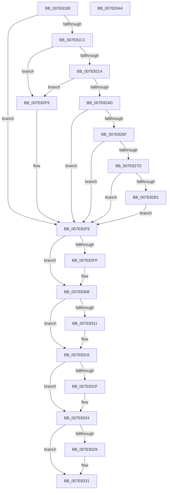

# CmpInitializeRegistryProcess

- RVA: `0x007E8180`–`0x007E8345` (길이 `453` bytes)
- VA: `0x00000001407E8180`
- 실행 섹션: `PAGE`
- PDB 이름 있음: `예`; PDB Function 태그: `아니요`
- unwind 정보 RVA: `0x000D6D64`
- 디코드: `114`개 명령, `453/453` bytes 표시
- 미해석 바이트: `0` (있으면 어셈블리에 `.byte`로 보존)

> 이 문서는 커널 이미지의 기계어와 PDB 기호를 분석해 생성했습니다. 4번과 5번은 함수 원형과 자료형을 바이너리 사용 방식에서 추정한 C 해석이며 원본 소스 복구 결과는 아닙니다.

## 1. Dependencies

- 직접 호출 지점: **14**; 고유 호출 대상: **12**
- 직접 호출자로 확인된 함수: **1**
- RIP 상대 이미지 참조: **8**

### Outgoing calls
- `0x007E81A9` → [CmSiProcessTupleInitialize](../../text/66/CmSiProcessTupleInitialize_function_0066DC24.md) (function, `0x0066DC24`)
- `0x007E81B2` → [CmpCreateRegistryProcessToken](CmpCreateRegistryProcessToken_function_007E7F6C.md) (function, `0x007E7F6C`)
- `0x007E8205` → [PsCreateMinimalProcess](../78/PsCreateMinimalProcess_function_00786D14.md) (function, `0x00786D14`)
- `0x007E823E` → [ObOpenObjectByPointer](../8B/ObOpenObjectByPointer_function_008B7420.md) (function, `0x008B7420`)
- `0x007E8260` → [ZwSetInformationProcess](../../text/6A/ZwSetInformationProcess_function_006AD450.md) (function, `0x006AD450`)
- `0x007E8272` → [CmSiProcessTupleStartFromHandle](../../text/66/CmSiProcessTupleStartFromHandle_function_0066DC44.md) (function, `0x0066DC44`)
- `0x007E8280` → [CmSiSetProcessWorkingSetMaximum](../../text/66/CmSiSetProcessWorkingSetMaximum_function_0066DD6C.md) (function, `0x0066DD6C`)
- `0x007E8293` → [KeInitializeEvent](../../text/40/KeInitializeEvent_function_0040DD10.md) (function, `0x0040DD10`)
- `0x007E82A6` → [CmpCreateRegistryThread](CmpCreateRegistryThread_function_007E80D0.md) (function, `0x007E80D0`)
- `0x007E82E6` → [ExInitializeLookasideListEx](../../text/46/ExInitializeLookasideListEx_function_00468840.md) (function, `0x00468840`)
- `0x007E8303` → [ObfDereferenceObject](../../text/2F/ObfDereferenceObject_function_002F9350.md) (function, `0x002F9350`)
- `0x007E8311` → [ZwClose](../../text/6A/ZwClose_function_006AD2B0.md) (function, `0x006AD2B0`)
- `0x007E831F` → [ZwClose](../../text/6A/ZwClose_function_006AD2B0.md) (function, `0x006AD2B0`)
- `0x007E832C` → [ZwClose](../../text/6A/ZwClose_function_006AD2B0.md) (function, `0x006AD2B0`)

### Direct callers
- [CmInitSystem1](../../init/C5/CmInitSystem1_function_00C559CC.md) at `0x00C55CE5`

### Static image references
- `0x007E81C1` → RVA `0x00FC6AB0` (`ALMOSTRO`; read)
- `0x007E81D1` → RVA `0x00FDA368` (`PAGEDATA`; read)
- `0x007E8225` → RVA `0x00FD8020` (`PAGEDATA`; read)
- `0x007E828C` → RVA `0x00EF71E0` (`.data`; read)
- `0x007E829B` → RVA `0x007E8140` (`CmpDummyThreadRoutine`; read)
- `0x007E82C3` → RVA `0x00475D80` (`CmSiFreeMemory`; read)
- `0x007E82D3` → RVA `0x0047FD60` (`CmpAllocatePoolLookaside`; read)
- `0x007E82DA` → RVA `0x00E2CA40` (`.data`; read)

## 2. Other-region calls and transfers

- 다른 실행 섹션으로 향하는 call: **10**
  - `0x007E81A9` → [CmSiProcessTupleInitialize](../../text/66/CmSiProcessTupleInitialize_function_0066DC24.md) (`PAGE` → `.text`)
  - `0x007E8260` → [ZwSetInformationProcess](../../text/6A/ZwSetInformationProcess_function_006AD450.md) (`PAGE` → `.text`)
  - `0x007E8272` → [CmSiProcessTupleStartFromHandle](../../text/66/CmSiProcessTupleStartFromHandle_function_0066DC44.md) (`PAGE` → `.text`)
  - `0x007E8280` → [CmSiSetProcessWorkingSetMaximum](../../text/66/CmSiSetProcessWorkingSetMaximum_function_0066DD6C.md) (`PAGE` → `.text`)
  - `0x007E8293` → [KeInitializeEvent](../../text/40/KeInitializeEvent_function_0040DD10.md) (`PAGE` → `.text`)
  - `0x007E82E6` → [ExInitializeLookasideListEx](../../text/46/ExInitializeLookasideListEx_function_00468840.md) (`PAGE` → `.text`)
  - `0x007E8303` → [ObfDereferenceObject](../../text/2F/ObfDereferenceObject_function_002F9350.md) (`PAGE` → `.text`)
  - `0x007E8311` → [ZwClose](../../text/6A/ZwClose_function_006AD2B0.md) (`PAGE` → `.text`)
  - `0x007E831F` → [ZwClose](../../text/6A/ZwClose_function_006AD2B0.md) (`PAGE` → `.text`)
  - `0x007E832C` → [ZwClose](../../text/6A/ZwClose_function_006AD2B0.md) (`PAGE` → `.text`)
- 별도 외부 분기/꼬리 이동을 확인하지 못했습니다.

## 3. Assembly (complete function range)

```asm
007E8180  48 89 5C 24 20                  mov qword ptr [rsp + 0x20], rbx
007E8185  55                              push rbp
007E8186  57                              push rdi
007E8187  41 56                           push r14
007E8189  48 8B EC                        mov rbp, rsp
007E818C  48 83 EC 70                     sub rsp, 0x70
007E8190  45 33 F6                        xor r14d, r14d
007E8193  0F 57 C0                        xorps xmm0, xmm0
007E8196  4C 89 75 20                     mov qword ptr [rbp + 0x20], r14
007E819A  41 8B FE                        mov edi, r14d
007E819D  4C 89 75 28                     mov qword ptr [rbp + 0x28], r14
007E81A1  4C 89 75 30                     mov qword ptr [rbp + 0x30], r14
007E81A5  0F 11 45 F0                     movups xmmword ptr [rbp - 0x10], xmm0
007E81A9  E8 76 5A E8 FF                  call 0x14066dc24
007E81AE  48 8D 4D 20                     lea rcx, [rbp + 0x20]
007E81B2  E8 B5 FD FF FF                  call 0x1407e7f6c
007E81B7  8B D8                           mov ebx, eax
007E81B9  85 C0                           test eax, eax
007E81BB  0F 88 38 01 00 00               js 0x1407e82f9
007E81C1  48 8B 0D E8 E8 7D 00            mov rcx, qword ptr [rip + 0x7de8e8]
007E81C8  48 8D 45 28                     lea rax, [rbp + 0x28]
007E81CC  48 89 44 24 58                  mov qword ptr [rsp + 0x58], rax
007E81D1  48 8D 15 90 21 7F 00            lea rdx, [rip + 0x7f2190]
007E81D8  4C 89 74 24 50                  mov qword ptr [rsp + 0x50], r14
007E81DD  45 33 C0                        xor r8d, r8d
007E81E0  4C 89 74 24 48                  mov qword ptr [rsp + 0x48], r14
007E81E5  44 8A 89 FA 05 00 00            mov r9b, byte ptr [rcx + 0x5fa]
007E81EC  4C 89 74 24 40                  mov qword ptr [rsp + 0x40], r14
007E81F1  4C 89 74 24 38                  mov qword ptr [rsp + 0x38], r14
007E81F6  44 89 74 24 30                  mov dword ptr [rsp + 0x30], r14d
007E81FB  44 89 74 24 28                  mov dword ptr [rsp + 0x28], r14d
007E8200  4C 89 74 24 20                  mov qword ptr [rsp + 0x20], r14
007E8205  E8 0A EB F9 FF                  call 0x140786d14
007E820A  8B D8                           mov ebx, eax
007E820C  85 C0                           test eax, eax
007E820E  0F 88 E1 00 00 00               js 0x1407e82f5
007E8214  48 8B 4D 20                     mov rcx, qword ptr [rbp + 0x20]
007E8218  48 8D 45 F0                     lea rax, [rbp - 0x10]
007E821C  48 89 44 24 30                  mov qword ptr [rsp + 0x30], rax
007E8221  45 8D 4E 01                     lea r9d, [r14 + 1]
007E8225  48 8B 05 F4 FD 7E 00            mov rax, qword ptr [rip + 0x7efdf4]
007E822C  45 33 C0                        xor r8d, r8d
007E822F  44 88 74 24 28                  mov byte ptr [rsp + 0x28], r14b
007E8234  BA 00 02 00 00                  mov edx, 0x200
007E8239  48 89 44 24 20                  mov qword ptr [rsp + 0x20], rax
007E823E  E8 DD F1 0C 00                  call 0x1408b7420
007E8243  8B D8                           mov ebx, eax
007E8245  85 C0                           test eax, eax
007E8247  0F 88 A8 00 00 00               js 0x1407e82f5
007E824D  48 8B 7D 28                     mov rdi, qword ptr [rbp + 0x28]
007E8251  45 8D 4E 10                     lea r9d, [r14 + 0x10]
007E8255  48 8B CF                        mov rcx, rdi
007E8258  4C 8D 45 F0                     lea r8, [rbp - 0x10]
007E825C  41 8D 56 09                     lea edx, [r14 + 9]
007E8260  E8 EB 51 EC FF                  call 0x1406ad450
007E8265  8B D8                           mov ebx, eax
007E8267  85 C0                           test eax, eax
007E8269  0F 88 8A 00 00 00               js 0x1407e82f9
007E826F  48 8B D7                        mov rdx, rdi
007E8272  E8 CD 59 E8 FF                  call 0x14066dc44
007E8277  8B D8                           mov ebx, eax
007E8279  85 C0                           test eax, eax
007E827B  78 7C                           js 0x1407e82f9
007E827D  41 8B FE                        mov edi, r14d
007E8280  E8 E7 5A E8 FF                  call 0x14066dd6c
007E8285  45 33 C0                        xor r8d, r8d
007E8288  41 8D 56 01                     lea edx, [r14 + 1]
007E828C  48 8D 0D 4D EF 70 00            lea rcx, [rip + 0x70ef4d]
007E8293  E8 78 5A C2 FF                  call 0x14040dd10
007E8298  45 33 C9                        xor r9d, r9d
007E829B  4C 8D 05 9E FE FF FF            lea r8, [rip - 0x162]
007E82A2  48 8D 4D 30                     lea rcx, [rbp + 0x30]
007E82A6  E8 25 FE FF FF                  call 0x1407e80d0
007E82AB  8B D8                           mov ebx, eax
007E82AD  85 C0                           test eax, eax
007E82AF  78 48                           js 0x1407e82f9
007E82B1  66 44 89 74 24 38               mov word ptr [rsp + 0x38], r14w
007E82B7  45 8D 4E 01                     lea r9d, [r14 + 1]
007E82BB  C7 44 24 30 43 4D 42 42         mov dword ptr [rsp + 0x30], 0x42424d43
007E82C3  4C 8D 05 B6 DA C8 FF            lea r8, [rip - 0x37254a]
007E82CA  48 C7 44 24 28 00 10 00 00      mov qword ptr [rsp + 0x28], 0x1000
007E82D3  48 8D 15 86 7A C9 FF            lea rdx, [rip - 0x36857a]
007E82DA  48 8D 0D 5F 47 64 00            lea rcx, [rip + 0x64475f]
007E82E1  44 89 74 24 20                  mov dword ptr [rsp + 0x20], r14d
007E82E6  E8 55 05 C8 FF                  call 0x140468840
007E82EB  85 C0                           test eax, eax
007E82ED  8B D8                           mov ebx, eax
007E82EF  41 0F 49 DE                     cmovns ebx, r14d
007E82F3  EB 04                           jmp 0x1407e82f9
007E82F5  48 8B 7D 28                     mov rdi, qword ptr [rbp + 0x28]
007E82F9  4C 39 75 20                     cmp qword ptr [rbp + 0x20], r14
007E82FD  74 09                           je 0x1407e8308
007E82FF  48 8B 4D 20                     mov rcx, qword ptr [rbp + 0x20]
007E8303  E8 48 10 B1 FF                  call 0x1402f9350
007E8308  48 8B 4D F0                     mov rcx, qword ptr [rbp - 0x10]
007E830C  48 85 C9                        test rcx, rcx
007E830F  74 05                           je 0x1407e8316
007E8311  E8 9A 4F EC FF                  call 0x1406ad2b0
007E8316  48 8B 4D 30                     mov rcx, qword ptr [rbp + 0x30]
007E831A  48 85 C9                        test rcx, rcx
007E831D  74 05                           je 0x1407e8324
007E831F  E8 8C 4F EC FF                  call 0x1406ad2b0
007E8324  48 85 FF                        test rdi, rdi
007E8327  74 08                           je 0x1407e8331
007E8329  48 8B CF                        mov rcx, rdi
007E832C  E8 7F 4F EC FF                  call 0x1406ad2b0
007E8331  8B C3                           mov eax, ebx
007E8333  48 8B 9C 24 A8 00 00 00         mov rbx, qword ptr [rsp + 0xa8]
007E833B  48 83 C4 70                     add rsp, 0x70
007E833F  41 5E                           pop r14
007E8341  5F                              pop rdi
007E8342  5D                              pop rbp
007E8343  C3                              ret
007E8344  CC                              int3
```

## 4. C-style interpretation (structured pseudocode)

```c
__int64 __fastcall CmpInitializeRegistryProcess(__int64 a1, __int64 a2, int a3)
{
    __int64 result;
    __int64 v_r14;
    __int64 v_rbx;
    __int64 v_rsp;
    unsigned __int64 v_stack_m28;
    unsigned __int64 v_stack_m30;
    unsigned __int64 v_stack_m38;
    unsigned __int64 v_stack_m40;
    unsigned __int64 v_stack_m48;
    unsigned __int64 v_stack_m50;
    unsigned int v_stack_m58;
    unsigned int v_stack_m60;
    unsigned __int64 v_stack_m68;
    unsigned __int64 v_stack_p10;
    unsigned __int64 v_stack_p18;
    unsigned __int64 v_stack_p20;
    unsigned __int64 v_stack_p8;

    v_stack_p20 = v_rbx;
    v_rsp = (v_rsp) - (112);
    v_r14 = 0;
    v_stack_p8 = 0;
    v_stack_p10 = 0;
    v_stack_p18 = 0;
    v_stack_m28 = v_xmm0;
    result = CmSiProcessTupleInitialize(a1, a2, a3, a4);
    result = CmpCreateRegistryProcessToken(v_stack_p8, a2, a3, a4);
    if (sign_flag) goto loc_007E82F9;
    v_stack_m30 = v_stack_p10;
    v_stack_m38 = 0;
    a3 = 0;
    v_stack_m40 = 0;
    v_stack_m48 = 0;
    v_stack_m50 = 0;
    v_stack_m58 = 0;
    v_stack_m60 = 0;
    v_stack_m68 = 0;
    result = PsCreateMinimalProcess(*(unsigned __int64 *)(v_rip + 8251624), v_rip + 8331664, a3, *(unsigned __int8 *)(*(unsigned __int64 *)(v_rip + 8251624) + 1530));
    if (sign_flag) goto loc_007E82F5;
    v_stack_m58 = v_stack_m28;
    a3 = 0;
    v_stack_m60 = 0;
    v_stack_m68 = *(unsigned __int64 *)(v_rip + 8322548);
    result = ObOpenObjectByPointer(v_stack_p8, 512, a3, v_r14 + 1);
    if (sign_flag) goto loc_007E82F5;
    result = ZwSetInformationProcess(v_stack_p10, v_r14 + 9, v_stack_m28, v_r14 + 16);
    if (sign_flag) goto loc_007E82F9;
    result = CmSiProcessTupleStartFromHandle(v_stack_p10, v_stack_p10, v_stack_m28, v_r14 + 16);
    if (sign_flag) goto loc_007E82F9;
    result = CmSiSetProcessWorkingSetMaximum(v_stack_p10, v_stack_p10, v_stack_m28, v_r14 + 16);
    a3 = 0;
    result = KeInitializeEvent(v_rip + 7401293, v_r14 + 1, a3, v_r14 + 16);
    a4 = 0;
    result = CmpCreateRegistryThread(v_stack_p18, v_r14 + 1, v_rip - 354, a4);
    if (sign_flag) goto loc_007E82F9;
    v_stack_m50 = 0;
    v_stack_m58 = 0x42424D43ULL;
    v_stack_m60 = 0x1000ULL;
    v_stack_m68 = 0;
    result = ExInitializeLookasideListEx(v_rip + 6571871, v_rip - 3573114, v_rip - 3614026, v_r14 + 1);
    v_rbx = (unsigned int)((unsigned int)(result));
    if (!sign_flag) { v_rbx = 0; }
    goto loc_007E82F9;
loc_007E82F5:
loc_007E82F9:
    if (v_stack_p8 != 0) {
        a1 = v_stack_p8;
        result = ObfDereferenceObject(a1, v_rip - 3573114, v_rip - 3614026, v_r14 + 1);
    }
    if (v_stack_m28 != 0) {
        result = ZwClose(v_stack_m28, v_rip - 3573114, v_rip - 3614026, v_r14 + 1);
    }
    if (v_stack_p18 != 0) {
        result = ZwClose(v_stack_p18, v_rip - 3573114, v_rip - 3614026, v_r14 + 1);
    }
    if (v_stack_p10 != 0) {
        a1 = v_stack_p10;
        result = ZwClose(a1, v_rip - 3573114, v_rip - 3614026, v_r14 + 1);
    }
    v_rsp = (v_rsp) + (112);
    return (unsigned int)((unsigned int)(v_rbx));
}
```

## 5. (Beta) C Style

```c
int64_t CmpInitializeRegistryProcess(int64_t Arg1, int64_t Arg2, int32_t Arg3)
{
    int64_t result;
    int64_t local_r14;
    int64_t local_rbx;
    int64_t local_rsp;
    uint64_t v_stack_m28;
    uint64_t v_stack_m30;
    uint64_t v_stack_m38;
    uint64_t v_stack_m40;
    uint64_t v_stack_m48;
    uint64_t v_stack_m50;
    uint32_t v_stack_m58;
    uint32_t v_stack_m60;
    uint64_t v_stack_m68;
    uint64_t v_stack_p10;
    uint64_t v_stack_p18;
    uint64_t v_stack_p20;
    uint64_t v_stack_p8;

    v_stack_p20 = local_rbx;
    local_rsp = (local_rsp) - (112);
    local_r14 = 0;
    v_stack_p8 = 0;
    v_stack_p10 = 0;
    v_stack_p18 = 0;
    v_stack_m28 = v_xmm0;
    result = CmSiProcessTupleInitialize(Arg1, Arg2, Arg3, a4);
    result = CmpCreateRegistryProcessToken(v_stack_p8, Arg2, Arg3, a4);
    if (sign_flag) goto loc_007E82F9;
    v_stack_m30 = v_stack_p10;
    v_stack_m38 = 0;
    Arg3 = 0;
    v_stack_m40 = 0;
    v_stack_m48 = 0;
    v_stack_m50 = 0;
    v_stack_m58 = 0;
    v_stack_m60 = 0;
    v_stack_m68 = 0;
    result = PsCreateMinimalProcess(*(uint64_t *)(v_rip + 0x7DE8E8), v_rip + 8331664, Arg3, *(uint8_t *)(*(uint64_t *)(v_rip + 0x7DE8E8) + 0x5FA));
    if (sign_flag) goto loc_007E82F5;
    v_stack_m58 = v_stack_m28;
    Arg3 = 0;
    v_stack_m60 = 0;
    v_stack_m68 = *(uint64_t *)(v_rip + 0x7EFDF4);
    result = ObOpenObjectByPointer(v_stack_p8, 512, Arg3, local_r14 + 1);
    if (sign_flag) goto loc_007E82F5;
    result = ZwSetInformationProcess(v_stack_p10, local_r14 + 9, v_stack_m28, local_r14 + 16);
    if (sign_flag) goto loc_007E82F9;
    result = CmSiProcessTupleStartFromHandle(v_stack_p10, v_stack_p10, v_stack_m28, local_r14 + 16);
    if (sign_flag) goto loc_007E82F9;
    result = CmSiSetProcessWorkingSetMaximum(v_stack_p10, v_stack_p10, v_stack_m28, local_r14 + 16);
    Arg3 = 0;
    result = KeInitializeEvent(v_rip + 7401293, local_r14 + 1, Arg3, local_r14 + 16);
    a4 = 0;
    result = CmpCreateRegistryThread(v_stack_p18, local_r14 + 1, v_rip - 354, a4);
    if (sign_flag) goto loc_007E82F9;
    v_stack_m50 = 0;
    v_stack_m58 = 0x42424D43ULL;
    v_stack_m60 = 0x1000ULL;
    v_stack_m68 = 0;
    result = ExInitializeLookasideListEx(v_rip + 6571871, v_rip - 3573114, v_rip - 3614026, local_r14 + 1);
    local_rbx = (uint32_t)((uint32_t)(result));
    if (!sign_flag) { local_rbx = 0; }
    goto loc_007E82F9;
loc_007E82F5:
loc_007E82F9:
    if (v_stack_p8 != 0) {
        Arg1 = v_stack_p8;
        result = ObfDereferenceObject(Arg1, v_rip - 3573114, v_rip - 3614026, local_r14 + 1);
    }
    if (v_stack_m28 != 0) {
        result = ZwClose(v_stack_m28, v_rip - 3573114, v_rip - 3614026, local_r14 + 1);
    }
    if (v_stack_p18 != 0) {
        result = ZwClose(v_stack_p18, v_rip - 3573114, v_rip - 3614026, local_r14 + 1);
    }
    if (v_stack_p10 != 0) {
        Arg1 = v_stack_p10;
        result = ZwClose(Arg1, v_rip - 3573114, v_rip - 3614026, local_r14 + 1);
    }
    local_rsp = (local_rsp) + (112);
    return (uint32_t)((uint32_t)(local_rbx));
}
```

## 6. Execution-region graph

[열기: 2D/3D 그래프와 함수 탐색 컨트롤 패널](../../../control-panel.html?section=page&rva=0x007E8180&view=graph)

- 2D 그래프는 위에서 아래로 흐르고, 3D 그래프는 빈 공간을 드래그해 회전합니다. Shift+드래그는 이동, 휠은 확대·축소, 함수 노드 선택은 대상 보고서 이동입니다.

### Static fallback


