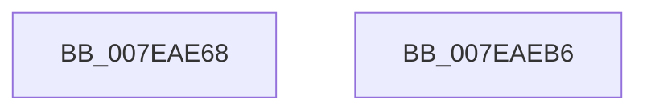

# CmpInsertKeyHash

- RVA: `0x007EAE68`–`0x007EAEB7` (길이 `79` bytes)
- VA: `0x00000001407EAE68`
- 실행 섹션: `PAGE`
- PDB 이름 있음: `예`; PDB Function 태그: `아니요`
- unwind 정보 RVA: `0x0005C788`
- 디코드: `22`개 명령, `79/79` bytes 표시
- 미해석 바이트: `0` (있으면 어셈블리에 `.byte`로 보존)

> 이 문서는 커널 이미지의 기계어와 PDB 기호를 분석해 생성했습니다. 4번과 5번은 함수 원형과 자료형을 바이너리 사용 방식에서 추정한 C 해석이며 원본 소스 복구 결과는 아닙니다.

## 1. Dependencies

- 직접 호출 지점: **1**; 고유 호출 대상: **1**
- 직접 호출자로 확인된 함수: **2**
- RIP 상대 이미지 참조: **0**

### Outgoing calls
- `0x007EAEAC` → [CmpAddKeyHashToEntry](../A6/CmpAddKeyHashToEntry_function_00A64D08.md) (function, `0x00A64D08`)

### Direct callers
- [CmRenameKey](CmRenameKey_function_007E8F48.md) at `0x007E9E8A`
- [CmpRehashKcbSubtree](CmpRehashKcbSubtree_function_007EB0C4.md) at `0x007EB13F`

### Static image references
- 디코드된 RIP-relative 메모리 참조가 없습니다.

## 2. Other-region calls and transfers

- 다른 실행 섹션으로 향하는 call: **0**
- 별도 외부 분기/꼬리 이동을 확인하지 못했습니다.

## 3. Assembly (complete function range)

```asm
007EAE68  48 83 EC 28                     sub rsp, 0x28
007EAE6C  8B 02                           mov eax, dword ptr [rdx]
007EAE6E  4C 8B D2                        mov r10, rdx
007EAE71  4C 8B 89 70 06 00 00            mov r9, qword ptr [rcx + 0x670]
007EAE78  44 8B C0                        mov r8d, eax
007EAE7B  41 C1 E8 09                     shr r8d, 9
007EAE7F  44 33 C0                        xor r8d, eax
007EAE82  41 69 C0 A3 8A 01 00            imul eax, r8d, 0x18aa3
007EAE89  44 8B C0                        mov r8d, eax
007EAE8C  41 C1 E8 09                     shr r8d, 9
007EAE90  44 33 C0                        xor r8d, eax
007EAE93  8B 81 78 06 00 00               mov eax, dword ptr [rcx + 0x678]
007EAE99  FF C8                           dec eax
007EAE9B  44 23 C0                        and r8d, eax
007EAE9E  4B 8D 0C 40                     lea rcx, [r8 + r8*2]
007EAEA2  45 33 C0                        xor r8d, r8d
007EAEA5  49 8D 14 C9                     lea rdx, [r9 + rcx*8]
007EAEA9  49 8B CA                        mov rcx, r10
007EAEAC  E8 57 9E 27 00                  call 0x140a64d08
007EAEB1  48 83 C4 28                     add rsp, 0x28
007EAEB5  C3                              ret
007EAEB6  CC                              int3
```

## 4. C-style interpretation (structured pseudocode)

```c
__int64 __fastcall CmpInsertKeyHash(__int64 a1, __int64 a2)
{
    __int64 result;
    __int64 v_rsp;

    v_rsp = (v_rsp) - (40);
    a3 = (unsigned int)(((unsigned int)((unsigned int)((unsigned int)(*(unsigned int *)(a2))))) >> (9));
    a3 = (unsigned int)((a3) ^ ((unsigned int)((unsigned int)(*(unsigned int *)(a2)))));
    result = (unsigned int)(((unsigned int)(*(unsigned int *)(a2))) * ((unsigned int)(a3)));
    a3 = (unsigned int)(((unsigned int)((unsigned int)(result))) >> (9));
    a3 = (unsigned int)((a3) ^ ((unsigned int)(result)));
    result = (unsigned int)(((unsigned int)(*(unsigned int *)(a1 + 1656))) - 1);
    a3 = (unsigned int)((a3) & ((unsigned int)(result)));
    a3 = 0;
    result = CmpAddKeyHashToEntry(a2, *(unsigned __int64 *)(a1 + 1648) + a3 + a3 * 2 * 8, a3, *(unsigned __int64 *)(a1 + 1648));
    v_rsp = (v_rsp) + (40);
    return result;
}
```

## 5. (Beta) C Style

```c
int64_t CmpInsertKeyHash(void *Arg1, void *Arg2)
{
    uint8_t *arg1 = (uint8_t *)Arg1;
    uint8_t *arg2 = (uint8_t *)Arg2;

    int64_t result;
    int64_t local_rsp;

    local_rsp = (local_rsp) - (40);
    a3 = (uint32_t)(((uint32_t)((uint32_t)((uint32_t)(*(uint32_t *)(arg2))))) >> (9));
    a3 = (uint32_t)((a3) ^ ((uint32_t)((uint32_t)(*(uint32_t *)(arg2)))));
    result = (uint32_t)(((uint32_t)(*(uint32_t *)(arg2))) * ((uint32_t)(a3)));
    a3 = (uint32_t)(((uint32_t)((uint32_t)(result))) >> (9));
    a3 = (uint32_t)((a3) ^ ((uint32_t)(result)));
    result = (uint32_t)(((uint32_t)(*(uint32_t *)(arg1 + 0x678))) - 1);
    a3 = (uint32_t)((a3) & ((uint32_t)(result)));
    a3 = 0;
    result = CmpAddKeyHashToEntry(Arg2, *(uint64_t *)(arg1 + 0x670) + a3 + a3 * 2 * 8, a3, *(uint64_t *)(arg1 + 0x670));
    local_rsp = (local_rsp) + (40);
    return result;
}
```

### 관측된 메모리 오프셋

구조체 형식이 확인되지 않은 접근은 인자 기준의 오프셋으로만 기록했습니다.

| 기준 인자 | 오프셋 표현 | 폭 (bit) | 접근 |
|---|---:|---:|---|
| `Arg1` | `+ 0x670` | `64` | `R` |
| `Arg1` | `+ 0x678` | `32` | `R` |
| `Arg2` | `+ 0x0` | `32` | `R` |

## 6. Execution-region graph

[열기: 2D/3D 그래프와 함수 탐색 컨트롤 패널](../../../control-panel.html?section=page&rva=0x007EAE68&view=graph)

- 2D 그래프는 위에서 아래로 흐르고, 3D 그래프는 빈 공간을 드래그해 회전합니다. Shift+드래그는 이동, 휠은 확대·축소, 함수 노드 선택은 대상 보고서 이동입니다.

### Static fallback


