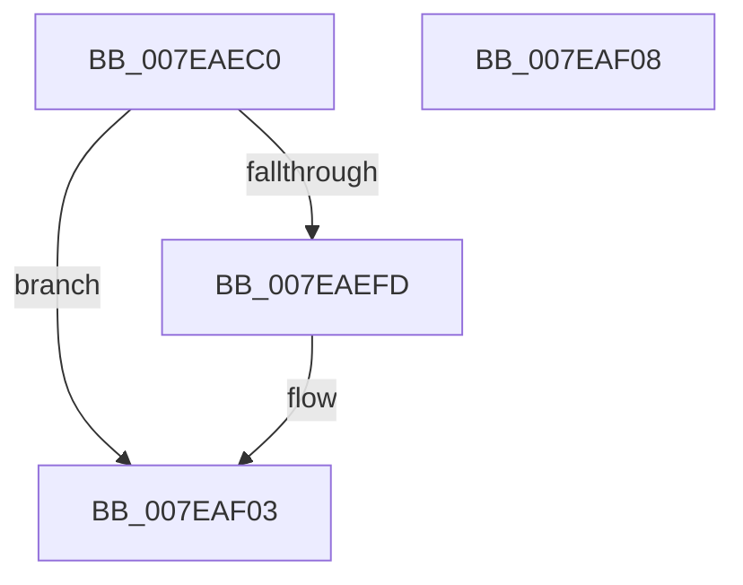

# CmpInvalidateSubtree

- RVA: `0x007EAEC0`–`0x007EAF09` (길이 `73` bytes)
- VA: `0x00000001407EAEC0`
- 실행 섹션: `PAGE`
- PDB 이름 있음: `예`; PDB Function 태그: `아니요`
- unwind 정보 RVA: `0x00063458`
- 디코드: `20`개 명령, `73/73` bytes 표시
- 미해석 바이트: `0` (있으면 어셈블리에 `.byte`로 보존)

> 이 문서는 커널 이미지의 기계어와 PDB 기호를 분석해 생성했습니다. 4번과 5번은 함수 원형과 자료형을 바이너리 사용 방식에서 추정한 C 해석이며 원본 소스 복구 결과는 아닙니다.

## 1. Dependencies

- 직접 호출 지점: **1**; 고유 호출 대상: **1**
- 직접 호출자로 확인된 함수: **6**
- RIP 상대 이미지 참조: **1**

### Outgoing calls
- `0x007EAEEE` → [CmpEnumerateAllOpenSubKeys](../9B/CmpEnumerateAllOpenSubKeys_function_009B031C.md) (function, `0x009B031C`)

### Direct callers
- [CmpSaveBootControlSet](../7D/CmpSaveBootControlSet_function_007DC744.md) at `0x007DCAC3`
- [CmRestoreKey](../7D/CmRestoreKey_function_007DCF04.md) at `0x007DD4F5`
- [CmRenameKey](CmRenameKey_function_007E8F48.md) at `0x007E973D`
- [CmRenameKey](CmRenameKey_function_007E8F48.md) at `0x007E979E`
- [CmpInvalidateAllHigherLayerKcbsPostCallback](../7F/CmpInvalidateAllHigherLayerKcbsPostCallback_function_007F15A0.md) at `0x007F15C7`
- [CmpPerformUnloadKey](../9A/CmpPerformUnloadKey_function_009AFA28.md) at `0x009B007C`
- [sub_00B1787E](../B1/Unknown_function_00B1787E.md) at `0x00B178E9`

### Static image references
- `0x007EAED1` → RVA `0x00AA3970` (`CmpInvalidateSubtreeWorker`; read)

## 2. Other-region calls and transfers

- 다른 실행 섹션으로 향하는 call: **0**
- 별도 외부 분기/꼬리 이동을 확인하지 못했습니다.

## 3. Assembly (complete function range)

```asm
007EAEC0  48 83 EC 48                     sub rsp, 0x48
007EAEC4  83 64 24 24 00                  and dword ptr [rsp + 0x24], 0
007EAEC9  41 8B C0                        mov eax, r8d
007EAECC  83 64 24 2C 00                  and dword ptr [rsp + 0x2c], 0
007EAED1  4C 8D 05 98 8A 2B 00            lea r8, [rip + 0x2b8a98]
007EAED8  89 44 24 28                     mov dword ptr [rsp + 0x28], eax
007EAEDC  24 01                           and al, 1
007EAEDE  89 54 24 20                     mov dword ptr [rsp + 0x20], edx
007EAEE2  8A D0                           mov dl, al
007EAEE4  4C 89 4C 24 30                  mov qword ptr [rsp + 0x30], r9
007EAEE9  4C 8D 4C 24 20                  lea r9, [rsp + 0x20]
007EAEEE  E8 29 54 1C 00                  call 0x1409b031c
007EAEF3  48 8B 4C 24 70                  mov rcx, qword ptr [rsp + 0x70]
007EAEF8  48 85 C9                        test rcx, rcx
007EAEFB  74 06                           je 0x1407eaf03
007EAEFD  8B 44 24 24                     mov eax, dword ptr [rsp + 0x24]
007EAF01  89 01                           mov dword ptr [rcx], eax
007EAF03  48 83 C4 48                     add rsp, 0x48
007EAF07  C3                              ret
007EAF08  CC                              int3
```

## 4. C-style interpretation (structured pseudocode)

```c
__int64 __fastcall CmpInvalidateSubtree(__int64 a1, int a2, int a3, __int64 a4, __int64 a5)
{
    __int64 result;
    __int64 v_rsp;
    unsigned __int64 v_stack_m18;
    unsigned int v_stack_m1C;
    unsigned int v_stack_m20;
    unsigned int v_stack_m24;
    unsigned int v_stack_m28;

    v_rsp = (v_rsp) - (72);
    v_stack_m20 = (unsigned int)((unsigned int)(a3));
    result = (unsigned __int8)(((unsigned int)(a3)) & (1));
    v_stack_m28 = a2;
    v_stack_m18 = a4;
    result = CmpEnumerateAllOpenSubKeys(a1, (unsigned __int8)(result), v_rip + 2853528, v_stack_m28);
    if (a5 != 0) {
        result = v_stack_m24;
        *(unsigned int *)(a5) = (unsigned int)(result);
    }
    v_rsp = (v_rsp) + (72);
    return result;
}
```

## 5. (Beta) C Style

```c
int64_t CmpInvalidateSubtree(int64_t Arg1, int32_t Arg2, int32_t Arg3, int64_t Arg4, int64_t Arg5)
{
    int64_t result;
    int64_t local_rsp;
    uint64_t v_stack_m18;
    uint32_t v_stack_m1C;
    uint32_t v_stack_m20;
    uint32_t v_stack_m24;
    uint32_t v_stack_m28;

    local_rsp = (local_rsp) - (72);
    v_stack_m20 = (uint32_t)((uint32_t)(Arg3));
    result = (uint8_t)(((uint32_t)(Arg3)) & (1));
    v_stack_m28 = Arg2;
    v_stack_m18 = Arg4;
    result = CmpEnumerateAllOpenSubKeys(Arg1, (uint8_t)(result), v_rip + 2853528, v_stack_m28);
    if (Arg5 != 0) {
        result = v_stack_m24;
        *(uint32_t *)(Arg5) = (uint32_t)(result);
    }
    local_rsp = (local_rsp) + (72);
    return result;
}
```

## 6. Execution-region graph

[열기: 2D/3D 그래프와 함수 탐색 컨트롤 패널](../../../control-panel.html?section=page&rva=0x007EAEC0&view=graph)

- 2D 그래프는 위에서 아래로 흐르고, 3D 그래프는 빈 공간을 드래그해 회전합니다. Shift+드래그는 이동, 휠은 확대·축소, 함수 노드 선택은 대상 보고서 이동입니다.

### Static fallback


