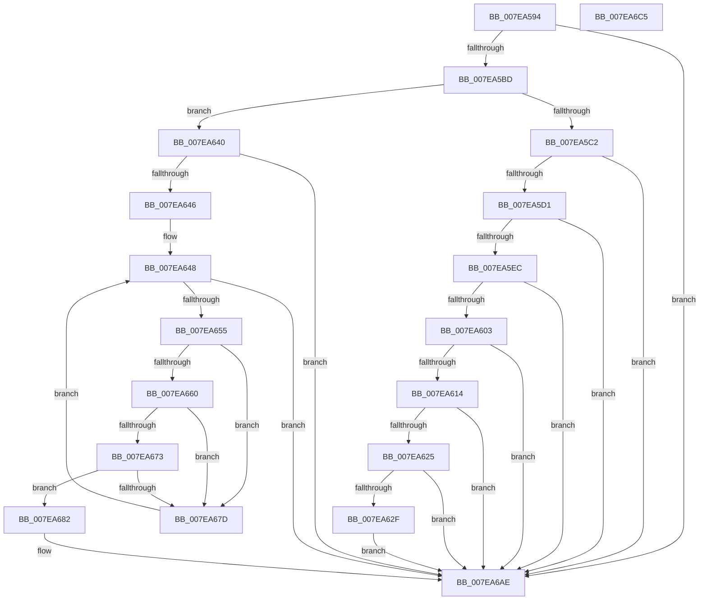

# CmpIsHiveAlreadyLoaded

- RVA: `0x007EA594`–`0x007EA6C6` (길이 `306` bytes)
- VA: `0x00000001407EA594`
- 실행 섹션: `PAGE`
- PDB 이름 있음: `예`; PDB Function 태그: `아니요`
- unwind 정보 RVA: `0x0005C954`
- 디코드: `79`개 명령, `306/306` bytes 표시
- 미해석 바이트: `0` (있으면 어셈블리에 `.byte`로 보존)

> 이 문서는 커널 이미지의 기계어와 PDB 기호를 분석해 생성했습니다. 4번과 5번은 함수 원형과 자료형을 바이너리 사용 방식에서 추정한 C 해석이며 원본 소스 복구 결과는 아닙니다.

## 1. Dependencies

- 직접 호출 지점: **7**; 고유 호출 대상: **6**
- 직접 호출자로 확인된 함수: **1**
- RIP 상대 이미지 참조: **0**

### Outgoing calls
- `0x007EA5C4` → [CmpIsKeyDeletedForKeyBody](../../pagecmrc/BC/CmpIsKeyDeletedForKeyBody_function_00BC9480.md) (function, `0x00BC9480`)
- `0x007EA5F6` → [CmpIsThisSameFile](../87/CmpIsThisSameFile_function_00877CE8.md) (function, `0x00877CE8`)
- `0x007EA62F` → [CmpUnfreezeHive](CmpUnfreezeHive_function_007EA778.md) (function, `0x007EA778`)
- `0x007EA648` → [CmpGetNextActiveHive](../84/CmpGetNextActiveHive_function_0084E2A0.md) (function, `0x0084E2A0`)
- `0x007EA66A` → [CmpIsThisSameFile](../87/CmpIsThisSameFile_function_00877CE8.md) (function, `0x00877CE8`)
- `0x007EA68C` → [CmpConstructName](../85/CmpConstructName_function_00856BE0.md) (function, `0x00856BE0`)
- `0x007EA6A3` → [ExReleaseRundownProtection](../../text/34/ExReleaseRundownProtection_function_00349E80.md) (function, `0x00349E80`)

### Direct callers
- [sub_00B49062](../B4/Unknown_function_00B49062.md) at `0x00B490A4`

### Static image references
- 디코드된 RIP-relative 메모리 참조가 없습니다.

## 2. Other-region calls and transfers

- 다른 실행 섹션으로 향하는 call: **2**
  - `0x007EA5C4` → [CmpIsKeyDeletedForKeyBody](../../pagecmrc/BC/CmpIsKeyDeletedForKeyBody_function_00BC9480.md) (`PAGE` → `PAGECMRC`)
  - `0x007EA6A3` → [ExReleaseRundownProtection](../../text/34/ExReleaseRundownProtection_function_00349E80.md) (`PAGE` → `.text`)
- 별도 외부 분기/꼬리 이동을 확인하지 못했습니다.

## 3. Assembly (complete function range)

```asm
007EA594  48 89 5C 24 08                  mov qword ptr [rsp + 8], rbx
007EA599  48 89 6C 24 10                  mov qword ptr [rsp + 0x10], rbp
007EA59E  48 89 74 24 18                  mov qword ptr [rsp + 0x18], rsi
007EA5A3  57                              push rdi
007EA5A4  48 83 EC 20                     sub rsp, 0x20
007EA5A8  32 DB                           xor bl, bl
007EA5AA  49 8B F1                        mov rsi, r9
007EA5AD  48 8B EA                        mov rbp, rdx
007EA5B0  48 8B F9                        mov rdi, rcx
007EA5B3  41 F6 C0 20                     test r8b, 0x20
007EA5B7  0F 85 F1 00 00 00               jne 0x1407ea6ae
007EA5BD  48 85 C9                        test rcx, rcx
007EA5C0  74 7E                           je 0x1407ea640
007EA5C2  33 D2                           xor edx, edx
007EA5C4  E8 B7 EE 3D 00                  call 0x140bc9480
007EA5C9  84 C0                           test al, al
007EA5CB  0F 85 DD 00 00 00               jne 0x1407ea6ae
007EA5D1  48 8B 47 08                     mov rax, qword ptr [rdi + 8]
007EA5D5  F7 80 B8 00 00 00 00 00 04 00   test dword ptr [rax + 0xb8], 0x40000
007EA5DF  48 8B 50 20                     mov rdx, qword ptr [rax + 0x20]
007EA5E3  48 89 16                        mov qword ptr [rsi], rdx
007EA5E6  0F 84 C2 00 00 00               je 0x1407ea6ae
007EA5EC  48 8B 92 08 06 00 00            mov rdx, qword ptr [rdx + 0x608]
007EA5F3  48 8B CD                        mov rcx, rbp
007EA5F6  E8 ED D6 08 00                  call 0x140877ce8
007EA5FB  84 C0                           test al, al
007EA5FD  0F 84 AB 00 00 00               je 0x1407ea6ae
007EA603  48 8B 0E                        mov rcx, qword ptr [rsi]
007EA606  8B 81 10 10 00 00               mov eax, dword ptr [rcx + 0x1010]
007EA60C  A8 40                           test al, 0x40
007EA60E  0F 85 9A 00 00 00               jne 0x1407ea6ae
007EA614  48 8B 47 08                     mov rax, qword ptr [rdi + 8]
007EA618  F7 40 08 00 00 04 00            test dword ptr [rax + 8], 0x40000
007EA61F  0F 85 89 00 00 00               jne 0x1407ea6ae
007EA625  B3 01                           mov bl, 1
007EA627  38 99 80 0B 00 00               cmp byte ptr [rcx + 0xb80], bl
007EA62D  75 7F                           jne 0x1407ea6ae
007EA62F  E8 44 01 00 00                  call 0x1407ea778
007EA634  48 8B 06                        mov rax, qword ptr [rsi]
007EA637  C6 80 80 0B 00 00 00            mov byte ptr [rax + 0xb80], 0
007EA63E  EB 6E                           jmp 0x1407ea6ae
007EA640  41 F6 C0 10                     test r8b, 0x10
007EA644  74 68                           je 0x1407ea6ae
007EA646  33 C9                           xor ecx, ecx
007EA648  E8 53 3C 06 00                  call 0x14084e2a0
007EA64D  48 8B F8                        mov rdi, rax
007EA650  48 85 C0                        test rax, rax
007EA653  74 59                           je 0x1407ea6ae
007EA655  8B 88 10 10 00 00               mov ecx, dword ptr [rax + 0x1010]
007EA65B  F6 C1 20                        test cl, 0x20
007EA65E  74 1D                           je 0x1407ea67d
007EA660  48 8B 90 08 06 00 00            mov rdx, qword ptr [rax + 0x608]
007EA667  48 8B CD                        mov rcx, rbp
007EA66A  E8 79 D6 08 00                  call 0x140877ce8
007EA66F  84 C0                           test al, al
007EA671  74 0A                           je 0x1407ea67d
007EA673  8B 87 10 10 00 00               mov eax, dword ptr [rdi + 0x1010]
007EA679  A8 40                           test al, 0x40
007EA67B  74 05                           je 0x1407ea682
007EA67D  48 8B CF                        mov rcx, rdi
007EA680  EB C6                           jmp 0x1407ea648
007EA682  48 8B 8F 78 0B 00 00            mov rcx, qword ptr [rdi + 0xb78]
007EA689  48 89 3E                        mov qword ptr [rsi], rdi
007EA68C  E8 4F C5 06 00                  call 0x140856be0
007EA691  48 8B 4C 24 50                  mov rcx, qword ptr [rsp + 0x50]
007EA696  48 8B D8                        mov rbx, rax
007EA699  48 89 01                        mov qword ptr [rcx], rax
007EA69C  48 8D 8F 68 06 00 00            lea rcx, [rdi + 0x668]
007EA6A3  E8 D8 F7 B5 FF                  call 0x140349e80
007EA6A8  48 85 DB                        test rbx, rbx
007EA6AB  0F 95 C3                        setne bl
007EA6AE  48 8B 6C 24 38                  mov rbp, qword ptr [rsp + 0x38]
007EA6B3  8A C3                           mov al, bl
007EA6B5  48 8B 5C 24 30                  mov rbx, qword ptr [rsp + 0x30]
007EA6BA  48 8B 74 24 40                  mov rsi, qword ptr [rsp + 0x40]
007EA6BF  48 83 C4 20                     add rsp, 0x20
007EA6C3  5F                              pop rdi
007EA6C4  C3                              ret
007EA6C5  CC                              int3
```

## 4. C-style interpretation (structured pseudocode)

```c
__int64 __fastcall CmpIsHiveAlreadyLoaded(__int64 a1, __int64 a2, unsigned __int8 a3, __int64 a4, __int64 a5)
{
    __int64 result;
    __int64 v_rbx;
    __int64 v_rsp;
    unsigned __int64 v_stack_p10;
    unsigned __int64 v_stack_p18;
    unsigned __int64 v_stack_p8;

    v_stack_p8 = v_rbx;
    v_stack_p10 = v_rbp;
    v_stack_p18 = v_rsi;
    v_rsp = (v_rsp) - (32);
    v_rbx = 0;
    if (((a3) & (32)) != 0) goto loc_007EA6AE;
    if (a1 == 0) goto loc_007EA640;
    a2 = 0;
    result = CmpIsKeyDeletedForKeyBody(a1, a2, a3, a4);
    if ((unsigned __int8)(result) != 0) goto loc_007EA6AE;
    *(unsigned __int64 *)(a4) = *(unsigned __int64 *)(*(unsigned __int64 *)(a1 + 8) + 32);
    if (((*(unsigned int *)(*(unsigned __int64 *)(a1 + 8) + 184)) & (0x40000ULL)) == 0) goto loc_007EA6AE;
    result = CmpIsThisSameFile(0, *(unsigned __int64 *)(*(unsigned __int64 *)(*(unsigned __int64 *)(a1 + 8) + 32) + 1544), a3, a4);
    if ((unsigned __int8)(result) == 0) goto loc_007EA6AE;
    if ((((unsigned __int8)((unsigned int)(*(unsigned int *)(*(unsigned __int64 *)(a4) + 4112)))) & (64)) != 0) goto loc_007EA6AE;
    if (((*(unsigned int *)(*(unsigned __int64 *)(a1 + 8) + 8)) & (0x40000ULL)) != 0) goto loc_007EA6AE;
    if ((*(unsigned __int8 *)(*(unsigned __int64 *)(a4) + 2944)) != 1) goto loc_007EA6AE;
    result = CmpUnfreezeHive(*(unsigned __int64 *)(a4), *(unsigned __int64 *)(*(unsigned __int64 *)(*(unsigned __int64 *)(a1 + 8) + 32) + 1544), a3, a4);
    *(unsigned __int8 *)(*(unsigned __int64 *)(a4) + 2944) = 0;
    goto loc_007EA6AE;
loc_007EA640:
    if (((a3) & (16)) == 0) goto loc_007EA6AE;
    a1 = 0;
loc_007EA648:
    result = CmpGetNextActiveHive(a1, *(unsigned __int64 *)(*(unsigned __int64 *)(*(unsigned __int64 *)(a1 + 8) + 32) + 1544), a3, a4);
    if (result == 0) goto loc_007EA6AE;
    if ((((unsigned __int8)((unsigned int)(*(unsigned int *)(result + 4112)))) & (32)) == 0) goto loc_007EA67D;
    result = CmpIsThisSameFile(0, *(unsigned __int64 *)(result + 1544), a3, a4);
    if ((unsigned __int8)(result) == 0) goto loc_007EA67D;
    if ((((unsigned __int8)((unsigned int)(*(unsigned int *)(result + 4112)))) & (64)) == 0) goto loc_007EA682;
loc_007EA67D:
    goto loc_007EA648;
loc_007EA682:
    *(unsigned __int64 *)(a4) = result;
    result = CmpConstructName(*(unsigned __int64 *)(result + 2936), *(unsigned __int64 *)(result + 1544), a3, a4);
    *(unsigned __int64 *)(a5) = result;
    result = ExReleaseRundownProtection(result + 1640, *(unsigned __int64 *)(result + 1544), a3, a4);
    v_rbx = (result != 0) ? 1 : 0;
loc_007EA6AE:
    v_rsp = (v_rsp) + (32);
    return (unsigned __int8)(v_rbx);
}
```

## 5. (Beta) C Style

```c
int64_t CmpIsHiveAlreadyLoaded(void *Arg1, int64_t Arg2, uint8_t Arg3, void *Arg4, void *Arg5)
{
    uint8_t *arg1 = (uint8_t *)Arg1;
    uint8_t *arg4 = (uint8_t *)Arg4;
    uint8_t *arg5 = (uint8_t *)Arg5;

    int64_t result;
    int64_t local_rbx;
    int64_t local_rsp;
    uint64_t v_stack_p10;
    uint64_t v_stack_p18;
    uint64_t v_stack_p8;

    v_stack_p8 = local_rbx;
    v_stack_p10 = local_rbp;
    v_stack_p18 = local_rsi;
    local_rsp = (local_rsp) - (32);
    local_rbx = 0;
    if (((Arg3) & (32)) != 0) goto loc_007EA6AE;
    if (Arg1 == NULL) goto loc_007EA640;
    Arg2 = 0;
    result = CmpIsKeyDeletedForKeyBody(Arg1, Arg2, Arg3, Arg4);
    if ((uint8_t)(result) != 0) goto loc_007EA6AE;
    *(uint64_t *)(arg4) = *(uint64_t *)(*(uint64_t *)(arg1 + 0x8) + 0x20);
    if (((*(uint32_t *)(*(uint64_t *)(arg1 + 0x8) + 0xB8)) & (0x40000ULL)) == 0) goto loc_007EA6AE;
    result = CmpIsThisSameFile(0, *(uint64_t *)(*(uint64_t *)(*(uint64_t *)(arg1 + 0x8) + 0x20) + 0x608), Arg3, Arg4);
    if ((uint8_t)(result) == 0) goto loc_007EA6AE;
    if ((((uint8_t)((uint32_t)(*(uint32_t *)(*(uint64_t *)(arg4) + 0x1010)))) & (64)) != 0) goto loc_007EA6AE;
    if (((*(uint32_t *)(*(uint64_t *)(arg1 + 0x8) + 0x8)) & (0x40000ULL)) != 0) goto loc_007EA6AE;
    if ((*(uint8_t *)(*(uint64_t *)(arg4) + 0xB80)) != 1) goto loc_007EA6AE;
    result = CmpUnfreezeHive(*(uint64_t *)(arg4), *(uint64_t *)(*(uint64_t *)(*(uint64_t *)(arg1 + 0x8) + 0x20) + 0x608), Arg3, Arg4);
    *(uint8_t *)(*(uint64_t *)(arg4) + 0xB80) = 0;
    goto loc_007EA6AE;
loc_007EA640:
    if (((Arg3) & (16)) == 0) goto loc_007EA6AE;
    Arg1 = 0;
loc_007EA648:
    result = CmpGetNextActiveHive(Arg1, *(uint64_t *)(*(uint64_t *)(*(uint64_t *)(arg1 + 0x8) + 0x20) + 0x608), Arg3, Arg4);
    if (result == 0) goto loc_007EA6AE;
    if ((((uint8_t)((uint32_t)(*(uint32_t *)(result + 0x1010)))) & (32)) == 0) goto loc_007EA67D;
    result = CmpIsThisSameFile(0, *(uint64_t *)(result + 0x608), Arg3, Arg4);
    if ((uint8_t)(result) == 0) goto loc_007EA67D;
    if ((((uint8_t)((uint32_t)(*(uint32_t *)(result + 0x1010)))) & (64)) == 0) goto loc_007EA682;
loc_007EA67D:
    goto loc_007EA648;
loc_007EA682:
    *(uint64_t *)(arg4) = result;
    result = CmpConstructName(*(uint64_t *)(result + 0xB78), *(uint64_t *)(result + 0x608), Arg3, Arg4);
    *(uint64_t *)(arg5) = result;
    result = ExReleaseRundownProtection(result + 1640, *(uint64_t *)(result + 0x608), Arg3, Arg4);
    local_rbx = (result != 0) ? 1 : 0;
loc_007EA6AE:
    local_rsp = (local_rsp) + (32);
    return (uint8_t)(local_rbx);
}
```

### 관측된 메모리 오프셋

구조체 형식이 확인되지 않은 접근은 인자 기준의 오프셋으로만 기록했습니다.

| 기준 인자 | 오프셋 표현 | 폭 (bit) | 접근 |
|---|---:|---:|---|
| `Arg1` | `+ 0x8` | `64` | `R` |
| `Arg4` | `+ 0x0` | `64` | `R` |
| `Arg4` | `+ 0x0` | `64` | `W` |
| `Arg5` | `+ 0x0` | `64` | `W` |

## 6. Execution-region graph

[열기: 2D/3D 그래프와 함수 탐색 컨트롤 패널](../../../control-panel.html?section=page&rva=0x007EA594&view=graph)

- 2D 그래프는 위에서 아래로 흐르고, 3D 그래프는 빈 공간을 드래그해 회전합니다. Shift+드래그는 이동, 휠은 확대·축소, 함수 노드 선택은 대상 보고서 이동입니다.

### Static fallback


