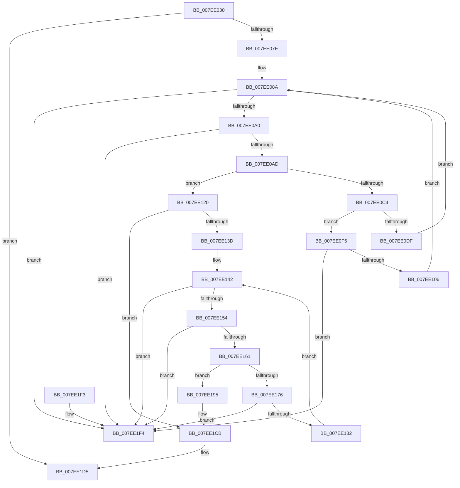

# CmpLazyCommitWorker

- RVA: `0x007EE030`–`0x007EE1FB` (길이 `459` bytes)
- VA: `0x00000001407EE030`
- 실행 섹션: `PAGE`
- PDB 이름 있음: `예`; PDB Function 태그: `아니요`
- unwind 정보 RVA: `0x000D6FAC`
- 디코드: `113`개 명령, `459/459` bytes 표시
- 미해석 바이트: `0` (있으면 어셈블리에 `.byte`로 보존)

> 이 문서는 커널 이미지의 기계어와 PDB 기호를 분석해 생성했습니다. 4번과 5번은 함수 원형과 자료형을 바이너리 사용 방식에서 추정한 C 해석이며 원본 소스 복구 결과는 아닙니다.

## 1. Dependencies

- 직접 호출 지점: **17**; 고유 호출 대상: **12**
- 직접 호출자로 확인된 함수: **0**
- RIP 상대 이미지 참조: **8**

### Outgoing calls
- `0x007EE05C` → [CmpInitializeThreadInfo](../../text/3F/CmpInitializeThreadInfo_function_003FBE70.md) (function, `0x003FBE70`)
- `0x007EE071` → [CmpAcquireHiveLoadUnloadRundown](../../pagecmrc/BC/CmpAcquireHiveLoadUnloadRundown_function_00BC9C6C.md) (function, `0x00BC9C6C`)
- `0x007EE07E` → [LOCK_HIVE_LOAD](../9B/LOCK_HIVE_LOAD_function_009B2300.md) (function, `0x009B2300`)
- `0x007EE08A` → [LOCK_TRANSACTION_LIST](../87/LOCK_TRANSACTION_LIST_function_00874AD4.md) (function, `0x00874AD4`)
- `0x007EE0C4` → [ExReleaseFastMutexUnsafe](../../text/25/ExReleaseFastMutexUnsafe_function_002503A0.md) (function, `0x002503A0`)
- `0x007EE0C9` → [KeLeaveCriticalRegion](../../text/25/KeLeaveCriticalRegion_function_0025D8B0.md) (function, `0x0025D8B0`)
- `0x007EE0D6` → [CmpTransMgrCommit](../9A/CmpTransMgrCommit_function_009AE8AC.md) (function, `0x009AE8AC`)
- `0x007EE0EE` → [CmpCleanupTransactionState](../84/CmpCleanupTransactionState_function_008428E0.md) (function, `0x008428E0`)
- `0x007EE12A` → [ExReleaseFastMutexUnsafe](../../text/25/ExReleaseFastMutexUnsafe_function_002503A0.md) (function, `0x002503A0`)
- `0x007EE12F` → [KeLeaveCriticalRegion](../../text/25/KeLeaveCriticalRegion_function_0025D8B0.md) (function, `0x0025D8B0`)
- `0x007EE13D` → [LOCK_TRANSACTION_LIST](../87/LOCK_TRANSACTION_LIST_function_00874AD4.md) (function, `0x00874AD4`)
- `0x007EE19C` → [ExReleaseFastMutexUnsafe](../../text/25/ExReleaseFastMutexUnsafe_function_002503A0.md) (function, `0x002503A0`)
- `0x007EE1A1` → [KeLeaveCriticalRegion](../../text/25/KeLeaveCriticalRegion_function_0025D8B0.md) (function, `0x0025D8B0`)
- `0x007EE1C6` → [KiSetTimerEx](../../text/23/KiSetTimerEx_function_00232CB0.md) (function, `0x00232CB0`)
- `0x007EE1CB` → [UNLOCK_HIVE_LOAD](../9B/UNLOCK_HIVE_LOAD_function_009B2EBC.md) (function, `0x009B2EBC`)
- `0x007EE1D0` → [CmpReleaseHiveLoadUnloadRundown](../../pagecmrc/BC/CmpReleaseHiveLoadUnloadRundown_function_00BC9CAC.md) (function, `0x00BC9CAC`)
- `0x007EE1D9` → [CmCleanupThreadInfo](../../text/41/CmCleanupThreadInfo_function_0041FD50.md) (function, `0x0041FD50`)

### Direct callers
- 이 함수 시작 RVA로 연결되는 직접 call은 확인되지 않았습니다. 간접 호출은 완전히 역산할 수 없습니다.

### Static image references
- `0x007EE083` → RVA `0x00EF57A0` (`.data`; read)
- `0x007EE0AD` → RVA `0x00EF57A0` (`.data`; write)
- `0x007EE0B4` → RVA `0x00EF5820` (`.data`; read)
- `0x007EE123` → RVA `0x00EEFC3C` (`.data`; write)
- `0x007EE176` → RVA `0x00EF57A8` (`.data`; read)
- `0x007EE18C` → RVA `0x00EF57A8` (`.data`; write)
- `0x007EE1A6` → RVA `0x00EF5760` (`.data`; read)
- `0x007EE1BF` → RVA `0x00EF57C0` (`.data`; read)

## 2. Other-region calls and transfers

- 다른 실행 섹션으로 향하는 call: **11**
  - `0x007EE05C` → [CmpInitializeThreadInfo](../../text/3F/CmpInitializeThreadInfo_function_003FBE70.md) (`PAGE` → `.text`)
  - `0x007EE071` → [CmpAcquireHiveLoadUnloadRundown](../../pagecmrc/BC/CmpAcquireHiveLoadUnloadRundown_function_00BC9C6C.md) (`PAGE` → `PAGECMRC`)
  - `0x007EE0C4` → [ExReleaseFastMutexUnsafe](../../text/25/ExReleaseFastMutexUnsafe_function_002503A0.md) (`PAGE` → `.text`)
  - `0x007EE0C9` → [KeLeaveCriticalRegion](../../text/25/KeLeaveCriticalRegion_function_0025D8B0.md) (`PAGE` → `.text`)
  - `0x007EE12A` → [ExReleaseFastMutexUnsafe](../../text/25/ExReleaseFastMutexUnsafe_function_002503A0.md) (`PAGE` → `.text`)
  - `0x007EE12F` → [KeLeaveCriticalRegion](../../text/25/KeLeaveCriticalRegion_function_0025D8B0.md) (`PAGE` → `.text`)
  - `0x007EE19C` → [ExReleaseFastMutexUnsafe](../../text/25/ExReleaseFastMutexUnsafe_function_002503A0.md) (`PAGE` → `.text`)
  - `0x007EE1A1` → [KeLeaveCriticalRegion](../../text/25/KeLeaveCriticalRegion_function_0025D8B0.md) (`PAGE` → `.text`)
  - `0x007EE1C6` → [KiSetTimerEx](../../text/23/KiSetTimerEx_function_00232CB0.md) (`PAGE` → `.text`)
  - `0x007EE1D0` → [CmpReleaseHiveLoadUnloadRundown](../../pagecmrc/BC/CmpReleaseHiveLoadUnloadRundown_function_00BC9CAC.md) (`PAGE` → `PAGECMRC`)
  - `0x007EE1D9` → [CmCleanupThreadInfo](../../text/41/CmCleanupThreadInfo_function_0041FD50.md) (`PAGE` → `.text`)
- 별도 외부 분기/꼬리 이동을 확인하지 못했습니다.

## 3. Assembly (complete function range)

```asm
007EE030  48 89 5C 24 08                  mov qword ptr [rsp + 8], rbx
007EE035  48 89 74 24 18                  mov qword ptr [rsp + 0x18], rsi
007EE03A  55                              push rbp
007EE03B  57                              push rdi
007EE03C  41 56                           push r14
007EE03E  48 8B EC                        mov rbp, rsp
007EE041  48 83 EC 60                     sub rsp, 0x60
007EE045  33 C0                           xor eax, eax
007EE047  48 8D 4D E0                     lea rcx, [rbp - 0x20]
007EE04B  21 45 28                        and dword ptr [rbp + 0x28], eax
007EE04E  0F 57 C0                        xorps xmm0, xmm0
007EE051  0F 11 45 E0                     movups xmmword ptr [rbp - 0x20], xmm0
007EE055  48 89 45 F0                     mov qword ptr [rbp - 0x10], rax
007EE059  40 B7 01                        mov dil, 1
007EE05C  E8 0F DE C0 FF                  call 0x1403fbe70
007EE061  48 8D 45 D0                     lea rax, [rbp - 0x30]
007EE065  48 8D 4D D0                     lea rcx, [rbp - 0x30]
007EE069  48 89 45 D0                     mov qword ptr [rbp - 0x30], rax
007EE06D  48 89 4D D8                     mov qword ptr [rbp - 0x28], rcx
007EE071  E8 F6 BB 3D 00                  call 0x140bc9c6c
007EE076  84 C0                           test al, al
007EE078  0F 84 57 01 00 00               je 0x1407ee1d5
007EE07E  E8 7D 42 1C 00                  call 0x1409b2300
007EE083  4C 8D 35 16 77 70 00            lea r14, [rip + 0x707716]
007EE08A  E8 45 6A 08 00                  call 0x140874ad4
007EE08F  48 8B 1D 0A 77 70 00            mov rbx, qword ptr [rip + 0x70770a]
007EE096  4C 39 73 08                     cmp qword ptr [rbx + 8], r14
007EE09A  0F 85 54 01 00 00               jne 0x1407ee1f4
007EE0A0  48 8B 03                        mov rax, qword ptr [rbx]
007EE0A3  48 39 58 08                     cmp qword ptr [rax + 8], rbx
007EE0A7  0F 85 47 01 00 00               jne 0x1407ee1f4
007EE0AD  48 89 05 EC 76 70 00            mov qword ptr [rip + 0x7076ec], rax
007EE0B4  48 8D 0D 65 77 70 00            lea rcx, [rip + 0x707765]
007EE0BB  4C 89 70 08                     mov qword ptr [rax + 8], r14
007EE0BF  49 3B DE                        cmp rbx, r14
007EE0C2  74 5C                           je 0x1407ee120
007EE0C4  E8 D7 22 A6 FF                  call 0x1402503a0
007EE0C9  E8 E2 F7 A6 FF                  call 0x14025d8b0
007EE0CE  4C 8D 45 28                     lea r8, [rbp + 0x28]
007EE0D2  48 8D 53 E0                     lea rdx, [rbx - 0x20]
007EE0D6  E8 D1 07 1C 00                  call 0x1409ae8ac
007EE0DB  85 C0                           test eax, eax
007EE0DD  78 16                           js 0x1407ee0f5
007EE0DF  48 8B 4B 20                     mov rcx, qword ptr [rbx + 0x20]
007EE0E3  48 8D 53 E0                     lea rdx, [rbx - 0x20]
007EE0E7  45 33 C9                        xor r9d, r9d
007EE0EA  45 8D 41 04                     lea r8d, [r9 + 4]
007EE0EE  E8 ED 47 05 00                  call 0x1408428e0
007EE0F3  EB 95                           jmp 0x1407ee08a
007EE0F5  48 8B 45 D8                     mov rax, qword ptr [rbp - 0x28]
007EE0F9  48 8D 4D D0                     lea rcx, [rbp - 0x30]
007EE0FD  48 39 08                        cmp qword ptr [rax], rcx
007EE100  0F 85 EE 00 00 00               jne 0x1407ee1f4
007EE106  48 89 43 08                     mov qword ptr [rbx + 8], rax
007EE10A  48 8D 4D D0                     lea rcx, [rbp - 0x30]
007EE10E  48 89 0B                        mov qword ptr [rbx], rcx
007EE111  40 32 FF                        xor dil, dil
007EE114  48 89 18                        mov qword ptr [rax], rbx
007EE117  48 89 5D D8                     mov qword ptr [rbp - 0x28], rbx
007EE11B  E9 6A FF FF FF                  jmp 0x1407ee08a
007EE120  40 84 FF                        test dil, dil
007EE123  0F 94 05 12 1B 70 00            sete byte ptr [rip + 0x701b12]
007EE12A  E8 71 22 A6 FF                  call 0x1402503a0
007EE12F  E8 7C F7 A6 FF                  call 0x14025d8b0
007EE134  40 84 FF                        test dil, dil
007EE137  0F 85 8E 00 00 00               jne 0x1407ee1cb
007EE13D  E8 92 69 08 00                  call 0x140874ad4
007EE142  48 8B 45 D0                     mov rax, qword ptr [rbp - 0x30]
007EE146  48 8D 4D D0                     lea rcx, [rbp - 0x30]
007EE14A  48 39 48 08                     cmp qword ptr [rax + 8], rcx
007EE14E  0F 85 A0 00 00 00               jne 0x1407ee1f4
007EE154  48 8B 08                        mov rcx, qword ptr [rax]
007EE157  48 39 41 08                     cmp qword ptr [rcx + 8], rax
007EE15B  0F 85 93 00 00 00               jne 0x1407ee1f4
007EE161  48 89 4D D0                     mov qword ptr [rbp - 0x30], rcx
007EE165  48 8D 55 D0                     lea rdx, [rbp - 0x30]
007EE169  48 89 51 08                     mov qword ptr [rcx + 8], rdx
007EE16D  48 8D 4D D0                     lea rcx, [rbp - 0x30]
007EE171  48 3B C1                        cmp rax, rcx
007EE174  74 1F                           je 0x1407ee195
007EE176  48 8B 0D 2B 76 70 00            mov rcx, qword ptr [rip + 0x70762b]
007EE17D  4C 39 31                        cmp qword ptr [rcx], r14
007EE180  75 72                           jne 0x1407ee1f4
007EE182  4C 89 30                        mov qword ptr [rax], r14
007EE185  48 89 48 08                     mov qword ptr [rax + 8], rcx
007EE189  48 89 01                        mov qword ptr [rcx], rax
007EE18C  48 89 05 15 76 70 00            mov qword ptr [rip + 0x707615], rax
007EE193  EB AD                           jmp 0x1407ee142
007EE195  48 8D 0D 84 76 70 00            lea rcx, [rip + 0x707684]
007EE19C  E8 FF 21 A6 FF                  call 0x1402503a0
007EE1A1  E8 0A F7 A6 FF                  call 0x14025d8b0
007EE1A6  48 8D 05 B3 75 70 00            lea rax, [rip + 0x7075b3]
007EE1AD  45 33 C9                        xor r9d, r9d
007EE1B0  45 33 C0                        xor r8d, r8d
007EE1B3  48 89 44 24 20                  mov qword ptr [rsp + 0x20], rax
007EE1B8  48 C7 C2 00 5D 1E EE            mov rdx, 0xffffffffee1e5d00
007EE1BF  48 8D 0D FA 75 70 00            lea rcx, [rip + 0x7075fa]
007EE1C6  E8 E5 4A A4 FF                  call 0x140232cb0
007EE1CB  E8 EC 4C 1C 00                  call 0x1409b2ebc
007EE1D0  E8 D7 BA 3D 00                  call 0x140bc9cac
007EE1D5  48 8D 4D E0                     lea rcx, [rbp - 0x20]
007EE1D9  E8 72 1B C3 FF                  call 0x14041fd50
007EE1DE  4C 8D 5C 24 60                  lea r11, [rsp + 0x60]
007EE1E3  49 8B 5B 20                     mov rbx, qword ptr [r11 + 0x20]
007EE1E7  49 8B 73 30                     mov rsi, qword ptr [r11 + 0x30]
007EE1EB  49 8B E3                        mov rsp, r11
007EE1EE  41 5E                           pop r14
007EE1F0  5F                              pop rdi
007EE1F1  5D                              pop rbp
007EE1F2  C3                              ret
007EE1F3  CC                              int3
007EE1F4  B9 03 00 00 00                  mov ecx, 3
007EE1F9  CD 29                           int 0x29
```

## 4. C-style interpretation (structured pseudocode)

```c
__int64 __fastcall CmpLazyCommitWorker(__int64 a1, __int64 a2, __int64 a3, int a4)
{
    __int64 result;
    __int64 v_rdi;
    __int64 v_rsp;
    unsigned __int64 v_stack_m18;
    unsigned __int64 v_stack_m28;
    unsigned __int64 v_stack_m38;
    unsigned __int64 v_stack_m40;
    unsigned __int64 v_stack_m48;
    unsigned __int64 v_stack_m58;
    unsigned int v_stack_p10;
    unsigned __int64 v_stack_p18;
    unsigned __int64 v_stack_p8;

    v_stack_p8 = v_rbx;
    v_stack_p18 = v_rsi;
    v_rsp = (v_rsp) - (96);
    result = 0;
    v_stack_m38 = v_xmm0;
    v_stack_m28 = 0;
    result = CmpInitializeThreadInfo(v_stack_m38, a2, a3, a4);
    v_stack_m48 = v_stack_m48;
    v_stack_m40 = v_stack_m48;
    result = CmpAcquireHiveLoadUnloadRundown(v_stack_m48, a2, a3, a4);
    if ((unsigned __int8)(result) == 0) goto loc_007EE1D5;
    result = LOCK_HIVE_LOAD(v_stack_m48, a2, a3, a4);
loc_007EE08A:
    result = LOCK_TRANSACTION_LIST(v_stack_m48, a2, a3, a4);
    if ((*(unsigned __int64 *)(*(unsigned __int64 *)(v_rip + 7370506) + 8)) != (v_rip + 7370518)) goto loc_007EE1F4;
    if ((*(unsigned __int64 *)(*(unsigned __int64 *)(*(unsigned __int64 *)(v_rip + 7370506)) + 8)) != (*(unsigned __int64 *)(v_rip + 7370506))) goto loc_007EE1F4;
    *(unsigned __int64 *)(v_rip + 7370476) = *(unsigned __int64 *)(*(unsigned __int64 *)(v_rip + 7370506));
    *(unsigned __int64 *)(*(unsigned __int64 *)(*(unsigned __int64 *)(v_rip + 7370506)) + 8) = v_rip + 7370518;
    if ((*(unsigned __int64 *)(v_rip + 7370506)) == (v_rip + 7370518)) goto loc_007EE120;
    result = ExReleaseFastMutexUnsafe(v_rip + 7370597, a2, a3, a4);
    result = KeLeaveCriticalRegion(v_rip + 7370597, a2, a3, a4);
    result = CmpTransMgrCommit(v_rip + 7370597, *(unsigned __int64 *)(v_rip + 7370506) - 32, v_stack_p10, a4);
    if (sign_flag) goto loc_007EE0F5;
    a4 = 0;
    result = CmpCleanupTransactionState(*(unsigned __int64 *)(*(unsigned __int64 *)(v_rip + 7370506) + 32), *(unsigned __int64 *)(v_rip + 7370506) - 32, a4 + 4, a4);
    goto loc_007EE08A;
loc_007EE0F5:
    if ((*(unsigned __int64 *)(v_stack_m40)) != v_stack_m48) goto loc_007EE1F4;
    *(unsigned __int64 *)(*(unsigned __int64 *)(v_rip + 7370506) + 8) = v_stack_m40;
    *(unsigned __int64 *)(*(unsigned __int64 *)(v_rip + 7370506)) = v_stack_m48;
    v_rdi = 0;
    *(unsigned __int64 *)(v_stack_m40) = *(unsigned __int64 *)(v_rip + 7370506);
    v_stack_m40 = *(unsigned __int64 *)(v_rip + 7370506);
    goto loc_007EE08A;
loc_007EE120:
    result = ExReleaseFastMutexUnsafe(v_stack_m48, *(unsigned __int64 *)(v_rip + 7370506) - 32, a4 + 4, a4);
    result = KeLeaveCriticalRegion(v_stack_m48, *(unsigned __int64 *)(v_rip + 7370506) - 32, a4 + 4, a4);
    if (0 != 0) goto loc_007EE1CB;
    result = LOCK_TRANSACTION_LIST(v_stack_m48, *(unsigned __int64 *)(v_rip + 7370506) - 32, a4 + 4, a4);
loc_007EE142:
    if ((*(unsigned __int64 *)(v_stack_m48 + 8)) != v_stack_m48) goto loc_007EE1F4;
    if ((*(unsigned __int64 *)(*(unsigned __int64 *)(v_stack_m48) + 8)) != v_stack_m48) goto loc_007EE1F4;
    v_stack_m48 = *(unsigned __int64 *)(v_stack_m48);
    *(unsigned __int64 *)(*(unsigned __int64 *)(v_stack_m48) + 8) = v_stack_m48;
    if (v_stack_m48 == v_stack_m48) goto loc_007EE195;
    if ((*(unsigned __int64 *)(*(unsigned __int64 *)(v_rip + 7370283))) != (v_rip + 7370518)) goto loc_007EE1F4;
    *(unsigned __int64 *)(v_stack_m48) = v_rip + 7370518;
    *(unsigned __int64 *)(v_stack_m48 + 8) = *(unsigned __int64 *)(v_rip + 7370283);
    *(unsigned __int64 *)(*(unsigned __int64 *)(v_rip + 7370283)) = v_stack_m48;
    *(unsigned __int64 *)(v_rip + 7370261) = v_stack_m48;
    goto loc_007EE142;
loc_007EE195:
    result = ExReleaseFastMutexUnsafe(v_rip + 7370372, v_stack_m48, a4 + 4, a4);
    result = KeLeaveCriticalRegion(v_rip + 7370372, v_stack_m48, a4 + 4, a4);
    a4 = 0;
    a3 = 0;
    v_stack_m58 = v_rip + 7370163;
    result = KiSetTimerEx(v_rip + 7370234, 0xFFFFFFFFEE1E5D00ULL, a3, a4);
loc_007EE1CB:
    result = UNLOCK_HIVE_LOAD(v_rip + 7370234, 0xFFFFFFFFEE1E5D00ULL, a3, a4);
    result = CmpReleaseHiveLoadUnloadRundown(v_rip + 7370234, 0xFFFFFFFFEE1E5D00ULL, a3, a4);
loc_007EE1D5:
    result = CmCleanupThreadInfo(v_stack_m38, 0xFFFFFFFFEE1E5D00ULL, a3, a4);
    return result;
loc_007EE1F4:
    return result;
}
```

## 5. (Beta) C Style

```c
int64_t CmpLazyCommitWorker(int64_t Arg1, int64_t Arg2, int64_t Arg3, int32_t Arg4)
{
    int64_t result;
    int64_t local_rdi;
    int64_t local_rsp;
    uint64_t v_stack_m18;
    uint64_t v_stack_m28;
    uint64_t v_stack_m38;
    uint64_t v_stack_m40;
    uint64_t v_stack_m48;
    uint64_t v_stack_m58;
    uint32_t v_stack_p10;
    uint64_t v_stack_p18;
    uint64_t v_stack_p8;

    v_stack_p8 = local_rbx;
    v_stack_p18 = local_rsi;
    local_rsp = (local_rsp) - (96);
    result = 0;
    v_stack_m38 = v_xmm0;
    v_stack_m28 = 0;
    result = CmpInitializeThreadInfo(v_stack_m38, Arg2, Arg3, Arg4);
    v_stack_m48 = v_stack_m48;
    v_stack_m40 = v_stack_m48;
    result = CmpAcquireHiveLoadUnloadRundown(v_stack_m48, Arg2, Arg3, Arg4);
    if ((uint8_t)(result) == 0) goto loc_007EE1D5;
    result = LOCK_HIVE_LOAD(v_stack_m48, Arg2, Arg3, Arg4);
loc_007EE08A:
    result = LOCK_TRANSACTION_LIST(v_stack_m48, Arg2, Arg3, Arg4);
    if ((*(uint64_t *)(*(uint64_t *)(v_rip + 0x70770A) + 0x8)) != (v_rip + 7370518)) goto loc_007EE1F4;
    if ((*(uint64_t *)(*(uint64_t *)(*(uint64_t *)(v_rip + 0x70770A)) + 0x8)) != (*(uint64_t *)(v_rip + 0x70770A))) goto loc_007EE1F4;
    *(uint64_t *)(v_rip + 0x7076EC) = *(uint64_t *)(*(uint64_t *)(v_rip + 0x70770A));
    *(uint64_t *)(*(uint64_t *)(*(uint64_t *)(v_rip + 0x70770A)) + 0x8) = v_rip + 7370518;
    if ((*(uint64_t *)(v_rip + 0x70770A)) == (v_rip + 7370518)) goto loc_007EE120;
    result = ExReleaseFastMutexUnsafe(v_rip + 7370597, Arg2, Arg3, Arg4);
    result = KeLeaveCriticalRegion(v_rip + 7370597, Arg2, Arg3, Arg4);
    result = CmpTransMgrCommit(v_rip + 7370597, *(uint64_t *)(v_rip + 0x70770A) - 32, v_stack_p10, Arg4);
    if (sign_flag) goto loc_007EE0F5;
    Arg4 = 0;
    result = CmpCleanupTransactionState(*(uint64_t *)(*(uint64_t *)(v_rip + 0x70770A) + 0x20), *(uint64_t *)(v_rip + 0x70770A) - 32, Arg4 + 4, Arg4);
    goto loc_007EE08A;
loc_007EE0F5:
    if ((*(uint64_t *)(v_stack_m40)) != v_stack_m48) goto loc_007EE1F4;
    *(uint64_t *)(*(uint64_t *)(v_rip + 0x70770A) + 0x8) = v_stack_m40;
    *(uint64_t *)(*(uint64_t *)(v_rip + 0x70770A)) = v_stack_m48;
    local_rdi = 0;
    *(uint64_t *)(v_stack_m40) = *(uint64_t *)(v_rip + 0x70770A);
    v_stack_m40 = *(uint64_t *)(v_rip + 0x70770A);
    goto loc_007EE08A;
loc_007EE120:
    result = ExReleaseFastMutexUnsafe(v_stack_m48, *(uint64_t *)(v_rip + 0x70770A) - 32, Arg4 + 4, Arg4);
    result = KeLeaveCriticalRegion(v_stack_m48, *(uint64_t *)(v_rip + 0x70770A) - 32, Arg4 + 4, Arg4);
    if (0 != 0) goto loc_007EE1CB;
    result = LOCK_TRANSACTION_LIST(v_stack_m48, *(uint64_t *)(v_rip + 0x70770A) - 32, Arg4 + 4, Arg4);
loc_007EE142:
    if ((*(uint64_t *)(v_stack_m48 + 0x8)) != v_stack_m48) goto loc_007EE1F4;
    if ((*(uint64_t *)(*(uint64_t *)(v_stack_m48) + 0x8)) != v_stack_m48) goto loc_007EE1F4;
    v_stack_m48 = *(uint64_t *)(v_stack_m48);
    *(uint64_t *)(*(uint64_t *)(v_stack_m48) + 0x8) = v_stack_m48;
    if (v_stack_m48 == v_stack_m48) goto loc_007EE195;
    if ((*(uint64_t *)(*(uint64_t *)(v_rip + 0x70762B))) != (v_rip + 7370518)) goto loc_007EE1F4;
    *(uint64_t *)(v_stack_m48) = v_rip + 7370518;
    *(uint64_t *)(v_stack_m48 + 0x8) = *(uint64_t *)(v_rip + 0x70762B);
    *(uint64_t *)(*(uint64_t *)(v_rip + 0x70762B)) = v_stack_m48;
    *(uint64_t *)(v_rip + 0x707615) = v_stack_m48;
    goto loc_007EE142;
loc_007EE195:
    result = ExReleaseFastMutexUnsafe(v_rip + 7370372, v_stack_m48, Arg4 + 4, Arg4);
    result = KeLeaveCriticalRegion(v_rip + 7370372, v_stack_m48, Arg4 + 4, Arg4);
    Arg4 = 0;
    Arg3 = 0;
    v_stack_m58 = v_rip + 7370163;
    result = KiSetTimerEx(v_rip + 7370234, 0xFFFFFFFFEE1E5D00ULL, Arg3, Arg4);
loc_007EE1CB:
    result = UNLOCK_HIVE_LOAD(v_rip + 7370234, 0xFFFFFFFFEE1E5D00ULL, Arg3, Arg4);
    result = CmpReleaseHiveLoadUnloadRundown(v_rip + 7370234, 0xFFFFFFFFEE1E5D00ULL, Arg3, Arg4);
loc_007EE1D5:
    result = CmCleanupThreadInfo(v_stack_m38, 0xFFFFFFFFEE1E5D00ULL, Arg3, Arg4);
    return result;
loc_007EE1F4:
    return result;
}
```

## 6. Execution-region graph

[열기: 2D/3D 그래프와 함수 탐색 컨트롤 패널](../../../control-panel.html?section=page&rva=0x007EE030&view=graph)

- 2D 그래프는 위에서 아래로 흐르고, 3D 그래프는 빈 공간을 드래그해 회전합니다. Shift+드래그는 이동, 휠은 확대·축소, 함수 노드 선택은 대상 보고서 이동입니다.

### Static fallback


